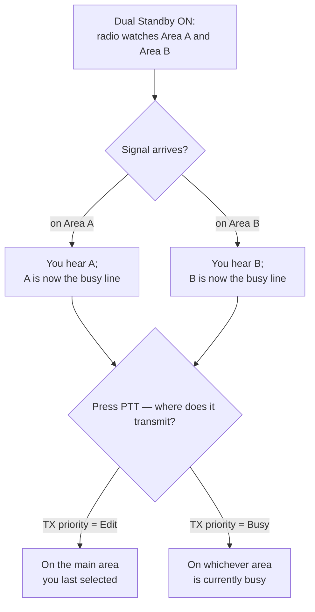

# Basic settings: operating, dual-watch and areas

The RT-6D hides its everyday operating switches inside one long `Basic Settings` list, and the colour screen only ever shows you two of them at a time. That is a shame, because these are the settings that decide how the radio _behaves_ — whether it listens to one channel or two, which of its two on-screen lines your press-to-talk actually keys, where the dial stops as you tune, and how it dodges a stuck repeater. This page walks the operating half of `Basic Settings` item by item: what each one does, what the radio is doing underneath, a sensible value, and — the bit the manual never tells you — when and why you would ever change it. The colour dual-VFO makes one big idea visual, so we start there.

You reach all of this the same way. Press **MENU**, turn the channel knob (or press **▲/▼**) to `01 Basic Settings`, press **MENU** to open it, scroll to the item, **MENU** to edit, **▲/▼** to change the value, **MENU** to save, and **↵/EXIT** to back out. Nothing on this page can damage the radio. The display, brightness, scanning and housekeeping items in the same list get their own treatment in [Understanding the display](outpost:entry/logbook73.guide.rt-6d/basic-display); the deep digital settings live in [DMR channels](outpost:entry/logbook73.guide.rt-6d/dmr-channels).

## How to read these pages

Each substantial item carries a one-glance verdict, the same scheme used across this handbook's radio guides.

| Symbol | Meaning                                                    |
| ------ | ---------------------------------------------------------- |
| ✅     | Set it like this and forget it — right for almost everyone |
| ⭐     | Genuinely useful, depending on how you operate             |
| ⚠️     | Advanced — understand it before you enable it              |
| ❌     | Leave it off unless you have a specific reason             |

## The two Areas: what the A/B screen really is

Before any of the switches make sense, you need the RT-6D's mental model. The colour screen is split into two horizontal lines, labelled **A** (top) and **B** (bottom). Radtel calls each line an **Area**, and each is an independent little radio: its own frequency or channel, its own mode (analogue or digital), its own power, its own everything. The **A/B** key chooses which Area is the **main** one — the one with the highlighted or brighter row, and the one your controls act on. Turn the knob and you change channels _in the main Area only_; the other sits quietly showing whatever you last left it on.

This is the single fact that unlocks the whole page. On a monochrome single-VFO radio you have one channel and no ambiguity. Here you always have two, and almost every operating decision below is really the question _"which of my two Areas is this about?"_ The colour helps enormously — the main Area is visually obvious at a glance, where an older mono radio hides it behind a small arrow you keep forgetting to check.

Two Areas is not two receivers. The RT-6D has one receiver that _time-shares_ between the lines when you ask it to (that is dual-watch, below). Left to itself with dual-watch off, only the main Area is live; the other is just parked scenery. So the workflow is: pick your main Area with **A/B**, tune or select a channel in it, and — if you want to keep half an ear on the other line too — turn dual-watch on.

A worked picture: put a local repeater on Area A and the [2 m](outpost:entry/logbook73.handbook/repeaters) calling frequency on Area B. Press **A/B** so A is main; the knob now steps repeater channels. Press **A/B** again and B is main; the knob steps VFO frequency instead. Same radio, two personalities, one keypress apart.

## Setting each Area up: Mode, Show and Zone

Six items — three per Area — decide what each line _is_ and what it _shows_. They are identical between A and B, so learn one and you know both.

### `Area A Mode` / `Area B Mode` — CH / Zone / Freq — ⭐ per Area

- **Does:** sets what the knob scrolls through for that Area. `CH` (channel) steps stored memory channels by number; `Zone` steps whole zones (a zone is a named folder of channels — see [DMR channels](outpost:entry/logbook73.guide.rt-6d/dmr-channels)); `Freq` turns that Area into a plain VFO where the knob and keypad tune raw frequency.
- **Inside:** the radio has 1024 memory channels grouped into up to 256 zones, plus a free-tuning VFO. This setting chooses which of those the Area exposes. It is the RT-6D's equivalent of the old **VFO/MR** switch, but _per Area_ — so A can be a locked-down channel list while B is a scratch VFO.
- **Recommendation:** ⭐ `CH` for day-to-day operating once your channels are programmed; `Freq` on the Area you use to hunt around the band by hand; `Zone` only when you flip between big folders often. **Beginners:** leave your programmed Area on `CH` and experiment on the other.
- **Should you change it?** Yes, to taste — one Area on `CH`, one on `Freq` is a lovely working combination.

### `Area A Show` / `Area B Show` — CH No / Freq / Alias — ✅ Alias

- **Does:** chooses what that Area's line _prints_ for a stored channel — its **channel number**, its raw **frequency**, or its **alias** (the text name you gave it, like `GB3XX` or `TG91`).
- **Recommendation:** ✅ `Alias` is the friendliest once you have named your channels; `Freq` if you think in megahertz; `CH No` if you memorise numbers. Pure preference — pick whichever you read fastest. The **\*** key also cycles this on the fly without diving into the menu.

### `Area A Zone` / `Area B Zone` — 1–256 — ⭐ pick your folder

- **Does:** selects which zone that Area is currently working in, from `1` to `256`. Change it and the Area's channel list becomes that zone's channels.
- **Why it exists:** 1024 channels is far too many to scroll. Zones let you keep a "home repeaters" folder, a "travel" folder, a "DMR talkgroups" folder and so on, and jump between them.
- **Recommendation:** ⭐ Set each Area to the zone you actually use there. **Beginners:** you likely have one zone to start with, so this stays at `1` until you build more. A definable key can be set to **Zone Selection** for faster switching — see [DMR channels](outpost:entry/logbook73.guide.rt-6d/dmr-channels) for building zones.

## Dual-watch: listening to both lines at once

Now the reason the two Areas exist. Three items govern how the radio watches both and, crucially, _which line your PTT keys_.

### `Dual Standby` — dual-watch on/off — ⭐ on when you need two

- **Does:** **On** makes the single receiver hop between Area A and Area B many times a second, stopping on whichever goes active so you can follow the conversation; **Off** listens only to the main Area.
- **Inside:** because there is one receiver, this is genuine time-sharing, not simultaneous reception. Two signals arriving at the same instant still collide — the radio can only park on one. Watching two lines also draws a little more current and makes the squelch feel a touch less snappy.
- **Recommendation:** ⭐ **On** when you genuinely want to monitor two channels (a repeater on A and a calling frequency on B, say); **Off** for simplicity, marginally better battery life and a quicker squelch. **Beginners:** start **Off** while you learn the radio, then switch it on once you are comfortable knowing which line is which.
- **Should you change it?** Yes — on and off as your operating needs change. A definable key can be assigned to **Dual standby** for a one-press toggle.

### `TX priority` — Edit / Busy — ⚠️ know this one

This is the setting that catches everyone, so read it twice.

- **Does:** when dual-watch is running and a call comes in on the _other_ line, this decides where your PTT transmits. `Edit` always transmits on the **main** Area — the one you last selected with **A/B**, regardless of which line is receiving. `Busy` transmits on whichever Area is currently **busy** (receiving), so you naturally answer on the line the call arrived on.
- **Inside:** with one transmitter the radio must choose a frequency the instant you key up. `Edit` chooses by _intent_ (the line you picked); `Busy` chooses by _activity_ (the line that just spoke).
- **Why it matters:** the classic dual-watch mistake is hearing a call on B, pressing PTT, and — with `Edit` set — replying on A, where nobody is listening. `Busy` cures that for conversational use, at the cost of occasionally transmitting on a line you did not mean to when a stray signal grabs it.
- **Recommendation:** ⚠️ **`Busy` if you mostly answer whoever calls you** across two channels; **`Edit` if you have one "home" channel you always want to transmit on** and merely monitor the other. Whichever you choose, glance at which Area is highlighted before you key up. **Beginners:** `Edit` is the more predictable of the two while you build the habit of checking the main line.

### `Set Main PTT TX` — Area A / Main — ⭐ pin it or float it

- **Does:** decides whether the PTT is hard-wired to **Area A** or follows the **Main** Area. Set to `Area A`, pressing PTT always transmits on the top line no matter which Area is currently main; set to `Main`, PTT follows whatever **A/B** has selected.
- **Inside:** it is a layer above `TX priority` — a coarse "always A" lock versus "follow my selection". Some operators keep their reliable channel permanently on Area A and want the trigger nailed to it so a stray knob-turn on B can never transmit in the wrong place.
- **Recommendation:** ⭐ **`Main`** for normal flexible operating — the PTT then does what the highlighted line tells you it will. Choose **`Area A`** only if you deliberately treat A as your fixed transmit channel and B as monitor-only. **Beginners:** leave it on `Main` so the bright line and your PTT always agree.
- **Should you change it?** Rarely, and only once you have a settled two-Area habit.

## Where the dial lives: Freq Step, Talk Around, Reverse CH

These three shape how a frequency behaves once an Area is in VFO or repeater use.

### `Freq Step` — tuning increment — ✅ match the service

- **Does:** sets how far the frequency jumps for each knob click or **▲/▼** press when an Area is in `Freq` (VFO) mode — the usual amateur grid values, `12.5` kHz and `25` kHz among them.
- **Inside:** the synthesiser lands on a grid of frequencies; the step is that grid's spacing. It does **not** change your transmit bandwidth (that is the channel's `Band Width`, covered in [DMR channels](outpost:entry/logbook73.guide.rt-6d/dmr-channels)) — only where the dial stops.
- **Recommendation:** ✅ **`12.5` kHz** suits most modern [2 m and 70 cm](outpost:entry/logbook73.handbook/repeaters) amateur work; a few legacy allocations sit on the `25` kHz grid. Check your national band plan for the spacing where you operate. **Beginners:** `12.5` kHz is the sensible home setting.
- **Common mistake:** blaming a "deaf" radio for missing a repeater when the real fault is a step that never quite lands on frequency.

### `Talk Around` — Off / Talk-Around / Invert Freq — ⚠️ know what each does

This one confuses people because it does two different jobs depending on the value.

- **Does:** `Off` is normal operation — you transmit with the channel's programmed offset (through the repeater). `Talk-Around` makes you **transmit on the receive (output) frequency**, so you talk _simplex_ on the repeater's output — direct radio-to-radio, bypassing the machine entirely. `Invert Freq` **swaps transmit and receive** so the Area transmits where it would normally receive and vice versa.
- **Why it exists:** `Talk-Around` is for when the other station is close enough to work direct — you both drop onto the output frequency and stop tying up the repeater. `Invert Freq` is a diagnostic and cross-purpose swap for unusual duplex arrangements.
- **Recommendation:** ⚠️ Leave it **`Off`** for ordinary operating. Reach for **`Talk-Around`** deliberately when you and a nearby station agree to go direct on a repeater's output. **Beginners:** understand `Off` is your normal state; treat the other two as tools you enable on purpose and switch back afterwards — it is easy to forget it is on and wonder why the repeater stops answering.

### `Reverse CH` — swap to hear the input — ⭐ a listening trick

- **Does:** temporarily flips the Area so you **receive on the repeater's input frequency** (the one you normally transmit on). A **TR** "backward freq" icon appears while it is active.
- **Inside:** a repeater re-transmits what it hears; Reverse lets you listen on its _input_ instead, so you hear the other station's raw signal directly rather than via the machine.
- **Why it exists:** two uses. First, to check whether you could work a station _direct_ (if you hear them strongly on the input, you may not need the repeater at all). Second, to tell whether a weak or noisy signal is the distant station or the repeater itself struggling.
- **Recommendation:** ⭐ A genuinely handy momentary check. Turn it on to listen, then **off again** — you cannot hold a normal conversation with Reverse engaged because your transmit is now on the output. **Beginners:** a nice trick to learn once repeaters make sense, not a set-and-forget.

## Battery and safety: Save Mode and Alarm Type

Two more operating items round out the set — one stretches the battery, one governs the panic button.

### `Save Mode` — battery saver — ✅ leave it on

- **Does:** lets the receiver micro-sleep while idle, waking briefly to sample the channel, then dozing again. Higher save settings sleep longer between checks.
- **Inside:** idle listening dominates a handheld's drain. Rather than run the receiver continuously, the radio powers it down for a fraction of a second at a time. The trade-off: a call arriving _during_ a sleep window is not heard until the next wake, so the very first syllable of a transmission can be clipped.
- **Recommendation:** ✅ **On** for everyday monitoring — real extra standby time you never notice. Turn it **Off** only when catching the first syllable matters, such as running net control or listening for brief weak calls. Note that dual-watch (`Dual Standby`) and battery saving pull against each other; if you watch two lines, you save a little less.
- **Common mistake:** chasing a phantom "the radio keeps missing the start of calls" fault when the cure is simply turning `Save Mode` off.

### `Alarm Type` — Local / Remote / Local+Remote — ⚠️ know before you press

- **Does:** sets what the dedicated **Alarm button** does. `Local` sounds a loud siren from the radio itself only. `Remote` transmits an alarm signal over the air without necessarily sounding locally. `Local+Remote` does both — siren _and_ transmitted alert.
- **Inside:** the alarm is an emergency-attention feature. `Local` is a personal-safety noisemaker; the `Remote` variants key the transmitter and send a tone or signal to other stations, which is why they carry responsibility.
- **Recommendation:** ⚠️ **`Local`** is the safe, courteous default — it cannot accidentally transmit an alarm across a busy repeater. Choose **`Remote`** or **`Local+Remote`** only if you have a genuine reason and understand that pressing the button then keys the radio on whatever frequency is active. **Beginners:** set `Local` and, honestly, learn where that Alarm button is so you do not press it by accident — a siren in a quiet room is a memorable surprise.
- **Should you change it?** Only with a real safety plan behind it.

## The quick DMR toggles that also live here

To save you diving into the channel menus mid-QSO, Radtel parks a handful of _digital_ shortcuts in `Basic Settings` (and on the definable keys). These do not have separate behaviour — each simply flips the matching setting on your current digital channel, which is why they belong to the digital half of the radio. Here they are at a pointer level; the full "what, why and when" for every one lives in [DMR channels](outpost:entry/logbook73.guide.rt-6d/dmr-channels), and the underlying concepts in [DMR slots & talkgroups](outpost:entry/logbook73.handbook/dmr-slots-talkgroups).

- **`Dual Slot` on/off** — toggles the channel's dual-slot (DCDM) mode, letting one frequency carry two conversations. Mirrors the channel's `DMR Mode`. Leave off unless a specific system needs it.
- **`Slot Switch`** — flips the active [timeslot](outpost:entry/logbook73.handbook/dmr-slots-talkgroups) between **1** and **2**. A DMR frequency carries two independent slots; this picks which one you are on. Match it to the talkgroup you want.
- **`CC Switch`** — steps the **colour code** (0–15), the digital equivalent of a repeater access tone. It must match the repeater or nobody hears you. Normally set once per channel, not on the fly.
- **`DMR Enc off`** — a quick switch to turn the channel's **encryption** off. Encryption is generally **not permitted on amateur bands**, so this exists mostly to _disable_ it fast; keep it off. See [DMR channels](outpost:entry/logbook73.guide.rt-6d/dmr-channels).
- **`Jump to TG list`** — a shortcut into the talkgroup receive list so you can change which talkgroups you hear without hunting through menus.
- **`Promiscuous`** — ⭐ toggles whether you decode **only** your selected talkgroup and colour code, or **all** traffic on the frequency and slot. On is superb for monitoring a busy DMR channel and learning what is about; off keeps you focused on your own talkgroup. A brilliant learning tool — more in [DMR channels](outpost:entry/logbook73.guide.rt-6d/dmr-channels).

Because these mirror the channel settings, changing one here changes it on the channel too — they are two doors into the same room. Use them for speed on the air; use the channel menus when you are setting a channel up properly.

## Key takeaways

- The RT-6D is really **two radios stacked on a colour screen** — Area A and Area B. **A/B** picks the _main_ Area (the bright line, the one the knob and PTT act on); everything else on this page is the question "which Area do I mean?".
- Configure each line with `Area A/B Mode` (`CH` / `Zone` / `Freq`), `Show` (`Alias` reads best) and `Zone` (1–256) — one Area on `CH`, one on `Freq` is a lovely working pair.
- **Dual-watch is the point of two Areas.** `Dual Standby` **On** time-shares the one receiver across both lines; `TX priority` then decides where PTT goes — `Busy` answers whoever called, `Edit` always transmits on your main line. Glance at the bright line before you key up.
- `Set Main PTT TX` pins the trigger to `Area A` or lets it follow `Main` — leave it on `Main` unless A is your deliberate fixed transmit channel.
- Tuning behaviour: `Freq Step` at `12.5` kHz suits most modern amateur work; `Talk Around` (`Talk-Around` for simplex on a repeater's output) and `Reverse CH` (listen on the input) are deliberate tools you switch on and _off_ again.
- `Save Mode` **On** stretches standby and is worth leaving on; `Alarm Type` **`Local`** is the courteous default that cannot accidentally transmit a siren.
- The digital shortcuts here (`Dual Slot`, `Slot Switch`, `CC Switch`, `DMR Enc off`, `Jump to TG list`, `Promiscuous`) are just fast doors into your digital channel's settings — keep encryption off, and try `Promiscuous` on for monitoring.

With the operating switches decoded, the next job is reading everything the colour screen is telling you — the icons, the two-line layout and the display and brightness settings — in [Understanding the display](outpost:entry/logbook73.guide.rt-6d/basic-display).
