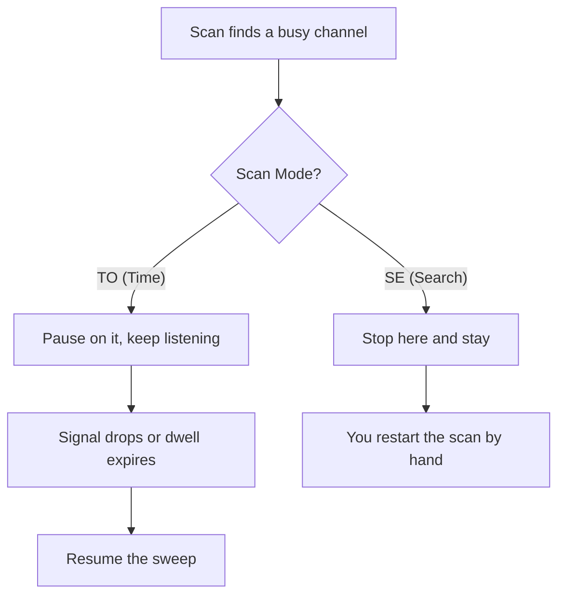
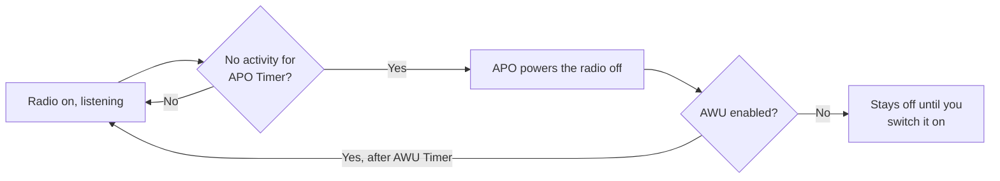

# Basic settings: display, scanning, power and housekeeping

The [Menu Reference](outpost:entry/logbook73.guide.rt-6d/menu-reference) lays every option out in tables so you can find one fast. This page slows down over the corner of **Basic Settings** that shapes how the radio _feels_ rather than what leaves the antenna: the screen and its colours, the beeps, the way it scans, how it manages battery when you walk away, and the housekeeping items that save, delete, reset and identify. None of these change your signal, so nothing here can put you off frequency or out of your [licence conditions](outpost:entry/logbook73.handbook/getting-licensed) — which makes this the safest menu to explore. For each item we answer the questions the manual never does: what it does, what the radio is doing underneath, a sensible value, and whether a beginner should touch it at all.

You reach any of these with the **MENU** key, step with **▲/▼** (a long press scrolls fast), open with **MENU**, change with **▲/▼**, save with **MENU**, and back out with **↵/EXIT**, exactly as in [Getting Started](outpost:entry/logbook73.guide.rt-6d/getting-started). Each item below carries the same one-glance verdict used across this guide: ✅ set it and move on · ⭐ genuinely useful, depends how you operate · ⚠️ advanced, understand it first · ❌ leave it off unless you have a reason. The tone, power and DMR settings live on their own pages — this is everything else in Basic Settings that is about comfort and care.

## Identity and sound: Radio Name, Voice Prompt, Key Beep

These three decide who the radio says it is and how much noise it makes back at you.

### Radio Name — ⭐ put your callsign here

The text label the radio holds for itself.

- **Does:** stores a short line of text — most owners type their **callsign**. On analogue channels it can also be sent as an "end tone" identifier if you enable the _Radio name_ option under TX End Tone in [Analogue settings](outpost:entry/logbook73.guide.rt-6d/analog-ssb).
- **Why it exists:** identity. A radio left on a club table or lost in a rucksack that shows `M0ABC` finds its way home; a blank one does not.
- **Recommendation:** ⭐ Type your callsign, once, when the radio is new. It costs nothing and is quietly useful.

### Voice Prompt — leave to taste

A robotic voice that announces menu items and actions aloud.

- **Does:** speaks the name of each menu item or action as you land on it. **On** talks; **Off** stays silent.
- **Inside:** stored audio clips played through the speaker as you navigate — it reads nothing from the air and transmits nothing.
- **Recommendation:** **On** can genuinely help while you are learning which item is which, especially with the RT-6D's long menu; most operators switch it **Off** once the layout is familiar, as it slows brisk menu work. Pure preference — try it, then decide.

### Key Beep — ✅ On while learning

The confirmation tone on each keypress.

- **Does:** sounds a short beep when a key registers. **On** confirms every press; **Off** is silent.
- **Why it exists:** feedback. With gloves, in the dark, or when you cannot see the screen, the beep tells you the press actually landed.
- **Recommendation:** ✅ Leave it **On** while you learn the radio, then choose to taste. It is entirely local — never transmitted, so it annoys nobody but you. Turn it **Off** for silent operation on a quiet net or in a meeting.

## The display: Light Timer, Brightness, Menu Exit

The RT-6D's colour screen is lovely to read and thirsty on the battery — these three tame it.

### Light Timer — ✅ a few seconds

How long the backlight stays lit after you touch a key.

- **Does:** keeps the screen lit for a set time after any activity, then dims it to save power. Typical choices are **Off** (screen never lights on its own), a handful of **seconds**, or **On** (always lit).
- **Inside:** the backlight is one of the biggest single drains on a handheld. Timing it out means the radio spends most of its standby life with the screen dark, waking it only when you press something.
- **Recommendation:** ✅ **A few seconds** (around `5`) is the comfortable middle — long enough to read, short enough to save real battery. Choose **On** only when the radio is mains- or car-powered and you want the display always visible; choose **Off** to squeeze maximum standby time.

### Brightness — ⭐ match your surroundings

How bright the backlight burns.

- **Does:** sets the backlight level across a range of steps.
- **Inside:** brighter costs more current. On a colour screen the difference between a low and high setting is noticeable both in readability and in battery life.
- **Recommendation:** ⭐ A **middle** level suits most use; adjust it as your surroundings change. Turn it **up** in bright daylight where a dim screen washes out, and **down** at night — both to save battery and to keep your night vision. For a lot of dark operating (early-morning nets, field work), low brightness with a short Light Timer is the kindest combination.

### Menu Exit — ✅ leave at default

How long the menu waits before dropping you back to the main screen on its own.

- **Does:** sets a timeout — if you open the menu and then do nothing, the radio backs itself out to the operating screen after this many seconds, so you are never left stranded deep in a submenu.
- **Why it exists:** a safety net. Walk away mid-edit, or get distracted, and the radio returns to a listening state rather than sitting on a menu page missing calls.
- **Recommendation:** ✅ The **default** is fine for almost everyone. Lengthen it only if you find the menu closing on you while you think; shorten it if you want the radio back to listening quickly.
- **Should you change it?** Rarely — leave it unless the timeout annoys you.

## Reading channels and frequencies: Freq Input, CT/DCS Code Show, CH Alias Colour, RSSI Refresh

This cluster shapes what the screen tells you about the channel you are on and how you type a frequency by hand.

### Freq Input (6/8 bits) — ⭐ 6 for everyday, 8 for precision

How many digits you key when you type a frequency directly in VFO (frequency) mode.

- **Does:** switches direct entry between **6 bits** and **8 bits** — that is, six or eight digits. With **6-bit** entry you type a frequency to the nearest kilohertz: key `1`,`4`,`5`,`5`,`0`,`0` and the radio reads `145.500` MHz. With **8-bit** entry you type two extra digits and reach down to tens of hertz: `1`,`4`,`5`,`5`,`0`,`0`,`0`,`0` for `145.50000` MHz.
- **Inside:** the synthesiser can land far finer than the 2 m and 70 cm channel grid needs. Six digits is really "MHz down to kHz", which is all a normal FM channel requires; eight digits exposes the fine resolution the chip is actually capable of.
- **Why it matters:** it changes what a direct entry _means_. Under 6-bit, six keypresses complete a frequency; under 8-bit, the radio waits for two more before it accepts one, so an entry that felt finished sits unfinished. If direct frequency entry ever behaves oddly — extra digits expected, or the last presses ignored — this setting is usually why.
- **Recommendation:** ⭐ **6 bits** for everyday VHF/UHF amateur work, where nothing lands off the kHz grid and fewer keypresses is faster. Switch to **8 bits** only if you tune where sub-kHz placement matters — chasing a precise **SSB** listening frequency on HF through an external antenna (see [Analogue & SSB](outpost:entry/logbook73.guide.rt-6d/analog-ssb)), for instance.
- **Should you change it?** Beginners: leave it at **6**. Move to 8 only when you have a frequency that needs it.

### CT/DCS Code Show — ⭐ On while setting tones

Whether the screen displays the sub-audible tone or code in use on an analogue channel.

- **Does:** **On** shows the current **CTCSS** tone (a quiet sub-audible pitch, "CT") or **DCS** code (a digital squelch code) on the display; **Off** hides it behind a generic icon.
- **Inside:** many [repeaters](outpost:entry/logbook73.handbook/repeaters) will only open if your transmission carries the correct sub-audible tone — a kind of key. This setting simply decides whether that key is shown to you or kept out of the way.
- **Recommendation:** ⭐ Turn it **On** while you are setting up analogue repeater channels, so you can confirm at a glance that the right tone is loaded before you key up. Once your channels are programmed and correct, **Off** gives a cleaner screen. It is display-only — it changes nothing you transmit either way.
- **Should you change it?** On during setup, off for a tidy display afterwards.

### CH Alias Colour — ⭐ colour-code your channels

The colour the channel's name (its _alias_) is drawn in on the colour screen.

- **Does:** picks the text colour for the channel alias from a generous list — `Blue`, `Green`, `Red`, `Yellow`, `White`, `Fuchsia`, `Pink`, `Orange`, `Tomato`, `Cyan` and `Golden`.
- **Why it exists:** the RT-6D's colour display is one of its real advantages over a mono handheld, and colour carries meaning faster than any label. A red name reads as "warning — full-power repeater" before your eye has even parsed the letters.
- **A practical use:** build yourself a colour scheme and stick to it. Many owners set one colour per _kind_ of channel — for example **red** for DMR repeaters, **green** for simplex, **cyan** for listening-only or SSB, **golden** for GPS/APRS channels on the Pro. Set consistently across a [zone](outpost:entry/logbook73.guide.rt-6d/contacts-zones) (most easily from the CPS software when you build your code plug), the colours turn a long channel list into something you can navigate by glance rather than by reading.
- **Recommendation:** ⭐ Choose high-contrast colours against the dark screen — **white**, **golden**, **cyan** and **green** all read cleanly; deep blues can be harder in low light. Pick a scheme that means something to _you_.
- **Should you change it?** Whenever it helps you read the radio faster.

### RSSI Refresh — ⭐ a middle value

How often the on-screen signal-strength meter updates.

- **Does:** sets the refresh rate of the **RSSI** (Received Signal Strength Indicator) — the S-meter — from **Off** through `100 ms` up to `2000 ms` (two seconds).
- **Inside:** RSSI is the radio's estimate of how strong the incoming signal is. A fast refresh (`100`–`300 ms`) gives a lively meter that twitches with every flutter; a slow one (`1000`–`2000 ms`) is calmer and reads the _average_ strength; **Off** stops the live meter entirely.
- **Recommendation:** ⭐ A **middle** value around `500 ms` is a good default — responsive but steady. Speed it up when aiming an antenna or hunting the strongest spot for a weak signal; set it **Off** to save a sliver of battery if you never look at it.

## Scanning: Scan Mode, Direction, Interval, Dwell, Return, Start/End Freq, Carrier LED

Scanning sweeps channels or a frequency range looking for activity so you do not have to sit on a dead channel. These settings decide how it sweeps and what it does when it finds something. The broader picture of scan lists and how to launch a scan lives in [Contacts, zones & scanning](outpost:entry/logbook73.guide.rt-6d/contacts-zones); here we explain the switches themselves.

### Scan Mode (TO / SE) — ⭐ TO for monitoring

What the radio does when a scan lands on a busy channel.

- **Does:** **TO** (Time-Operated) pauses on the active channel, then resumes the sweep after a set delay whether the signal is still there or not; **SE** (Search) stops dead on the first signal it finds and stays there, leaving you to restart the scan by hand.

- **Why it exists:** two different jobs. Skimming a band for whatever is active, you want the radio to sample each conversation and keep moving (**TO**). Hunting for one specific signal — a beacon, an intruder, a station you are trying to locate — you want it to stop and hold the moment it hears anything (**SE**).
- **Recommendation:** ⭐ **TO** is the better all-round choice for general monitoring — it lets you hear a bit of each active channel without the scan freezing on the first carrier forever. Reach for **SE** when you are searching for a single signal and want the sweep to halt on it.
- **Common mistake:** using **SE** for casual monitoring and having it stop permanently on a stray carrier or a birdie (a spurious internal signal). And remember scanning needs the squelch set properly first (see [Analogue & SSB](outpost:entry/logbook73.guide.rt-6d/analog-ssb)) — too low and it stalls on noise.
- **Should you change it?** Yes, to match the job — **TO** to monitor, **SE** to hunt.

### Scan Direction — ✅ leave at default

Which way the sweep steps through the list.

- **Does:** sets the scan to climb **up** through channels/frequencies or descend **down**.
- **Recommendation:** ✅ It makes no practical difference to _what_ you find — only the order you meet it. Leave it at the default; flip it only if you prefer the sweep to move the other way, or you can nudge direction on the fly with **▲/▼** during many scans.
- **Should you change it?** Almost never.

### Scan Interval — ⭐ default, faster to catch quick calls

How long the radio pauses on each channel as it sweeps, listening for a signal before stepping on.

- **Does:** sets the per-channel sampling time — the sweep speed.
- **Inside:** on each channel the radio has to sit for a moment to decide whether the squelch will open. A **shorter** interval sweeps the list faster but risks stepping past a signal that appears a fraction late; a **longer** interval is slower but more thorough.
- **Recommendation:** ⭐ The **default** suits most lists. Shorten it if you scan a long list and want to get round it quickly; lengthen it if you find the scan skipping brief transmissions.
- **Should you change it?** Only if scanning feels too slow or too twitchy.

### Scan Dwell — ⭐ 3–5 seconds

In **TO** mode, how long the radio lingers on a busy channel after activity before resuming.

- **Does:** sets the hold time before a Time-Operated scan moves on — the pause you get to hear the tail of a transmission and any reply.
- **Inside:** without a dwell, the scan would leave the instant a signal dropped and you would miss the answer to the call you just heard. Dwell holds the channel open a few seconds so a conversation has a chance to continue before the sweep resumes.
- **Recommendation:** ⭐ **3–5 seconds** is a comfortable window — long enough to catch a reply, short enough that a dead channel does not stall the sweep. Lengthen it if you keep missing the back-and-forth; shorten it to keep the scan brisk.
- **Should you change it?** Set once, to taste.

### Scan Return (Original / Current CH) — ⭐ your preference

Where the radio lands when you stop a scan.

- **Does:** **Original** returns you to the channel you started the scan from; **Current CH** leaves you on whatever channel the scan last stopped on.
- **Recommendation:** ⭐ **Current CH** is usually the friendlier choice — you stop the scan _because_ you found something, so staying there is what you want. Choose **Original** if you treat scanning as a temporary sweep and always want to come home to a known base channel afterwards.
- **Should you change it?** A one-time preference either way.

### Scan Start Freq / Scan End Freq — ⭐ set your listening window

The frequency limits for a range scan in VFO mode.

- **Does:** **Scan Start Freq** and **Scan End Freq** define the bottom and top of the band the radio sweeps when you scan by _frequency_ (as opposed to scanning a list of stored channels).
- **Why it exists:** a range scan is how you go looking for activity across a slice of band without having stored every channel first. Set the two limits and the radio walks the frequencies between them at the current [step](outpost:entry/logbook73.guide.rt-6d/menu-reference).
- **Recommendation:** ⭐ Set them to bracket whatever you want to sweep — for example the 2 m simplex segment, or a local repeater output sub-band. Keep the window as narrow as your interest allows: a tight range scans quickly and finds signals sooner; a whole-band range takes much longer to get round. Check your national band plan for sensible edges.
- **Should you change it?** Whenever you want to explore a different slice of band.

### Carrier LED — ⭐ Off to save battery

Whether the LED lights green when the radio is receiving a signal.

- **Does:** **On** flashes the LED **green** whenever the squelch opens on a received signal; **Off** keeps it dark on receive. (The LED still shows **red** on transmit regardless — that indication is not optional.)
- **Why it exists:** a visual cue that the channel is active without looking at the screen — handy during a scan to see at a glance that something is coming in.
- **Recommendation:** ⭐ **On** is a pleasant confirmation while scanning; **Off** saves a little battery and keeps the radio discreet in the dark, where a blinking green LED is both a drain and a giveaway. For long standby or low-profile use, off wins.

## Power and sleep: APO, APO Timer, AWU, AWU Timer

The most useful pair of settings for anyone who forgets to switch the radio off, or who wants marathon standby. **APO** turns the radio _off_ by itself; **AWU** wakes it back _up_ on a schedule. They can work as a cycle.

### APO (Auto Power Off) — ⭐ On if you forget to switch off

Turns the radio off after a stretch of no operation.

- **Does:** **On** powers the radio down once you have not touched a control (or received traffic, depending on the model's rules) for the **APO Timer** period; **Off** leaves it running until you switch it off yourself.
- **Why it exists:** the classic "I left it on in my bag and the battery was flat next morning". APO is the cure.
- **Recommendation:** ⭐ Turn it **On** if you are the sort to forget the volume knob — a flat battery when you need the radio is far worse than an auto-off you can override. Leave it **Off** only when you genuinely want unattended, indefinite monitoring (a base radio left listening to a repeater, say).
- **Should you change it?** On for a personal handheld you carry; off for a dedicated monitor.

### APO Timer — ✅ 30–60 minutes

How long APO waits before switching off.

- **Does:** sets the inactivity period that triggers Auto Power Off.
- **Recommendation:** ✅ **30 to 60 minutes** is a sensible window — long enough that a quiet spell during a QSO or a net does not catch you out, short enough to save the battery if you wander off and forget. Only meaningful when **APO** is On.
- **Should you change it?** Set once alongside APO.

### AWU (Auto Wake-Up) — ⚠️ advanced, for long-standby monitoring

Powers the radio back on by itself after it has slept.

- **Does:** **On** lets the radio wake itself up after the **AWU Timer** interval — most usefully paired with APO, so the set sleeps to save battery, wakes to listen for a while, then sleeps again. **Off** is the normal state.
- **Inside:** this is a duty-cycle trick for very long standby. Instead of listening continuously, the radio spends most of its time powered down and wakes periodically to check for traffic, trading a chance of missing a call _during_ a sleep window for dramatically longer battery life.
- **Recommendation:** ⚠️ Leave it **Off** for ordinary use — you want the radio awake and listening when you carry it. Turn it **On** only for a specific long-unattended job where periodic checking is acceptable and stretching a single charge over days matters more than catching every call. Understand that anything transmitted while the radio is asleep is simply not heard.
- **Should you change it?** Only for a deliberate long-standby setup.

### AWU Timer — set to match the job

How long the radio sleeps before AWU wakes it.

- **Does:** sets the interval between wake-ups when AWU is On. A **short** timer wakes often (catches more, saves less); a **long** timer sleeps deeply (saves most, misses more).
- **Recommendation:** match it to what you are monitoring — a shorter interval if you cannot afford to miss much, a longer one if you are stretching standby to its limit. Only relevant when **AWU** is On.
- **Should you change it?** Only as part of setting up AWU.

## Housekeeping: Save CH, Delete CH, Version, DMR Version, Flash IC, Initialization

The last group is chores and information — saving and removing channels, reading firmware details, and the big red reset.

### Save CH — ✅ how VFO settings become a memory

Stores the current VFO (frequency-mode) setup into a memory channel.

- **Does:** takes everything you have dialled up in VFO mode — frequency, offset, tone, power, bandwidth — and writes it into a numbered memory channel so you can recall it instantly later.
- **Why it matters:** memory channels are the whole point of a programmed radio. Once a repeater or simplex frequency is saved, you never re-enter its offset and tone by hand on the air again. In practice most owners build channels wholesale in the CPS software, but **Save CH** is how you capture a frequency you have found in the field.
- **Recommendation:** ✅ Use it whenever you tune something worth keeping. Give the channel a clear alias afterwards.
- **Should you change it?** It is an action, not a setting — use it as needed.

### Delete CH — ⚠️ removes a stored channel

Erases a memory channel.

- **Does:** removes the selected channel from memory. On a radio with up to 1024 channels this is how you clear out mistakes or channels you no longer want.
- **Recommendation:** ⚠️ Straightforward, but there is no undo in the field — deleting from the handheld is permanent unless you have a saved code plug to restore from. Prefer to manage channels in the CPS where you have a backup and can see the whole list.
- **Should you change it?** Only when you mean to remove a channel — and ideally with a code plug backed up first.

### Version — informational

Shows the radio's firmware version.

- **Does:** displays the installed firmware version — a read-only figure.
- **Why you would look:** to check what firmware you are on before a support query or an update, or to confirm an update took. It changes nothing.

### DMR Version — informational

Shows the version of the DMR (digital) firmware component.

- **Does:** displays the version of the [DMR](outpost:entry/logbook73.handbook/dmr-slots-talkgroups) protocol stack separately from the main firmware. Read-only.
- **Why you would look:** DMR support is a distinct block of firmware; when troubleshooting a digital problem or asking for help, the DMR version is worth quoting alongside the main **Version**.

### Flash IC — informational

Identifies the memory chip.

- **Does:** reports the flash memory chip fitted — a `25Q256`, 32 MB part — where your channels, zones, contacts and settings are stored. Read-only, and occasionally asked for during support. Nothing to set.

### Initialization — ⚠️ factory reset, back up first

Returns the radio to its factory state.

- **Does:** resets settings back to their defaults. Depending on the option chosen, this wipes your **menu settings** and can also clear your **channels, zones, contacts and DMR ID** back to the factory blank.
- **What a reset keeps vs wipes:** the **firmware** itself (both the main **Version** and the **DMR Version**) and the radio's factory calibration are _not_ touched — a reset does not un-flash or de-tune the radio. What it _does_ clear is your work: the code plug you built, your DMR ID, your zones and channels, and your menu tweaks. Treat it as "wipe everything I configured, keep the radio's brain and tuning".
- **When you would use it:** to recover from a tangled configuration you cannot unpick, or to hand the radio on with your details removed.
- **⚠️ Caution:** **back up your code plug from the CPS first.** A reset is the one action on this page you cannot undo, and rebuilding channels, zones and your DMR ID by hand is slow, error-prone work. Save the code plug to your computer, _then_ reset, _then_ restore. With no backup, do not reset unless you are prepared to start from a blank radio. Never do this casually.

## Key takeaways

- **Display comfort is a battery trade.** **Light Timer** at a few seconds, a middle **Brightness**, and **Carrier LED** off give a screen you can read without draining the pack; only go **On**/bright when mains-powered.
- **Freq Input** decides how many digits a direct frequency needs — **6 bits** for everyday VHF/UHF (the kHz grid), **8 bits** only when sub-kHz precision matters, as in SSB listening. Odd direct-entry behaviour usually traces back to this.
- **CH Alias Colour** turns the RT-6D's colour screen into a navigation aid — pick a consistent scheme (red = repeaters, green = simplex, cyan = listening) and read your channel list by glance. **CT/DCS Code Show** on during setup confirms your repeater tones.
- **Scanning:** **TO** mode with a **3–5 second** dwell is the monitoring default; **SE** is for hunting one signal. **Scan Return: Current CH** keeps you where the scan stopped; **Start/End Freq** set the window for a range scan.
- **APO** on (with a 30–60 minute timer) saves you from a flat battery when you forget to switch off; **AWU** is an advanced long-standby trick that sleeps and wakes on a schedule — leave it off for ordinary carry.
- **Housekeeping:** **Save CH** captures a field frequency into memory; **Version / DMR Version / Flash IC** are read-only information for support; **Initialization** is a factory reset that keeps the firmware and calibration but wipes everything you configured — **back up your code plug first**.

With the display, scanning and housekeeping settings understood, the next step is the heart of this radio — building a digital channel from a slot, colour code and talkgroup — in [DMR Channels](outpost:entry/logbook73.guide.rt-6d/dmr-channels).
