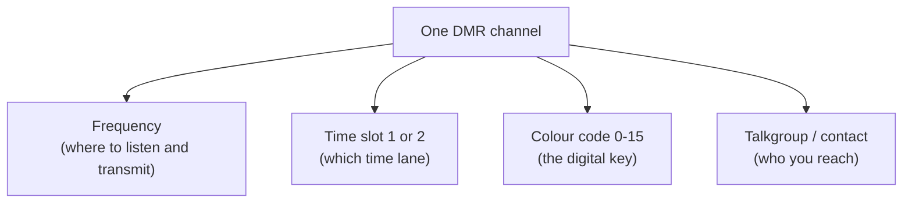
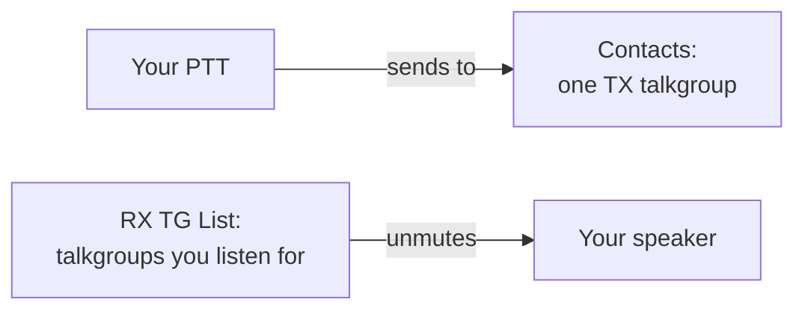
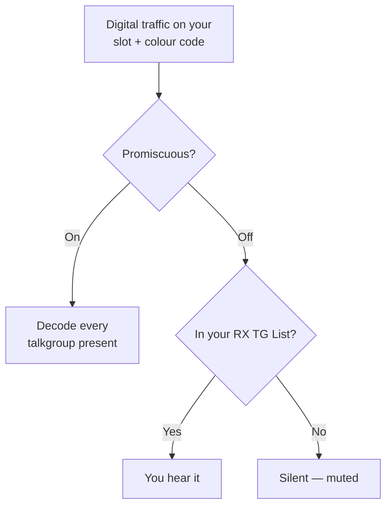
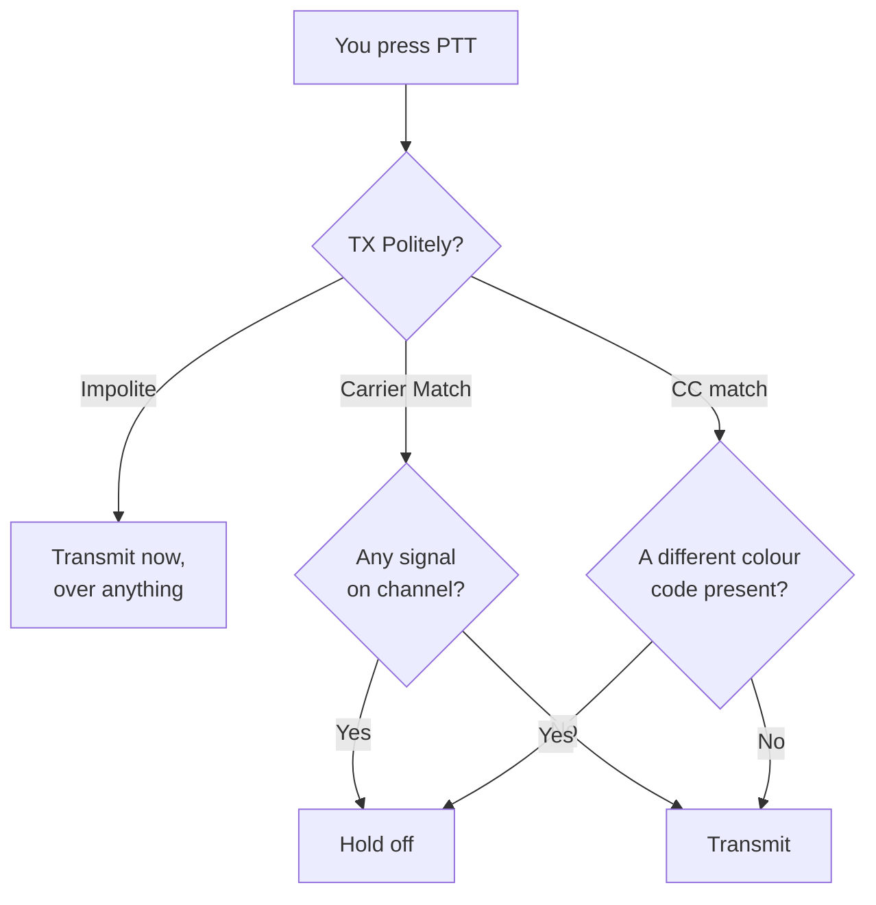

# DMR channels: slot, colour code, talkgroup and promiscuous

A DMR channel is not just a frequency. It is a small bundle of settings that all have to agree with the far end before a single word gets through — and on the RT-6D those settings live across two menus, which is exactly where newcomers come unstuck. Learn the bundle once and the rest of digital voice falls into place: this page is the heart of the guide.

The deep, universal theory lives in the handbook, and this page links out to it rather than repeating it. If you have not yet read the [DMR overview](outpost:entry/logbook73.handbook/dmr) and [Slots, colour codes & talkgroups](outpost:entry/logbook73.handbook/dmr-slots-talkgroups), skim them first.

## The mental model: a DMR channel = frequency + slot + colour code + talkgroup

On an analogue FM radio a "channel" is a memory storing a frequency, a power level and maybe a sub-tone. A DMR channel stores more, because a DMR conversation does not live on a frequency the way an FM one does. It lives on a numbered **talkgroup**, carried in a numbered **time slot**, gated by a **colour code**, on a **frequency**. Get one of the four wrong and you meet total silence — no error, no hiss, nothing.

A single physical frequency carries two conversations at once because DMR splits it in time into two slots — the [slots and talkgroups](outpost:entry/logbook73.handbook/dmr-slots-talkgroups) chapter explains that two-lane road in full. The **colour code** is the digital equivalent of a CTCSS tone — a number that must match or your radio stays deaf and mute — and the **talkgroup** is who you are talking to. The RT-6D shows where you stand on its colour screen: **`DMR D`** marks a digital channel, **`CXX`** the colour code, **`T1`/`T2`** the slot.

Each item below carries the same one-glance verdict used across the guide: ✅ set it and move on · ⭐ genuinely useful, depends how you operate · ⚠️ advanced, understand it first · ❌ leave it off. You reach any menu with **MENU**, move with **▲/▼**, save with **MENU**, and back out with **↵/EXIT**, as covered in [Getting Started](outpost:entry/logbook73.guide.rt-6d/getting-started).

## Two menus, one channel: Channel Settings and Digital Setting

The RT-6D splits DMR settings across two menu groups; knowing which is which saves a lot of hunting.

- **`Channel Settings`** holds everything that belongs to _this one channel_: its slot, colour code, TX talkgroup, receive list, power, time-out, promiscuous flag and so on. Change channel and these change with it.
- **`Digital Setting`** holds the radio-wide settings and the _libraries_ the channels draw from: your **Personal ID** (your DMR ID), the master **Contacts Set** list, the **TG List Set** of receive lists, and the **Encryption Set** key store. A channel's `Contacts` and `RX TG List` are pointers into these libraries.

So you build a contact or a receive list _once_ in Digital Setting, then any number of channels point at it. In practice almost everyone builds all of this on a computer with the Radtel CPS software over the USB-C cable — a "code plug" — because typing talkgroups on a keypad is slow and error-prone. [Hotspots & code plugs](outpost:entry/logbook73.handbook/dmr-hotspots) covers CPS; [Contacts & Zones](outpost:entry/logbook73.guide.rt-6d/contacts-zones) covers doing it on the radio itself.

## DMR Mode and Slot — the time lanes

### DMR Mode — ✅ set to match the channel

`Channel Settings → DMR Mode` chooses whether the channel uses one time slot or both.

- **Does:** with **Dual Slot off** the channel is single-slot — the ordinary case. With **Dual Slot on** it enables **DCDM** (Double Capacity Direct Mode), packing two independent simplex conversations onto one frequency by using both slots. Through a repeater both slots are always in play — the repeater sources the timing that keeps the lanes separate. On simplex there is no repeater to keep time, so DCDM works by having one radio inject a sync signal the others follow.
- **Values:** Dual Slot off / on.
- **Recommendation:** ✅ For simplex, leave **Dual Slot off** — the amateur DMR simplex calling frequencies assume single-slot direct mode, and it is the most compatible choice. Turn **Dual Slot on** only for a repeater channel that uses it, or a coordinated simplex group that has agreed to run DCDM. Enable it unilaterally and radios silently fail to decode each other, disagreeing on the slot structure.

### DMR Slot — ⭐ match the repeater's published slot

`Channel Settings → DMR Slot` picks **Slot 1** or **Slot 2** (shown on screen as `T1` or `T2`).

- **Does:** selects which of the two TDMA time lanes this channel uses through a repeater. Each talkgroup is assigned to a slot by the repeater's owner — a common convention puts busy wide-area traffic on one slot and local traffic on the other, so a worldwide net does not tie up the local lane.
- **Values:** Slot 1 / Slot 2.
- **Recommendation:** ⭐ Set whatever the repeater's listing specifies for the talkgroup you want; on a plain simplex channel (Dual Slot off) the slot does not matter, so leave it on **Slot 1**.
- **Common mistake:** the right talkgroup on the _wrong slot_ routes nothing and can block the repeater's other conversation. Confirm slot _and_ talkgroup together from the published list.

## Colour Code — ✅ the digital key

`Channel Settings → Color Code` sets a number from `0` to `15` (the menu spells it "Color"; it shows on the display as `CXX`).

- **Does:** stamps every transmission with a code number, and a repeater or receiving radio ignores anything whose colour code does not match — exactly as an FM radio ignores a signal without the right [CTCSS tone](outpost:entry/logbook73.handbook/dmr-slots-talkgroups). Unlike CTCSS it is a field decoded from the digital signalling, not a sub-audible tone; it lets two nearby repeaters share one frequency, and it feeds the "colour-code" admit rule under TX Politely.
- **Values:** `0`–`15`. **Colour code 1** is the de-facto amateur default.
- **Recommendation:** ✅ Set whatever the repeater or simplex group publishes; everyone in a simplex group uses the same one. When in doubt, `1`.
- **Common mistake:** a wrong colour code is the classic "my radio is dead" complaint — the repeater will not key and you hear nothing at all, with no warning.

## Contacts and RX TG List — who you reach, who you hear

These two are the crux of DMR routing, kept deliberately separate: the talkgroup you _transmit_ to, and the list of talkgroups you _receive_.

### Contacts — ⭐ your transmit talkgroup

`Channel Settings → Contacts` picks, from the master `Digital Setting → Contacts Set` list, the single destination your PTT sends to.

- **Does:** sets where your audio is routed when you transmit — either a **Group Call** (a talkgroup number such as `91` Worldwide or `235` UK-wide) or a **Private Call** (one person's DMR ID). The network reads this number off your transmission and routes your voice to every repeater and hotspot subscribed to that talkgroup. This is the mental shift from analogue: routing is by _group number_, not frequency — a talkgroup is a virtual channel that can span the world, and programming one channel per talkgroup is how you "change channels" on DMR. One built-in **All Call** contact cannot be edited or deleted.
- **Values:** any Group Call or Private Call in your contacts database (Contact ID `1`–`16777215`).
- **Recommendation:** ⭐ Build a contact per talkgroup you use and point the channel at it. The number depends on the network — see [DMR networks](outpost:entry/logbook73.handbook/dmr-networks): **BrandMeister** uses the raw number (`91` = `91`), whereas **TGIF** wants a `4` prefix zero-padded to seven digits (TGIF `777` = `4000777`). Program the wrong form and it will not connect.
- **Common mistake:** treating a _dynamic_ talkgroup like a permanent one — a user-activated group drops off the repeater after 10–15 minutes of quiet and must be re-triggered by transmitting.

### RX TG List — ⭐ the talkgroups you listen for

`Channel Settings → RX TG List` selects a receive list from `Digital Setting → TG List Set`.

- **Does:** sets which talkgroups the channel will _unmute for_, independent of the single one it transmits to, so one channel can monitor several groups on the same slot — you sit on your favourite talkgroup but still hear a call arrive on a regional or special-event group. In TG List Set you press **MENU** to add a talkgroup to a list and **↵/EXIT** to deselect it; a channel then points at that whole list.
- **Recommendation:** ⭐ Add every group you want to hear on that slot, paired with the transmit contact you intend to answer on.
- **Common mistake:** if a talkgroup is _not_ in the RX TG List — and Promiscuous is off — you stay silent even though its traffic is on your slot. The next setting is the escape hatch.

## Promiscuous — ⭐ hear everyone, or just your group

`Channel Settings → Promiscuous` is the RT-6D's built-in digital monitor, and one of the nicest things it does over a plainer handheld. Turned **on**, the channel decodes _every_ talkgroup present on your frequency, slot and colour code, ignoring the RX TG List filter. Turned **off**, you hear only the talkgroups you deliberately listed.

- **Does:** widens the receive filter from "the groups on my list" to "anything on this slot with a matching colour code"; the RT-6D can even follow whatever active talkgroup it finds. It is made for discovery — landing on an unfamiliar repeater, you rarely know which talkgroups are busy, and promiscuous lets you _hear the machine_ without pre-programming a single group. Assign it to a side key or long-press number key (see [Keys & Settings](outpost:entry/logbook73.guide.rt-6d/keys)) to flip it live.
- **Recommendation:** ⭐ Turn it **on** when exploring a busy repeater or a hotspot; turn it **off** for a quiet, focused watch on one talkgroup. It is a monitoring preference, not a compliance setting — the full etiquette is in [DMR operating](outpost:entry/logbook73.handbook/dmr-operating).
- **Crucial catch:** promiscuous only changes what you **hear**. Your **PTT still transmits solely to the channel's assigned Contacts talkgroup** — hearing a group is _not_ being on it, and answering does not join it. To talk on a group you heard, switch to (or build) a channel whose Contacts points at it. A busy scan is not chaos but everything at once; turn it off and the din resolves back into your one chosen talkgroup.

## TX Politely — ⭐ the admit rule

`Channel Settings → TX Politely` decides _when_ the radio is allowed to transmit when you press PTT — DMR's manners setting, worth understanding properly.

- **Impolite:** transmit regardless of what is on the air — this keys straight over a conversation in progress, so reserve it for controlled testing.
- **Carrier Match:** transmit only if the channel is completely idle. _Any_ signal — even a different colour code or slot — blocks you. The most cautious setting.
- **CC match:** transmit if the slot is free, or if the only signal present carries _your_ colour code — it defers to a stranger's system on the same frequency but still lets you key into your own busy repeater.
- **Recommendation:** ⭐ Use **CC match** as the default for repeater channels — polite to the wider band without locking you out of your own machine. Use **Carrier Match** on shared simplex to avoid doubling, and keep **Impolite** for the bench only. Leaving it on Impolite and talking over live QSOs is a cardinal sin in the [DMR operating](outpost:entry/logbook73.handbook/dmr-operating) chapter.

## Encryption — ❌ off, and it is not optional

`Channel Settings → Encryption` offers **Off** or one of keys `1`–`256` (built in `Digital Setting → Encryption Set`) that scramble the digital payload so only radios holding the same key can decode you.

- **Recommendation:** ❌ **Off on every amateur channel — always.** Amateur regulations essentially everywhere forbid transmissions that obscure their meaning: FCC Part 97.113(a)(4) in the US, Ofcom Clause 19 in the UK, and equivalents under your own regulator. The feature exists only because these are commercial-heritage radios where encryption is legal on business licences.
- **Also know:** even unencrypted, DMR is _not_ private — anyone with a compatible radio can monitor it — so encryption buys no legal privacy and lands you outside your licence. Switch it on "to test it" and nobody can understand you while you quietly break the law. See [Getting Licensed](outpost:entry/logbook73.handbook/getting-licensed) and [DMR operating](outpost:entry/logbook73.handbook/dmr-operating).

## Channel ID and CH ID Selection — ⚠️ leave on Radio ID

Most DMR handhelds send your one Personal ID on every channel. The RT-6D adds a twist: **`CH ID Selection`** chooses the source — **Radio ID** (your global Personal ID, the normal case) or **Channel ID** (the per-channel ID stored in the **`Channel ID`** item). It lets an operator who holds more than one registered ID — a separate hotspot ID, say — bind a particular ID to a particular channel rather than switching the whole radio's identity.

- **Recommendation:** ⚠️ Leave **CH ID Selection** on **Radio ID** unless you have a specific, registered reason not to. Every channel then transmits your one Personal ID, and there is nothing to get wrong.
- **Common mistake:** setting Channel ID to a made-up or borrowed number "to keep channels tidy". A DMR ID must be _yours_, registered to your licence at RadioID.net — inventing one breaks routing and misidentifies you.

## Power, time-out and Limit RX/TX

The remaining Channel Settings items are practical housekeeping, familiar from analogue.

### TX Power — ⭐ lowest that holds the link

`Channel Settings → TX Power` chooses **Low** or **High** (shown as `L`/`H`); on these radios High is roughly 4–5 W, Low around a watt.

- **Recommendation:** ⭐ Use the **lowest power that keeps a solid digital link**. DMR is "digital cliff" — perfect audio until the link marginally fails, then abrupt robotic garble — so more watts is not always better. Into a nearby [hotspot](outpost:entry/logbook73.handbook/dmr-hotspots), **Low** avoids overloading the little MMDVM board; save **High** for weak or distant repeaters. The reasoning is in [RF power](outpost:entry/logbook73.handbook/rf-power).

### TOT — ⭐ a sensible ceiling

`Channel Settings → TOT` (time-out timer) cuts your transmission after a set time: **Off**, or roughly `5 s`–`600 s`.

- **Recommendation:** ⭐ Set something like **60–120 s** so a stuck PTT cannot hold a repeater's slot open and block everyone. If your overs keep getting chopped mid-sentence, it — or the repeater's timer — is too short.

### Limit RX/TX — ⭐ receive-only when you want it

`Channel Settings → Limit RX/TX` sets what the channel may do: **RX+TX**, **Only RX** (listen but never transmit) or **Only TX**. Set **Only RX** on a channel you keep purely to monitor — a busy talkgroup, an out-of-region repeater — and the radio physically cannot key up there, even by accident.

- **Recommendation:** ⭐ Leave everyday channels on **RX+TX**; reach for **Only RX** to make a deliberate monitor channel safe against a stray PTT. Only TX is a niche most never need. Set Only RX and later forget, and PTT simply does nothing — by design.

The other Channel Settings items — `Scan Add`, `CH Alias` (its display name), and `Offset Dir`/`Offset Freq`/`TX Freq` (the repeater transmit shift) — work as on the analogue side and are covered in [Contacts & Zones](outpost:entry/logbook73.guide.rt-6d/contacts-zones) and the [Menu Reference](outpost:entry/logbook73.guide.rt-6d/menu-reference). For a repeater, store the _output_ (listen) frequency as the channel and let the offset place your transmit frequency; on simplex, offset is irrelevant.

## Personal ID — ✅ your DMR ID, set once

`Digital Setting → Personal ID` holds your **DMR ID**, a number from `1` to `16776415`.

- **Does:** rides on every transmission you make; the network maps it to your callsign for the display and logging — this is _why_ DMR shows who is talking, and why the RT-6D's colour screen can put a name next to an incoming call.
- **Recommendation:** ✅ Enter your own unique 7-digit ID, issued free by **RadioID.net** after you upload proof of licence (verification typically takes a day or two). The first three digits are your country's Mobile Country Code; one ID serves you on every network worldwide. Set once and forget.
- **Common mistake:** transmitting with a made-up or borrowed ID — collisions break routing and you appear as an unknown or duplicate station. You cannot get on DMR properly without your own; details in [DMR networks](outpost:entry/logbook73.handbook/dmr-networks).

## A worked example — one channel, end to end

Suppose your club runs a 70 cm DMR repeater. Its listing (these numbers are illustrative — always check the published ones) says: output `439.4000 MHz`, a `−` offset, **colour code 1**, **Worldwide (TG 91)** static on **Slot 1**, **UK-wide (TG 235)** on **Slot 2**. You want a channel to work TG 235.

1. In `Digital Setting → Contacts Set`, create a Group Call contact "UK 235" = `235` (BrandMeister uses the raw number).
2. In `Digital Setting → TG List Set`, make a list that includes `235` — press **MENU** to add it — plus `91` to hear worldwide traffic.
3. In `Channel Settings`: frequency `439.4000 MHz`; `Offset Dir` = `−` and `Offset Freq` = the published shift; `DMR Mode` = Dual Slot off; `DMR Slot` = **Slot 2**; `Color Code` = `1`; `Contacts` = "UK 235"; `RX TG List` = your list; `Promiscuous` = off; `Encryption` = **Off**; `TX Politely` = **CC match**; `CH ID Selection` = **Radio ID**; `TX Power` = **Low**; `TOT` = `120 s`; `Limit RX/TX` = **RX+TX**.

Four things had to agree with the repeater — frequency, slot, colour code and talkgroup — and now they do. Press PTT and your voice routes onto TG 235 across the network; flip Promiscuous on later to hear everything the machine is carrying.

## Try it yourself

- **Say the model out loud.** Point at any DMR channel and name its four parts: frequency, slot, colour code, talkgroup. If you cannot state all four, you do not yet know what that channel does.
- **Register for a DMR ID** at RadioID.net now — nothing works until you have one, and verification takes a day or two.
- **Build one channel by hand** for a local repeater or a hotspot, following the worked example above — doing it once on the keypad teaches you what the CPS software does for you later.
- **Toggle Promiscuous** on a busy repeater channel: off, you hear only your listed groups; on, the whole slot. Either way your PTT still goes only to the channel's Contacts talkgroup.
- **Break the colour code on purpose** (off the air, PTT unpressed): set it wrong, then right, and watch the display's `CXX` change. This silent-failure mode inoculates you against the "my radio is dead" panic.

## Key takeaways

- A DMR channel is **frequency + time slot + colour code + talkgroup** — all four must agree with the far end or you get total silence, no warning.
- Settings live in **two menus**: `Channel Settings` for this channel's slot, colour code, TX contact, RX list, promiscuous flag, power, time-out and offset; `Digital Setting` for your **Personal ID** and the contact/list _libraries_ the channels point at.
- **Colour code** (default `1`) is the digital CTCSS; **Contacts** is the one talkgroup you transmit to; **RX TG List** is the list of talkgroups you hear — keep them consistent.
- **Promiscuous** is the RT-6D's built-in monitor: on = hear every talkgroup on the slot, off = only your listed groups — but your **PTT always transmits to the channel's Contacts talkgroup** either way.
- **TX Politely** is your admit rule: **CC match** for repeaters, **Carrier Match** for shared simplex, **Impolite** only on the bench.
- **Encryption stays Off** on every amateur channel — obscuring meaning is against licence conditions almost everywhere, and DMR gives no real privacy anyway.
- Leave **CH ID Selection** on **Radio ID**, set **TX Power** low, give **TOT** a sane ceiling, use **Limit RX/TX** for monitor-only channels — and get your **own** 7-digit DMR ID from RadioID.net before you transmit.

With the settings understood, the next step is getting on the air for real — registering, picking a repeater or hotspot, and making your first digital call in [Getting On DMR](outpost:entry/logbook73.guide.rt-6d/dmr-getting-on).
