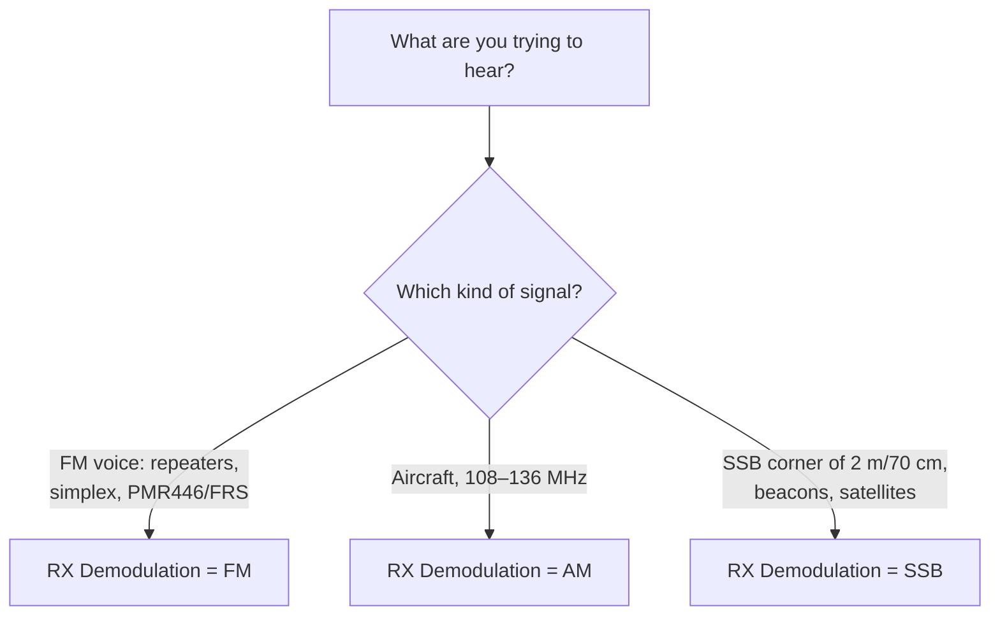
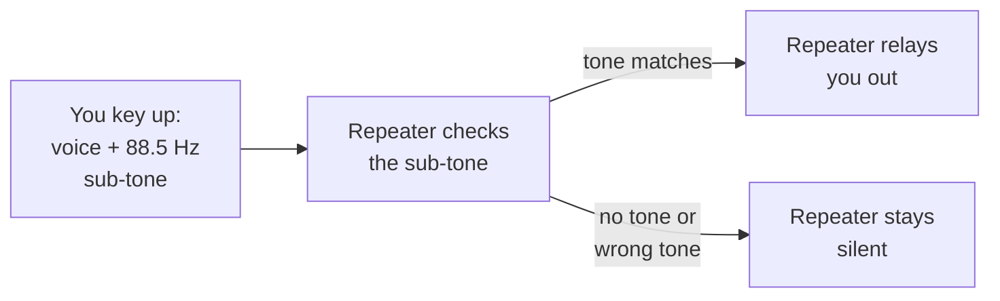

# Analogue FM, SSB receive, tones and DTMF

The RT-6D wears "DMR" on the box, but underneath it is a thoroughly capable analogue FM handheld — and it hides one trick the plain DMR sets do not have: a receiver that can demodulate **AM** and even **SSB** as well as FM. That turns a pocket radio into a modest all-mode listening post: FM repeaters and simplex, the aircraft band, and the single-sideband corners of the VHF/UHF bands. This page covers the RT-6D as an analogue radio — the extra receive modes, the **Analog Set** menu, the per-channel settings, the sub-tones that unlock repeaters, and the full DTMF signalling suite.

Everything below is reached the same way, covered in [Getting Started](outpost:entry/logbook73.guide.rt-6d/getting-started): press **MENU**, step to the item with **▲/▼** or the channel knob, press **MENU** to edit, choose the value, and confirm to save. The **↵/EXIT** key backs out. In VFO mode, **Side-key 2** flips the current band between analogue and digital, so you can drop onto the analogue side in a moment.

## One radio, three ways to listen

Strip away DMR and the RT-6D is a wideband receiver with a transmitter bolted to part of it. The two are not the same size. It **receives** far more than it can **transmit**: FM broadcast from `64–108 MHz`, the AM aircraft band from `108–136 MHz`, and everything from `136 MHz` up to `520 MHz` in between. It only **transmits** in the two amateur segments the hardware is built for — roughly `136–174 MHz` (2 m) and `400–470 MHz` (70 cm) — and even then only within your licence conditions. Listening is generous; talking is deliberately narrow.

The clever part is a per-channel setting called **RX Demodulation**, tucked into the analogue Channel Settings (menu **05**). It tells the radio _how_ to turn the radio wave back into sound: `FM`, `AM`, or `SSB`. Most analogue amateur voice is FM, so that is the default. But switch it and the same receiver copies quite different signals.



| Mode  | What it copies            | Where you meet it                                   |
| ----- | ------------------------- | --------------------------------------------------- |
| `FM`  | Frequency-modulated voice | Repeaters, simplex, most VHF/UHF activity           |
| `AM`  | Amplitude-modulated voice | Air traffic control, some old utility channels      |
| `SSB` | Single-sideband voice     | Weak-signal 2 m/70 cm, beacons, satellite downlinks |

A channel remembers its own demodulation, so you can build a "London Approach" AM channel next to a `144.300 MHz` SSB monitor next to your local FM repeater, and each just works when you land on it.

## AM airband and SSB receive

### The aircraft band — ✅ AM

Aviation voice has stayed on **AM** (amplitude modulation) for a century, because two aircraft transmitting at once produce a readable heterodyne rather than the total capture-effect blanking you get on FM — a genuine safety feature. The RT-6D receives the civil airband, `108–136 MHz`, and demodulates it as AM.

Build an airband channel by setting the frequency and switching **RX Demodulation** to `AM`. You cannot — and must not — transmit here: the airband is not an amateur allocation, so set **Limit RX/TX** (below) to `Only RX` on any airband channel and remove the temptation entirely. With a modest external antenna you will hear the tower and approach frequencies at your nearest airport comfortably.

### SSB receive — ⭐ a bonus, not a rig

**SSB** (single sideband) is the efficient voice mode that rules the HF DX bands and the weak-signal segments of VHF/UHF. Instead of a full AM signal — a carrier plus two mirror-image sidebands — SSB throws away the carrier and one sideband, putting all the power into the voice information. It is explained properly in [HF](outpost:entry/logbook73.handbook/hf); the short version is that SSB is how amateurs work long distance with modest power.

The RT-6D can _receive_ SSB, which is unusual and genuinely useful — but be clear-eyed about what it is. Two honest caveats:

- **It is receive-only.** You cannot transmit SSB on this radio; the transmitter is FM/DMR only. `SSB` under RX Demodulation exists purely for listening.
- **The front end is built to a budget.** This is a wide-coverage handheld, not a communications receiver. It has no proper narrow SSB filter and coarse tuning steps, so SSB comes through hissy, is easily overloaded by strong nearby signals, and is fiddly to tune to the exact pitch where a voice sounds natural. An external antenna may help weak signals, but can worsen overload; choose and test it for the operating environment.

And note the limit that matters: the RT-6D's receiver **starts at 64 MHz**. It does _not_ tune the HF bands where SSB DX actually lives, so this is not a shortwave receiver. Where SSB reception earns its place is inside the radio's real range — the SSB sub-bands of 2 m (around `144.150–144.400 MHz` in many band plans) and 70 cm, propagation beacons, and some satellite downlinks. Treat it as a bonus that lets you _notice_ an SSB opening or a beacon, then reach for a proper rig to work it. Check your national band plan for where SSB sits on each band.

```viz
{
  "type": "spectrum",
  "title": "Why SSB is efficient — carrier and one sideband removed",
  "caption": "AM sends a carrier plus two mirror sidebands; SSB keeps just one sideband and drops the carrier, so all the power carries voice. The RT-6D can demodulate that single sideband on receive.",
  "components": [
    { "f": 30, "amp": 0.5, "label": "AM lower", "width": 8, "tone": "muted" },
    { "f": 40, "amp": 0.95, "label": "AM carrier", "tone": "ink" },
    { "f": 50, "amp": 0.5, "label": "AM upper", "width": 8, "tone": "muted" },
    { "f": 80, "amp": 0.7, "label": "SSB (upper only)", "width": 8, "tone": "primary" }
  ],
  "xLabel": "frequency"
}
```

## The Analog Set menu, item by item

Menu **03 Analog Set** shapes the radio's analogue voice and behaviour — the settings that apply whatever analogue channel you are on. Most you set once and forget; two or three you nudge by ear. The one-glance verdict runs through this guide: ✅ set and forget · ⭐ useful, depends how you operate · ⚠️ understand before you touch · ❌ leave off for amateur use.

| Item                 | What it does                       | Values                             | Verdict                  |
| -------------------- | ---------------------------------- | ---------------------------------- | ------------------------ |
| SQ level             | Analogue squelch threshold         | 0–10                               | ✅ middle (~4–6)         |
| TX Start Tone        | Alert sent as you key up           | Off/on                             | ⭐ off                   |
| TX End Tone          | Roger beep / alias at end of over  | Off / Roger1 / Roger2 / Radio name | ❌ off for ham           |
| Single Tone          | Tone-burst frequency               | 1750 Hz                            | ⭐ regional              |
| VOX                  | Voice-activated transmit           | On/off                             | ⭐ off unless hands-free |
| VOX TH               | VOX trigger sensitivity            | 0–254                              | ⚠️ tune by ear           |
| VOX Delay            | Hang time after you stop talking   | 0–5                                | ⭐ small                 |
| Detect Range         | Window for the Freq Detect feature | band range                         | ✅ default               |
| Repeater Delay       | Squelch-tail / turnaround delay    | 0–2000 ms                          | ⭐ small                 |
| Mic Gain             | Microphone sensitivity             | 0–31                               | ✅ default               |
| A DAC / A/B SPK Gain | Audio output levels                | 0–15 / 0–63                        | ✅ default               |
| Glitch TH            | Noise-glitch rejection for squelch | 0–10                               | ⚠️ default               |
| DTMF …               | The DTMF signalling suite          | —                                  | see below                |

### SQ level — ✅ middle

The squelch: how strong a signal must be before the radio lets any sound through the speaker. At `0` the gate is wide open and you hear constant hiss; toward `10` only strong signals break through. Start around `4–6`, raise it a notch if the squelch keeps chattering open on noise, drop it if you suspect you are missing weak stations. It is one of the few settings worth tuning live, by ear, to wherever you are standing.

### Mic, DAC and SPK gains — ✅ leave at default

**Mic Gain** (`0–31`) sets how hot your microphone runs — too low and you sound faint, too high and you sound distorted. **A DAC Gain** (`0–15`) and the **A/B SPK Gain** (`0–63`) set audio output levels, with a separate figure for each of the two VFOs so you can balance them. All ship at sensible defaults; if a regular contact reports your audio is thin or blown out, nudge Mic Gain a couple of steps and ask again. The digital side has its own gains under [DMR Getting On](outpost:entry/logbook73.guide.rt-6d/dmr-getting-on).

### TX Start / End Tone — mostly ❌

These add sounds to your transmission. **TX End Tone** offers `Off`, `Roger1`, `Roger2`, or `Radio name` — the roger beeps append a short "I've finished" tone when you release PTT; `Radio name` sends your alias as an identifying burst. On the amateur bands, ❌ **leave the roger beep off**: amateurs say "over" and identify by callsign, and a beep on every over just makes others sit through an extra tone. It is at home on licence-free family channels ([PMR446 in Region 1, FRS in North America](outpost:entry/logbook73.handbook/repeaters)), less so on a repeater. Assign a side key to toggle it in [Keys](outpost:entry/logbook73.guide.rt-6d/keys) if you switch between the two worlds.

### Single Tone — ⭐ your region's tone burst

**Single Tone** sets the frequency of the RT-6D's tone burst, the classic `1750 Hz` in Europe and the UK. A tone burst is a brief, audible single tone sent at the _start_ of your over that an older repeater listens for as its "wake up" signal, before continuous sub-tones took over. Fire it by assigning **Send Single Tone** to a key (see [Keys](outpost:entry/logbook73.guide.rt-6d/keys)) and pressing it as you begin transmitting. North American machines use CTCSS instead and the burst goes unused; check your local convention.

### VOX — ⭐ off unless you need hands-free

**VOX** (voice-operated transmit) keys the radio automatically when you speak, so you can operate hands-free. **VOX TH** (`0–254`) sets how loud your voice must be to trigger it, and **VOX Delay** (`0–5`) how long it keeps transmitting after you stop. VOX is convenient with a headset but it cannot judge whether the channel is busy, so it will happily transmit over someone. Leave it **off** for normal operating; if you use it, tune VOX TH by ear until ordinary speech triggers cleanly but background noise does not, and keep VOX Delay short so you do not hold the channel after each phrase.

### Repeater Delay and Glitch TH — ⭐/⚠️ small or default

**Repeater Delay** (`0–2000 ms`) holds the audio muted for a moment around the end of a received signal, hiding the burst of noise — the "squelch tail" or "kerchunk" — you hear when a repeater drops its carrier. A couple of hundred milliseconds tidies that away; too long and the start of the next over gets swallowed. **Glitch TH** (`0–10`) fine-tunes how tolerant the squelch is of brief noise glitches before it opens — a lower number is more trigger-happy, higher is more stubborn. Leave it at default unless the squelch is flickering open on noise that SQ level alone will not settle. **Detect Range** sets the window for the Freq Detect key feature (which measures a nearby signal's frequency and sub-tone); leave it default.

## Per-channel analogue settings (menu 05)

Some analogue behaviour belongs to the _channel_, not the whole radio, and lives in **Channel Settings** (menu **05**) alongside RX Demodulation. Set these when you build a channel, and they travel with it.

### Band Width — ✅ match the channel

**Band Width** (`Wide` / `Narrow`) sets how wide a slice of the band your FM signal fills. **Wide** swings about ±5 kHz (roughly a 25 kHz slot); **Narrow** limits it to about ±2.5 kHz (roughly 12.5 kHz). Mismatch it and audio comes out muffled and quiet (you narrow, they wide) or distorted and loud (you wide, they narrow). Match whatever the channel or repeater specifies — PMR446/FRS is narrow by rule, and most modern amateur channels are narrow too, though some older 25 kHz repeaters still want wide. Check the repeater's listing.

### Busy Lock and Limit RX/TX — ✅ the safety nets

**Busy Lock** refuses to let you transmit onto a channel already in use — pure good manners that stops the classic newcomer "double". It offers `Off`, `Carrier Match` (blocks TX if _any_ carrier is present) and `CTC/DCS Match` (blocks only if a signal with the _matching_ sub-tone is present, so an unrelated signal on the frequency will not lock you out). `Carrier Match` is the safest general choice.

**Limit RX/TX** (`RX+TX` / `Only RX` / `Only TX`) locks a channel to one direction. This is the setting that makes a receive-only channel genuinely receive-only — set **Only RX** on every airband, SSB-monitor, and broadcast channel so you can _never_ accidentally transmit somewhere you are not permitted. It is the electronic equivalent of taping over the PTT.

### Tail Tone and Scrambler

**Tail Tone** (`Off` / `55 Hz` / `120°` / `180°` / `225°` / `240°` phase shift) is a CTCSS tail-elimination trick: at the end of your over the radio sends a brief phase-shifted tone that tells the _other_ radio's tone squelch to close cleanly, killing the squelch-tail noise at their end. Leave it `Off` unless you and a regular contact both run tone squelch and want the cleaner drop.

**Scrambler** (`Off` / `1–8`) is an analogue voice scrambler that inverts your speech so only a matching radio can unscramble it. ❌ **Leave it off.** Obscuring the meaning of a transmission is not permitted under amateur licence conditions anywhere — this is a rule, not a preference. It exists for the commercial radios this chipset is built for, not for you.

## Getting into a repeater: CTC/DCS

Most FM repeaters do not relay every signal they hear — that would let distant noise key them up all day. Instead they listen for a quiet **sub-audible tone** riding under your voice, and only repeat you if it is present. This is the single most common reason a beginner "can hear the repeater but can't get in": the frequency and offset are right, but the tone is missing. The full concept — access tones, offsets, why repeaters exist — is in [Repeaters](outpost:entry/logbook73.handbook/repeaters); here is how the RT-6D handles it.

There are two flavours. **CTCSS** (shown **CTC**) sends one continuous low-frequency tone, from about `67 Hz` to `250 Hz`, under your audio. **DCS** sends a continuous slow digital code instead, with variants under **DCS Encrypt** (`Standard` / `Encrypt1–3` / `Mute Code`) and a **Mute Code** field for a private-line style code. On the RT-6D you can even split them: **RX CTC/DCS** and **TX CTC/DCS** are separate, so the radio can require one tone to open its own squelch while sending a different one to the repeater. Most of the time you set the same tone both ways.



A sub-tone is a **property of the channel**, not a live dial you spin — you attach it when you build the channel, along with the frequency, **Offset Dir** (`+`/`−`) and **Offset Freq**. By far the tidiest way to do this is the Radtel CPS software over the USB-C cable, where a whole repeater lives on one row of a spreadsheet; the same code-plug workflow that programmes your DMR channels, in [Configs](outpost:entry/logbook73.guide.rt-6d/configs) and [DMR Hotspots](outpost:entry/logbook73.handbook/dmr-hotspots). If you know a repeater is there but not its tone, assign **CTC/DCS scan** to a key: the radio steps through the standard tones while the machine is talking and stops on the one being sent. Note it down and store it.

## The DTMF suite

**DTMF** — Dual-Tone Multi-Frequency — is the same pair-of-tones-per-key system as an old touch-tone telephone. On a radio it sends short strings of digits over the air: to open an autopatch, page a station, or command remote equipment. The RT-6D has a full DTMF encoder in **Analog Set**, and sends DTMF from the keypad in DTMF input mode (the **#/DTMF** key in analogue mode).

| Item          | Sets                                 | Values                         |
| ------------- | ------------------------------------ | ------------------------------ |
| DTMF Delay    | Pause before the first digit is sent | ms                             |
| DTMF Interval | Gap between digits                   | ms                             |
| DTMF Duration | How long each digit tone lasts       | ms                             |
| DTMF Mode     | When a stored code is auto-sent      | Off / TX start / TX end / Both |
| DTMF Select   | Which stored code slot is active     | 01–16                          |
| DTMF Display  | Show digits on screen as sent        | On / Off                       |
| DTMF TX Gain  | Transmit level of the tones          | 0–127 (rec 64)                 |
| DTMF RX TH    | Receive decode threshold             | 0–127 (rec 24)                 |
| DTMF Control  | Enables remote command features      | On / Off                       |

The timing values (**Delay**, **Interval**, **Duration**) matter when a system is fussy about how fast digits arrive; the defaults suit most amateur autopatches. **DTMF Mode** can fire a pre-stored code automatically at the start or end of every over — needless for casual use, so `Off` is the honest default. **DTMF Select** picks which of the 16 stored slots is live, and **DTMF Display** shows the digits as they go out. Stick with the recommended `64` TX gain and `24` RX threshold unless a system will not decode you.

Be honest about how much of this you will use. DTMF autopatch and paging were staples of 1990s repeater life; today they are a novelty in many places, kept alive by a handful of legacy systems. **DTMF Control** is the switch that also arms the remote **Stun/Kill/Monitor** commands — commercial fleet features that are almost never appropriate on the amateur bands. Leave it `Off` unless you have a specific, licensed reason; the detail lives in [Extras](outpost:entry/logbook73.guide.rt-6d/extras) and [DMR Operating](outpost:entry/logbook73.handbook/dmr-operating). If you ever do run them, one rule is non-negotiable: **always set the wake-up code first**, or a stunned radio cannot be revived over the air.

## Try it yourself

Build three receive-only listening channels and one working repeater, end to end:

1. **Airband monitor.** Set a channel to your nearest airport's tower frequency, **RX Demodulation** to `AM`, and **Limit RX/TX** to `Only RX`. Listen with an external antenna.
2. **SSB spotter.** Set a channel around `144.300 MHz`, **RX Demodulation** to `SSB`, again **Only RX**. During a band opening or contest you will hear the SSB weak-signal crowd — coarsely, but enough to know something is happening.
3. **Local FM repeater.** Set the repeater's _output_ as the frequency, **Offset Dir** and **Offset Freq** to its shift (say `−0.6 MHz` on 2 m), attach its **CTC** tone (use **CTC/DCS scan** if you do not know it), **Band Width** to match its listing, and **Busy Lock** to `Carrier Match`. Listen, then key up with your callsign.
4. **Compare.** Notice how each channel remembers its own demodulation and limits — one radio, three completely different jobs, none of them fighting the others.

Do that once and the analogue side of the RT-6D holds no more mysteries. Save the channels into a [zone](outpost:entry/logbook73.guide.rt-6d/contacts-zones) so they are one twist of the knob away.

## Key takeaways

- The RT-6D **receives** far more than it **transmits**: FM broadcast, AM airband (`108–136 MHz`) and everything to `520 MHz`, but it only transmits in the 2 m and 70 cm amateur segments, within your licence.
- **RX Demodulation** (`FM` / `AM` / `SSB`) is set per channel — FM for repeaters and simplex, AM for aircraft, SSB for the weak-signal corners of 2 m/70 cm, beacons and satellites.
- **SSB receive is a bonus, not a rig**: receive-only, cheap front end, coarse tuning, no HF coverage (the receiver starts at 64 MHz) — pair it with a good external antenna and read [HF](outpost:entry/logbook73.handbook/hf) for what SSB really is.
- In **Analog Set**, tune **SQ level** by ear and leave the roger beep (**TX End Tone**), **VOX** and **Scrambler** off for amateur use; the gains and Glitch TH stay at default.
- Repeaters open on a sub-tone: attach **CTC** or **DCS** to the channel (split RX/TX if you like), discover unknown ones with **CTC/DCS scan**, and let **Busy Lock** and **Limit RX/TX** keep you out of trouble — the theory is in [Repeaters](outpost:entry/logbook73.handbook/repeaters).
- The **DTMF suite** is a capable but niche encoder; leave **DTMF Control** (and the remote Stun/Kill it arms) off unless you have a licensed reason.

Next, give your channels names and companions — your DMR [Contacts and Zones](outpost:entry/logbook73.guide.rt-6d/contacts-zones).
