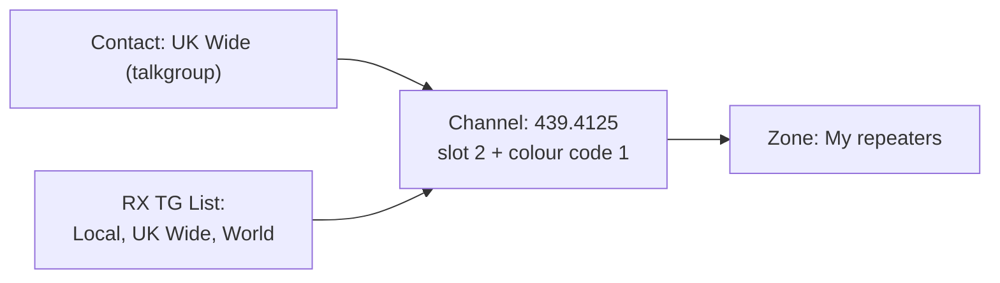
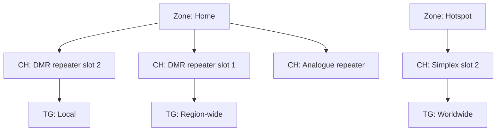
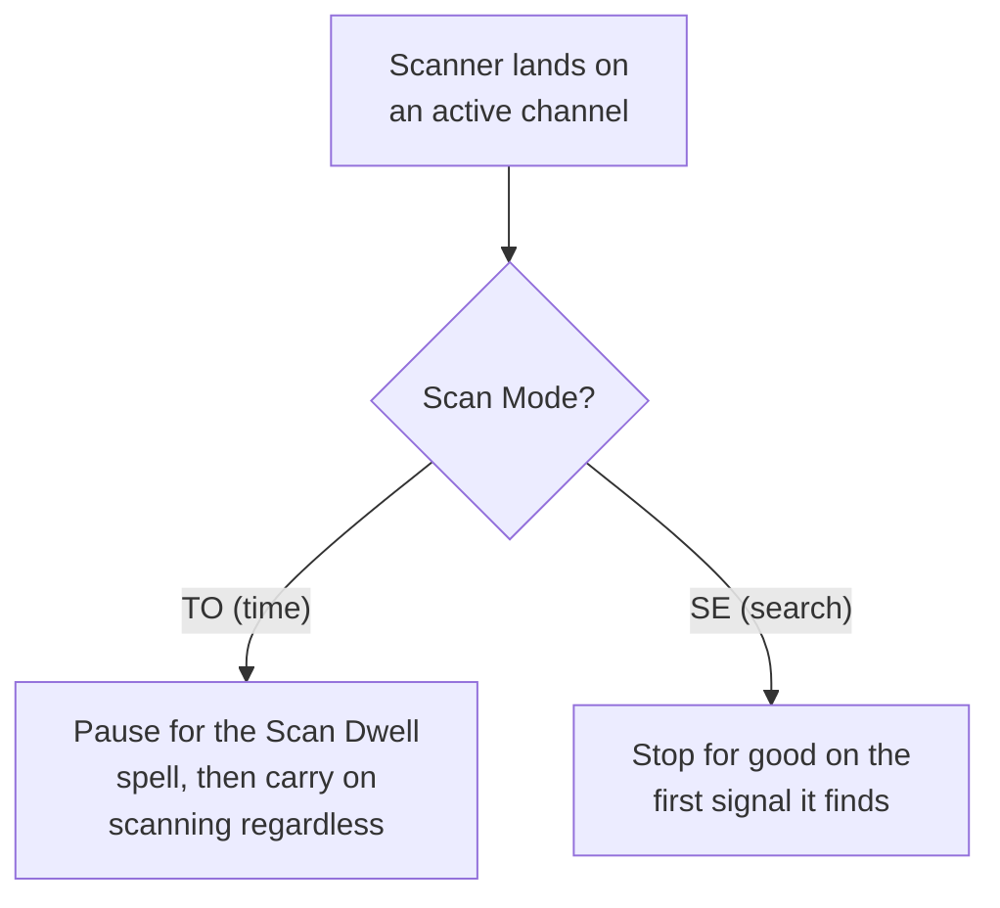

# Contacts, talkgroups, zones and scanning

Once you have a couple of DMR channels working, the next question is always the same: how do you keep dozens of them straight, and how do you make sure the right people reach your speaker? That is what this page is about — the RT-6D's address book of talkgroups and contacts, the receive lists that decide who you hear, the zones that file all those channels into tidy, purpose-built drawers, and the scanner that sweeps across them. Get these ideas clear and a radio that holds 1024 channels stops being intimidating and starts feeling like a well-organised toolbox.

None of this is deep [DMR](outpost:entry/logbook73.handbook/dmr) theory — that lives in the handbook, and we link to it as we go. Here we are concerned only with which RT-6D menus hold each piece and how they fit together. Every menu is reached the way [Getting Started](outpost:entry/logbook73.guide.rt-6d/getting-started) describes: **MENU** to open and confirm, **▲ / ▼** to move, **MENU** again to save, **↵ / EXIT** to back out.

## The digital address book — Contacts Set

A DMR **contact** is just an entry in the radio's address book that points at a number. That number is either a **talkgroup** — a shared conversation channel that many people join, explained in full in [Slots & talkgroups](outpost:entry/logbook73.handbook/dmr-slots-talkgroups) — or an individual person's **DMR ID** for a private one-to-one call. The RT-6D does not care which; both are stored the same way, as a friendly name against an ID between `1` and `16777215`.

You manage them under **Digital Setting → Contacts Set**, where you can add, edit and delete entries. Each contact needs three things: a name (so the colour screen shows "UK Wide" rather than a bare number), the ID itself, and its call type — group call or private call. In practice you will build a small library: the talkgroups you actually use, plus a handful of individual IDs for people you speak to directly.

### All Call — the one you cannot delete

Every RT-6D carries a built-in contact named **All Call** that you cannot remove. All Call is a special DMR address (ID `16777215`) that every radio listening on that slot and colour code will hear, regardless of its own talkgroup or receive list. It is the digital equivalent of a general call to anyone within earshot.

Treat it with respect. Because everyone hears it, All Call cuts across whatever conversation is already running on the slot — useful in a genuine net or emergency, antisocial as an everyday habit. On busy networks and repeaters, All Call is often discouraged or blocked outright. Leave it as the un-deletable curiosity it is, and reach for a normal talkgroup for ordinary contacts.

### Private calls and DMR IDs

To call one person directly, you store their personal DMR ID as a private-call contact. Your own ID lives separately under **Digital Setting → Personal ID** — you must have one, issued free from RadioID.net, before you transmit at all. Why that matters, and how IDs and networks such as BrandMeister fit together, is covered in [DMR networks](outpost:entry/logbook73.handbook/dmr-networks). A private call is still sent in the open; it addresses one radio rather than a group, but it is not private in the security sense — nothing you send on the amateur bands is.

## From contact to channel — how they connect

Here is the idea that unlocks everything else: a contact is not a channel. A DMR **channel** on the RT-6D is a bundle of four things — a **frequency**, a **time slot**, a **colour code**, and a **talkgroup (contact)** — the mental model from [Slots & talkgroups](outpost:entry/logbook73.handbook/dmr-slots-talkgroups). The contact is the "who"; the channel is the "who, where and how" wrapped together.

Each channel points at your address book in two places, both under **Channel Settings** (covered in full in [DMR channels](outpost:entry/logbook73.guide.rt-6d/dmr-channels)):

- **Contacts** — the **TX contact**. This is the talkgroup or ID your voice goes _to_ when you press PTT on this channel. Pick "UK Wide" here and everything you say on this channel goes to that talkgroup.
- **RX TG List** — the **receive group list** this channel listens to (more on building those next). This is the set of talkgroups you _hear_ on this channel.

So one talkgroup, stored once in Contacts Set, can be the TX contact on several different channels — one per slot, per repeater, per hotspot. You build the contact once and reuse it everywhere.

## The receive list — TG List Set

The **TX contact** decides where your voice goes; the **RX TG List** decides which talkgroups reach your speaker on a given channel. Without it, a DMR channel would only ever hear the single talkgroup you transmit on — and you would miss everything else passing through that slot.

You build these lists under **Digital Setting → TG List Set**. Open a list and you see your contacts; on the RT-6D, pressing **MENU** on a member selects it into the list, and pressing **↵** removes it again. Add the talkgroups you want this list to monitor, save, and then attach the finished list to a channel via **Channel Settings → RX TG List**.

A sensible list for a repeater channel might include your local talkgroup, a regional one and a worldwide one, so you hear activity on all three while still transmitting only to whichever talkgroup that channel is set for. This is closely tied to **Promiscuous** mode — set per DMR channel, it lets you hear _every_ talkgroup on the slot rather than only the ones on your list — and to DMR listening etiquette generally, which [DMR operating](outpost:entry/logbook73.handbook/dmr-operating) covers properly. Keep the list focused: a TG list stuffed with every talkgroup you can think of turns a quiet channel into a firehose.

## Address Book and Call Log — the RT-6D's extra pair

The RT-6D adds two conveniences the plainer sets do without, both under **Digital Setting**.

The **Address Book** is a personal phonebook: names stored against individual DMR IDs, kept separate from the talkgroup-heavy Contacts Set. It is the natural place to keep the people you private-call or send [text messages](outpost:entry/logbook73.guide.rt-6d/extras) to, so you address them by name rather than typing a nine-digit ID each time.

The **Call Log** is the radio's "last heard" list — a running record of the caller IDs the RT-6D has decoded, newest first. It is genuinely useful: hear an unfamiliar station, glance at the Call Log to see who it was, and — if you want to reply directly or keep the ID — copy it straight into a private-call contact. **Clear All Log** wipes the list when it gets cluttered. There is also **Called Hold** (`0`–`60`), which sets how long the screen holds a received call's details before it clears, giving you time to read who just came back to you.

## Zones — organising by purpose, not by band

A **zone** is simply a labelled group of channels — a drawer in the filing cabinet. The RT-6D gives you a generous **256 zones**, each able to hold up to **1024 channels**, edited under **Zone Settings (06)**, where you name a zone and choose which channels belong to it. In day-to-day use you flip between zones rather than scrolling one enormous list, and each of the radio's two working areas remembers its own zone (**Basic Settings → Area A Zone** and **Area B Zone**, each `1`–`256`).

The single most useful habit is to **organise zones by purpose, not by band**. It is tempting to make a "2 m zone" and a "70 cm zone", but that is rarely how you operate. You think in terms of _where you are_ and _what you are doing_ — at home, on the commute, at the club, on the hotspot — and a good zone plan mirrors that. A mixed zone that puts your local analogue repeater, your local DMR repeater and a couple of simplex calling channels side by side is far more useful than one split down the middle by frequency.

Because the RT-6D has a colour screen, you get one extra organising trick the mono radios lack: **Basic Settings → CH Alias Colour** paints each channel's on-screen name in one of eleven colours (Blue, Green, Red, Yellow, White and so on). Give every channel in a zone the same colour — analogue in green, DMR in blue, simplex in red — and a glance tells you what kind of channel you are on before you read a word.

### A worked zone plan

Here is a plan that suits a lot of operators. Names are yours to choose; the point is the grouping.

| Zone        | What lives in it                                                                    | Why it is grouped this way                                                                |
| ----------- | ----------------------------------------------------------------------------------- | ----------------------------------------------------------------------------------------- |
| `1 Home`    | Local analogue repeater, local DMR repeater (both slots), a simplex calling channel | Everything you reach from the house, analogue and digital together                        |
| `2 Hotspot` | Your hotspot's simplex channels, one per talkgroup you use                          | All your hotspot conversations in one drawer — see [DMR hotspots](outpost:entry/logbook73.handbook/dmr-hotspots) |
| `3 Simplex` | Analogue and DMR simplex calling frequencies                                        | Direct radio-to-radio work, no infrastructure                                             |
| `4 Travel`  | Repeaters along a regular route or a club's patch                                   | Load it before a journey; skip it the rest of the time                                    |
| `5 Monitor` | NOAA weather, PMR446/FRS, HF SSB listening spots, anything receive-only             | Listen-mostly channels kept out of the way                                                |

Notice that analogue and digital channels sit happily in the same zone — the RT-6D does not force a split. A digital channel and an analogue one can be neighbours, and switching between them is just moving up or down the list (or a tap of **Side-key 2** in VFO mode to swap analogue/digital).

Building all of this by hand on the keypad is possible but slow. The far easier route — especially once you have more than a handful of channels — is the Radtel CPS software over the USB-C cable, where you type contacts, TG lists, channels and zones on a proper keyboard and load them as one **code plug**. That workflow is explained in [Configs & code plugs](outpost:entry/logbook73.guide.rt-6d/configs) and, in general terms, in [DMR hotspots](outpost:entry/logbook73.handbook/dmr-hotspots).

## Scanning — sweeping across analogue and digital

Scanning steps automatically through a set of channels looking for activity, stopping when it finds some. On the RT-6D it works across both modes at once: an analogue repeater and a DMR channel can share a scan, and the radio decides "busy" appropriately for each.

### Choosing what gets scanned

A channel joins the scan only if you add it. Under **Channel Settings → Scan Add**, set a channel to include it or leave it out. The natural unit to scan is a zone: add the channels in a purpose-built zone, and a single scan sweeps that whole drawer. Start scanning with the function you have mapped to a side key or the Yellow key (see [Keys & side-buttons](outpost:entry/logbook73.guide.rt-6d/keys)).

### How the scanner behaves — Scan Mode

When the scanner lands on an active channel it has to decide what to do, and **Basic Settings → Scan Mode** picks the rule. The RT-6D offers two:

- **TO — time-operated.** Pause on the signal for the spell set by **Scan Dwell**, then carry on scanning whether or not the channel is still busy. Good for sampling a lot of activity without getting stuck on any one channel — the sensible everyday default.
- **SE — search.** Stop on the first active signal and stay there. Useful when you are trying to locate which channel a group is using, or when you just want the scanner to hand you one busy frequency and stop hunting.

### Tuning the sweep

Several more settings shape the scan, all in **Basic Settings**:

- **Scan Direction** — sweep up or down through the list. A matter of taste.
- **Scan Interval** — how quickly the scanner steps from one channel to the next. Faster catches more; slower gives each channel a moment longer to reveal a signal.
- **Scan Dwell** — how long the scanner lingers on an active channel in the time-operated sense before moving on. Longer dwell means you sample each active channel for longer.
- **Scan Return** — where the radio settles when you stop: `Original CH` returns to the channel you started from, `Current CH` keeps you on wherever the scan last stopped — handy when you want to answer the station the scan just found.
- **Scan Start Freq / Scan End Freq** — the lower and upper bounds when you scan a slice of a band in VFO (frequency) mode rather than a channel list. Set them to fence the scanner into, say, the 2 m calling segment.

## Dual standby — watching two areas at once

Separate from scanning, **dual standby** lets the radio keep half an ear on a second channel while sitting on your main one. The RT-6D has two working areas, **A** and **B**, shown together on the dual-VFO colour screen; turn on **Basic Settings → Dual Standby** and it alternates its receiver between them, so you can monitor, say, a local repeater in Area A and a hotspot in Area B without choosing between them.

A couple of companions matter here. **Basic Settings → TX Priority** decides which area your PTT keys when both are live — `Edit` uses the area you have selected as main, `Busy` follows whichever area is currently receiving. And **Side-key 1** can be assigned as a **Slaver PTT** (in [Keys & side-buttons](outpost:entry/logbook73.guide.rt-6d/keys)), giving you a dedicated button that transmits on the B area while the main PTT stays with A — a neat way to talk on either area without swapping which is "main". Each area's mode, on-screen readout and zone are set independently (**Area A/B Mode, Show, Zone**), so the two can be entirely different setups. Dual standby is not the same as scanning many channels — it watches exactly two — but for "keep me on the repeater but tell me if anything happens on the hotspot" it is exactly the tool.

## Try it yourself

Build one clean zone from scratch and prove the whole chain works:

1. In **Digital Setting → Contacts Set**, add one talkgroup contact — a name and its ID as a group call. Check your network's talkgroup list ([DMR networks](outpost:entry/logbook73.handbook/dmr-networks)) for the number; do not guess it.
2. In **Digital Setting → TG List Set**, make a list and press **MENU** to add that talkgroup to it. Save.
3. On a DMR channel ([DMR channels](outpost:entry/logbook73.guide.rt-6d/dmr-channels)), set **Channel Settings → Contacts** to your new talkgroup and **RX TG List** to your new list, and turn **Scan Add** on.
4. In **Zone Settings (06)**, make a zone called `Test`, put that channel in it, and give it a **CH Alias Colour** so it stands out. Switch Area A to it via **Basic Settings → Area A Zone**.
5. Set **Basic Settings → Scan Mode** to `TO`, then start a scan from your side key and watch it pause on activity for the Scan Dwell spell before moving on.

If you can talk to that talkgroup, hear it come back, and later find the caller in your **Call Log**, every link in the chain — contact, list, channel, zone, scan — is doing its job.

## Key takeaways

- A **contact** (Digital Setting → Contacts Set) is an address-book entry pointing at a talkgroup or a person's DMR ID, from `1` to `16777215`; **All Call** (`16777215`) is the built-in, un-deletable everyone-hears-it contact — use it sparingly.
- A DMR **channel** is frequency + slot + colour code + contact; **Channel Settings → Contacts** sets who you transmit _to_, **RX TG List** sets who you _hear_ — press **MENU** to add a talkgroup to a **TG List Set** list, **↵** to remove it.
- The RT-6D adds an **Address Book** (a name-and-ID phonebook for private calls and messages) and a **Call Log** (the last-heard list you can copy IDs from); **Called Hold** sets how long a received call stays on screen.
- **Zones** — 256 of them, up to 1024 channels each — are drawers you organise **by purpose, not by band**; mix analogue and digital freely, colour-code names with **CH Alias Colour**, and build them fast in the CPS.
- **Scan Add** chooses what gets scanned; **Scan Mode** offers **TO** (pause the Scan Dwell spell, then resume — the everyday default) and **SE** (stop on the first signal); **Direction/Interval/Dwell/Return** and **Start/End Freq** fine-tune the sweep.
- **Dual Standby** watches exactly two areas (A and B) at once; **TX Priority** and a **Slaver PTT** side key decide which one you transmit on.
- **Promiscuous** mode and **Encryption** are matters for the channel, not the address book — encryption stays **off** on the amateur bands; listening etiquette lives in [DMR operating](outpost:entry/logbook73.handbook/dmr-operating).

With your channels, contacts and zones organised, the RT-6D Pro's headline extras come next — the built-in GPS, position beacons and APRS digipeater in [GPS & APRS](outpost:entry/logbook73.guide.rt-6d/gps-aprs).
