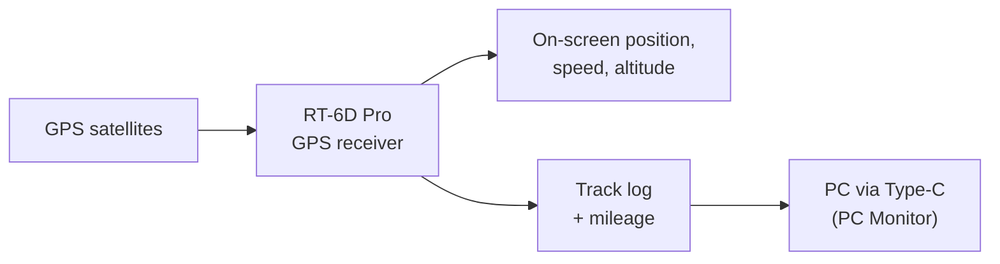

# GPS and APRS (RT-6D Pro)

Tucked away at the bottom of the menu, past all the DMR machinery, the RT-6D Pro hides a complete little location station: a satellite receiver that always knows where it is, and an APRS beacon that can put you on a live map anyone in the world can open. These are the features that separate the **Pro** from the plain RT-6D — and they are the reason a modest handheld can leave a breadcrumb trail across a hillside walk. This page explains what each setting does on _this_ radio, and links out to the handbook for the deeper theory of how position reporting actually works.

> **RT-6D Pro only.** Everything on this page — the whole GPS menu (`09 Extend / GPS`) and the entire APRS menu — exists **only on the RT-6D Pro**. The standard RT-6D has neither the GPS module nor the APRS engine, so if these menus are missing, you have the non-Pro radio and nothing here applies. The DMR chapters ([DMR channels](outpost:entry/logbook73.guide.rt-6d/dmr-channels), [getting on DMR](outpost:entry/logbook73.guide.rt-6d/dmr-getting-on)) cover both models.

## The GPS receiver — where the radio thinks it is

Global positioning works by listening: a receiver picks up faint timing signals from a constellation of satellites overhead and, from the tiny differences in when each one arrives, works out its own latitude, longitude, altitude and the exact time. The RT-6D Pro has one of these receivers built in, and once it is switched on and has a clear view of the sky, the radio always knows where it is. That single fact feeds everything else — the beacon you send, the distance-and-bearing read-outs, and the track it logs as you move.

### Turning GPS on

`GPS On-off` is the master switch for the satellite receiver. Off, the module is powered down and the radio is an ordinary handheld that has no idea where it is; on, it starts hunting for satellites. A cold radio indoors can take a few minutes to find its first fix — give it a clear view of the sky, ideally outdoors, and wait for the position read-out to settle. Leaving GPS on costs a little battery, so switch it off when you are not beaconing or logging a track.

Because you will not want to dig into the menu every time, the RT-6D Pro lets you put GPS on a **programmable key**. In [Key Define](outpost:entry/logbook73.guide.rt-6d/keys) you can assign `GPS`, `GPS Manual Rec` (drop a track point on demand), `Query GPS Track` (review a logged track) or `APRS Beacon` (fire a beacon now) to a side key, the yellow key or a long-pressed number — so the whole location toolkit is a single press away.

### Coordinate type, time zone and units — display comfort only

The next cluster of settings changes only _how position data is shown to you_ on the colour screen. None of them alter what you transmit — APRS always sends position in its own standard format on the air — so set them once to taste and forget them.

| Setting           | Values                          | What it controls                          |
| ----------------- | ------------------------------- | ----------------------------------------- |
| `Coordinate Type` | Degrees / Deg-Min / Deg-Min-Sec | How latitude and longitude read on screen |
| `UTC Zone`        | offset from UTC                 | Shifts the GPS clock to your local time   |
| `Speed Unit`      | (per the unit menu)             | Units for the speed read-out              |
| `Distance Unit`   | (per the unit menu)             | Units for distance-to-station             |
| `Altitude Unit`   | metre / foot                    | Units for the altitude read-out           |

A word on the clock: satellites broadcast time in **UTC** (Coordinated Universal Time, the global reference), and `UTC Zone` only offsets what _you_ see. In the UK that means UTC+0 in winter and UTC+1 for British Summer Time — but network timestamps stay in UTC regardless, so this is purely for your own convenience. `Coordinate Type` of Degrees+Minutes matches the way most APRS tools and paper maps quote positions, which makes it the easy default.

### Fixed versus mobile — a base station types its position in

There are two ways the radio can know where it is. A **mobile** station reads its live GPS fix and moves with you. A **fixed** station — a home base that never moves — can instead have its position typed in by hand, which is more accurate than a wandering satellite fix and lets you leave the power-hungry GPS module off entirely. The `Fixed Lat`, `Fixed Lon` and `Fixed Alt` fields store those hand-entered coordinates.

The easy way to fill them is to let the radio get a good fix _at_ the location, read the numbers off the screen, then type them into the fixed fields. Watch the **N/S** and **W/E** hemisphere carefully — the UK is north latitude and (mostly) west longitude, and a wrong hemisphere throws your dot to the other side of the planet. Which of these two sources the beacon actually uses is set later, by APRS `Station Mode`.

### Track logging and mileage

Beyond feeding the beacon, the RT-6D Pro can quietly log where it has been. `GPS Auto Record` switches on automatic logging, and `GPS Record Time` sets the interval between logged points — a shorter interval draws a finer trail but fills the memory faster. `Manual record` (also the `GPS Manual Rec` key function) drops a single point exactly when you press it, handy for marking a summit, a gate or a car park. `Query Track` plays back what you have logged, and `Clear Track` wipes it to start fresh.

Alongside the track, the radio keeps a running **mileage** total: `Mileage` shows the accumulated distance travelled, `Mileage Type` selects how it is counted, and `Clear Mileage` resets it — useful at the start of a walk or a drive so the figure means something.

### Getting the track onto a computer

Two settings bridge the radio to a PC. `PC Monitor` streams the live GPS data (the standard sentences the receiver produces) out of the Type-C jack so mapping software on a computer can read your position in real time. `GPS Baudrate` sets the serial speed for that link — the number the PC software must be told to expect; if the computer sees nothing, a baud-rate mismatch is the first thing to check. This is how a logged track becomes a map you can keep, share or overlay on a plan of where you have been.

## APRS on the RT-6D Pro

[APRS](outpost:entry/logbook73.handbook/aprs) — the Automatic Packet Reporting System — is a way for radios to broadcast short data bursts, most often "here is my callsign and where I am", which a volunteer network of relay stations carries onward until an internet-connected station (an **I-gate**) posts them to a public map such as `aprs.fi`. On the RT-6D Pro the GPS you just set up becomes the source of position, and the radio's packet modem turns that position into the warbling tones that go out over FM. The deep theory of packets, paths and I-gates lives in the handbook — read [APRS](outpost:entry/logbook73.handbook/aprs) first — and this section covers the buttons on _this_ radio.

Here is the journey a single beacon takes, and where each menu fits:

### The one number that matters most — 144.800, not 144.390

Before anything else, the frequency. **In Europe, the UK and the rest of ITU Region 1, the APRS calling channel is `144.800 MHz` FM.** In North America it is `144.390 MHz`. These are different frequencies, and a great many newcomers copy a US tutorial, set `144.390`, and then wonder why they never appear on the map — they are beaconing on an empty channel nobody near them is listening to. Set `APRS TX CH` and `APRS RX CH` to the correct frequency **for your region**, and always check your national band plan, because the channel and the accepted digipeater paths both vary by country. When in doubt in Region 1, it is `144.800`.

### The master switch and Station Mode

`APRS On-off` enables the whole APRS engine — the modem, the beacon timer and the digipeater — as a group. Off, the radio is a plain voice handheld; on, it listens for and decodes packets and will beacon when one is due.

`Station Mode` is the setting that ties APRS back to the GPS menu. It has two choices:

- **GPS mobile** — each beacon reads the live GPS fix, so your dot tracks you as you move. This is what you want for any portable or mobile use.
- **Fixed coords** — each beacon uses the hand-entered `Fixed Lat/Lon/Alt` from the GPS menu and ignores the satellites. This is for a stationary base, and lets you leave GPS off to save power.

Leaving Station Mode on "Fixed coords" while out walking is a classic mistake — every beacon then plots you back at home. Match it to whether the station actually moves.

### Beacon Setup and Beacon Mode

`Beacon Setup` is where the packet you send is assembled — most importantly your **callsign**, which is mandatory. APRS is amateur radio, so every packet must be identified by _your_ issued callsign (an `M7`, `2E0` or `M0` in the UK; your own national call elsewhere); there is no anonymous or "test" mode that is legal to transmit. Beacon Setup is also where you set your **SSID** (the `-7` that conventionally marks a handheld, `-9` a vehicle), your map **symbol**, and the **digipeater path** — the request, written into the packet, asking the network how far to relay you. The community-standard path for a portable or mobile station is two hops, `WIDE1-1,WIDE2-1`, which is polite and effective; asking for more just clogs the shared channel. All of this — SSIDs, symbols, why two hops — is explained fully in [APRS](outpost:entry/logbook73.handbook/aprs), so set it there and enter the values here.

`Beacon Mode` governs _when_ beacons go out — whether you fire them by hand (with the `APRS Beacon` key), on a fixed timer, or automatically as you move. A sensible rule for a shared channel is to beacon no more often than you need: a walker every few minutes, a fast-moving vehicle a little more often. You can always send an extra beacon on demand with the assigned key.

### DIGI Setup — should you relay other people?

`DIGI Setup` turns the RT-6D Pro into a **digipeater** — a station that hears someone else's packet and rebroadcasts it to extend their range. From a fixed station with a good antenna and a clear takeoff this genuinely helps local coverage, but a badly placed or battery-powered digi just adds collisions to the channel. For almost everyone the honest answer is to **leave the digipeater off**; run one only as a deliberate, fixed, well-sited fill-in station, never casually from a handheld in a rucksack. The etiquette of digipeating is covered in [APRS](outpost:entry/logbook73.handbook/aprs).

### The supporting settings

The rest of the APRS menu is timing, alerts and housekeeping:

| Setting                           | What it does                                                           |
| --------------------------------- | ---------------------------------------------------------------------- |
| `APRS RX CH` / `APRS TX CH`       | The receive and transmit channels — set both to `144.800` in Region 1  |
| `Demod Tone`                      | The modem's tone decoding for incoming packets                         |
| `TX/RX Data Upload`               | Streams packet data to a PC over Type-C                                |
| `Beacon Pop-up`                   | Shows a received station's details on screen as packets arrive         |
| `PTT Priority`                    | Lets a voice PTT press take priority over the APRS beacon              |
| `PTT Delay`                       | The pause around PTT so voice and beacon do not collide                |
| `RX CH Mute`                      | Silences the APRS channel's audio so you do not hear the packet warble |
| `Beacon List` / `Beacon List CLR` | The list of stations you have heard, and a command to wipe it          |
| `Beacon Save`                     | Stores your beacon configuration                                       |
| `APRS Init`                       | Resets **only** the APRS settings to defaults                          |

Two of these are worth a note. `RX CH Mute` is a comfort setting — APRS packets sound like a harsh two-tone screech, and muting the APRS channel spares your ears while the radio still decodes silently. `PTT Priority` and `PTT Delay` matter when you run APRS and voice at the same time: they make sure pressing PTT to talk does not get tangled with a beacon trying to go out at the same instant. And remember `Beacon Pop-up`, with GPS on, turns the radio into a little "who is around me" display — each received station appears with its distance and bearing from you, which is genuinely good fun on the move.

## Try it yourself — set up a GPS beacon

Here is a start-to-finish run at putting yourself on the map, using only settings from this page. Do it outdoors with a clear view of the sky.

1. **Fix your position.** In `09 Extend / GPS`, set `GPS On-off` to on. Step outside and wait for the position read-out to settle — the first fix from cold can take a few minutes.
2. **Set the channel.** Set both `APRS RX CH` and `APRS TX CH` to **`144.800 MHz`** (Region 1) — _not_ `144.390`, which is North America only.
3. **Enter your identity.** In `Beacon Setup`, type your **own callsign** and pick an SSID — `-7` for a handheld. Choose a walker symbol and leave the path at the standard two-hop `WIDE1-1,WIDE2-1`. (The what-and-why of these is in [APRS](outpost:entry/logbook73.handbook/aprs).)
4. **Choose the position source.** Set `Station Mode` to **GPS mobile** so each beacon carries your live position.
5. **Go live.** Set `APRS On-off` to on, and either let `Beacon Mode` beacon on its timer or press your assigned `APRS Beacon` key to send one now.
6. **Check the map.** On a phone or computer, open `aprs.fi` and search your callsign-SSID (for example `M7ABC-7`). If a network station heard you, your dot appears. Nothing showing? Confirm the frequency is `144.800`, that you have a real GPS fix, and that you are somewhere a digipeater can hear you.

Keep the power modest, the path to two hops, and beacon no more often than you need — that is all it takes to be a good citizen of a busy shared channel.

## Key takeaways

- **GPS and APRS are RT-6D Pro only** — the standard RT-6D has neither menu, so if they are missing you have the non-Pro radio.
- **GPS** feeds everything: turn it on for any portable use, or type a `Fixed Lat/Lon/Alt` for a base and leave the module off; the coordinate, time-zone and unit settings only change the display, never what you transmit.
- The radio can **log a track and count mileage**, replay it with `Query Track`, and stream live position to a PC via `PC Monitor` (match `GPS Baudrate` at both ends).
- **In Region 1 (Europe/UK) APRS is `144.800 MHz` FM — not the US `144.390`** — and both frequency and paths vary by country, so check your national band plan.
- **`Station Mode = GPS mobile`** for anything that moves, **Fixed coords** only for a base; a mismatched mode plots you in the wrong place.
- **Your own callsign is mandatory** in `Beacon Setup`, the two-hop `WIDE1-1,WIDE2-1` path is the polite default, and the digipeater in `DIGI Setup` should stay **off** for everyone but a fixed, well-sited station — the deep theory is all in [APRS](outpost:entry/logbook73.handbook/aprs).

With the Pro's location features covered, the last stop is the odds and ends that round out the radio — the FM broadcast receiver, SMS, alarms and the rest: [Extras & odds and ends](outpost:entry/logbook73.guide.rt-6d/extras).
