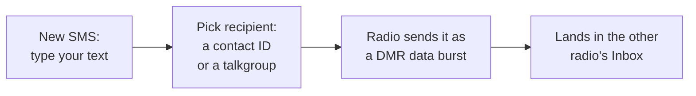
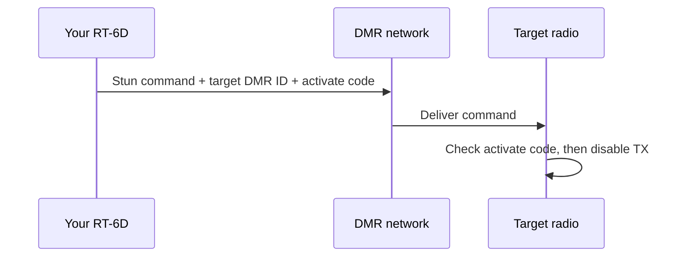
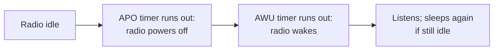

# SMS, NOAA, FM radio, spectrum and safety

Every radio hides a drawer of odds and ends that never fit the daily menus, and the RT-6D's drawer is fuller than most: it can send text messages over DMR, receive weather broadcasts and ordinary FM radio, paint a little picture of what's on the band, and — more soberingly — reach out and disable another radio across the air. This page walks that drawer. Two of these features are **digital-only** (they need a DMR channel to work); the rest run whatever mode you are in. And unlike the GPS and APRS covered in [GPS & APRS](outpost:entry/logbook73.guide.rt-6d/gps-aprs), every feature here lives on **both** the RT-6D and the RT-6D Pro.

Each feature carries the same one-glance verdict used throughout this guide: ✅ set it and forget it · ⭐ genuinely useful, depends how you operate · ⚠️ advanced, understand it first · ❌ leave it off. Reach any menu with the usual **MENU → move → MENU → Exit** dance from [Getting Started](outpost:entry/logbook73.guide.rt-6d/getting-started), and assign the key-triggered ones (Spectrum, NOAA, FM radio, the remote functions) from the [Keys & Buttons](outpost:entry/logbook73.guide.rt-6d/keys) menu.

## Text messages over DMR — the Message menu ⭐

DMR is a data protocol as much as a voice one, and one thing it carries neatly is short text. The **Message** menu (`Message`, menu group 07) is a small SMS client: `New SMS` to compose, `Inbox` / `Outbox` / `Drafts` to read and manage, `Default SMS` for a canned message you send often, and `Clear All SMS` to wipe the lot.

This is **digital-only**. SMS rides on DMR's data channel — the same time-sliced digital stream that carries your voice, explained in [DMR slots & talkgroups](outpost:entry/logbook73.handbook/dmr-slots-talkgroups) — so it only works on a DMR channel, never on an analogue one. You compose with the keypad the phone way (press `2` for a/b/c, and so on), pick a recipient, and the radio sends the text as a data burst instead of audio.

Who receives it depends on how you address it. Send to an individual **DMR ID** from your [Address Book](outpost:entry/logbook73.guide.rt-6d/contacts-zones) and it reaches that one radio (if it is on the network and listening on the right talkgroup). Send to a **talkgroup** and every radio monitoring that talkgroup gets it. Through a [hotspot or repeater onto a network](outpost:entry/logbook73.handbook/dmr-networks) like BrandMeister, a text can travel the same routes your voice does — handy for passing a callsign, a frequency, or a locator that would be fiddly to read out phonetically.

Two format switches control who can actually read what you send.

### SMS Format — Default vs Moto ⭐

`SMS Format` chooses how the message is packaged: `Default` (Radtel's own encoding, best between these radios and across most amateur DMR networks) or `Moto` (the Motorola TMS text-message format). Set `Moto` only when you specifically need to exchange texts with Motorola commercial handhelds that expect that format; for talking to other hobby DMR radios and network services, leave it on `Default`. Mismatch it and your messages arrive as gibberish or not at all, so match whatever the person on the other end is running.

### SMS Font — Unicode vs GBK ✅

`SMS Font` picks the character set: `Unicode` (the international standard that covers the Latin alphabet, accents and most of the world's scripts) or `GBK` (a Chinese character encoding). For English and other Latin-script text, ✅ leave it on **Unicode** — it is the safe, universally-understood choice. Only switch to `GBK` if you are deliberately exchanging Chinese-language messages with radios set the same way.

## NOAA weather channels — a North-American receiver ⭐ where it applies

Assign `NOAA CH` to a key (via [Keys & Buttons](outpost:entry/logbook73.guide.rt-6d/keys)) and the radio jumps to a preset list of the **NOAA Weather Radio** channels — the continuous public-service weather broadcasts run in the United States and Canada on seven VHF frequencies around `162 MHz`. These carry rolling forecasts and, importantly, automatic severe-weather and hazard alerts.

Be honest with yourself about geography here. This is a **receive-only** convenience aimed squarely at North America: outside the US and Canada those `162 MHz` channels are silent or used for something else entirely, so the feature simply finds nothing. If you operate in North America it is a genuinely useful safety extra — a storm warning on a pocket radio when you are out in the field. Everywhere else, treat it as a curiosity and get your weather from your own national service instead. Either way it has nothing to do with amateur transmitting; you are just listening to a broadcast, well within anyone's [licence conditions](outpost:entry/logbook73.handbook/getting-licensed).

## FM broadcast radio — the everyday extra ⭐

The RT-6D will tune ordinary **FM broadcast radio** — the music-and-talk stations you know from a car — through the `FM Radio` menu (group 08). Its receiver reaches from `64` to `108 MHz`, which spans the world's various broadcast allocations: the `87.5–108 MHz` band used across most of the world, the lower `64–74 MHz` OIRT band still found in parts of Eastern Europe, and everything between. Broadcast-band edges differ by region, so tune to what your country actually uses.

Inside the menu, `CH List` holds up to **16 FM presets** you can store your favourite stations in, and `RX Standby` decides whether the radio keeps half an ear on your amateur channel while the broadcast plays — a form of dual-watch, so a call on your monitored frequency can interrupt the music. ⭐ Leave `RX Standby` **on** if you want to stay reachable while you listen; turn it off for undisturbed listening when you are off-duty.

It is exactly what it sounds like — a bonus broadcast receiver — but two small caveats. Listening still drains the battery, and the FM section shares the front end, so a strong nearby transmitter (yours or someone else's) can break through. As a way to fill quiet time on a SOTA summit or in the car park before a net, it earns its place.

## The Spectrum scope — a pocket band-scope ⚠️ analogue only

Assign `Spectrum` to a key and the RT-6D turns its display into a simple **band scope**: a sweep across a span of frequencies centred on where you are tuned, with taller bars where it hears activity. It is the handheld cousin of the panadapter on a big radio — a way to _see_ the band rather than hunt across it channel by channel.

Set your expectations to match the price of the radio. This is a slow, coarse **swept** scope: the receiver hops across the span one step at a time and draws what it found, so it catches steady carriers well but can miss brief, bursty signals between sweeps. It is **analogue-only** — a tool for the FM/AM world, not for reading DMR traffic — and it is nothing like the real-time spectrum display of an SDR. What it is _good_ for is a quick "is anything happening near here?" glance: finding which local simplex frequency a group has drifted to, spotting an active repeater output, or seeing whether a channel you are about to use is already busy. Treat it as a pointer, then tune to the interesting bar and listen properly.

## The remote-control family — Stun, Kill, Wake and Remote Monitor ⚠️

This is the corner of the menu to understand _before_ you go near it. DMR carries not just voice and text but **commands**, and the RT-6D can send four of them to another DMR radio by its individual **DMR ID**:

| Command          | What it does to the target radio                                                       |
| ---------------- | -------------------------------------------------------------------------------------- |
| `Remote Stun`    | Disables its **transmit** — it can still receive, but cannot key up                    |
| `Remote Kill`    | Disables the radio **entirely** until revived                                          |
| `Remote Wakeup`  | **Revives** a stunned or killed radio, restoring it                                    |
| `Remote Monitor` | Forces the target to **key up and transmit its microphone audio** — a covert listen-in |

These are **digital-only** and built on DMR's individual-call and control signalling. They are fleet-management tools straight from the commercial world these radios are derived from: a dispatcher disables a lost or stolen handheld, or a supervisor checks on a worker who has gone quiet. On the amateur bands they range from _rarely appropriate_ to _plainly not on_ — reaching out to disable another operator's radio, or to make it transmit without their knowledge, is not something you do to a fellow amateur.

### Set your activate code first — a warning

Every one of these commands is gated by an **activate code** (and the radio's `DTMF Control` must be enabled for the signalling to work — see the [Analogue & SSB](outpost:entry/logbook73.guide.rt-6d/analog-ssb) settings). The code is the whole security model: a radio only obeys a Stun, Kill or Monitor that carries the code it expects.

The blunt lesson is that this cuts both ways. **If you leave your activate code at a default or unset value, another operator who knows it can stun, kill or covertly monitor _your_ radio.** So even if you never intend to send one of these commands, set a private activate code on your own radio as a matter of basic hygiene. If you _do_ keep the feature available, treat the transmitting ones with the same care as any deliberate control operation: only within your [licence conditions](outpost:entry/logbook73.handbook/dmr-operating), only with consent, and never as a prank. Note too the related `Alarm Type` (`Local` / `Remote` / `Local+Remote`) in the basic settings, which decides whether the [alarm button](outpost:entry/logbook73.guide.rt-6d/keys) alerts only locally or also sends a signal on the air. The safest posture for most operators: set a strong activate code, then leave these functions unassigned.

## Time Manage — auto power-off and auto wake ✅

Two paired settings in `Basic Settings` look after the battery while you are not touching the radio. `APO` (automatic power-off) with its `APO Timer` shuts the radio down after a chosen spell of inactivity — the classic "left it on in the bag" saver. `AWU` (automatic wake-up) with its `AWU Timer` does the opposite, bringing the radio back to life on a timer so it can listen again.

The manual is terse about these, so treat the pairing as a **battery-stretching sleep/wake cycle** rather than a precise wall-clock alarm. Used together they let a radio doze through long quiet spells and rouse itself periodically to check for activity, which can add hours to a charge on a monitoring watch. ✅ A modest `APO` (say, after a couple of hours idle) is sensible insurance against a flat battery; whether you want `AWU` on depends on whether you would rather the radio wake itself or stay off until you switch it on. (A true time-of-day clock on this radio comes from the GPS receiver's `UTC Zone` on the Pro — see [GPS & APRS](outpost:entry/logbook73.guide.rt-6d/gps-aprs).)

## Try it yourself

Pick the harmless ones and get a feel for the drawer:

1. **Send yourself a text.** If you have two DMR radios, put both on the same simplex DMR channel, `Message → New SMS`, address it to the other radio's DMR ID, and send. Watch it land in the `Inbox`. No radio to hand? Read how the same text would route across [a DMR network](outpost:entry/logbook73.handbook/dmr-networks).
2. **Store an FM preset.** Open `FM Radio`, tune a local station, and save it into the `CH List`. Toggle `RX Standby` and notice whether a call on your amateur channel breaks through.
3. **Watch the band.** Assign `Spectrum` to the [yellow key](outpost:entry/logbook73.guide.rt-6d/keys), point the radio at a busy 2 m segment, and see the bars rise where the repeaters and simplex calls live.
4. **Lock your radio down.** Set a private activate code so nobody can stun, kill or monitor your RT-6D — then leave the remote functions unassigned.

## Key takeaways

- **DMR SMS** (the `Message` menu) is text over the digital channel — **digital-only**; address it to a DMR ID or a talkgroup, keep `SMS Format` on `Default` (use `Moto` only for Motorola radios) and `SMS Font` on `Unicode` for Latin text.
- **NOAA weather** is a receive-only key function for the North-American `162 MHz` weather service; genuinely useful there, silent everywhere else.
- **FM broadcast radio** is a bonus receiver from `64–108 MHz` with 16 presets; leave `RX Standby` on to stay reachable while you listen.
- The **Spectrum** scope is an analogue-only, slow swept band-scope — a good "is anything happening near here?" pointer, not an SDR panadapter.
- **Stun, Kill, Wake and Remote Monitor** are digital fleet-management commands that are rarely appropriate on ham; whatever you do, **set your own activate code** so nobody can turn them on _you_, and keep any transmitting use within your [licence and DMR etiquette](outpost:entry/logbook73.handbook/dmr-operating).
- **Time Manage** (`APO` + `AWU`) is a sleep/wake battery-saver — a modest auto power-off is cheap insurance against a flat battery.

Nearly every feature here is triggered by a button, so the natural next stop is learning which button does what — head to [Keys & Buttons](outpost:entry/logbook73.guide.rt-6d/keys) to map the side keys, the yellow key and the long-press shortcuts to the functions you actually use.
