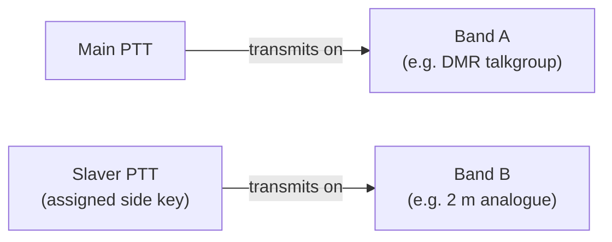
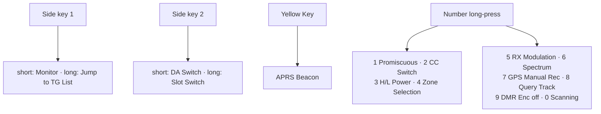

# Programmable keys and side-key functions

A DMR handheld carries more functions than it has buttons, and the RT-6D's answer is to let you decide what most of those buttons do. Get the layout right and the everyday jobs — open the squelch, jump to your talkgroup list, flip a time slot, send an APRS beacon — become a single press instead of a dive into the menus. This page maps every key that can be reprogrammed, lists the whole assignable-function menu, and suggests a layout that suits someone running DMR with GPS and APRS.

The **Key Define** menu (group `02`) is where all of this lives. Reach it as you would any menu — press **MENU**, turn the channel knob (or use **▲ / ▼**) to move, **MENU** again to open a slot, pick a function, **MENU** to save, **↵/EXIT** to back out — exactly the pattern covered in [Getting Started](outpost:entry/logbook73.guide.rt-6d/getting-started).

## Which keys you can reprogram, and which you can't

Not every button is up for grabs. Some are fixed because the radio would be unusable otherwise — you cannot reassign **PTT** (it always transmits on the main band), the **channel/menu knob**, the **volume/power knob**, or the core navigation keys **MENU**, **A/B**, **VFO/MR** and **↵/EXIT**. The dedicated **Alarm** button and the **#/DTMF** and **\*** keys also keep their built-in jobs (though a long-press of **\*** locks the keypad, and a long-press of **#** lets you key in a transmit frequency).

What you _can_ shape is a set of six slots in **Key Define**, and the humble number pad. Each side key offers a **short** press and a **long** press as separate assignments, so the two physical side keys give you four actions between them.

| Key Define slot                 | Physical key                 | Factory default                        |
| ------------------------------- | ---------------------------- | -------------------------------------- |
| `Slaver PTT`                    | nominated secondary PTT      | keys the **B** band (dual-watch PTT)   |
| `Side key 1 S` / `Side key 1 L` | upper side key, short / long | short = **Monitor** (open squelch)     |
| `Side key 2 S` / `Side key 2 L` | lower side key, short / long | short = analogue/digital switch in VFO |
| `Yellow Key`                    | the yellow front button      | customisable (varies by batch)         |
| `0-9 Long`                      | long-press each number key   | ten more assignable actions            |

That last row is the hidden treasure. A **long-press** of any digit `0`–`9` can carry its own function, while a short press still types the digit for frequency entry, DTMF and text. Ten programmable actions sit under your thumb without adding a single button — this is where a busy DMR operator parks the things they reach for most.

### Slaver PTT — the second push-to-talk

The RT-6D shows two channels at once (region **A** and region **B**), and `Slaver PTT` designates a key as the **transmit button for the B band** while the main PTT stays wedded to A. It turns true dual-watch into dual-_operating_: monitor a DMR talkgroup on A and a local analogue simplex frequency on B, and answer whichever calls without swapping which band is "main".

Leave it on the default side key if you regularly work two bands at once; if you only ever use one channel at a time, free that key for something else.

## The assignable-function list

Every slot above draws from the same menu of functions. There are a lot, so the table groups them and gives the one-glance verdict used throughout these guides: ✅ great on a key · ⭐ genuinely useful, depends how you operate · ⚠️ advanced, understand it first · ❌ rarely worth a key. `None` clears a slot.

### Everyday operating

| Function                          | What pressing it does                                                 | On a key? |
| --------------------------------- | --------------------------------------------------------------------- | --------- |
| `Monitor`                         | forces the squelch open so you can hear a weak signal                 | ✅        |
| `H/L Power`                       | toggles transmit power High ↔ Low                                     | ⭐        |
| `SQ`                              | steps the squelch level up/down by ear                                | ⭐        |
| `Scanning`                        | starts/stops the channel or frequency scan                            | ⭐        |
| `Zone Selection`                  | jumps between your memory zones                                       | ⭐        |
| `DA Switch (VFO)`                 | switches the VFO between analogue and digital                         | ⭐        |
| `Talk around`                     | transmits on the repeater's output (simplex) to work a station direct | ⭐        |
| `Save CH`                         | stores the current VFO settings to a memory channel                   | ⭐        |
| `Freq Step`                       | changes the tuning step                                               | ✅        |
| `Brightness` / `Backlight on/off` | screen brightness / kills the backlight                               | ✅        |
| `Dual standby`                    | toggles watching both A and B                                         | ⭐        |
| `Tx priority`                     | Edit vs Busy transmit priority                                        | ⚠️        |
| `FM radio`                        | opens the broadcast FM receiver                                       | ✅        |
| `VOX`                             | voice-activated transmit on/off                                       | ❌        |
| `Roger Beep`                      | the end-of-over beep on/off                                           | ❌        |

### Analogue and monitoring extras

| Function           | What pressing it does                                       | On a key? |
| ------------------ | ----------------------------------------------------------- | --------- |
| `RX Modulation`    | cycles the analogue receive demodulator **FM / AM / SSB**   | ⭐        |
| `Spectrum`         | opens the analogue spectrum scope (a band-activity display) | ⭐        |
| `Send Single Tone` | sends the `1750 Hz` repeater tone burst                     | ⭐        |
| `CTC/DCS scan`     | scans to identify an incoming sub-tone                      | ⭐        |
| `NOAA CH`          | jumps to the NOAA weather channels (where broadcast)        | ⭐        |

`RX Modulation` on a key is the quick route to the RT-6D's SSB receive — handy for tuning HF on an external antenna, with the cheap-front-end caveats in [Analogue & SSB Receive](outpost:entry/logbook73.guide.rt-6d/analog-ssb). `Spectrum` gives you a fast look at what is busy nearby without leaving your channel.

### DMR functions

| Function                       | What pressing it does                                        | On a key? |
| ------------------------------ | ------------------------------------------------------------ | --------- |
| `Slot Switch`                  | flips the DMR time slot 1 ↔ 2                                | ⭐        |
| `CC Switch`                    | steps the colour code                                        | ⭐        |
| `Jump to TG List`              | opens your talkgroup receive list to pick one                | ⭐        |
| `Promiscuous`                  | toggles hearing **all** talkgroups on the slot vs only yours | ⭐        |
| `DMR Enc off`                  | forces DMR encryption off                                    | ⭐        |
| `Dual Slot On-off`             | toggles DCDM dual-slot mode                                  | ⚠️        |
| `New SMS` / `Jump to SMS Menu` | start a text message / open the messaging menu               | ⭐        |

These are the reason the number-pad long-presses exist. A DMR channel is a bundle of frequency, [time slot, colour code and talkgroup](outpost:entry/logbook73.handbook/dmr-slots-talkgroups), and being able to nudge the slot, colour code or talkgroup from a key — rather than editing the channel — is how you chase a net that has moved. `Promiscuous` is a monitoring superpower explained in [DMR Operating](outpost:entry/logbook73.handbook/dmr-operating): off, you hear only your set talkgroup; on, you hear every conversation passing through that slot. `DMR Enc off` deserves a key of its own precisely because [encryption is generally not permitted on the amateur bands](outpost:entry/logbook73.handbook/dmr-operating) — a one-press "make sure I'm in the clear" is cheap insurance.

### GPS and APRS (RT-6D Pro)

| Function          | What pressing it does             | On a key? |
| ----------------- | --------------------------------- | --------- |
| `GPS`             | turns the GPS receiver on/off     | ✅        |
| `APRS Beacon`     | sends an APRS position beacon now | ⭐        |
| `GPS Manual Rec`  | drops a track point on demand     | ⭐        |
| `Query GPS Track` | reviews your recorded track       | ⭐        |

These only appear on the **Pro**, which carries the GPS and APRS hardware; the plain RT-6D omits them. How the beacon and track logging actually work is in [GPS & APRS](outpost:entry/logbook73.guide.rt-6d/gps-aprs) — remember that in Europe and the UK the APRS channel is `144.800 MHz`, not the US `144.390`.

### Remote and admin — advanced

| Function                          | What pressing it does                        | On a key? |
| --------------------------------- | -------------------------------------------- | --------- |
| `Remote Monitor`                  | remotely opens another radio's microphone    | ⚠️        |
| `Remote Stun` / `Kill` / `wakeup` | disables, kills or re-enables a target radio | ⚠️        |
| `Online check`                    | pings a radio to see if it is reachable      | ⚠️        |
| `Alarm`                           | raises the emergency alarm                   | ⚠️        |

The remote functions are real DMR features aimed at fleet management: `Stun`/`Kill` can disable a lost or stolen radio, and `Remote Monitor` opens a distant microphone. They only work against radios you control, need `DTMF Control` enabled and an activate code set first, and firing them at anyone else is both antisocial and outside your [licence conditions](outpost:entry/logbook73.handbook/getting-licensed). Most amateurs never assign them. `Alarm` already has its own dedicated button, so you rarely need to duplicate it.

## A layout for a DMR + GPS/APRS operator

Here is a sensible starting point. Nothing is sacred — remap to taste — but this puts the DMR essentials and the Pro's location features one press away while keeping the side keys close to their familiar defaults.

| Key                | Assignment        | Why                                                        |
| ------------------ | ----------------- | ---------------------------------------------------------- |
| Side key 1 — short | `Monitor`         | open the squelch to check a weak signal (keep the default) |
| Side key 1 — long  | `Jump to TG List` | change talkgroup without editing the channel               |
| Side key 2 — short | `DA Switch (VFO)` | flip analogue ↔ digital in the VFO (near-default)          |
| Side key 2 — long  | `Slot Switch`     | chase a net onto the other time slot                       |
| Yellow Key         | `APRS Beacon`     | send your position on demand                               |
| `1` long           | `Promiscuous`     | toggle monitoring all talkgroups                           |
| `2` long           | `CC Switch`       | step the colour code when it will not decode               |
| `3` long           | `H/L Power`       | drop to Low for local work                                 |
| `4` long           | `Zone Selection`  | hop between your DMR and analogue zones                    |
| `5` long           | `RX Modulation`   | reach SSB/AM receive quickly                               |
| `6` long           | `Spectrum`        | glance at band activity                                    |
| `7` long           | `GPS Manual Rec`  | mark a track point                                         |
| `8` long           | `Query GPS Track` | review the log                                             |
| `9` long           | `DMR Enc off`     | one-press "I am in the clear"                              |
| `0` long           | `Scanning`        | start/stop scanning                                        |

Leave `Slaver PTT` on its default side key if you work two bands at once; otherwise set it to `None` and reclaim the slot. If you never touch APRS, put `Promiscuous` on the Yellow Key instead — it is the DMR toggle you will reach for most.

## Try it yourself

Programme just one key and feel the difference. Assign `Jump to TG List` to the **long** press of side key 1:

1. Press **MENU** and go to **Key Define** (`02`).
2. Open `Side key 1 L`, scroll to `Jump to TG List`, press **MENU** to save, then **↵/EXIT**.
3. On a DMR channel, long-press side key 1 — your talkgroup receive list opens.
4. Pick a different talkgroup and confirm; you are now listening to it without having edited the channel or reached for the CPS software.

Do the same for `DMR Enc off` on a number long-press, and you have a fast, deliberate way to guarantee you never transmit encrypted by accident. When you settle on a layout you like, capture it in your [code plug](outpost:entry/logbook73.guide.rt-6d/configs) so a factory reset never loses it.

## Key takeaways

- Only six **Key Define** slots plus the ten number long-presses are programmable; **PTT**, the knobs and the core navigation keys are fixed.
- Each **side key** has independent **short** and **long** assignments, and a **long-press** of any digit `0`–`9` adds ten more actions without extra buttons.
- `Slaver PTT` turns one side key into a second push-to-talk for the **B** band, so you can operate two bands at once.
- The DMR functions worth a key are `Slot Switch`, `CC Switch`, `Jump to TG List` and `Promiscuous` — the fast way to follow a net that moves, per [DMR Operating](outpost:entry/logbook73.handbook/dmr-operating).
- Give `DMR Enc off` a key of its own; [encryption is generally illegal on the amateur bands](outpost:entry/logbook73.handbook/dmr-operating), and a one-press check keeps you honest.
- On the **Pro**, `GPS`, `APRS Beacon`, `GPS Manual Rec` and `Query GPS Track` put the location features at your thumb — the plain RT-6D omits them.
- The remote `Stun`/`Kill`/`Monitor` functions are fleet-management tools that need `DTMF Control` and an activate code, and only ever against radios you control.

With the buttons doing your bidding, the next page steps back from the menus to explain the ideas behind them: what colour codes, time slots and promiscuous mode really mean in [What the Settings Really Mean](outpost:entry/logbook73.guide.rt-6d/theory).
