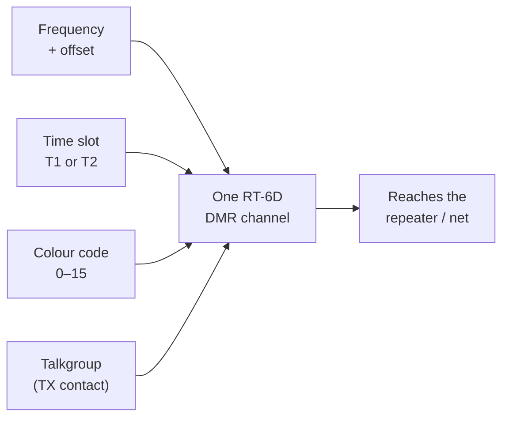
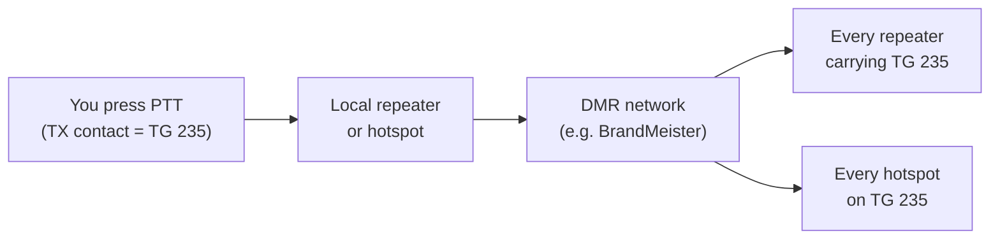
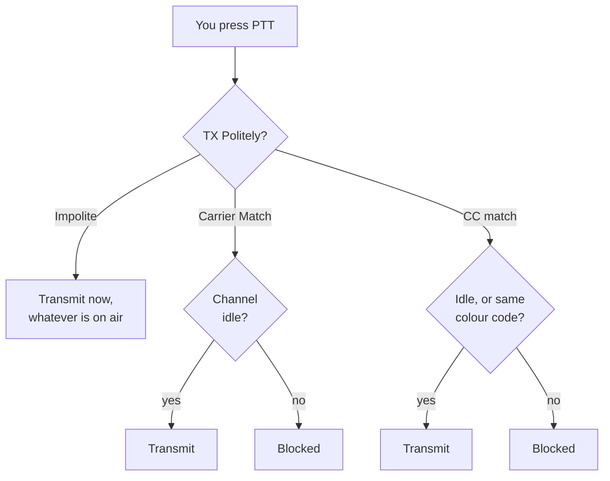

# What the DMR settings really mean

Somewhere in the RT-6D's `Channel Settings` and `Digital Setting` menus sit a handful of items that decide whether your push-to-talk reaches a single hilltop or the far side of the planet — and, just as often, whether it reaches anyone at all. On analogue FM you tune a frequency and talk; on DMR (Digital Mobile Radio, the digital voice mode this radio speaks) four small numbers have to line up first, and a wrong one leaves you in total silence with no error to explain why. This page is the _why_ behind those menus. It uses the RT-6D's own item names as worked examples and points you, for the deep theory, at the handbook's [DMR chapters](outpost:entry/logbook73.handbook/dmr) — because the concepts here are universal to every DMR radio, not peculiar to Radtel.

Think of it as the map that turns the [DMR channel menu](outpost:entry/logbook73.guide.rt-6d/dmr-channels) from a wall of jargon into a set of decisions you understand. Everything below applies equally to the RT-6D and the GPS-equipped RT-6D **Pro** — the DMR core is identical.

## The four numbers that make a DMR channel

On FM, a memory channel is essentially one thing: a frequency (plus perhaps a sub-tone). On DMR, a channel is **four** things stacked together, and all four must match the repeater or the group you are trying to reach:

- a **frequency** (and offset, for a repeater) — set in `Channel Settings → Offset Dir` and `Offset Freq`;
- a **time slot** — `Channel Settings → DMR Slot`, either `Slot 1` or `Slot 2`;
- a **colour code** — `Channel Settings → Color Code`, a number 0–15;
- a **talkgroup** — the transmit contact in `Channel Settings → Contacts`.



Miss any one and nothing routes. The full anatomy — with real numbers and the mistakes each field invites — lives in [Slots, Colour Codes & Talkgroups](outpost:entry/logbook73.handbook/dmr-slots-talkgroups); the sections below explain what each number _is_ and why the radio needs it. The RT-6D's colour display shows three of the four at a glance on whichever region (A or B) is active: a digital marker for a DMR channel, `T1`/`T2` for the slot, and `CXX` for the colour code.

## Two conversations on one carrier — TDMA and the time slots

The single cleverest thing about DMR is that one repeater — one input frequency, one output frequency — carries **two independent conversations at once**. It does this with TDMA (Time Division Multiple Access): the radios take strict alternating turns. Each transmits a 30-millisecond burst of data, falls silent for 30 ms while the other slot has its turn, then bursts again — fast enough that both listeners hear smooth, continuous speech. Picture two trains sharing a single track by taking perfectly timed turns, so quick the passengers never notice the other train exists.

Those two turns are `Slot 1` and `Slot 2` (the RT-6D shows them as `T1` and `T2`). When you set `Channel Settings → DMR Slot`, you are choosing which of the two alternating turns your channel uses through the repeater. The repeater owner assigns each talkgroup to a particular slot — a common convention is local and regional traffic on one slot, worldwide nets on the other, so a busy long-distance conversation never ties up the local slot. **Key the right talkgroup on the wrong slot and nothing happens** — worse, you may tread on the repeater's other conversation.

### DMR Mode: single slot, or Dual Slot

`Channel Settings → DMR Mode` decides whether the time-slot structure applies at all. With **Dual Slot off**, the channel is single-slot: on a simplex frequency, any DMR radio on the same frequency and colour code hears you, slot number ignored. This is the safe default for [simplex](outpost:entry/logbook73.guide.rt-6d/dmr-channels), because most amateur DMR simplex assumes plain single-slot direct mode. Switch **Dual Slot on** and the radio uses Double Capacity Direct Mode (DCDM): one radio injects the timing signal a repeater would normally provide, letting _two_ simplex conversations share one frequency. It only works if every radio in the group agrees on both the on/off state and the slot number — mismatch either and the radios silently fail to decode each other. Leave it off unless a group has deliberately agreed to run DCDM.

## Colour Code — the digital CTCSS

A colour code is a number from 0 to 15 that rides inside every DMR transmission. It does the same job that a CTCSS sub-tone does on analogue FM: it lets a radio (or a repeater) ignore traffic that is not meant for it. Two repeaters can share a frequency in the same region as long as they use different colour codes — each simply disregards the other's signals. You set it in `Channel Settings → Color Code`, and the display confirms it as `CXX`.

The catch that traps every newcomer: **a wrong colour code produces total silence, with no warning at all.** The repeater does not key up, you hear nothing, and the radio looks broken. It is the digital twin of setting the wrong CTCSS tone. Colour Code `1` is the de-facto amateur default, but always use whatever the repeater or simplex group publishes. Unlike a CTCSS tone, the colour code is not a sub-audible sound — it is a digital field decoded from the signalling — and it does a second job too: it feeds the "polite" transmit logic you will meet under [TX Politely](#tx-politely--when-the-radio-may-speak) below. The deeper treatment, including why it beats analogue tones for sharing spectrum, is in [Slots, Colour Codes & Talkgroups](outpost:entry/logbook73.handbook/dmr-slots-talkgroups).

## Talkgroups — routing by number, not by frequency

Here is the mental shift that DMR demands. On FM, a conversation _lives on a frequency_: to join it you tune there. On DMR, a conversation lives on a numbered **talkgroup**, and an internet-linked network routes it to wherever people are listening. Key up on talkgroup `91` (Worldwide) or `235` (UK-wide) and your audio reaches every repeater and hotspot carrying that group, anywhere on Earth. The frequency you transmit on is just the on-ramp; the talkgroup number is the destination.

On the RT-6D a talkgroup is a **contact**. You build the list in `Digital Setting → Contacts Set` (each entry is a `Contact ID` from 1 to 16777215, and there is one `All Call` entry that cannot be removed), then point a channel's transmit destination at one of them with `Channel Settings → Contacts`. That contact can be a **Group Call** (a talkgroup, the usual case) or a **Private Call** (one specific operator's DMR ID, for a one-to-one).



### Your DMR ID: the number that names you

Before _any_ of this works you must set your own DMR ID in `Digital Setting → Personal ID`. This 7-digit number rides every over, and the network resolves it back to your callsign for the display and the dashboards — that is _how_ DMR always shows who is talking. You cannot invent one: IDs are issued free by RadioID.net once you prove you hold an amateur licence, and the first three digits encode your country. Borrowing or guessing an ID collides with a real operator and breaks routing for both of you. The registration process and the network landscape are covered in [DMR Networks & IDs](outpost:entry/logbook73.handbook/dmr-networks).

### Static versus dynamic

Talkgroups come in two flavours, and knowing which is which saves a lot of "why is it dead?" A **static** talkgroup is permanently bound to a repeater's slot — always on, always audible there. A **dynamic** (user-activated) talkgroup attaches on demand: the first person to transmit on it links it to the repeater, it stays up while people are talking, then automatically drops after roughly 10–15 minutes of silence. If a dynamic group has timed out, later calls will not reach you until someone keys it up again. This is pure network behaviour, not a radio setting — but it explains why a talkgroup that was busy an hour ago can fall silent.

## Listening: the RX talkgroup list

A channel transmits to exactly one talkgroup, but it can _listen_ to many. The **RX talkgroup list** is the set of talkgroups a channel will unmute for. You build lists in `Digital Setting → TG List Set` — pressing the `MENU` key selects a member, pressing `↵/EXIT` deselects it — and attach one to a channel with `Channel Settings → RX TG List`. Add every group you want to hear on that slot (say, your local plus a regional plus a special-event talkgroup) so you never sit in silence while a call you would have answered passes by on the same slot.

The trap: **if a talkgroup is not in the channel's RX talkgroup list, you will not hear it**, even though the traffic is physically present on your slot and colour code. Keep the list and your transmit contact consistent — hear the group you actually reply to.

### Promiscuous monitoring

There is a wider way to listen, called promiscuous (or "digital monitor") mode: decode _every_ talkgroup on the current frequency and slot whose colour code matches, ignoring the RX talkgroup list filter entirely. On the RT-6D it is a per-channel switch, `Channel Settings → Promiscuous` (on/off), and it can also be dropped onto a definable key for a quick toggle. It is excellent for discovering what a repeater carries. Two honest caveats: hearing a group is not the same as joining it — your PTT still transmits only to the channel's assigned talkgroup — and a busy repeater becomes a chaotic jumble. The etiquette and the trade-offs are in [DMR Operating](outpost:entry/logbook73.handbook/dmr-operating); for a quiet, filtered experience on one talkgroup, leave it off and let the RX talkgroup list be your gate.

## TX Politely — when the radio may speak

This is the "admit criteria": the rule that governs _whether the radio is allowed to key up at all_ when you press PTT. On the RT-6D it is `Channel Settings → TX Politely`, with three settings whose plain-English meanings are worth learning:

| RT-6D setting   | Meaning          | Behaviour                                                                                                                                             |
| --------------- | ---------------- | ----------------------------------------------------------------------------------------------------------------------------------------------------- |
| `Impolite`      | Always transmit  | Keys up regardless of what is on the channel — will talk over a conversation in progress.                                                             |
| `Carrier Match` | Channel free     | Transmits only if the RF channel is completely idle; _any_ signal, even a different colour code or slot, blocks you.                                  |
| `CC match`      | Colour-code free | Transmits if the slot is free **or** the only signal present shares your colour code — defers to strangers, but lets you into your own busy repeater. |



For repeater channels, **`CC match` is the courteous default** — it keeps you from doubling on your own DMR system while not blocking you because of unrelated traffic on the same frequency. On shared simplex frequencies, `Carrier Match` avoids doubling with _any_ user. Reserve `Impolite` for controlled testing only; on the air it interrupts conversations in progress and is exactly the behaviour that gives newcomers a bad name. This is the DMR equivalent of the analogue "busy lockout", and the full etiquette sits in [DMR Operating](outpost:entry/logbook73.handbook/dmr-operating).

## AMBE — why your voice becomes data, and won't cross modes

Everything above assumes the radio can turn your speech into the digital bursts that TDMA shuttles about. That job belongs to a **vocoder** — a voice coder-decoder. DMR uses AMBE+2 (Advanced Multi-Band Excitation), which analyses your voice and describes it as a stream of just 2450 bits per second, wraps it in error-correction, and sends about 3600 bits per second down each time slot. The RT-6D does this in hardware (its digital modulation is 4FSK, four-level frequency-shift keying — four tone steps standing for pairs of bits).

Two practical consequences fall straight out of this:

- **The digital cliff.** Because the audio is reconstructed from data, it stays _perfect_ right up to the point where too many bits are lost — then it collapses abruptly into robotic "R2-D2" garble or silence, rather than fading gracefully like FM. Your coverage feels larger than it is until it suddenly is not, so judge range conservatively.
- **Modes do not interoperate.** DMR, D-STAR and System Fusion all descend from the same DVSI vocoder family, yet they wrap the data in incompatible protocols. A DMR radio cannot talk to a D-STAR repeater any more than a French speaker can be understood by insisting louder in French. The RT-6D is a DMR (and analogue FM) radio; it will not decode the other digital modes on the air. The family tree and what distinguishes each mode is in [Digital Voice](outpost:entry/logbook73.handbook/digital-voice).

The `Digital Setting` menu also holds the digital-side comfort controls that this data path makes possible — `SQ level` (a 0–16 digital squelch), `Mic Gain`/`SPK Gain`, and the `Group Hold` / `Single Hold` timers that keep a call "held" for a moment after the other station stops, so a quick reply lands back on the same talkgroup without you re-keying.

## SSB, AM and the spectrum scope — the analogue receiver's extra tricks

The RT-6D adds something the RT-4D lacks, and it lives entirely on the analogue side: a choice of _demodulator_. `Channel Settings → RX Demodulation` on an analogue channel offers `FM`, `AM` and `SSB` — three different ways of pulling audio back out of a radio wave. Understanding what each does turns a mysterious menu into a listening tool.

A radio signal is a carrier wave that has been _modulated_ — nudged in some way to carry your voice. The demodulator has to undo exactly the kind of nudge that was applied:

- **FM** (frequency modulation) reads the voice from tiny wobbles in the carrier's _frequency_. It is what amateur 2 m and 70 cm voice, and broadcast FM, use.
- **AM** (amplitude modulation) reads it from changes in the carrier's _strength_. Airband and shortwave broadcast use AM, which is why the RT-6D receives the aviation band as AM.
- **SSB** (single sideband) is a stripped-down, efficient cousin of AM that throws away the carrier and one half of the signal to save power and bandwidth — the workhorse of long-distance HF voice. It sounds like a duck until you tune it precisely, then a voice snaps into focus.

On the RT-6D, SSB and AM are **receive only** — you cannot transmit them — and the wideband front end is a budget one, so treat this as a fun listening bonus (feed in an external HF antenna and eavesdrop on the shortwave bands) rather than a substitute for a real HF rig. The [Analogue & SSB](outpost:entry/logbook73.guide.rt-6d/analog-ssb) page covers the practicalities; the modulation theory in depth is in [Software-Defined Radio](outpost:entry/logbook73.handbook/software-defined-radio), which is where these ideas are most cleanly explained.

There is a companion feature worth meeting here too: the **spectrum scope**, a function you can drop onto a definable key. Instead of listening to one frequency, it sweeps a slice of the band and draws a little graph of _how much signal sits where_ — a live picture of the spectrum around you.

```viz
{
  "type": "spectrum",
  "title": "What the spectrum scope draws",
  "caption": "A sweep of a band slice: the height of each spike is how strong a signal is at that frequency. Tall, narrow spikes are active carriers; the low fuzz along the bottom is the background noise floor.",
  "components": [
    { "f": 22, "amp": 0.55, "label": "quiet channel", "tone": "muted" },
    { "f": 44, "amp": 0.95, "label": "strong local", "tone": "primary" },
    { "f": 70, "amp": 0.35, "label": "weak signal", "tone": "ink" }
  ],
  "noiseFloor": 0.12,
  "xLabel": "frequency across the swept slice"
}
```

Reading it is intuitive once you have seen it: the horizontal axis is frequency, the vertical is signal strength, so a tall spike means "there is something busy here" and the low fuzz along the bottom is the ever-present noise floor. It is a fast way to find where the activity is before you commit to listening — and a gentle first taste of the waterfall-and-spectrum displays that [software-defined radios](outpost:entry/logbook73.handbook/software-defined-radio) turn into a whole way of operating.

## Encryption — the setting to never touch

Because these are commercial-heritage radios, the RT-6D carries a full encryption capability: `Channel Settings → Encryption` (Off, or `Key1`–`Key256`) with the keys defined in `Digital Setting → Encryption Set`, offering ARC4 and AES-128/256 scrambling. Three things must match for two radios to talk encrypted — the same type, the same serial number and the same key value. The display shows `ENC` when it is active.

**On the amateur bands you must leave it off.** Amateur regulators worldwide forbid transmissions that obscure their meaning — the FCC's Part 97.113(a)(4) in the US and Ofcom's 2024 licence Clause 19 in the UK are two examples, and virtually every national regulator says the same. The feature exists only because these radios are re-badged commercial equipment where encryption is legal under business rules; it is not for you. There is a second, blunter point: unencrypted DMR is _not_ private anyway — anyone with a compatible radio can monitor it — so DMR never grants secrecy, and the setting must simply stay `Off` on every ham channel. If it were accidentally on, others would hear only silence or noise while you transmitted illegally. The licensing background is in [Getting Licensed](outpost:entry/logbook73.handbook/getting-licensed) and the operating angle in [DMR Operating](outpost:entry/logbook73.handbook/dmr-operating).

## Try it yourself

You can read all four numbers off a single working channel without transmitting:

1. Put the RT-6D on a programmed DMR repeater channel and look at the colour display: a digital marker tells you it is DMR, `T1` or `T2` the slot, `CXX` the colour code — all on whichever region (A or B) is active.
2. Step into `Channel Settings` and note `Contacts` (your transmit talkgroup) and `RX TG List` (everything the channel will _hear_). Ask yourself: does the group I answer on appear in the list I listen to?
3. Check `TX Politely`. If it reads `Impolite`, change it to `CC match` for a repeater — you have just made yourself a more courteous operator in one keypress.
4. Confirm `Encryption` is `Off`, and that `Digital Setting → Personal ID` holds _your_ RadioID.net number, not a factory placeholder.
5. For the analogue extra, put region A on an analogue channel, set `RX Demodulation` to `AM`, and listen across the airband — then try `SSB` on an HF signal from an external antenna and tune slowly until a voice locks in.

Do the DMR steps on two different repeater channels and compare the four numbers. Seeing how the slot and colour code change from machine to machine — while the talkgroup routing stays the same — is the moment DMR stops being magic and starts being a system you can read.

## Key takeaways

- A DMR channel is **four numbers** — frequency, time slot (`DMR Slot`), colour code (`Color Code`) and talkgroup (`Contacts`) — and all four must match or the radio sits in silent, error-free failure.
- **TDMA** splits one carrier into two 30 ms time slots, so a single repeater carries two conversations at once; `DMR Mode`/Dual Slot decides whether that structure applies, and DCDM extends it to simplex only when a whole group agrees.
- The **colour code** is the digital CTCSS: a wrong value gives total silence, `1` is the amateur default, and it also drives the polite-transmit logic.
- **Talkgroups route by number, not frequency**; you set your transmit destination in `Contacts`, listen via the `RX TG List`, and must program your own **DMR ID** in `Personal ID` before transmitting.
- **`TX Politely`** is the admit rule — `CC match` (colour-code free) for repeaters, `Carrier Match` (channel free) for shared simplex, `Impolite` essentially never.
- The **AMBE+2 vocoder** turns your voice into data, which is why DMR shows a hard "digital cliff" and why it cannot interoperate with D-STAR or Fusion.
- The RT-6D's analogue side adds `RX Demodulation` (FM/AM/**SSB** receive) and a **spectrum scope** — listening bonuses whose theory lives in [Software-Defined Radio](outpost:entry/logbook73.handbook/software-defined-radio).
- **Encryption stays `Off`** on ham: it is illegal to obscure meaning, and DMR offers no real privacy in any case.

With the _why_ clear, the fastest way to get all of this right is to let software do the typing: next comes [Code plugs & CPS configs](outpost:entry/logbook73.guide.rt-6d/configs), where the Radtel programming software turns these settings into a code plug you can build once and load in seconds.
