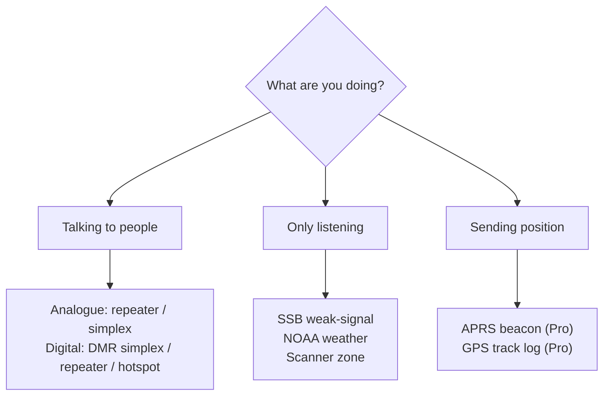
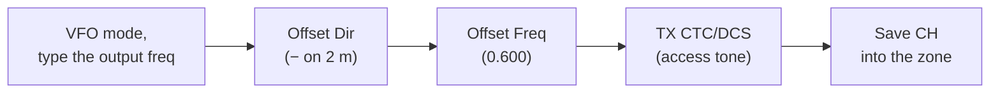
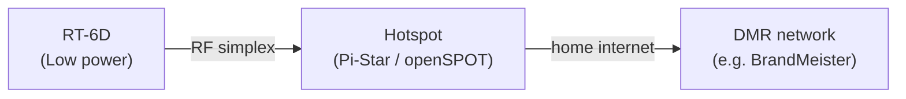

# Ready-made configurations

You have met every setting on its own; here is where they come together into working stations. This chapter is a cookbook — a set of ready-made setups you can copy straight onto the RT-6D, each with a short "why you'd want it" and a table of menu items with the values to enter. Because this is a DMR radio with a colour dual-VFO screen and (on the **Pro**) GPS and APRS, the recipes span analogue voice, digital voice, data and pure listening. Pick the one that matches what you are about to do, apply it, and you are on the air correctly the first time.

## How to use these recipes

Every table names a setting the way the rest of this guide does: the menu **group** — for example `01 Basic Settings` — then the **item**, such as `Save Mode`. Reach any of them with **MENU**, the channel knob or the **▲ / ▼** keys, and **MENU** again to save, exactly as in [Getting Started](outpost:entry/logbook73.guide.rt-6d/getting-started). Two habits make all of this painless:

- **For analogue, build it in VFO mode, then save it.** Most per-channel analogue settings — frequency, tone, offset, bandwidth, modulation — are edited in frequency mode. Dial the recipe in on a VFO with the **VFO/MR** key, then use `01 Basic Settings → Save CH` to store the whole snapshot into a numbered channel, and drop that channel into a [zone](outpost:entry/logbook73.guide.rt-6d/contacts-zones). Do it once and you never touch the menus again.
- **For DMR, use the computer.** The digital recipes below have four ingredients each — frequency, slot, colour code and talkgroup — plus a contact list, and hand-keying all of that is a weekend lost. Programme DMR from the **Radtel CPS** over the USB-C cable and write it as a **code plug**, exactly as [Getting on DMR](outpost:entry/logbook73.guide.rt-6d/dmr-getting-on) describes. The tables below map one-to-one onto both the CPS and the on-radio menus.

### The house defaults every recipe assumes

Rather than repeat the same lines in every table, set these once as your baseline. They are the "good operator" defaults from the menu chapters, and every recipe below inherits them unless it says otherwise. A few of these live on the channel (analogue or digital) rather than in the global menus — those are marked.

| Setting                            | Value         | Why                                                                     |
| ---------------------------------- | ------------- | ----------------------------------------------------------------------- |
| `03 Analog Set → SQ level`         | 3             | Silences the hiss but still lets weak signals through                   |
| `04 Digital Setting → SQ level`    | default       | DMR squelch — leave at the factory value unless you have reason         |
| `Busy Lock` (per analogue channel) | Carrier Match | Refuses to transmit onto a channel someone else is using                |
| `TX Politely` (per DMR channel)    | Carrier Match | The digital equivalent — waits for a clear slot                         |
| `TX Power` (per channel)           | Low           | The lowest power that does the job — see [RF Power](outpost:entry/logbook73.handbook/rf-power) |
| `TOT` (per channel)                | 180 s         | Cuts a stuck transmission before it hogs the channel                    |
| `01 Basic Settings → Save Mode`    | On            | Sensible micro-sleep for the receiver on battery                        |
| `01 Basic Settings → Dual Standby` | On            | Watch both VFOs (A and B) at once                                       |
| `03 Analog Set → TX End Tone`      | Off           | No courtesy "roger" beep on amateur voice                               |
| `03 Analog Set → VOX on-off`       | Off           | You decide when to transmit, not a cough                                |
| `01 Basic Settings → Key Beep`     | On            | Confirms key presses                                                    |
| `01 Basic Settings → Lock Timer`   | short         | Stops pocket-dialling the menu                                          |
| `01 Basic Settings → Light Timer`  | short         | Screen off when idle, to save the battery                               |
| `Encryption` (per DMR channel)     | **Off**       | Encryption is generally illegal on amateur bands — always off           |

Everything that follows changes just the handful of settings that make each station what it is.

## Analogue stations

The RT-6D is a capable analogue set as well as a digital one — its side-key 2 flips a VFO between analogue and digital on the fly. These two recipes cover the everyday FM work a new licensee does most: talking through a [repeater](outpost:entry/logbook73.handbook/repeaters) and talking direct.

### Analogue repeater + simplex

Build one zone called "Local FM" with two channels — the nearest 2 m repeater and a simplex working frequency — and most days you never leave it. Replace `GB3xx` with your nearest machine from your national society's repeater list.

| Name       | Frequency | Mode | Offset Dir | Offset Freq | Tone               | Notes                               |
| ---------- | --------- | ---- | ---------- | ----------- | ------------------ | ----------------------------------- |
| 2m Call    | `145.500` | FM   | —          | —           | none               | 2 m FM calling channel (Region 1)   |
| GB3xx      | `145.700` | FM   | `−`        | `0.600`     | CTCSS from listing | Your local 2 m repeater             |
| 2m Simplex | `145.5xx` | FM   | —          | —           | none               | A working simplex frequency, direct |

The repeater is the fiddly one. A Region 1 2 m repeater listens `0.6 MHz` below its output, so on that channel set `05 Channel Settings → Offset Dir` to `−` and `Offset Freq` to `0.600`. Nearly all of them need a [CTCSS sub-tone](outpost:entry/logbook73.guide.rt-6d/analog-ssb) to open — set `05 Channel Settings → TX CTC/DCS` to the value the keeper publishes (77.0 Hz is common in parts of Region 1, but it varies, so check the listing). Some machines still respond to a **1750 Hz** access burst instead; if so, assign `Send Single Tone` to a key in [Key Define](outpost:entry/logbook73.guide.rt-6d/keys) and press it to send the burst.

The simplex channel is the opposite — nothing clever at all. Leave `Offset Dir` off, tone off, `TX Power` Low, and you transmit and receive on the one frequency. The commonest analogue mistake is leaving a duplex offset or a TX tone set from a repeater channel, then wondering why nobody answers on simplex — you are transmitting `0.6 MHz` away, or only opening a repeater that is not there.

Set `05 Channel Settings → Band Width` as the listing states — most Region 1 machines are `Narrow`. Listen first to confirm the machine is idle, then key up briefly with your callsign to test access. The offsets and tones are conventions; the individual repeater's listing (the RSGB ETCC list in the UK, RepeaterBook elsewhere) is the final word. Every control here is covered in [Analogue & SSB](outpost:entry/logbook73.guide.rt-6d/analog-ssb).

## DMR stations

Now the digital side. Each of these is the four-ingredient channel from [DMR channels](outpost:entry/logbook73.guide.rt-6d/dmr-channels) — **frequency + slot + colour code + talkgroup** — arranged for a particular way of reaching the network. Programme them in the Radtel CPS; the field names below are the ones on both the software and the `05 Channel Settings` digital form.

### DMR simplex

The simplest digital station: two radios talking directly, no repeater or hotspot between them — handy on a group walk or across a rally field. Both radios must agree on every ingredient, because there is no infrastructure to reconcile a mismatch.

| RT-6D field   | Value                                     | Why                                                  |
| ------------- | ----------------------------------------- | ---------------------------------------------------- |
| Frequency     | a digital simplex freq (`43x.xxx`)        | Same TX and RX — pick one your band plan sets aside  |
| `DMR Slot`    | `1`                                       | Simplex conventionally uses time slot 1              |
| `Color Code`  | `1`                                       | Both radios must match — DMR's version of a sub-tone |
| `Contacts`    | a group call (e.g. TG `99`) or `All Call` | Who you key up to — check your local convention      |
| `RX TG List`  | that same talkgroup                       | So you hear the replies                              |
| `Promiscuous` | `On`                                      | Hear everyone on the frequency, not just one group   |
| `TX Politely` | `Carrier Match`                           | Wait for a clear channel                             |
| `TX Power`    | Low                                       | You are usually close by                             |
| `Encryption`  | **Off**                                   | Always off on the amateur bands                      |

There is no `Offset` on a simplex channel — TX frequency equals RX frequency. Because everyone shares the one slot, `Promiscuous On` is the friendly choice here: you decode all the talk passing through rather than only your set talkgroup.

### DMR repeater

A DMR repeater is a shared, higher-power machine that puts you onto the wider network. You copy its published details exactly — get the colour code or slot wrong and the radio is ignored in silence, with no hiss to warn you.

| RT-6D field                  | Value                         | Why                                        |
| ---------------------------- | ----------------------------- | ------------------------------------------ |
| Frequency (RX)               | the repeater's output         | What you listen on                         |
| `Offset Dir` / `Offset Freq` | the published split           | Sets your TX frequency away from RX        |
| `DMR Slot`                   | `1` or `2` per the listing    | Slots carry separate conversations         |
| `Color Code`                 | per the listing (`0`–`15`)    | Must match, or you are locked out silently |
| `Contacts`                   | the talkgroup you want        | Who you call when you key up               |
| `RX TG List`                 | a list holding that talkgroup | What you hear come back                    |
| `TX Politely`                | `Carrier Match`               | Do not transmit over a call in progress    |
| `TX Power`                   | High                          | A distant hilltop machine earns the power  |
| `Encryption`                 | **Off**                       | Always                                     |

Build one channel per talkgroup you want on that repeater — "changing talkgroup" really means "selecting a different channel". A directory such as RepeaterBook lists the exact slot, colour code and talkgroups each machine carries; that table is what you copy in. The theory is in [DMR slots & talkgroups](outpost:entry/logbook73.handbook/dmr-slots-talkgroups).

### DMR hotspot

Most amateurs reach DMR from home through a **hotspot** — a tiny digital modem that bridges your handheld to the network over your home internet. It needs no local repeater, and the matching radio channel is short work because a simplex hotspot has TX and RX on one frequency.

| RT-6D field   | Value                           | Why                                                     |
| ------------- | ------------------------------- | ------------------------------------------------------- |
| Frequency     | your hotspot's freq (`43x.xxx`) | TX = RX for a simplex hotspot                           |
| `DMR Slot`    | `2`                             | Simplex hotspots use time slot 2 (e.g. on BrandMeister) |
| `Color Code`  | `1`                             | Hotspots commonly use colour code 1 — match it          |
| `Contacts`    | the talkgroup (e.g. WW `91`)    | The room you drop into                                  |
| `RX TG List`  | that talkgroup                  | So you hear it                                          |
| `TX Politely` | `Carrier Match`                 | Polite admit                                            |
| `TX Power`    | Low                             | The hotspot is a few metres away — Low is plenty        |
| `Encryption`  | **Off**                         | Always                                                  |

A **duplex** hotspot uses a TX/RX split like a miniature repeater; if you run one, fill in `Offset Dir` and `Offset Freq` to match it. Everything about hotspots — Pi-Star, code plugs and where to fetch the user database so incoming calls show a callsign — is in [DMR hotspots & code plugs](outpost:entry/logbook73.handbook/dmr-hotspots). Set `01 Basic Settings → CH Alias Colour` to give hotspot channels one screen colour and repeater channels another; on the dual-VFO display, that splash tells you which bank you are on at a glance.

## Data & location (RT-6D Pro)

These two recipes need the GPS and APRS menus that exist **only on the RT-6D Pro**. If your radio has no `09 Extend / GPS` menu, you have the standard set and these do not apply.

### APRS position beacon

This is the mainstream, well-working use of APRS: your radio periodically transmits its GPS position so you appear on the live [APRS](outpost:entry/logbook73.handbook/aprs) map. The one number people get wrong is the frequency; the one setting they get wrong is the path.

| Setting                        | Value                      | Why                                           |
| ------------------------------ | -------------------------- | --------------------------------------------- |
| `09 Extend / GPS → GPS On-off` | On                         | The beacon needs a live fix                   |
| `APRS On-off`                  | On                         | Master switch for the engine                  |
| `Station Mode`                 | GPS mobile                 | Beacon your live position, not a fixed grid   |
| `APRS RX CH` / `APRS TX CH`    | `144.800` (Region 1)       | The Region 1 APRS channel — **not** `144.390` |
| `Beacon Setup` → callsign      | your callsign              | Mandatory — no legal anonymous mode           |
| `Beacon Setup` → SSID          | `-7` on foot / `-9` mobile | Marks the kind of station you are             |
| `Beacon Setup` → path          | `WIDE1-1,WIDE2-1`          | The polite two-hop standard                   |
| `Beacon Mode`                  | timer                      | Beacon on a sensible interval                 |
| `DIGI Setup`                   | Off                        | You are a tracker, not a digipeater           |

**The frequency is the classic trap.** In Europe, the UK and the rest of ITU Region 1 the APRS calling channel is `144.800 MHz` FM; North America uses `144.390 MHz`. Copy a US tutorial, set `144.390`, and you beacon on an empty channel nobody near you hears. **The path is the second trap:** `WIDE1-1,WIDE2-1` asks for two hops — one fill-in and one wide-area digipeater — which gets a handheld heard without stamping on the network. Longer paths from a handheld are the APRS equivalent of shouting. And beacon no faster than you need: a walker every few minutes is ample. The full setting-by-setting story is in [GPS & APRS](outpost:entry/logbook73.guide.rt-6d/gps-aprs).

### GPS track-logging

Sometimes you do not want to transmit at all — you just want the radio to remember where you walked, to review or export later. This recipe logs a track with APRS switched **off**, so nothing goes on the air.

| Setting                         | Value            | Why                                             |
| ------------------------------- | ---------------- | ----------------------------------------------- |
| `09 Extend / GPS → GPS On-off`  | On               | Logging needs live fixes                        |
| `GPS Auto Record`               | On               | Automatically drop track points                 |
| `GPS Record Time`               | your interval    | Shorter = finer trail but fills memory faster   |
| `Coordinate Type`               | Deg-Min          | Matches most maps and APRS tools                |
| `Clear Track` / `Clear Mileage` | run at the start | So the log and distance mean this trip only     |
| `APRS On-off`                   | Off              | Pure logging — nothing transmitted              |
| `PC Monitor` / `GPS Baudrate`   | as needed        | Stream the track to a PC over Type-C afterwards |

`Manual record` (or the `GPS Manual Rec` key) drops a single point exactly when you press it — perfect for marking a summit or a gate. `Query Track` replays the log on the radio; `PC Monitor` streams the standard position sentences out of the USB-C jack so mapping software can read them (tell the PC the same speed as `GPS Baudrate`, or it sees nothing). Because you are not beaconing, you can leave `TX Power` irrelevant and simply enjoy a receiver that quietly records your route.

## Listening (receive only)

The RT-6D receives far more widely than it transmits, and these recipes are legal for anyone, licensed or not — receiving is not transmitting. Do not key up on any frequency that is not one of your amateur allocations.

### SSB weak-signal listening

The RT-6D's party trick is **SSB (single sideband) receive** on analogue channels — a demodulation mode most cheap handhelds lack. It opens up the weak-signal segments where SSB voice and CW live, which sound like nonsense in FM or AM.

| Setting                                 | Value            | Why                                                 |
| --------------------------------------- | ---------------- | --------------------------------------------------- |
| `05 Channel Settings → RX Demodulation` | SSB              | The setting that unlocks single-sideband audio      |
| `05 Channel Settings → Band Width`      | Narrow           | SSB is a narrow signal                              |
| `03 Analog Set → SQ level`              | 0–1              | SSB has no carrier to break a squelch — run it open |
| `01 Basic Settings → Freq Step`         | small (e.g. 1 k) | Tune finely to zero-beat a voice                    |
| Transmit                                | never            | SSB here is receive-only                            |

**Where it tunes matters.** The RT-6D's receiver covers FM broadcast (`64–108 MHz`), AM (`108–136 MHz`) and `136–520 MHz` digital/analogue — so SSB reception lands in the VHF/UHF weak-signal segments (such as the 2 m SSB portion), not the shortwave HF bands, which sit below its range. With a decent external antenna it is a genuinely useful SSB monitor within that coverage; for the true HF bands you still want an HF receiver or an [SDR](outpost:entry/logbook73.handbook/software-defined-radio). Keep the [wide front-end caveats](outpost:entry/logbook73.handbook/overload-and-ghost-signals) in mind — a big antenna near strong transmitters can conjure signals that are not really there. The full mode is covered in [Analogue & SSB](outpost:entry/logbook73.guide.rt-6d/analog-ssb).

### NOAA weather monitor

In North America, the NOAA Weather Radio network broadcasts continuous forecasts and alerts on a handful of VHF channels around `162 MHz` FM. The RT-6D has a dedicated **NOAA** function you assign to a key.

| Setting                                 | Value    | Why                                      |
| --------------------------------------- | -------- | ---------------------------------------- |
| A key → `NOAA CH` (in Key Define)       | assigned | One press jumps to the weather channels  |
| `05 Channel Settings → RX Demodulation` | FM       | NOAA broadcasts are FM                   |
| Transmit                                | never    | Receive only — not an amateur allocation |

Assign `NOAA CH` to the yellow key or a long-pressed number in [Key Define](outpost:entry/logbook73.guide.rt-6d/keys), and a press steps through the weather channels for the strongest local one. This is a North American service — elsewhere in the world, weather and hazard information travels on different systems, so treat NOAA as a Region 2 convenience rather than a worldwide feature. Either way it is receive-only.

### Scanner zone

Put your most-watched channels in one zone and let the radio hunt across them, so you catch activity without twiddling the knob. Combine that with **Dual Standby** and the RT-6D watches two VFOs while it scans.

| Setting                            | Value        | Why                                      |
| ---------------------------------- | ------------ | ---------------------------------------- |
| `Scan Add` (per channel)           | On           | Include the channel in the scan          |
| `01 Basic Settings → Scan Mode`    | SE (carrier) | Pause on activity, resume when it clears |
| `01 Basic Settings → Scan Return`  | Current CH   | Stay where the traffic is when it stops  |
| `01 Basic Settings → Dual Standby` | On           | Watch A and B together as well           |
| A key → `Scanning` (in Key Define) | assigned     | Start and stop the scan with one press   |

Set `Scan Add` on every channel you want swept, drop them into a zone called "Scan", and start it from your assigned key. `Scan Mode` set to `SE` (search/carrier-operated) holds on a busy channel until it clears; the alternative resumes after a fixed time. For sweeping an unknown stretch of a band rather than saved channels, `Scan Start Freq` and `Scan End Freq` in `01 Basic Settings` bound a VFO frequency sweep instead.

## Grab-and-go

### Emergency go-bag

A radio kept for when the power or the phones are down should be configured for **weeks of readiness, then hours of use** — maximum standby, minimum fuss. Programme it, charge it, and let it sleep.

| Setting                           | Value                     | Why                                             |
| --------------------------------- | ------------------------- | ----------------------------------------------- |
| `01 Basic Settings → Save Mode`   | On (deepest available)    | Longest possible standby between checks         |
| `TX Power` (per channel)          | Low                       | Conserve the battery; raise only when you must  |
| `01 Basic Settings → Light Timer` | short                     | Every second of screen costs charge             |
| A key → `Monitor` (in Key Define) | assigned                  | One-press squelch-open to dig out a weak signal |
| `01 Basic Settings → AWU`         | understand before relying | Auto wake-up — know how it behaves first        |
| Local calling/repeater channels   | pre-stored zone           | No menu-diving in a crisis                      |

Store your area's calling channels and the two or three most useful repeaters — analogue and DMR — in a zone named "Emergency" so you can find them by feel. The RT-6D also has an **Alarm** button and `Alarm Type` settings; understand what each does before you rely on it, and never trigger a transmitting alarm as a test on a live channel. Keep a spare charged battery, the USB-C charging lead, and a written copy of your key frequencies and your callsign in the bag, and top the battery up every few months. In a real emergency, monitor first, transmit briefly, and stay within your licence — a working radio you know how to use beats a clever one you do not.

## Try it yourself

Pick one recipe and build it end to end today:

1. **Analogue in five minutes.** In VFO mode, tune your nearest 2 m repeater's output, set `Offset Dir` `−`, `Offset Freq` `0.600`, `TX CTC/DCS` to its published tone, then `Save CH` into a new "Local FM" zone. Listen, then key up with your callsign to test access.
2. **Or a DMR test channel.** In the Radtel CPS, build one hotspot or repeater channel from the table above — `Color Code`, `DMR Slot`, a talkgroup `Contacts`, `TX Politely` `Carrier Match`, `Encryption` `Off` — write it, and call the Parrot service to hear yourself played back.
3. **Or, on a Pro, a beacon.** Set `GPS On-off` On, `APRS TX/RX CH` to `144.800` (Region 1), your callsign and `-7` in `Beacon Setup`, `Station Mode` GPS mobile, `APRS On-off` On — then find your dot on `aprs.fi`.

Whichever you choose, save it into a named zone so tomorrow it is one twist of the knob away.

## Key takeaways

- Set the **house defaults** once — Busy Lock / TX Politely on `Carrier Match`, `TX Power` Low, VOX and roger tone off, `SQ level` 3, `TOT` 180 s — and every recipe inherits good manners; each config then changes only the few settings that define it.
- **Analogue: build in VFO mode, then `Save CH` into a named zone. DMR: build in the Radtel CPS as a code plug** — hand-keying four-ingredient digital channels is impractical.
- A **DMR channel = frequency + slot + colour code + talkgroup**: simplex uses slot 1 and one frequency, a hotspot commonly slot 2 and colour code 1, a repeater copies its published split, slot and colour code exactly.
- **Keep `Encryption` Off on every DMR channel** — it is generally illegal on the amateur bands — and start with `Promiscuous` Off except on simplex, where On lets you hear the whole channel.
- **APRS and GPS are RT-6D Pro only**; beacon on `144.800` in Region 1 (**not** `144.390`), with your callsign and a two-hop `WIDE1-1,WIDE2-1` path — or log a track with APRS off and export it over USB-C.
- **The listening recipes are receive-only and legal for anyone** — SSB weak-signal within the radio's coverage, NOAA weather in North America, and a scanner zone with `Scan Add` on your favourite channels.

When a recipe does not behave — no transmit, silent DMR, no APRS dot, ghost signals — the next chapter is your first stop: [Troubleshooting](outpost:entry/logbook73.guide.rt-6d/troubleshooting).
