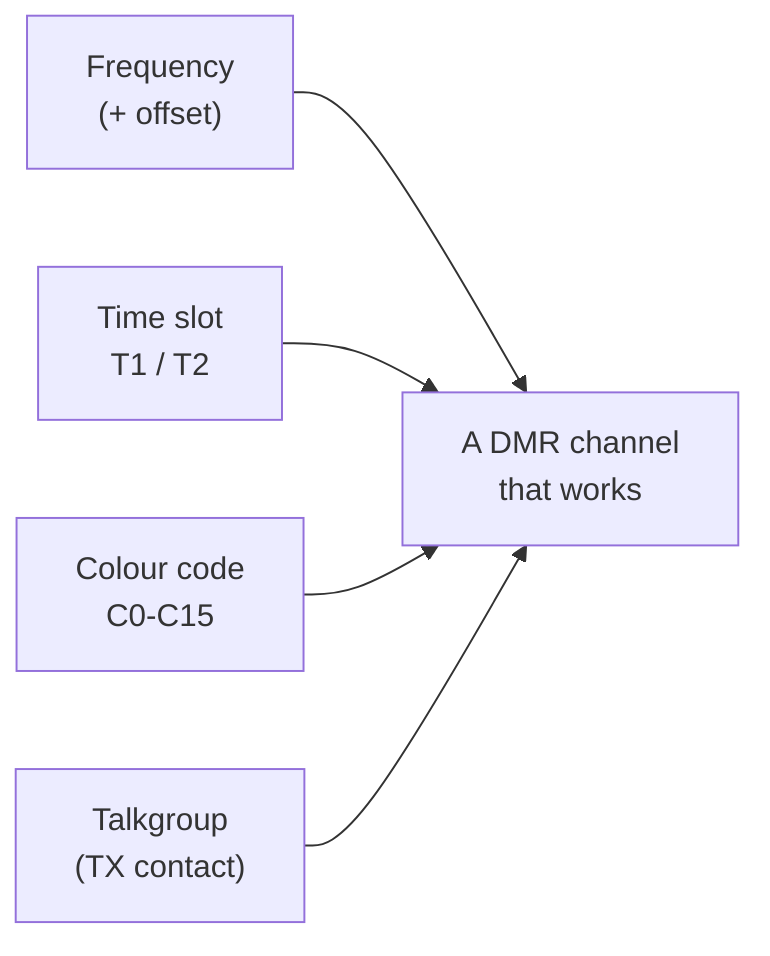
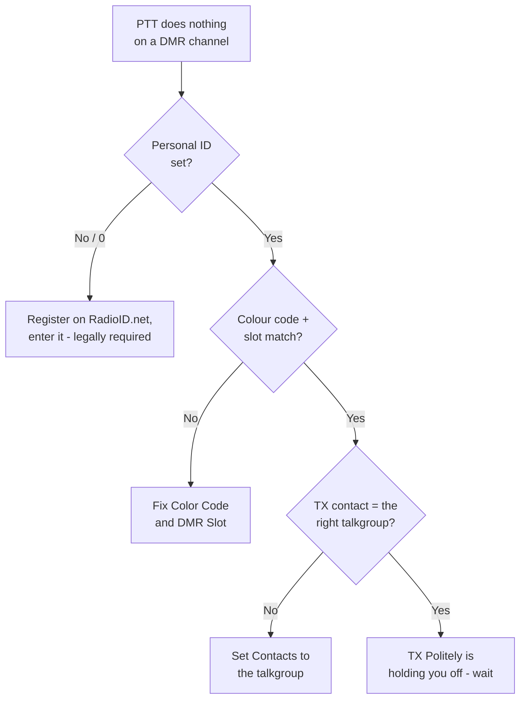
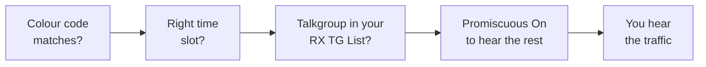
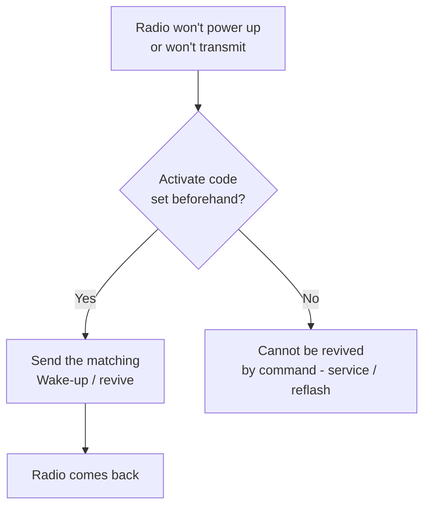

# Troubleshooting

Almost every "my RT-6D is broken" moment turns out to be one value in the wrong menu, not a fault in the metal — and a [DMR](outpost:entry/logbook73.handbook/dmr) radio with a colour screen, SSB in its receiver and (on the Pro) GPS and APRS gives you simply more values to get wrong than a plain analogue handheld. That is oddly reassuring: a settings problem is one you can fix in under a minute once you know where to look. This page is a calm, symptom-first field guide to the questions that send DMR newcomers to the forums at midnight — why the repeater ignores you, why the channel is silent, why your SSB sounds like a duck, why the beacon never appears — with the likely cause and the fix for each.

## How to troubleshoot without panic

Two habits make everything below faster.

First, **read the screen before you touch a menu.** The RT-6D's colour display packs the whole state of a channel into a few tags: `DMR D` marks a digital channel (versus the `AM`/`FM` analogue marker), `T1`/`T2` shows the [time slot](outpost:entry/logbook73.handbook/dmr-slots-talkgroups), `CXX` shows the colour code, `H`/`L` shows power, and a small `ENC` warns you encryption is on. Nine faults in ten are already spelled out there — the wrong slot, a colour code that doesn't match the repeater, an `ENC` you never meant to switch on. Because the screen shows two VFOs at once (A and B), also glance at which region — `A` or `B` — is the working band before you blame the radio. Learn to read all of this the way you did in [Getting Started](outpost:entry/logbook73.guide.rt-6d/getting-started).

Second, **hold the four-part model of a DMR channel in your head.** A working digital channel is always _four_ things lined up at once:

Miss any one of the four and the channel misbehaves in a way that _looks_ like a hardware fault but isn't. Most of this page is really just "which of the four is wrong, and how do you tell?" Everything below follows the shape **symptom → likely cause → fix**, with the causes ranked roughly by how often they are the culprit. If a fix touches an idea rather than a knob, the deep version lives in the handbook's DMR chapters, and we link out rather than repeat it.

## "DMR won't key the repeater or hotspot"

You can hear the digital [repeater](outpost:entry/logbook73.handbook/repeaters) (or your desktop hotspot) idling, you press PTT, and nothing gets through — no reply, sometimes a rejection tone, sometimes just silence. A DMR access point is a fussy doorman with several separate locks, and any one of them keeps you out. Walk them in order.

**You have no DMR ID.** Every DMR transmission carries your unique numeric identity, and the radio ships with `Personal ID` unset. Without it the network has no idea who you are, and a well-run repeater or [BrandMeister](outpost:entry/logbook73.handbook/dmr-networks) server refuses you outright. You must register (free) at [RadioID.net](https://radioid.net/), receive your (usually seven-digit) ID, and enter it once under `04 Digital Setting` → `Personal ID`. This is not optional and not a per-channel setting — it is your on-air callsign in numeric form. The wider registry story is in [DMR networks](outpost:entry/logbook73.handbook/dmr-networks).

**The colour code is wrong.** A DMR [colour code](outpost:entry/logbook73.handbook/dmr-slots-talkgroups) (`0`–`15`) is the digital equivalent of a [CTCSS](outpost:entry/logbook73.handbook/repeaters) access tone — the repeater only opens for the right one. If `05 Channel Settings` → `Color Code` doesn't match the value in the listing (hotspots are commonly `1`), the machine hears a valid signal it refuses to relay. Read the `CXX` tag on your screen against the directory entry; they must be identical.

**You are on the wrong time slot.** A DMR repeater carries two conversations at once on one frequency by splitting time into two slots, and most talkgroups are assigned to a _specific_ slot. Keying the wrong one drops your traffic into the void. Set `05 Channel Settings` → `DMR Slot` to the slot the machine assigns for that talkgroup; the `T1`/`T2` tag confirms it. (A simplex hotspot behaves as slot `2`.)

**The TX contact is the wrong talkgroup.** On DMR you don't just transmit — you transmit _to_ a [talkgroup](outpost:entry/logbook73.handbook/dmr-slots-talkgroups), and that talkgroup is the channel's TX contact. If `05 Channel Settings` → `Contacts` points at the wrong group (or at nothing), your voice goes somewhere no one is listening. Set it to the group you want, defined first in `04 Digital Setting` → `Contacts Set` as covered in [Contacts & Zones](outpost:entry/logbook73.guide.rt-6d/contacts-zones).

**TX Politely is blocking you.** The RT-6D's admit criteria — `05 Channel Settings` → `TX Politely` — decides _when_ the radio is allowed to key up. `Carrier Match` refuses to transmit while any signal is present; `CC match` refuses only when it detects a signal on your own colour code; `Impolite` transmits regardless. If the channel is occupied — or your squelch is hearing noise as a carrier — the PTT stays locked and it feels dead. Wait for a real gap; `Impolite` is the wrong default on shared amateur channels. The etiquette behind all of this lives in [DMR operating](outpost:entry/logbook73.handbook/dmr-operating).

If every lock is right and it _still_ won't go through, the mundane causes remain: you may be out of range (raise `05 Channel Settings` → `TX Power` from `Low` to `High`, or fit a better [antenna](outpost:entry/logbook73.handbook/antennas)), or the network link behind the repeater may simply be down.

## "The DMR channel is silent"

The access point is clearly there — other operators' radios light up, or the hotspot's own log shows traffic — but yours sits mute. Receiving DMR is _also_ a chain of matching conditions, and it fails silently. Check them in this order.

**The colour code doesn't match.** Just as on transmit, the RT-6D only _decodes_ a digital signal whose colour code matches `05 Channel Settings` → `Color Code`. A mismatch and the radio treats a perfectly strong DMR carrier as noise to ignore. This is the single commonest reason a busy repeater sounds dead.

**You're monitoring the wrong slot.** If the traffic you want is on `T2` and your channel is set to `T1`, you hear nothing of it — the two slots are, for listening purposes, two separate channels. Match `05 Channel Settings` → `DMR Slot` to where the talkgroup lives.

**The talkgroup isn't in your RX TG List.** This is the DMR-specific trap that catches everyone. Your channel only unmutes for talkgroups named in its receive list — `05 Channel Settings` → `RX TG List`, built from members you tick under `04 Digital Setting` → `TG List Set`. A talkgroup that isn't on that list is decoded and then discarded, so the activity never reaches your speaker. Add the group to the list, or select a list that already contains it.

**Promiscuous is off — turn it on to monitor everything.** Here is where the RT-6D does something its RT-4D sibling could not. `05 Channel Settings` → `Promiscuous` is a genuine all-hear toggle. With it `Off`, the channel plays only the talkgroups in your `RX TG List` — a tidy, quiet channel for talking. With it `On`, the radio unmutes for _every_ talkgroup passing through that frequency, slot and colour code, so you hear all the traffic a repeater or hotspot carries, list or no list. If a channel is silent and you expected to hear "everything", `Promiscuous` `Off` is very often why. It is a superb learning tool and a distracting talking one — monitor with it on, then switch it off before you settle on a group. The full picture is in [DMR operating](outpost:entry/logbook73.handbook/dmr-operating).

**Digital squelch set too tight.** `04 Digital Setting` → `SQ level` (`0`–`16`) sets how strong a digital signal must be before the radio opens. Wound up high, it can gate out weaker-but-perfectly-decodable traffic. Bring it down a step or two if marginal signals never break through.

## "Analogue won't open the repeater"

Half the RT-6D's life is ordinary FM, and an analogue [repeater](outpost:entry/logbook73.handbook/repeaters) fails for the classic analogue reasons, covered in full in the [Analogue & SSB chapter](outpost:entry/logbook73.guide.rt-6d/analog-ssb).

| Symptom                             | Likely cause                   | Fix                                                                                                      |
| ----------------------------------- | ------------------------------ | -------------------------------------------------------------------------------------------------------- |
| Repeater never relays your FM       | Wrong or missing sub-tone      | Set `05 Channel Settings` → `TX CTC/DCS` to the value the listing gives; the `CTC`/`DCS` tag should show |
| You transmit on the wrong frequency | Offset direction or size wrong | Set `05 Channel Settings` → `Offset Dir` (`+`/`−`) and `Offset Freq` to your band plan                   |
| Older machine ignores you entirely  | It wants a 1750 Hz toneburst   | Assign `Single Tone (1750Hz)` to a side key (via [Keys](outpost:entry/logbook73.guide.rt-6d/keys)) and send it                 |
| Squelch never opens on reply        | Analogue squelch too tight     | Lower `03 Analog Set` → `SQ level` (`0`–`10`; the middle is a sensible start)                            |
| Channel oddly narrow or distorted   | Bandwidth mismatch             | Set `05 Channel Settings` → `Band Width` (`Wide`/`Narrow`) to match the machine                          |

The offsets and tones are _not_ the RT-6D's invention — they belong to each repeater, and your national directory (the RSGB's ETCC list in the UK, RepeaterBook elsewhere) is the final word. A tone that is close but not identical fails as completely as no tone at all.

## "SSB sounds like a duck (or nothing at all)"

SSB receive is the RT-6D's party trick — set an analogue channel's demodulation to single sideband and you can listen to HF voice on an external antenna. But SSB is the fussiest mode to tune, and a wrong setting turns speech into a comical warble or a wall of hiss. It is **receive only** — the radio does not transmit SSB — so nothing here is a transmit fault.

**You are on the wrong demodulator.** SSB played through an FM or AM demodulator is unintelligible mush. Set `05 Channel Settings` → `RX Demodulation` to `SSB` on that channel. FM voice through `SSB`, equally, sounds wrong — the demodulator must match the mode of the signal you are chasing.

**You are tuned a hair off frequency.** This is the big one. Single sideband carries no carrier of its own, so the radio reconstructs the voice from your tuning point — and if you are even a little off, every pitch shifts with you. Too low and voices boom and slur; too high and they turn into chipmunks or Donald Duck. There is no "locked-on" click as with FM; you tune by ear until the speech sounds natural. Use the smallest `Freq Step` the band allows (set it in `01 Basic Settings` → `Freq Step`) so each nudge is tiny, and creep onto the signal a step at a time.

**You expected the wrong sideband or band.** Convention puts most amateur voice on lower sideband below roughly 10 MHz and upper sideband above it, and broadcast utility signals follow their own rules — so a channel that "won't resolve" may simply be the opposite sideband to what you set. And remember the receiver's coverage: SSB listening lives on the HF stretch you reach through an external antenna, not the VHF/UHF bands where the rubber duck works. The whole subject, including why a cheap wideband front end colours what it hears, is in [Analogue & SSB](outpost:entry/logbook73.guide.rt-6d/analog-ssb).

## "The APRS beacon never appears" (Pro)

On the RT-6D **Pro**, [APRS](outpost:entry/logbook73.handbook/aprs) beaconing lets your position pop up on the map. When it doesn't, the fault is nearly always one of three: the wrong frequency, no GPS fix, or a path/digipeater setting that stops you being relayed. Work the table top to bottom.

| Symptom                             | Likely cause                          | Fix                                                                                                                                                                                             |
| ----------------------------------- | ------------------------------------- | ----------------------------------------------------------------------------------------------------------------------------------------------------------------------------------------------- |
| Nobody hears the beacon             | Wrong APRS frequency                  | Set the APRS channel to `144.800` in Region 1 (Europe/UK); North America uses `144.390`. Mixing the two is the classic error                                                                    |
| Radio never beacons at all          | No GPS fix, in mobile mode            | With `Station Mode` = GPS mobile, the beacon waits for a valid position — get a fix first (see below)                                                                                           |
| You move but the map shows one spot | Station in fixed-coordinate mode      | You set `Station Mode` to fixed coords; switch it to GPS mobile so it beacons your live position                                                                                                |
| Heard locally but not on aprs.fi    | Path/digipeater not set to be relayed | Check `Beacon Setup` so your beacon requests a relay (the polite `WIDE1-1,WIDE2-1` two-hop path — see [APRS](outpost:entry/logbook73.handbook/aprs)); leave `DIGI Setup` off unless you truly mean to run a digipeater |
| Beacon garbled on receive           | Wrong demodulation tone               | Set `Demod Tone` for standard 1200-baud packet; a mismatch decodes to noise                                                                                                                     |
| Nothing on air, engine looks on     | APRS master switch off                | Set `APRS On-off` to on — it gates the whole engine                                                                                                                                             |

Two habits keep you a good network citizen. Enter your callsign before you beacon (the radio must not transmit APRS without it), and keep the path short: a two-hop request gets a handheld heard without stamping on every digipeater for miles. Longer paths from a handheld are the APRS equivalent of shouting. The full walk-through is in [GPS & APRS](outpost:entry/logbook73.guide.rt-6d/gps-aprs).

## "GPS won't get a fix" (Pro)

No fix, no position — and on a moving station, no beacon. The GPS receiver lives in `09 Extend / GPS` on the Pro.

- **GPS is switched off.** Set `09 Extend / GPS` → `GPS On-off` to on. It is off by default to save the battery, and an off receiver never fixes.
- **You are asking it to fix indoors.** GPS needs a clear view of the sky. Under a roof, in a car park or in a steel-framed building it may never lock. Step outside, hold the radio up, and give a _cold_ start several minutes to find enough satellites — the first fix of the day is always the slowest.
- **You are in fixed-coordinate mode.** If `Station Mode` (APRS) is set to fixed coords, or you have entered `Fixed Lat/Lon/Alt`, the radio uses those numbers and ignores the live receiver by design. That is correct for a home base; switch to GPS mobile if you want it to track.
- **Baud-rate or PC-monitor confusion.** `GPS Baudrate` and `PC Monitor` govern how the GPS data is streamed out; if you have been feeding position to a computer, leave these as the manual sets them for normal operation rather than a monitoring mode. When in doubt, `Initialization` in `01 Basic Settings` returns the radio to a known state — but back up your code plug first (below).

## "The programming software won't connect"

Sooner or later you will build channels, contacts and [zones](outpost:entry/logbook73.guide.rt-6d/contacts-zones) in software rather than by keypad — the only sane way past a handful of channels, and the standard way [code plugs](outpost:entry/logbook73.handbook/dmr-hotspots) are managed. When the **Radtel CPS** refuses to see the radio, it is almost always the physical link, not the radio.

| Cause                      | Tell-tale                 | Fix                                                                  |
| -------------------------- | ------------------------- | -------------------------------------------------------------------- |
| Charge-only USB-C cable    | Nothing enumerates at all | Use a genuine _data_ cable — many bundled leads carry power only     |
| Missing / wrong USB driver | Radio not on any COM port | Install the driver the CPS supplies; on Windows check Device Manager |
| Wrong COM port selected    | CPS times out reading     | Pick the port that appears when you plug the radio in                |
| Radio asleep or dimmed     | Read fails part-way       | Power it on, full battery, leave it un-dimmed while reading          |
| Dropped mid-read           | Partial read, error       | Reseat the Type-C connector, close and reopen the CPS, retry         |

Two rules save most of the grief. **Always read _from_ the radio before you write** — that pulls its current code plug into the app as your safety net. And **keep a saved backup** of a known-good code plug: if a write goes wrong, you restore in seconds instead of rebuilding by hand. The RT-6D programmes over the Type-C port on its side — the same jack you charge from — so make sure the CPS is pointed at that data port and nothing else.

## "The radio is dead and won't revive"

This is the frightening one, and it is entirely self-inflicted — so let us be clear about it. The RT-6D supports the DMR **Stun / Kill / Wake-up** commands: an operator with the right individual-call setup can remotely disable a radio, and _Kill_ can render a unit apparently lifeless.

The rule the manual is emphatic about: **always set an Activate code _first_.** Kill and Wake-up rely on `03 Analog Set` → `DTMF Control` being enabled and on the individual-call and code settings being in place _before_ anything goes wrong. If a radio is killed and no Activate code was ever configured, there is no command that brings it back — that is the whole point of the feature as an anti-theft measure, and it cuts both ways. Configure the codes when you set the radio up, keep them written down somewhere safe, and treat Stun/Kill (and Remote Monitor) as tools you understand before you ever point them at a radio. Never send a Kill as a test on a live channel. These live among the assignable functions in [Extras](outpost:entry/logbook73.guide.rt-6d/extras).

If the radio is dark for a _non_-command reason — a botched firmware flash, say — that is a service-and-reflash job, not a Wake-up. Back up your code plug before you ever touch firmware so a bad write is an inconvenience rather than a loss.

## "I can transmit but nobody hears me"

Your PTT keys, the red LED lights, and yet you raise no one — analogue or digital.

**You are outside your transmit band.** The RT-6D _receives_ far more widely than it may legally transmit: FM broadcast, aviation airband, and the full digital range all come in, but transmit is confined to your amateur allocations within `136–174` and `400–470` MHz. Tune a VFO to a broadcast or airband frequency and the transmitter is either dead or radiating where you must not. Bring the active channel back inside your [licence](outpost:entry/logbook73.handbook/getting-licensed)'s amateur bands — never seek a way to defeat the limit.

**You keyed the wrong VFO's PTT.** The RT-6D shows two regions, A and B, at once, and if `02 Key Define` → `Slaver PTT` has turned side-key 1 into the B-band PTT, it is easy to transmit on the region you didn't mean. Check which region carries the main-band marker, and press the PTT that matches it.

**A low battery is refusing to transmit.** A nearly flat 7.4 V pack makes a dirty signal, and the radio would rather receive-only than radiate badly. Receive keeps working, which is confusing. Charge it.

## Try it yourself

Prove the two things DMR newcomers most often get wrong, so you never wonder in the field.

1. **Prove your four-part channel before you key.** Pick a DMR repeater or your hotspot and, on its channel, read the screen out loud against the listing: frequency, `T1`/`T2` slot, `CXX` colour code, and the TX contact in `05 Channel Settings` → `Contacts`. Confirm `04 Digital Setting` → `Personal ID` holds your real RadioID.net number. Only then key up briefly with your callsign. You have just run the "won't key" checklist in reverse.
2. **Prove your software link before you rely on it.** With a data USB-C cable and the driver installed, open the Radtel CPS and _read from_ the radio. When its current code plug appears, save it as a named backup. You have now confirmed the cable, driver and port all work — and banked the safety net that turns any future mistake into a quick restore.

Both drills take five minutes and turn the checklists above into muscle memory.

## Key takeaways

- **Read the colour screen first** — `DMR D`, `T1`/`T2`, `CXX`, `H`/`L` and `ENC`, plus the A/B region marker, spell out most "faults" before you open a menu.
- **A DMR channel is four things at once** — frequency, slot, colour code and talkgroup — and nearly every "won't key" problem is one of the four out of line, plus a missing `Personal ID`.
- **Silent DMR receive is usually colour code, slot, or the RX TG List** — and the RT-6D's `Promiscuous` toggle is the all-hear switch: `On` to monitor everything, `Off` to settle on one group.
- **SSB is receive-only and tuning-critical** — set `RX Demodulation` to `SSB`, use a tiny `Freq Step`, and creep onto the signal until the voice sounds natural rather than like a duck.
- **On the Pro, a missing beacon is frequency, GPS fix, or path** — `144.800` in Region 1 (not `144.390`), a real GPS lock under open sky, and a short polite path.
- **Programming and revival failures are self-limiting** — use a _data_ USB-C lead, read before you write, keep a backup code plug, and set an Activate code _before_ you ever need Stun/Kill/Wake.

With the radio behaving, the last thing left is the operator — how to sound good, stay legal and be welcome on any talkgroup: [Best Practices & Etiquette](outpost:entry/logbook73.guide.rt-6d/best-practices).
