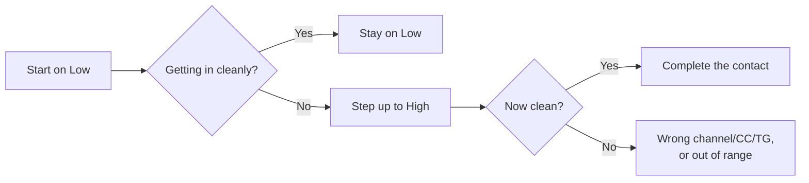
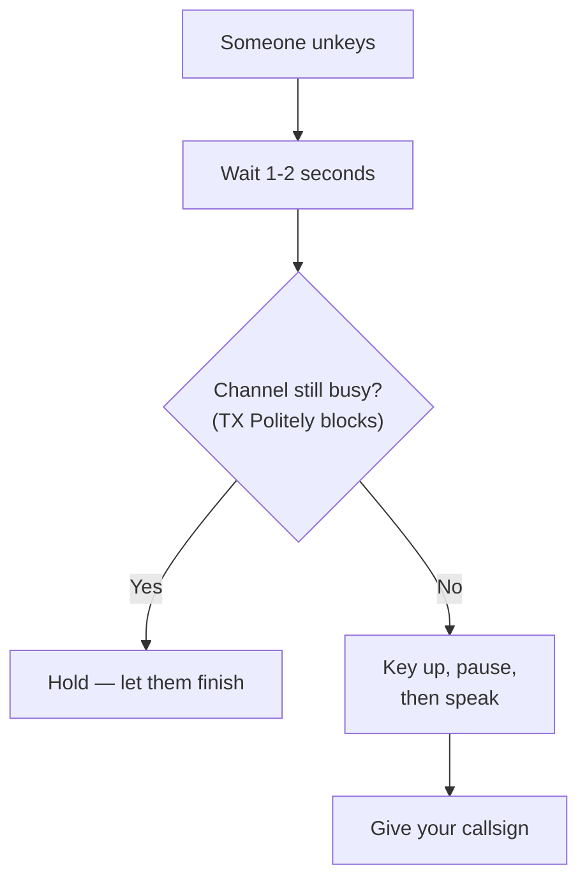

# Best practices and etiquette

A radio does exactly what you tell it, so the difference between a good operator and an awkward one lives almost entirely in a handful of habits. The RT-6D is a capable dual-band DMR handheld with a wide receiver, plenty of power, and — on the Pro — a GPS and APRS engine, which means it can just as easily be a nuisance as an asset. This chapter gathers the manners: how to run power, how to stay legal and in-band, how to share a busy DMR talkgroup gracefully, how to beacon your position without clogging the network, and how to look after the battery, the antenna and your own code plug. None of it is hard, and all of it makes you the operator other people are glad to hear.

## Run the least power that does the job

The RT-6D transmits at two levels — _Channel Settings → TX Power_ is `High` or `Low` — and the honest default for nearly everything is `Low`. Low from a handheld is around a watt, which reaches a local [repeater](outpost:entry/logbook73.handbook/repeaters), a nearby [hotspot](outpost:entry/logbook73.handbook/dmr-hotspots) or a station across town without trouble. High exists for the moment a contact is genuinely marginal — a weak simplex path, a distant machine — not as a permanent setting.

Two good reasons back this up. The first is courtesy: more power than you need means you reach further than you need, which is more chance of sitting on top of someone you cannot hear on a shared channel. The second is physics and battery — every extra watt is heat in your hand and charge off the cell, and on DMR the difference between Low and High at the far end is often nothing you can hear. [RF Power](outpost:entry/logbook73.handbook/rf-power) explains why "as low as works" is both polite and kinder to the radio.

If High does not fix a DMR problem, more power is rarely the answer — a dead talkgroup is usually a wrong [colour code, time slot or contact](outpost:entry/logbook73.handbook/dmr-slots-talkgroups), not a weak signal, and no wattage cures a misconfigured channel.

## Stay in-band, and leave encryption off

The RT-6D receives far more widely than it transmits. Its receiver covers FM broadcast, airband AM, SSB and the full `136–520 MHz` span, but it only _transmits_ on `136–174` and `400–470 MHz` — and even inside those ranges you may only key up where **your licence** permits. Listening is free for anyone; transmitting is not. Before a channel ever gets a transmit frequency, confirm it falls within your national amateur allocation and your licence class. The [SSB receive](outpost:entry/logbook73.guide.rt-6d/analog-ssb) feature is a lovely way to tune the HF bands on an external antenna, but it is receive-only — the radio cannot and must not transmit there.

The other hard line is **encryption**. The RT-6D offers DMR encryption (_Digital Setting → Encryption Set_, and per-channel _Channel Settings → Encryption_) with ARC4 and AES options. On the amateur bands this is almost universally **illegal** — amateur radio is an open service, and obscuring the content of a transmission defeats its whole legal basis. Keep every channel's encryption `Off`. The menu exists because the same hardware is sold into commercial markets where licensed private systems use it; on a ham channel it has no legitimate place. There is a fuller discussion in [DMR operating practice](outpost:entry/logbook73.handbook/dmr-operating), but the rule is short: leave it off, everywhere, always.

While you are thinking about the digital side, set your **DMR ID** correctly. You need one issued to your callsign from [RadioID.net](outpost:entry/logbook73.handbook/dmr-networks) before you transmit on DMR at all, entered once at _Digital Setting → Personal ID_. Transmitting with a borrowed, guessed or blank ID puts the wrong callsign on the network and confuses everyone downstream — it is the digital equivalent of not identifying.

## Share a DMR talkgroup gracefully

DMR packs two conversations onto one frequency using [time slots](outpost:entry/logbook73.handbook/dmr-slots-talkgroups), and a busy [talkgroup](outpost:entry/logbook73.handbook/dmr-networks) can carry a lot of people. Good manners here are mostly about timing and restraint.

### Leave a gap, and mind the slot

The single most common DMR discourtesy is transmitting the instant the other station unkeys. On a networked talkgroup your audio travels through a repeater or hotspot, across the internet, and out again — there is real latency, and other operators need a moment to break in. **Wait a beat** after each over. A one-to-two-second gap lets someone with priority traffic get a word in, and it lets the network settle. It also gives your own radio's _Channel Settings → TX Politely_ a chance to do its job: set to `Carrier Match` or `CC match` rather than `Impolite`, the RT-6D holds your transmission until the slot is actually free, so you slot into a gap instead of colliding. Pair that with _Basic Settings → TX priority_ set to `Busy`, which refuses to transmit onto a channel already in use.

Mind the **slot**, too. A DMR channel is tied to a specific time slot (`1` or `2` at _Channel Settings → DMR Slot_) as its keeper decided; transmitting on the wrong slot means talking over the other conversation sharing that frequency. Programme the slot the repeater or hotspot specifies and leave it — this is not a setting to fiddle with live.

A small physical habit helps as well: key the PTT, pause half a second, _then_ start talking. DMR clips the very start of an over while the link establishes, so the pause stops your callsign being chopped off.

### Disconnect dynamic talkgroups when you leave

On [BrandMeister](outpost:entry/logbook73.handbook/dmr-networks) and similar networks, calling a talkgroup that is not statically assigned to your slot creates a **dynamic** connection — your repeater or hotspot subscribes to that talkgroup for a while so you can hear replies. That is convenient, but if you wander off and leave it connected, your local machine keeps pulling that traffic and playing it out over everyone nearby for as long as the timeout lasts. When you finish on a dynamic talkgroup, **drop it** — key the network's disconnect contact (commonly talkgroup `4000`, but check your network) so the link releases cleanly. It is the digital equivalent of hanging up the phone rather than leaving it off the hook.

### Promiscuous mode is for listening, not talking

The RT-6D's _Channel Settings → Promiscuous_ option, when `On`, lets you hear **every** talkgroup active on the frequency and slot, not just the one your channel is set to. It is a wonderful monitoring tool — you discover who is about without hopping channels. But it is a _receive_ convenience: when you reply, you still transmit on the contact your channel is programmed with, so check what talkgroup you are actually about to key onto before you answer something you heard promiscuously. Monitoring widely and transmitting deliberately is the whole art, and [DMR operating](outpost:entry/logbook73.handbook/dmr-operating) walks through it.

## Beacon your position sensibly (Pro)

The RT-6D **Pro** carries a GPS and an [APRS](outpost:entry/logbook73.handbook/aprs) engine, and APRS is a place where a careless setup quietly annoys a lot of people you will never meet. Three things matter.

**The right frequency for your region.** APRS uses a single agreed channel per region, and getting it wrong means you beacon into silence — or, worse, onto the wrong service. In Europe, the UK and most of ITU Region 1 the APRS frequency is **`144.800 MHz` FM**; North America uses `144.390 MHz`. Set _APRS → APRS TX CH_ (and RX CH) to the correct one for where you are, not the one in a video from another continent.

**A sensible beacon interval.** APRS is a shared channel, and every beacon you send is airtime nobody else can use. A person walking does not need to report every few seconds — an update every minute or two is plenty, and a stationary station less often still. The interval lives in the beacon settings (_APRS → Beacon Setup_ / _Beacon Mode_, with the GPS record cadence under _Extend → GPS Record Time_ on the Pro). Smart-beaconing setups that speed up when you are moving and slow down when you stop are the ideal; a fixed fast beacon from a handheld is the classic way to flood a channel.

**A modest path, and no accidental digipeating.** The path is a request to be relayed. The polite standard for a portable or mobile station is a short two-hop path — the widely used `WIDE1-1,WIDE2-1` convention — which gets you heard without stamping across the network for counties around; longer paths from a handheld are the APRS equivalent of shouting. And leave the radio's own digipeater off: _APRS → DIGI Setup_ should stay disabled unless you genuinely mean to run a digipeater, because switching it on quietly turns your tracker into infrastructure that repeats other people's packets. You are a tracker — beacon where you are, at a gentle rate, on the right frequency, and let the network do the rest. [APRS](outpost:entry/logbook73.handbook/aprs) has the full picture.

## Battery, antenna and RF safety

A little care with the hardware keeps the radio working and keeps you comfortable.

**Antenna first, always.** Never transmit without an antenna fitted, and never with a badly matched one — a high [SWR](outpost:entry/logbook73.handbook/swr) reflects power back into the transmitter and, over time, damages it. If you fit an aftermarket or mobile antenna, check the match. And treat a _removable_ antenna as a responsibility: the RT-6D has more power and a better antenna than a licence-free set, which is exactly why it is not one — do not treat it as an [FRS/PMR446](outpost:entry/logbook73.handbook/vhf) walkie-talkie.

**Keep it off your head on transmit.** Hold the radio so the antenna is a little away from your face and eyes when you key up, particularly at High power — the sensible habit is a few centimetres of clearance, more if you are transmitting a lot. This is ordinary [RF exposure](outpost:entry/logbook73.handbook/rf-power) prudence, not alarm; a handheld watt is small, but the antenna is close, so give it room.

**Look after the cell.** Charge over the Type-C jack, avoid running the battery flat and leaving it there, and carry a spare or a USB power bank for a long day — lithium cells lose capacity in the cold, so a winter hill day drains faster than you expect. Use _Basic Settings → Save Mode_ to stretch standby, and turn the backlight timer (_Basic Settings → Light Timer_) down when you are conserving. The Pro's GPS is a steady drain when it is hunting for a fix, so switch it off (_Extend → GPS_) when you are not beaconing or logging.

## Look after your code plug and tracks

Everything that makes a DMR radio useful — the [contacts, zones, colour codes and talkgroups](outpost:entry/logbook73.guide.rt-6d/dmr-channels) — lives in a **code plug**, the configuration file you build in the Radtel CPS software and load over USB-C. That file is worth protecting.

- **Back it up before you change it.** Read the current code plug out of the radio and save a dated copy before every edit or firmware update. A code plug represents hours of work; a botched write or a bad flash can wipe it, and a backup turns a disaster into a five-minute restore. See [hotspots and code plugs](outpost:entry/logbook73.handbook/dmr-hotspots) for how the file is structured.
- **Keep the contact list current, not bloated.** DMR is far friendlier when incoming callsigns show as names, which means keeping a talkgroup and user list loaded. Refresh it from the network's database occasionally rather than letting it rot — but you do not need every ID on Earth; a sensible regional list is easier to manage than the whole planet.
- **Manage your GPS tracks.** On the Pro, _Extend → GPS Auto Record_ logs your position over time, and that memory fills up. Pull the tracks you want to keep off the radio, then use _Extend → Clear Track_ to clear space before a big trip — a full log stops recording new points. Treat the track memory like a camera's card: offload, then wipe.
- **Label and version your files.** Name your code-plug backups with the date and a note ("2m repeaters added"), so when something breaks you can roll back to the last version that worked rather than guessing.

## Try it yourself

Do a five-minute "good citizen" audit of your RT-6D:

1. Open a DMR channel and confirm _Channel Settings → TX Power_ is `Low` and _TX Politely_ is `Carrier Match` or `CC match`, not `Impolite`.
2. Walk every channel and confirm _Encryption_ is `Off` — no exceptions.
3. Check _Digital Setting → Personal ID_ holds _your_ DMR ID from RadioID.net.
4. On the Pro, confirm _APRS → APRS TX CH_ is the correct frequency for your region (`144.800` in Region 1) and that _DIGI Setup_ is off.
5. Connect the radio to the CPS over USB-C, read the current code plug, and save a dated backup. You now have a restore point.

Five minutes, and you are the operator other people are pleased to hear.

## Key takeaways

- **Run `Low` power by default** and reach for `High` only when a contact genuinely needs it — more power rarely fixes a DMR problem, which is usually a wrong colour code, slot or talkgroup.
- **Transmit only where your licence allows**, inside the radio's `136–174` / `400–470 MHz` transmit ranges; the wide receiver and SSB are for listening only.
- **Leave encryption off on every channel** — it is illegal on amateur bands — and transmit with your own DMR ID from RadioID.net.
- **Share the slot gracefully**: wait a beat between overs, pause after keying, set `TX Politely` and `TX priority = Busy`, and **disconnect dynamic talkgroups** when you leave.
- **Beacon sensibly (Pro)**: correct regional APRS frequency (`144.800` in Region 1), a gentle interval, a short two-hop path, and the digipeater left off.
- **Mind the hardware**: never transmit without a good antenna, keep it clear of your head, look after the battery, and switch GPS off when idle.
- **Back up your code plug and clear your GPS tracks** — a dated backup before every edit or flash turns a wipe into a quick restore.

You now have the whole radio and the manners to go with it. To go deeper into the digital mode itself — how slots, colour codes, talkgroups and networks actually fit together — start at the handbook's [DMR overview](outpost:entry/logbook73.handbook/dmr).
