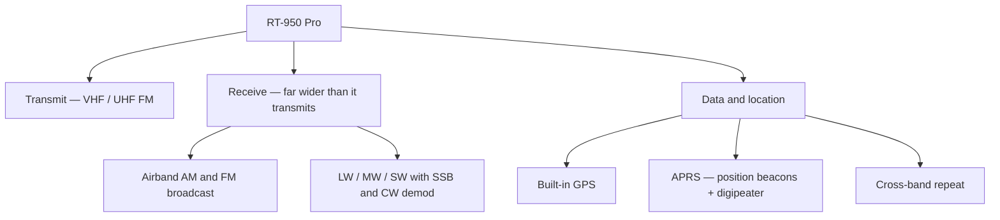

# Why this guide (and why a cheap radio)

Plenty of radio amateurs own a radio that cost a fraction of their main rig, tries to do a dozen things at once, and shipped with a nine-page manual that explains almost none of them. The Radtel RT-950 Pro is one of those radios — a genuinely ambitious budget multi-band handheld — and for a great many people it is the doorway into the whole hobby. This guide takes it seriously, because it deserves to be taken seriously.

## Why write a book about a cheap radio?

The factory manual for the RT-950 Pro is nine pages long. It lists the menu items and stops there: it will tell you that menu item `RP-STE` exists and offers values `OFF/1/2…10`, but not what a repeater squelch tail is, why you would eliminate it, or which value to choose. That is the gap this guide fills. For every setting on the radio, we answer the questions the manual skips — **what it does, what the radio is doing inside, why the feature exists at all, sensible values, and whether you should touch it.**

The pay-off is bigger than one radio. Because the RT-950 Pro exposes so much — duplex offsets, tone squelch, a full APRS packet stack, cross-band repeat — learning it properly teaches you a working slice of amateur radio itself. Get fluent here and you can sit down in front of a rig ten times the price and already know what its menus are for.

## A note for experienced operators

If you have been licensed for years, you may be wondering why a reference like this should exist for a radio you might not reach for first. Fair — so let us be honest, and accurate. These are not lab-grade radios. To achieve their low price and broad frequency coverage, they typically use less selective front-end filtering than premium amateur handhelds, and in high-RF environments this can lead to receiver overload, intermodulation and "ghost" signals — a behaviour well documented on models like the UV-5R, and something to be aware of particularly with inexpensive wideband handhelds. Their transmit performance is generally acceptable for amateur use, but its consistency and spectral purity are not on a par with higher-end equipment. The build is functional rather than luxurious, and few would argue they are the equal of a well-engineered Yaesu, Icom or Kenwood on a crowded band.

But two things are also true. First, a cheap radio that gets someone learning offsets, CTCSS tones, APRS paths and power discipline is worth far more to the hobby than an expensive one that stays in its box because its owner is afraid of it. These radios bring people **in** — and this guide's job is to make sure they arrive understanding what they are doing, transmitting cleanly and legally, and behaving well on shared channels. Second, the skills transfer. An operator who can explain why `WIDE1-1,WIDE2-1` is the polite APRS path, or why you run the lowest power that does the job, is a good operator on any equipment.

So wherever this guide makes a recommendation, it pushes towards clean, legal, considerate operation: lowest sensible power, no accidental digipeating, tones set correctly, and always within licence conditions. If that is the operator a cheap radio produces, everyone wins.

## What the RT-950 Pro actually is

Under the cryptic menus sits a surprisingly ambitious little radio:

In plain terms:

- **It transmits** on the 2 m (144 MHz) and 70 cm (430 MHz) amateur bands in FM — the bands a new licensee lives on — and, in FM only, on 6 m and the 27 MHz CB segment as well, each with real limits and legalities (covered just below).
- **It receives much more widely than it transmits.** It will pull in the aviation [airband](outpost:entry/logbook73.handbook/vhf) in AM, ordinary FM broadcast, and — genuinely unusual at this price — long, medium and short wave with proper **SSB and CW** demodulation. Shortwave listening is a real highlight (medium wave is weaker — early batches were notoriously deaf there — and owners report a weak patch around 250–275 MHz on some units); even so, there is a small [HF receiver](outpost:entry/logbook73.handbook/receivers) hiding in your pocket.
- **It knows where it is.** A built-in GPS gives it position, and feeds the next feature.
- **It speaks APRS.** A built-in [APRS](outpost:entry/logbook73.handbook/aprs) engine and TNC handle position beaconing and a one-hop digipeater, usable over the air or bridged to a phone over Bluetooth. (Station-to-station _messaging_ exists but is immature in current firmware — this guide is candid about what works and what does not.) It is the feature the factory manual explains least and this guide explains most.
- **It can be a cross-band repeater**, listening on one band and repeating on the other — a genuinely useful trick covered in its own section.
- **It shows three VFOs at once** (A, B and C) on a colour screen, and can watch all three — the radio's "tri-watch".

## What it transmits — and the FM-only catch

The receiver roams almost everywhere; the _transmitter_ is fussier. Two things matter before you key up. **It transmits FM only** — its lovely AM, SSB and CW abilities are receive-only — and its transmit bands are much narrower than its receive coverage, so for a UK amateur the bands you will really use are **2 m, 70 cm and the FM part of 6 m**. It also has a CB (27 MHz) transmitter that, tempting as it looks, **you should not use**: it is not a type-approved CB set, so operating it there is not legal.

The full story — the FM-only limit, CB legality, where 6 m FM is worth having, and why the radio does _not_ transmit on 10 m despite what some reviews claim — has its own chapter: [CB, 6 m & the FM-only Limit](outpost:entry/logbook73.guide.rt-950-pro/cb).

## What it is not

Knowing a tool's limits is part of using it well, so here is the honest list:

- **It is a broad receiver, not a fussy one.** The wide coverage that makes it fun comes with less selective front-end filtering than a premium handheld, so in a strong-RF spot — near a broadcast, paging or cellular site, or on a big outdoor antenna — it can overload and desense, and serve up [ghost signals](outpost:entry/logbook73.handbook/overload-and-ghost-signals) that are not really on the frequency you are hearing. This is well documented on the UV-5R and reported (varying from unit to unit) on the RT-950 Pro, and is common to inexpensive wideband handhelds generally — premium radios from the established makers cover the same ranges with much better front ends. In everyday portable use you will rarely notice it; if a "repeater" appears on an odd frequency next to a transmitter site, suspect intermod before you believe it. A modest antenna, or a band-pass filter for fixed use, tames it.
- **Its transmit is generally acceptable, not premium.** Modern budget handhelds generally meet the regulatory requirements of the markets they are sold in, and current production is much cleaner than early examples — but consistency and spectral purity still do not match higher-end amateur equipment. The specifics: the UV-5R's spurious emissions have a documented history (early units often exceeded the amateur limit; independent tests of recent production generally show them meeting it, if with less margin than premium radios), while the RT-950 Pro's transmitter has never been independently measured, so any confident "it's clean" claim — including the exact dB figures that circulate online — is unverified rather than proven. Either way the practical answer is the same: operate in-band, run the lowest power that does the job, and add a band-pass filter for fixed or repeater use.
- **The RT-950 Pro's firmware is young.** It updates often, its APRS messaging is half-finished, and it is not CHIRP-compatible (you programme it with the vendor software or phone app). Owners also report that a bad firmware flash can brick the radio — its bootloader does no integrity check — so update deliberately and keep a backup, and expect a little variation between units. None of this is a deal-breaker; it is the reality of a fast-moving budget product, and this guide flags each quirk where it lives.
- **It will transmit where it should not.** Like most radios of its kind it can be made to transmit outside the amateur allocations — and it is that capability, not spurious emissions, that actually drew regulators' attention to Baofeng-type radios (a nuance the internet routinely garbles). Do not use it out of band. **Transmit only where your licence permits** — for a UK Foundation licensee, that means your 2 m and 70 cm amateur allocations at your permitted power, and nothing else.

## How it actually tests

The RT-950 Pro is new enough that there is little lab-grade test data — mostly owner and reviewer reports — so treat this as the current picture rather than the last word, and expect some unit-to-unit variation:

- **Receive:** shortwave/HF SSB and VHF airband are widely praised; weak-signal sensitivity and overload behaviour at strong-RF sites are reported to vary between units ([KE2YK review](https://ke2yk.com/2025/10/22/dont-buy-the-hype-a-brutally-honest-review-of-the-rt950-pro/), [RadioReference discussion](https://forums.radioreference.com/threads/rt-950-pro-v-rt-880-some-early-thoughts.494760/)).
- **Transmit power:** measured at roughly 6.5–8.5 W against a "10 W" specification ([KE2YK](https://ke2yk.com/2025/10/22/dont-buy-the-hype-a-brutally-honest-review-of-the-rt950-pro/)).
- **Transmit purity:** no independent laboratory measurement exists; the precise dB figures circulating online are not backed by a published test, so we treat spectral-purity claims as unverified ([RadioReference](https://forums.radioreference.com/threads/radtel-rt-950-fcc-restrictions.500929/)).
- **Firmware & APRS:** position beaconing works; station-to-station messaging is unfinished; firmware updates are frequent and it is not CHIRP-compatible ([Charlotte ARC](https://www.carc-nc.us/forums/threads/radtel-rt-950-pro-thoughts.629/)).
- **Audio:** consistently described as clear and punchy — a genuine strength for the price.

These are enthusiast reports rather than a controlled test lab, so where a claim matters — transmit purity especially — this guide is careful to say what is _measured_ versus what is _assumed_.

## Who this guide is for, and how to read it

You are welcome here whether you are a brand-new licensee who has just unboxed one of these, a listener exploring what the receiver can hear (much of this radio is legal to _use_ unlicensed, since receiving is not transmitting), or an old hand who simply wants a menu reference that finally explains everything.

The guide is built in sections, and you do not have to read them in order:

- **Getting Started** orients you: the layout, the display, the modes, and how to think about programming. Read this first.
- **Every Menu Explained** is the reference — a one-page menu map plus a chapter for each group of settings. Dip into it whenever a menu item puzzles you.
- **Radio Theory** is the _why_ — the concepts the settings rest on, cross-linked to the main [handbook](outpost:entry/logbook73.handbook) for the full story.
- **Practical Configurations** gives you ready-made setups to copy straight onto the radio.
- **Troubleshooting** and **Best Practices** are the "why won't it…" and the "how to be a good operator" sections.

A word on the slant: recommendations here lean towards **UK amateur practice** — Foundation-friendly, with UK band-plan conventions and licence-free comparisons like [PMR446](outpost:entry/logbook73.handbook/uhf). The underlying theory is universal, so if you are elsewhere, take the concepts and check your own national band plan and licence conditions.

## Before you begin

Three things make the rest of this guide go smoothly:

1. **Charge the battery fully** before first use, and fit the supplied antenna finger-tight — never transmit without an antenna attached.
2. **Know your licence conditions.** If you are not yet licensed, you can still follow every receive-only part of this guide legally; see [Getting Licensed](outpost:entry/logbook73.handbook/getting-licensed) when you are ready to transmit.
3. **A quick safety note.** A handheld is a transmitter next to your head. Keep the antenna a few centimetres from your face when transmitting, use the lowest power that does the job, and never key up into a damaged or missing antenna. That is the whole of RF safety for a radio this size; [RF Power](outpost:entry/logbook73.handbook/rf-power) has the reasoning.

## Key takeaways

- The RT-950 Pro is a budget multi-band handheld whose nine-page manual hides real capability behind cryptic menus; this guide is the reference it should have shipped with.
- It **transmits** on 2 m and 70 cm FM, **receives** far more widely (airband, broadcast, HF SSB/CW), and includes **GPS, a full APRS stack and cross-band repeat**.
- It has the honest limits of an inexpensive wideband radio — less selective front-end filtering that can overload in strong RF, transmit that is generally acceptable but not premium-grade, and (on the RT-950 Pro) young firmware — so operate cleanly, in-band, at the lowest sensible power, and only where your licence allows.
- Learning it well teaches transferable amateur-radio skills; a cheap radio in the hands of a careful operator is a gift to the hobby, not an embarrassment.
- Read **Getting Started** to get oriented, then treat the rest as a reference you dip into.

Ready? Let's pick it up and learn our way around it — [Getting Started: Layout, Display & Modes](outpost:entry/logbook73.guide.rt-950-pro/getting-started).
