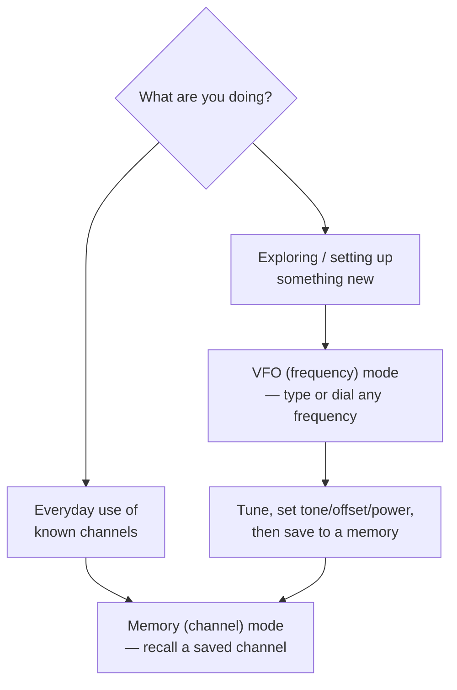
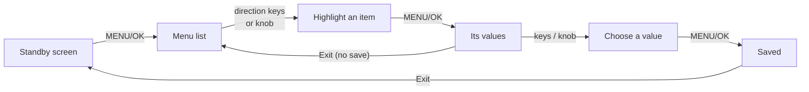

# Getting started: layout, display and modes

The fastest way to be put off a radio is to press the wrong button in the first five minutes and end up somewhere baffling with no idea how to get back. So before we touch a single menu, let's get properly oriented: what every control does, what the screen is telling you, and the two or three ideas — VFOs, modes, zones — that the whole radio is built around. Twenty minutes here and the rest of the guide will feel obvious.

## The front panel

There is not much to the front panel — a handful of controls, and each one earns its place. Don't try to memorise them; just get a feel for what does what as we walk through them in turn, top to bottom.

1. **Antenna (SMA-F).** The socket is a female SMA; the supplied antenna screws in finger-tight — never force it, and never transmit without it attached, as a transmitter with nowhere to send its power can damage itself. Any replacement must suit the intended band, connector and operating environment; more in [Antennas](outpost:entry/logbook73.handbook/antennas).
2. **Channel knob.** The top-left knob is your main selector. In memory mode it steps through your stored channels; in frequency mode it tunes the active VFO up and down by the current step size. It is the control your thumb will rest on.
3. **Volume / power knob.** The top-right knob switches the radio on with a click and sets the volume — clockwise for on and louder, anticlockwise to a click for off. That is _all_ it does, which is a mercy on a radio with this many features.
4. **Indicator LED.** A small light above the screen: it glows on transmit and shows charging status in the dock. A quick glance confirms you are actually transmitting — useful when you are not sure the PTT has taken.
5. **Colour display.** The screen shows up to three frequencies at once. It rewards a proper read, so it gets its own section next.
6. **PTT A / B / C, and side key 2.** This is the radio's clever party trick. Rather than one transmit button, the left edge carries **three** — one for each of the VFOs A, B and C — so you can transmit on any of the three without first making it the active one. Below them, **side key 2** is programmable (monitor, torch, and more), set in [Keys, Bluetooth, Signalling & Settings](outpost:entry/logbook73.guide.rt-950-pro/menus-system).
7. **Direction keys.** The four-way pad moves you around menus and, on the standby screen, nudges settings up and down.
8. **The function keys.** Four keys do the heavy lifting, and each has a _second_ job on a long press:
   - **MENU/OK** — enter the menu, and confirm a selection. _Long press:_ spectrum display.
   - **A/B/C** — switch which VFO is active. _Long press:_ remote sub-tone (CTCSS/DCS) scan.
   - **Exit** — step back out of a menu, or clear an entry. _Long press:_ frequency sweep mode.
   - **V/M** — swap between frequency (VFO) and memory (channel) mode. _Long press:_ jump straight to the APRS screen.
9. **Numeric keypad.** In frequency mode, type a frequency directly — far quicker than winding the knob. In memory mode, the number keys jump to channels. And once you have assigned them (see [Keys, Bluetooth, Signalling & Settings](outpost:entry/logbook73.guide.rt-950-pro/menus-system)), a **long press** on `0`–`9` fires a quick function of your choosing.

> **The single most useful habit:** when you get lost, press **Exit** a few times. It walks you back out of any menu to the standby screen, undoing nothing. There is no way to get so deep you cannot escape.

## Understanding the display

The standby screen looks busy because it is showing you three radios at once. Once you know the anatomy of one row, you know all three.

```viz
{
  "type": "display",
  "title": "RT-950 Pro — the standby display",
  "caption": "Three VFOs at once. The highlighted row (here, B) is the primary — the one the main PTT transmits on. Every tag around a frequency is a setting you can change.",
  "screen": {
    "rows": [
      { "vfo": "A", "freq": "127.000", "mode": "AM", "power": "H", "bw": "W", "zone": "Zone 1 · 001" },
      { "vfo": "B", "freq": "435.000", "mode": "FM", "power": "M", "bw": "N", "shift": "-", "zone": "Zone 1 · 002", "active": true },
      { "vfo": "C", "freq": "145.500", "mode": "FM", "power": "L", "bw": "W", "tone": "CT", "zone": "Zone 1 · 003" }
    ],
    "topIcons": ["GPS", "BT", "100%"],
    "bottomTags": ["VOX", "APRS", "MO", "TW", "LOCK"]
  },
  "callouts": [
    { "n": 1, "x": 12, "y": 3, "label": "Status icons", "side": "left" },
    { "n": 2, "x": 8, "y": 17, "label": "VFO letter", "side": "left" },
    { "n": 3, "x": 32, "y": 17, "label": "Frequency", "side": "left" },
    { "n": 4, "x": 90, "y": 15, "label": "Mode tags", "side": "right" },
    { "n": 5, "x": 88, "y": 30, "label": "Zone · channel", "side": "right" },
    { "n": 6, "x": 62, "y": 50, "label": "Active VFO", "side": "right" },
    { "n": 7, "x": 18, "y": 95, "label": "Feature strip", "side": "left" }
  ]
}
```

1. **Status icons** run along the top: GPS (on and locked), Bluetooth, and the battery gauge, plus others that appear as needed — a padlock when the keypad is locked, a speaker-with-slash for standby, a musical note for the DTMF side tone, and a `Z` when repeater mode is on.
2. **The VFO letter** — `A`, `B` or `C` — tells you which of the three rows you are looking at.
3. **The frequency** is the big number: what that VFO is tuned to.
4. **The little tags** around the frequency are live settings, and learning to read them saves you diving into menus to check: the **power** level (`H`/`M`/`L`), the **bandwidth** (`W` wide or `N` narrow), the **duplex shift** (`+`/`−`) when set for a repeater, and the **sub-tone** tag (`CT` for CTCSS, `DCS` for digital) when a tone is active. The **modulation** (`FM`/`AM`) shows too.
5. **Zone and channel** appear in memory mode: which zone (folder) you are in, and the channel number within it.
6. **One row is highlighted** — the **active**, or primary, VFO. This matters more than it looks: the main transmit key sends on _this_ row, menu changes you make apply to _this_ row, and the direction keys tune _this_ row. The `A/B/C` key moves the highlight.
7. **The bottom row** is a status strip of features that are switched on: `VOX` (voice-activated transmit), `APRS`, `MO` (monitor open), `TW` (tri-watch), and the lock. If the radio is behaving oddly — transmitting on its own, say — this strip usually explains why.

## VFO and memory: the two ways to tune

Every setting on this radio hangs off one basic choice: are you dialling a frequency by hand, or recalling one you saved earlier? Those are the two **modes**, and the `V/M` key swaps between them.



**VFO (frequency) mode** gives you the whole band to roam. Type a frequency on the keypad or wind the knob, and the radio goes there. This is where you _set things up_: find a repeater, add its offset and tone, choose a power level — and then store the lot into a memory so you never have to do it again.

**Memory (channel) mode** recalls those stored channels. A memory is not just a frequency: it remembers the frequency, the duplex offset, the CTCSS/DCS tones, the bandwidth, the power level and a name, all in one recall. This is where you live day to day — spin to "GB3 local" and everything is already correct.

Two things trip people up. First, **memory mode is unavailable until you have stored at least one channel** — a brand-new radio has nothing to recall, so `V/M` appears to do nothing. Store a channel and it springs to life. Second, **many settings can only be edited in VFO mode**: the radio will not let you re-tune or re-tone a memory channel directly, because a memory is a saved snapshot. Change it in VFO mode, then overwrite the memory.

## A, B and C: the three VFOs

Most handhelds give you two VFOs; the RT-950 Pro gives you three, and shows all of them at once. Think of A, B and C as three little independent radios sharing one screen, one speaker and one set of controls. Each has its own frequency, mode, tone and power.

Only one is **active** at a time — the highlighted row. The active VFO is the one the knob tunes, the one the menu edits, and the one the **main PTT** transmits on. Press the `A/B/C` key to move the highlight between them.

The three transmit buttons on the side change the game slightly: **PTT A, B and C each transmit on their own VFO regardless of which is active.** So you can leave B highlighted for tuning while still firing off a transmission on C by pressing its dedicated key. Once that clicks, you will use it constantly.

Finally, **tri-watch** (`TW` on the display) tells the radio to keep an ear on all three VFOs, hopping between them so it can catch a call on any one. It is the reason to think of A/B/C as _jobs_: a common setup is A on the aviation airband to listen out, B on your local [repeater](outpost:entry/logbook73.handbook/repeaters), and C on the 2 m [calling channel](outpost:entry/logbook73.handbook/repeaters) `145.500 MHz`, with tri-watch keeping all three live. You switch it on with the confusingly-named **Standby Set** item in [The Radio Menu](outpost:entry/logbook73.guide.rt-950-pro/menus-radio) — it is the tri-watch toggle, not a power setting — and the tag on the bottom strip reads `TW` when three VFOs are watched, `DW` when only two are.

## The startup modes: Normal, Test, Super and Radio

Everything above describes the radio in its ordinary state — but the RT-950 Pro actually boots into one of several **startup modes**, each chosen by holding a key as you switch the radio on. What they mostly change is one thing: **how much of the radio's frequency range is unlocked.** You will spend almost all your time in the first one; the rest are advanced, and two of them will happily let you transmit somewhere your licence does not.

> **The rule that governs all of them.** These modes only move the radio's _own_ guard-rails. They do **not** grant you permission to transmit anywhere — that comes from your [licence](outpost:entry/logbook73.handbook/getting-licensed) and nothing else. Unlocking a band you may not use and then keying up on it is illegal however easy the radio makes it. Treat Test and Super mode as _receive_ tools unless you positively know the band is yours to transmit on.

**Normal (Work) Mode — where you should live.** The default: just switch on, holding nothing. Transmit is held to the ranges the radio ships permitted for — your 2 m / 70 cm / 6 m amateur allocations and the 27 MHz CB segment — and the VFOs tune the ordinary bands. If you are ever unsure which mode you are in, powering off and on without touching a key brings you straight back here.

**All Band Test Mode — the band-unlock.** Hold the **down direction key** while switching the radio on; the very same combo switches it back to Work Mode, so it is a toggle you set once. Test Mode lifts the tuning restrictions — you can change a VFO's work band to the extended `18–64 MHz` low range, park a VFO (commonly **C**) on the 27 MHz CB channels, and reach oddities such as the 33 MHz band that Work Mode hides. As a wide **receive** tool it is genuinely handy. Two things to know: some bands _only appear_ in this mode, which is why a VFO sitting on CB here can drop the watch tag from `TW` to `DW` (that CB VFO falls outside the tri-watch); and because Test Mode also removes the _transmit_ guard-rails, staying legal is now entirely down to you.

**Super Mode — the widest-open state.** Hold **`8`** together with the **`PTT-C`** side key (some units label it PF1) while switching on, and keep holding until **`Supermode`** appears on the display. This opens the radio furthest of all — extended transmit and receive right across the hardware's capability. It is an experimental / bench mode, not an operating one: reach for it only if you understand exactly what you are doing, and re-read the rule above before you so much as think about the PTT.

**Radio Mode — the broadcast receiver.** Not a band-unlock at all, but listed here because you reach it the same way: **long-press `0`** to drop into the FM / AM / shortwave broadcast receiver (`0.15–30 MHz`). It is receive-only, and covered in full in [The Receive-only Radio](outpost:entry/logbook73.guide.rt-950-pro/receive-radio).

## Finding your way around the menu

The menu is a single long list, and you drive it with four movements. There is no way to break anything by exploring — changes only take effect when you confirm them, and `Exit` always backs you out.



In words: **MENU/OK** opens the menu and confirms; the **direction keys** or the **channel knob** move the highlight; **MENU/OK** again drops into an item's values; you pick one and press **MENU/OK** to save; **Exit** steps back without saving. If you walk away, the menu times out on its own and returns to standby.

One quirk worth knowing early, because it causes real confusion: **in memory (channel) mode, several menu items are greyed out or refuse to change.** Bandwidth, tones, scan settings and the like belong to the _channel_, not the radio, so to change them you switch to VFO mode, make the change there, and save it back into the memory. Only the power level can usually be nudged directly on a stored channel.

## How to think about programming

You can put channels into this radio two ways, and the right answer depends on how many.

**By hand**, using the keypad and menu, is perfect for a handful of channels — your two local repeaters and a couple of simplex frequencies. Tune it in VFO mode, set the offset, tone and power, then save it to a memory and give it a name. Ten minutes, no cables.

**By software** is the answer for anything more. The RT-950 Pro programs both over a USB cable and over **Bluetooth to a phone app** (the vendor's own software or app — unlike the UV-5R, it is not CHIRP-compatible), and software turns an afternoon of thumb-aching menu-diving into a five-minute job: type your channels into a table, drag them into order, and write them all at once. Just as importantly, software lets you **save a backup** — so a fumbled factory reset costs you nothing.

However you load them, organise your channels into **zones**. A zone is simply a folder — the radio holds up to 15 of them, 64 channels each — and a little planning here pays off forever:

| Zone           | What goes in it                                          |
| -------------- | -------------------------------------------------------- |
| Repeaters      | Your local 2 m and 70 cm machines, offsets and tones set |
| Simplex        | Calling and working channels for direct contacts         |
| Airband        | Nearby airfields and approach frequencies (receive only) |
| PMR446         | The licence-free channels, for family and events         |
| APRS / data    | `144.800 MHz` and any packet frequencies                 |
| Marine / other | Coastguard, marine and anything else you monitor         |

Group by _purpose_, not by band, and you will always know where to spin to. Build the list in software, keep a backup, and you have a radio that is genuinely yours.

## Try it yourself

With a charged battery and the antenna fitted:

1. **Power on and set the volume** with the top-right knob. Open the squelch briefly by holding the monitor function (side key or menu) and you will hear the background hiss — that is the receiver actually listening.
2. **Go to VFO mode** (press `V/M` until the zone/channel tags disappear) and type `145.500` on the keypad — the 2 m FM calling channel in Region 1. Listen for a few minutes at a busy time of day.
3. **Give the three VFOs three jobs.** Press `A/B/C` to highlight each row in turn and set one to an airband frequency, one to your nearest repeater's output, and one to `145.500`. Switch on tri-watch — _Radio → Standby Set → ON_ — and let it hop.
4. **Open the menu** with `MENU/OK`, find **`SQL`** (squelch), and change the value while listening: low numbers let the hiss through, high numbers silence weak signals. You have just felt what squelch does — the theory is in [What the Settings Really Mean](outpost:entry/logbook73.guide.rt-950-pro/theory).
5. **Toggle `V/M`** back and forth and watch the display: the zone/channel tags appear in memory mode and vanish in frequency mode.

Nothing here can harm the radio, and `Exit` always brings you home.

## Key takeaways

- The two **top knobs** select/tune and set volume/power; the **three side PTTs** each transmit on their own VFO (A/B/C); the four **function keys** each have a second job on a long press.
- The display shows **three VFOs at once**; the **highlighted** one is active — it tunes, edits and transmits on the main PTT. The tags around each frequency are live settings (power, bandwidth, shift, tone).
- **VFO mode** dials any frequency (for setting up); **memory mode** recalls saved channels (for daily use). Memory mode needs at least one stored channel, and most per-channel settings are edited in VFO mode then saved.
- The radio boots into a **startup mode** chosen by holding a key at power-on: **Normal (Work) Mode** by default (transmit-limited — where you should stay), **All Band Test Mode** (hold the down key — unlocks extended tuning, CB and 33 MHz), **Super Mode** (`8` + `PTT-C` — widest open) and **Radio Mode** (long-press `0` — the broadcast receiver). Test and Super mode drop the transmit guard-rails, so your **licence**, not the radio, is what keeps you legal.
- The menu is one long list driven by **MENU/OK → move → MENU/OK → Exit**; changes only apply when confirmed, and `Exit` always escapes.
- Program a few channels by hand, many by **software** (cable or Bluetooth), and organise everything into **zones** by purpose — then keep a backup.

Now you can find your way around, two short chapters cover what the radio does beyond the 2 m and 70 cm ham bands — beginning with what it can (and cannot) transmit, in [CB, 6 m & the FM-only Limit](outpost:entry/logbook73.guide.rt-950-pro/cb).
