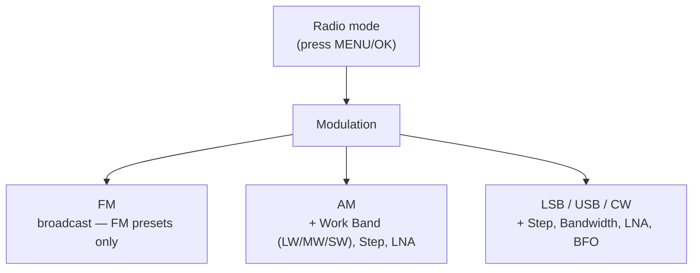

# The receive-only radio: AM, SW and SSB

The transmitter is the narrow part of this radio; the _receiver_ is the show-off. Hidden behind an unlabelled key is a genuine general-coverage receiver — long, medium and short wave, the aviation airband, single sideband and Morse — that turns a £-cheap handheld into a pocket world-band set. Almost nobody finds it by accident, because the factory manual barely mentions it and the menus to drive it are not where you would look. This chapter is the map: what the mode is called, how to switch it on, and how to reach every setting once you are in it.

## Three receive features people muddle up

First, some untangling, because the RT-950 Pro has **three** separate receive-side features and their names get swapped around online:

| Feature                                  | What it is                                                                                   | How you reach it                                             |
| ---------------------------------------- | -------------------------------------------------------------------------------------------- | ------------------------------------------------------------ |
| **Radio mode** (the multi-mode receiver) | The general-coverage listener: FM/AM broadcast, LW/MW/SW, airband AM, SSB and CW             | A key assigned to `RADIO` (below)                            |
| **Spectrum** (scope)                     | A live band-activity display — a bar of signal strength across a range                       | Long-press `MENU/OK`, or a key set to `SPECTRUM`             |
| **Sweep** (a.k.a. Search)                | A carrier-and-tone finder: reads a nearby transmitter's frequency **and** its CTCSS/DCS tone | Long-press a direction key, or a key set to `Sweep`/`Search` |

All three are receive-only — none of them transmit — but when people talk about the RT-950 Pro's "receive-only mode", they almost always mean the first one: the **multi-mode radio receiver**. That is the subject of most of this chapter; Spectrum and Sweep get a short section at the end.

> **A note on accuracy.** This mode is firmware-dependent and, frankly, a work in progress — Radtel's own manual is thin, behaviour changes between firmware versions, and reviewers disagree about how sensitive the receiver is. Everything below is drawn from the manual and from owners who have mapped it out, but treat exact key-presses as "very likely" rather than gospel, and confirm them on your own unit.

## Getting in: how to switch on Radio mode

There is no button on the radio labelled "Radio". You have to _assign_ one, which is exactly why the feature is so easy to miss.

The mode is turned on by a key set to the **`RADIO`** function. You choose which key from the **User Key** menu (or in the programming software), where the side key and the long-press of the number keys `0`–`9` can each be given a job. The most popular choice, and the one owners keep recommending, is a **long-press of the `0` key**.

1. Go to _Menu → User Key_ (or use the programming software over the **USB cable** — the Bluetooth programming is unreliable and can corrupt settings, so avoid it).
2. Assign the **`RADIO`** function to the long-press of a key — long-press `0` is the usual pick.
3. Back on the standby screen, **long-press that key**. The screen shows an `FM Initialization` splash for a second and opens on the broadcast **FM** band.

You are now in Radio mode. If it does not trigger reliably, you are not doing it wrong — the radio is fussy about telling a long press from a short one. A well-known workaround is to assign `RADIO` to **both** the short and long press of the same key, so _any_ press launches it.

To leave, press the assigned key again or use the Exit/back key to return to normal transceiver operation. (The exact exit keystroke is one of the mode's poorly-documented corners; if one press does not do it, try the other.)

## Getting to the settings: MENU/OK is the door

Here is the part the manual hides and the question this chapter exists to answer: **once you are in Radio mode, a short press of the `MENU/OK` key opens the radio menu**, and the very first item is **Modulation**. That is the settings screen. Everything you can adjust about the receiver lives under, or is reshaped by, that one menu.

Modulation is the _master switch_ — choosing it changes which other settings even appear:

- Pick **FM** and you get ordinary broadcast FM, with a bank of FM memory presets.
- Pick **AM** and a **Work Band** item appears (Long, Medium or Short wave), along with Frequency Step and the LNA gain control.
- Pick **LSB**, **USB** or **CW** (single sideband and Morse) and you unlock the full HF listener: Frequency Step, Bandwidth, LNA and the all-important BFO, with continuous tuning across roughly 0.15–30 MHz.

Every time you change Modulation the receiver re-initialises — you will see that `FM Initialization` message flash up again even when you have just chosen AM. That is cosmetic; ignore it.

Two navigation keys work inside Radio mode:

- The **`V/M`** key toggles **Frequency mode** (tune anywhere by the current step, or type a frequency on the keypad) and **Channel mode** (step through the presets you saved). Channel mode is unavailable until you have stored at least one preset.
- A short press of **`#`**, in Frequency mode, starts an **auto-scan** for active stations (its behaviour follows _Radio → Scan Mode_ — Time, Carrier or Search — just like the main scanner).

## Every setting, and what it does

### Modulation — ✅ the mode you are listening in

FM / AM / LSB / USB / CW. Match it to the signal: broadcast stations are **FM** (music band) or **AM** (long/medium/short wave); amateur and utility voice on HF is **SSB** — **LSB below about 10 MHz** (the 80 m and 40 m bands), **USB above it** (20 m and up, and most utility stations); Morse is **CW**. Choose wrong and even a strong signal is unintelligible mush.

### Work Band — ⭐ AM only: which broadcast band

Appears only when Modulation is AM. Picks **LW** (roughly 153–279 kHz), **MW** (the medium-wave / "AM radio" band, ~520–1710 kHz) or **SW** (short wave, ~2.3–30 MHz). Selecting one re-initialises the receiver and shows that band's range across the top of the screen. In the SSB modes there is no Work Band — you simply tune the whole 0.15–30 MHz span continuously.

### Frequency Step — ⭐ how far each tuning click jumps

The distance the arrow keys move per press. In AM the choices are 1 kHz / 10 kHz / 100 kHz; in SSB they run 1 kHz / 5 kHz / 10 kHz / 100 kHz / 500 kHz / 1000 kHz. Use a **big step** to slew across a band looking for signals, then drop to the **smallest step (1 kHz)** to zero in. (Some firmware adds much finer sub-kHz steps for precise SSB netting — another thing to check on your version.)

### LNA — ⭐ the front-end gain control

Labelled `LNA`, this sets receiver gain: **AGC** (the radio manages gain automatically — the sensible default), a fixed **0 dB** (maximum sensitivity, for digging out weak signals), or a fixed value stepping down toward **−35 dB** (attenuation, to tame a strong local signal that is overloading the front end). Start on AGC; reach for 0 dB on a weak, quiet band, and for a negative value only if a booming signal is distorting or splattering. This is the same "less filtering, so watch for overload" story told in [Overload & Ghost Signals](outpost:entry/logbook73.handbook/overload-and-ghost-signals).

### Bandwidth — ⭐ SSB/CW only: how wide a slice you hear

Available in the SSB/CW modes: 0.5 / 1.0 / 1.2 / 2.2 / 3.0 / 4.0 kHz. Narrower means less noise and less interference but a thinner sound. Use **2.2–3.0 kHz for SSB voice** (open up to 3–4 kHz if it sounds muffled), and **0.5–1.2 kHz for CW** or to squeeze out an adjacent station. AM broadcast has no user bandwidth control.

### BFO — ⚠️ SSB/CW only: the fine-tune that makes voices human

The **beat frequency oscillator** is what turns the duck-quack of an off-tune sideband signal into natural speech (or a Morse tone into the pitch you like). After you have coarse-tuned to the frequency, nudge the BFO until voices sound right. There is no published range for it, so do not go looking for a "correct" number — tune by ear. If you have never resolved an SSB signal before, [Modulation](outpost:entry/logbook73.handbook/modulation) explains why this fiddly step is necessary.

> **The quick-adjust trick — the `*` key and the tuning dial.** Diving into the menu for every tweak is tedious, and there is a much faster way. In any mode _except_ FM — that is, in **AM, LSB, USB or CW** — press the **`*`** key and the focus drops to the row of settings along the bottom of the screen: **Step, BW (bandwidth), LNA, BFO** and so on. The selected one highlights; now **turn the top tuning dial** (the channel knob you normally tune frequency with) to change its value, and press `*` again to step to the next setting. This is the natural way to work the receiver: flick to **BFO** and spin the dial until an SSB voice sounds right, flick to **BW** to narrow out an interfering station, flick to **Step** to change your tuning increment — all without opening the menu. (In FM there are no such parameters, so `*` does not bring the row up. This on-the-fly behaviour is firmware-dependent, so confirm it on your unit.)

### Memory presets (MEMCH) — ⭐ save your favourites

Each modulation keeps its **own bank of 15 presets** — FM MEMCH, AM MEMCH and SSB MEMCH, reached through the Modulation menu. These are separate from the radio's main transceiver memories. The exact keystroke to _store_ into a slot is not spelled out in the manual, so check it on your firmware; but once saved, Channel mode (`V/M`) steps through them.

## Two worked recipes

**To resolve an SSB signal (say, 40 m amateur voice on 7.150 MHz):**

1. Enter Radio mode; short-press `MENU/OK` → Modulation → **LSB** (it is below 10 MHz).
2. Type `7.150` on the keypad, or arrow to it.
3. Set Bandwidth to about **2.7 kHz**, leave LNA on **AGC**, and turn the squelch down so the band is open.
4. Fine-tune with the **smallest step** and the **BFO** until the voices sound natural rather than cartoonish.

Owners have copied real 40 m DX and the WWV time signals this way, even on the stock whip — though weak-signal sensitivity gets mixed reviews (some find it a little deaf), and a proper HF antenna transforms it.

**To listen to shortwave broadcast (AM):** enter Radio mode → `MENU/OK` → Modulation → **AM** → Work Band → **SW**; then arrow-tune or press `#` to auto-scan, and adjust LNA for the best signal-to-noise. Medium wave and the airband (in AM) work the same way. The AM and FM broadcast performance is the receiver's most-praised aspect.

## Spectrum and Sweep, briefly

Two related monitor tools, both receive-only:

- **Spectrum** (long-press `MENU/OK`, or a key set to `SPECTRUM`) shows a live bar of signal strength across a chunk of band — a quick visual "what's active right now?", the same idea as [FFTs & Waterfalls](outpost:entry/logbook73.handbook/ffts-and-waterfalls) in miniature.
- **Sweep** (long-press a direction key, or a key set to `Sweep`/`Search`) points the radio at a nearby transmitter and reads back its **frequency and its CTCSS/DCS access tone**, which you can then save to a channel — invaluable for finding a repeater's tone when the listing is wrong. It works within the transmit bands (VHF 136–174, UHF 400–520 MHz).

Neither is the "receive-only mode" people mean — that is the multi-mode radio receiver above — but both are worth knowing, and both are pure listening tools.

## Try it yourself

1. **Assign the key.** In _User Key_, set the long-press of `0` (and, to be safe, its short press too) to `RADIO`. Program over the USB cable, not Bluetooth.
2. **Wake the receiver.** Long-press `0`, wait for the `FM Initialization` splash, and listen to a local FM broadcast station to confirm it works.
3. **Find the settings.** Short-press `MENU/OK` → Modulation → **AM** → Work Band → **MW**, then Exit and tune across the medium-wave band after dark — you will hear stations from hundreds of miles away.
4. **Resolve a sideband signal.** Switch Modulation to **LSB**, tune to the 40 m band (around 7.05–7.20 MHz) in the evening, set Bandwidth ~2.7 kHz, and work the BFO until an amateur QSO snaps into clear speech. That moment — mush becoming a human voice — is the whole magic of SSB.

## Key takeaways

- The RT-950 Pro's "receive-only mode" is its **Radio mode** — a general-coverage receiver for FM/AM broadcast, LW/MW/SW, airband AM, SSB and CW. (Spectrum and Sweep are separate monitor tools.)
- You **enter it via a key assigned to `RADIO`** (long-press `0` is the popular choice), set in the User Key menu or the programming software; it opens with an `FM Initialization` splash on broadcast FM.
- **The settings live under a short press of `MENU/OK` → Modulation**, which is the master switch: AM adds Work Band (LW/MW/SW), Step and LNA; SSB/CW add Bandwidth and the BFO.
- Set **LSB below ~10 MHz, USB above**; Bandwidth ~2.7 kHz for voice; LNA on AGC by default; and use the **BFO** to make SSB voices natural.
- It is **firmware-dependent and a little rough** — key timing is picky (assign `RADIO` to both presses), programme over USB not Bluetooth, and confirm exact keystrokes on your own unit.

You now have the whole radio, transmit and receive. Before the menu reference there is one more set of "extra powers" worth knowing — the ways this radio _finds_ activity for you: [Scan, Search, Sweep & the Spectrum Scope](outpost:entry/logbook73.guide.rt-950-pro/scanning).
