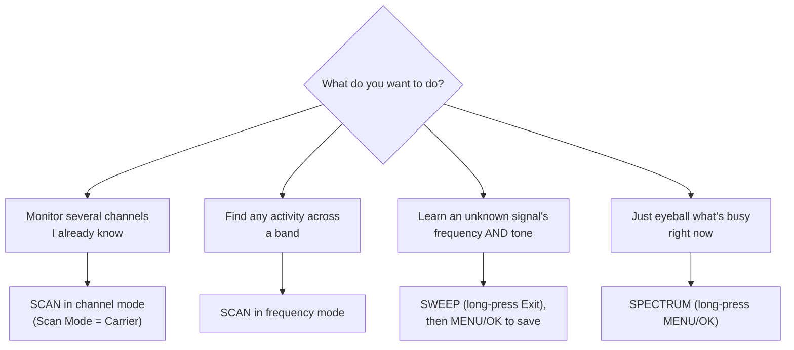

# Scan, search, sweep and the spectrum scope

Four of the RT-950 Pro's most useful tricks are all about _finding_ things rather than talking: sweeping channels for activity, hunting an unknown signal's frequency and tone, and eyeballing a whole band on a scope. Unfortunately Radtel gave them overlapping names — there is a **Scan** function, a **Search** key, a **Sweep** mode, _and_ a "Search" setting buried inside Scan — and the manual explains some of them beautifully and others not at all. This chapter untangles the four, tells you how to reach each one, and is honest about the corners Radtel simply never documented.

All four are **receive-only** — none of them transmits — so you can explore every one of them without a licence and without keying up.

## The four, at a glance

| Feature              | How you enter it                                           | What it does                                                                              |
| -------------------- | ---------------------------------------------------------- | ----------------------------------------------------------------------------------------- |
| **Scan**             | A key set to `SCAN`                                        | Steps through your memory channels, or up a band by the tuning step, stopping on activity |
| **Sweep**            | Long-press the **Exit/back** key (or a key set to `Sweep`) | Reads a nearby signal's **frequency _and_ its CTCSS/DCS tone**, and can save both         |
| **Spectrum**         | Long-press **`MENU/OK`** (or a key set to `SPECTRUM`)      | A live scope showing activity across a slice of band                                      |
| **Search** (the key) | A side key set to `SEARCH`                                 | Undocumented by Radtel — almost certainly the same as **Sweep** (see below)               |

> **Where the keys come from.** The side key and the long-press of the number keys `0`–`9` are each assignable in _Menu → User Key_ (or the programming software). The side-key list offers `RADIO / MONI / SCAN / SEARCH / SOS / SPECTRUM / Beacon TX`; the number-key list offers a different set including `SCAN / SPECTRUM / SCAN QT` and more. That the two lists don't match is the root of most of the confusion below.

## Scan — the channel and frequency scanner

This is the ordinary scanner, and it is well documented. Assign a key to **`SCAN`** and press it; what happens then depends on which mode you are in:

- **In channel (memory) mode** it scans the channels you have added to the **scan list** — not necessarily _all_ your memories. The manual's wording here ("requires power-on scan to add") is genuinely murky; the practical point is that a channel has to be flagged into the scan list before it will be included. On the closely-related base model this is done from a _Scan Add/Delete_ memory menu, so expect something similar on the Pro — but treat the exact menu path as unconfirmed and check it on your unit.
- **In frequency (VFO) mode** it sweeps _up the band_ in the current _Step_ increment (set at _VFO/CH → Step_), stopping when it hears something.

How it _resumes_ after stopping is set at **`Menu → Radio → Scan Mode`**, with three behaviours — and note this is the "Search" that is _not_ the Search key:

- **Time** — stops on a signal, then resumes after about 5 seconds whether or not the signal is still there. Good for _sampling_ a busy band without getting stuck.
- **Carrier** — ✅ the friendly default: stops and _stays_ for the whole transmission, then resumes about 5 seconds after the carrier drops. This is what you want to follow a conversation.
- **Search** — stops on the first signal and _stays put_ (does not resume). Handy to park on the first active channel it finds.

Scan Mode gets its full menu treatment in [The Radio Menu](outpost:entry/logbook73.guide.rt-950-pro/menus-radio); the takeaway here is simply that **Carrier is the setting most people want**.

## Sweep — read a signal's frequency _and_ its tone

Sweep is the clever one, and the single most useful of the four for a new operator, because it solves the classic problem: _"I can hear this repeater but I don't know its access tone."_

Enter it by **long-pressing the Exit/back key** (the manual assigns Sweep to that key's long press) or by assigning a side key to `Sweep`. Point the radio at an active local frequency and Sweep **detects the transmitter's carrier frequency _and_ its CTCSS or DCS sub-tone**, and shows both on screen. Press **`MENU/OK`** to save the found frequency (and its tone) straight into a channel. It works only on the transmit bands — **VHF 136–174 MHz and UHF 400–520 MHz** — not on HF, airband or broadcast.

> **A keystroke caveat.** Radtel's own PDF puts Sweep on the **Exit/back** key's long press, but some third-party copies of the manual say a **direction key**, and the **`A/B/C`** key's long press is separately documented as a "remote sub-tone scan". If one does not work, try the other — and see the honesty note at the end about why this is so muddled.

The RT-950 Pro actually offers _several_ overlapping ways to find a sub-tone — Sweep (frequency + tone), the `A/B/C` long-press "remote sub-tone scan", a `SCAN QT` assignable key, and the _CTCSS DCS → Scan SubCode_ menu item — and Radtel never explains how they differ. In practice they are all decoding the CTCSS/DCS a signal carries; **Sweep is the one to reach for** because it also gives you the frequency and offers to save the pair. The menu-driven tone scan is covered in [CTCSS, DCS & Sub-tones](outpost:entry/logbook73.guide.rt-950-pro/menus-ctcss).

## Spectrum — the band scope

Long-press **`MENU/OK`** (or assign a key to `SPECTRUM`) and the radio draws a **live scope of activity across a slice of band** — a quick visual answer to "what's busy right now?", the same idea as a full radio's waterfall in miniature (the concept is in [FFTs & Waterfalls](outpost:entry/logbook73.handbook/ffts-and-waterfalls)). It is a monitor tool: watch the bars, spot an active frequency, then go and tune it.

Here honesty matters, because this is where Radtel's documentation simply stops. **The manual says only that a long press of `MENU/OK` "enters spectrum mode" — nothing about how wide the span is, where it is centred, whether you can change either, how you drop onto a signal you see, or even how you exit.** Reviewers describe it as a real-but-basic band scope, "more basic than the analyser on a desktop transceiver," and it clearly varies between firmware versions. So treat it as a "have a look" feature: open it, learn its behaviour on _your_ firmware by experimenting (Exit will get you out), and do not expect the span/marker controls of a benchtop analyser. It is genuinely handy for airband and repeater watching once you have felt out how your version behaves.

## Search — the key Radtel forgot to explain

And now the honest bit. **`SEARCH` appears in the side-key assignment list, but the manual never says what it does** — there is no "Search" operating section anywhere. Two things we _can_ say with confidence:

- It is **not** the same as the "Search" option inside _Scan Mode_ (that only changes how the Scan function resumes; on its own it does nothing).
- Since the only sweep-a-band-and-read-a-signal behaviour the manual actually documents is **Sweep**, and "Sweep" is oddly _absent_ from the assignable-key lists while "SEARCH" is present, the most likely explanation is that **the `SEARCH` key simply is the Sweep function under another name.** That is an inference, not a documented fact — so if you assign `SEARCH` to a key, treat whatever it does as "probably Sweep" and confirm by watching the screen.

## So which do I use, when?

## An honesty note (worth reading once)

This whole area is the most thinly-documented part of the radio, and behaviour shifts between firmware versions — one build of the closely-related base model even broke CTCSS tone decode on receive, which quietly cripples Sweep and the tone scans. Where this chapter says "the manual is silent" or "probably", that is deliberate: it is better to tell you where the edges are than to invent a keystroke that does not work on your firmware. Confirm the fuzzy ones (the `SEARCH` key, the Spectrum controls, the exact scan-list menu) on your own unit, and remember these are all receive features — nothing here can put you on the air by accident.

## Try it yourself

1. **Build a scan list and scan it.** Add your two or three local repeaters to the scan list, set _Radio → Scan Mode → Carrier_, assign a key to `SCAN`, and let it run — it should stop and hold whenever one of them is in use.
2. **Steal a tone with Sweep.** While a local repeater or a friend is transmitting on 2 m or 70 cm, long-press the Exit/back key to Sweep, read the frequency and CTCSS/DCS tone it shows, and press `MENU/OK` to save the pair to a channel. You now have a correctly-toned memory without touching a repeater listing.
3. **Open the scope.** Long-press `MENU/OK` to enter Spectrum, watch a busy band (airband in the afternoon is lively), and get a feel for how _your_ firmware pans and exits.

## Key takeaways

- **Scan** steps through memory channels (in the scan list) or up a band by the step; **`Menu → Radio → Scan Mode`** sets how it resumes — **Carrier** for following a QSO, **Time** for sampling, **Search** to park on the first signal.
- **Sweep** (long-press Exit/back) reads a nearby signal's **frequency _and_ CTCSS/DCS tone** and saves both with `MENU/OK` — the quickest way to learn an unknown repeater's tone. VHF/UHF only.
- **Spectrum** (long-press `MENU/OK`) is a live band scope; Radtel documents almost none of its controls, so learn it on your firmware.
- The **`SEARCH` key is undocumented** and is _not_ the Scan-Mode "Search"; it is most likely the Sweep function under another name.
- It is a firmware-dependent, thinly-documented corner of the radio — everything here is receive-only, so experiment freely.

That is the last of the RT-950 Pro's "extra powers"; from here the guide turns to the menu itself, starting with the [Menu Reference](outpost:entry/logbook73.guide.rt-950-pro/menu-reference).
