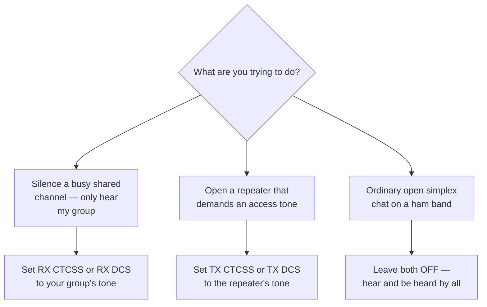
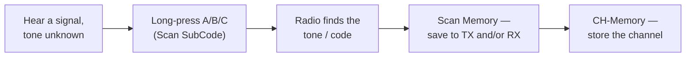

# CTCSS, DCS and sub-tones

Two radios can share a frequency and still leave each other in peace, if each carries a quiet signature under the voice that says "this one's for us". That signature is a **sub-audible tone**, and it is the idea behind this whole menu group. Master it and you unlock two everyday superpowers: a speaker that only wakes for the people you care about, and the ability to open a [repeater](outpost:entry/logbook73.handbook/repeaters) that ignores anyone who doesn't know the knock. This chapter explains what those tones are, the all-important difference between the receive side and the transmit side, and every item the RT-950 Pro gives you to control them.

As before, each item carries a one-glance verdict — ✅ set and forget · ⭐ useful, depends · ⚠️ advanced · ❌ leave off — and the menu path is written _group → item_ (here, _CTCSS DCS → RX CTCSS_), reached with **MENU/OK**, the direction keys, and **MENU/OK** to save.

## What a sub-audible tone actually is

Imagine a crowded room where several conversations share the air, and you have agreed with your friends on a low, steady hum you will all quietly play under your voices. You cannot really hear the hum over the talking, but a machine listening for it can — and it can be told to only pipe up when _your_ hum is present. That is exactly what a sub-audible tone does on a radio channel.

The most common scheme is called **CTCSS** — Continuous Tone-Coded Squelch System (older radios call it "PL", Motorola's trade name). Your radio adds a single, constant, low-pitched sine tone — somewhere between **67.0 Hz and 254.1 Hz** — underneath your normal speech and sends it the whole time you transmit. Human speech on a radio lives from about 300 Hz upward, and the radio deliberately rolls off everything below 300 Hz before it reaches the speaker, so the tone is filtered out of what you hear. It is _there_, riding under every word, but it is inaudible — hence "sub-audible".

```viz
{
  "type": "wave",
  "title": "A CTCSS sub-tone riding under the voice",
  "caption": "The slow, steady tone sits below the speech band, so you never hear it — but a tone decoder listening only for that pitch does.",
  "xLabel": "time",
  "traces": [
    { "kind": "noise", "amp": 0.55, "label": "your voice (300–3000 Hz)", "tone": "muted", "style": "faint" },
    { "kind": "sine", "freq": 1.5, "amp": 0.45, "label": "CTCSS sub-tone (67–254 Hz)", "tone": "primary", "style": "solid" }
  ]
}
```

The receiving radio runs a **tone decoder**: a narrow filter tuned to look only for that one pitch. If it hears the right tone, it decides the transmission is "for us" and opens the speaker; if the tone is absent or wrong, it stays silent even though a perfectly strong signal is sitting right there on the frequency. Nothing about the audio quality changes — a tone is not encryption, not privacy, and does nothing to stop anyone else hearing you. It is purely a **selective-calling** trick that decides whose transmissions your speaker bothers to play.

**DCS** — Digital-Coded Squelch (also "DPL") — does the same job with a digital fingerprint instead of a single pitch. Rather than one steady tone, the radio sends a slow, continuously repeating **23-bit code word** as a low-speed data stream (around 134 bits per second) under the voice. It is still sub-audible, still continuous, but because it is a code rather than a frequency there are far more of them — the RT-950 Pro offers `D023` through `D754` — and each carries a polarity marker, `N` (normal) or `I` (inverted), which we'll meet shortly. For the operator, CTCSS and DCS are interchangeable tools; you use whichever one the channel or repeater you're working specifies. The full theory of how both are generated and detected is in [What the Settings Really Mean](outpost:entry/logbook73.guide.rt-950-pro/theory).

One thing to keep separate in your head: the sub-audible **CTCSS tone** here is _not_ the same as the **1750 Hz tone burst** some repeaters want to hear before they'll open. That burst is a single, brief, genuinely audible beep, set under _Radio → R-TONE_ and covered in [The Radio Menu](outpost:entry/logbook73.guide.rt-950-pro/menus-radio). CTCSS is continuous and inaudible; the tone burst is a one-off you can hear. Different jobs, different menu.

## RX versus TX: the difference that matters

Every tone on this radio comes in two independent halves, and confusing them is the single most common tone mistake on any handheld. Read this section twice.

- **RX (receive) tone** is **tone squelch** — it controls _your own speaker_. Set an RX tone and the radio only opens for transmissions carrying that exact tone; everything else on the frequency stays muted. This keeps your speaker quiet on a busy shared channel.
- **TX (transmit) tone** is what _you send out_ — it controls whether you can open _someone else's_ tone squelch, most often a **repeater's**. Set a TX tone and every transmission you make carries that signature under the voice, whether or not you're using any RX tone yourself.

They are set separately because they do separate jobs, and a channel may need one, the other, both, or neither.



The practical upshot for a new licensee working a repeater: you almost always need the **TX tone set to the repeater's access tone**, and you can usually leave the **RX tone OFF**. Why leave RX off? Because if you set an RX tone and the repeater doesn't happen to send that tone back on its output, your radio will sit there stubbornly silent while the repeater is talking to you — a classic "my radio's gone deaf" panic that is really just tone squelch doing its job. Set TX to open the machine, leave RX open so you hear everything, and you'll never be caught out. Advance to matched RX/TX tones only once you understand what each side is doing.

## RX CTCSS — ⭐ useful on shared channels

Only open your speaker for transmissions carrying a matching analogue tone.

- **Does:** applies **tone squelch** on receive. With `RX CTCSS` set to, say, `88.5 Hz`, the radio stays silent for any signal on the frequency that doesn't carry an 88.5 Hz sub-tone — even loud, clear ones — and opens only for those that do.
- **Inside:** on top of the normal noise squelch (_Radio → SQL_), a tone decoder examines the sub-audible band of every signal strong enough to break squelch. Only if it detects the exact tone you've programmed does the firmware un-mute the audio. No tone, or the wrong tone, and the speaker stays shut.
- **Why it exists:** on a channel shared by many groups — a PMR446 hillside, a busy simplex calling frequency, a worksite — tone squelch lets your radio ignore everyone but your own people, so you're not listening to strangers' overs all day.
- **Values:** OFF, or one of 50 standard tones from `67.0 Hz` to `254.1 Hz`.
- **UK recommendation:** ⭐ **OFF** for general amateur monitoring — part of good amateur practice is _hearing_ the channel so you don't transmit over someone. Turn it **ON** only when you deliberately want to filter to one group, and pick the tone the group has agreed on.
- **Example:** four of you are walking a ridge on PMR446 channel 8. You all set `RX CTCSS` and `TX CTCSS` to `88.5 Hz`, and now a scout group two valleys over — sharing the same channel on a different tone — no longer interrupts you, and you don't interrupt them.
- **Common mistakes:** setting an RX tone on a repeater output and then hearing silence because the repeater sends no tone (or a different one) on its output; forgetting it's on and wondering why a strong local signal produces nothing; assuming it gives privacy — it does not, anyone without a tone set hears you perfectly.
- **Related:** RX DCS (the digital equivalent — use one _or_ the other, never both on the same VFO); _Radio → SQL_ (the plain noise squelch that must still open first); TX CTCSS.
- **Should you change it?** Only when you specifically want a private-feeling group on a busy channel. For learning the bands, leave it off.

## RX DCS — ⭐ useful on shared channels

The same idea as RX CTCSS — tone squelch — using a digital code instead of a single tone.

- **Does:** opens your speaker only for signals carrying a matching **DCS code word**. Functionally identical to RX CTCSS for the operator, just keyed to a digital fingerprint rather than a pitch.
- **Inside:** the decoder reads the slow repeating bitstream under the voice, checks it against your programmed code _and its polarity_ (`N`/`I`), and only un-mutes on a match.
- **Why it exists:** DCS gives many more distinct codes than the 50 CTCSS tones and is less prone to a nearby channel's tone accidentally matching yours; some networks standardise on it.
- **Values:** OFF, or codes `D023N` through `D754I`. The three-digit numbers are octal (base-8) code numbers, and the suffix is polarity: **`N` = normal, `I` = inverted** — inverted flips the sense of the code's bits, and two radios must agree on both the number _and_ the polarity to talk.
- **UK recommendation:** ⭐ **OFF** unless a specific channel or repeater asks for a DCS code. Where it's used, copy it exactly — `D023N` is not the same as `D023I`.
- **Common mistakes:** getting the polarity wrong (`N` vs `I`) and blaming the radio; running RX DCS _and_ RX CTCSS on the same VFO (choose one); assuming the codes are decimal (they're octal — the radio only offers valid ones, so scroll rather than guess).
- **Related:** RX CTCSS; TX DCS; the Scan SubCode tool below, which finds a code for you.
- **Should you change it?** Only to match a channel that specifies DCS. Otherwise leave it off.

## TX CTCSS — ⭐ send an access tone

Add a continuous analogue sub-tone to everything you transmit — usually to open a repeater.

- **Does:** with `TX CTCSS` set, every transmission you make carries that sub-audible tone underneath your voice. Its main job is to satisfy a repeater's **access tone** (also called CTCSS access or "tone access"): most repeaters will not open — will not relay you — unless they hear the correct tone.
- **Inside:** the firmware mixes the chosen sine tone in below your speech audio before modulation, continuously, for as long as you hold the PTT. The distant repeater's decoder listens for it exactly as your own RX decoder would.
- **Why it exists:** access tones stop a repeater from being keyed up by every passing bit of interference, distant co-channel signal or intermod product, and let several repeaters share an input frequency across a region without triggering each other.
- **Values:** OFF, or one of the 50 tones `67.0`–`254.1 Hz`.
- **UK recommendation:** set it to **your repeater's published CTCSS tone** — this is the one tone setting you'll use most. On plain simplex amateur contacts, leave it **OFF**; there's no repeater to open and no reason to add a tone. Your national repeater directory (in the UK, the RSGB's listings) is the final word on each machine's tone.
- **Example:** your local 2 m machine `GB3xx` is listed with a `77.0 Hz` access tone. You store the channel in VFO mode with Direction `−`, Offset `0.600` MHz and `TX CTCSS = 77.0 Hz`, then save it. Now a press of PTT sends 77.0 Hz under your voice and the repeater opens; drop the tone and it ignores you completely.
- **Common mistakes:** setting the tone on the wrong side (an RX tone won't open a repeater — the repeater needs to _hear_ your tone, so it must be **TX**); entering the tone a neighbouring repeater uses; forgetting to save it into the memory, so the stored channel can't open the machine.
- **Related:** _VFO/CH → Direction_ and _Offset_ (a repeater needs the duplex shift too); _Radio → R-TONE_ (the separate 1750 Hz burst some repeaters use instead of or as well as CTCSS); RX CTCSS.
- **Should you change it?** Yes, whenever you program a repeater that uses CTCSS access — which is most of them.

## TX DCS — ⭐ send a digital access code

The digital equivalent of TX CTCSS — sends a continuous **DCS code word** under your transmissions, for repeaters or networks that use DCS access rather than a CTCSS tone.

- **Values:** OFF, or `D023N`–`D754I`, again with `N`/`I` polarity.
- **UK recommendation:** set it only if the repeater or system specifically lists a **DCS** code for access; most UK amateur repeaters use CTCSS, so this stays **OFF** more often than TX CTCSS. Match the code and polarity exactly.
- **Example:** a data or worksite system published as `D047N` for access — set `TX DCS = D047N` and leave TX CTCSS off (use one scheme, not both).
- **Common mistakes:** enabling TX DCS _and_ TX CTCSS together (send one sub-audible scheme, not both); mismatched polarity; using DCS on a repeater that actually wants CTCSS.
- **Related:** TX CTCSS; RX DCS; Scan SubCode.
- **Should you change it?** Only for a system that specifies DCS access.

## The standard CTCSS tones

For reference, here is the full standard set the RT-950 Pro offers. You never need to memorise these — you copy whatever your repeater or group specifies — but it's handy to see the whole ladder, and to recognise that these are shared industry-standard frequencies every make of radio uses.

|       |       |       |       |       |
| ----- | ----- | ----- | ----- | ----- |
| 67.0  | 69.3  | 71.9  | 74.4  | 77.0  |
| 79.7  | 82.5  | 85.4  | 88.5  | 91.5  |
| 94.8  | 97.4  | 100.0 | 103.5 | 107.2 |
| 110.9 | 114.8 | 118.8 | 123.0 | 127.3 |
| 131.8 | 136.5 | 141.3 | 146.2 | 151.4 |
| 156.7 | 159.8 | 162.2 | 165.5 | 167.9 |
| 171.3 | 173.8 | 177.3 | 179.9 | 183.5 |
| 186.2 | 189.9 | 192.8 | 196.6 | 199.5 |
| 203.5 | 206.5 | 210.7 | 218.1 | 225.7 |
| 229.1 | 233.6 | 241.8 | 250.3 | 254.1 |

All values in Hz. DCS codes run from `023` to `754` (octal), each available in normal (`N`) and inverted (`I`) polarity — well over a hundred usable combinations once polarity is counted.

## FHSS Code — ❌ leave off

A vendor frequency-hopping feature with almost no public documentation.

- **Does:** when switched on and given a shared code, two Radtel radios hop together across a pseudo-random sequence of frequencies many times a second, so that only radios carrying the same FHSS (Frequency-Hopping Spread Spectrum) code can follow the conversation.
- **Inside:** as best anyone outside the vendor can tell, the code seeds a hop pattern both radios compute in step; to a normal receiver parked on one frequency, the signal appears only in fleeting bursts, which is the point.
- **Why it exists:** it's a private-network feature aimed at the licence-free and commercial market — a group of matched Radtel radios that other listeners can't easily follow. It is proprietary and does **not** interoperate with any other make.
- **Values:** OFF / ON (with a code).
- **UK recommendation:** ❌ **OFF.** Frequency-hopping is not standard amateur practice, defeats the open, monitorable nature of the amateur bands, and only works Radtel-to-Radtel. There is also too little published detail to be confident where and how it may legally be used — so on the amateur bands, leave it alone.
- **Common mistakes:** switching it on out of curiosity and then being unable to work anybody, because no ordinary radio can follow a hopping signal.
- **Related:** Encryption (below) — another "private group" feature to avoid on ham.
- **Should you change it?** No.

## Encryption — ❌ illegal on the amateur bands

Proprietary voice encryption. This one is not a matter of taste — keep it off on ham.

- **Does:** when on, scrambles your transmitted audio so that only a radio with the same encryption enabled can recover intelligible speech; to everyone else you're an unintelligible warble.
- **Inside:** the audio is transformed by a proprietary process before transmission and reversed at the far end. It is not strong cryptography, and it is not interoperable with other makes — but its _intent_ is to obscure the meaning of your transmission, and that intent is the problem.
- **Why it exists:** it's a feature carried over from the commercial and licence-free market, where private groups may sometimes use it under the appropriate rules.
- **Values:** OFF / ON.
- **UK recommendation:** ❌ **OFF, always, on the amateur bands.** Amateur licences worldwide require transmissions to be _in plain language_ and forbid the use of codes or ciphers **intended to obscure the meaning** of a message. Encryption does exactly what the rules prohibit. The amateur service is built on being open and self-policing — anyone can listen, which is how the bands stay well-behaved — and encryption breaks that compact. Using it on an amateur frequency is a breach of your licence conditions.
- **Common mistakes:** confusing "nobody can understand me" with "privacy" — on ham it's neither allowed nor a good idea; leaving it enabled after experimenting off-air and then transmitting illegally without realising.
- **Related:** _Radio → Scramble_ is a _separate_ analogue voice-inversion feature with the same legal problem — also ❌ on ham; FHSS Code above.
- **Should you change it?** No — and understand _why_, because the reasoning applies to every radio you'll ever own.

## Scan SubCode — ⭐ very handy

Discover which CTCSS tone or DCS code a signal is using. This is the genuinely useful tool in the group, and one the factory manual barely mentions.

- **Does:** while you're receiving a signal, the radio cycles through every CTCSS tone (or DCS code, or both) and stops when it detects the one the incoming signal is carrying — telling you a repeater's or station's tone without you having to look it up.
- **Inside:** the tone decoder is pointed in turn at each candidate tone/code, checking whether that pitch or pattern is present in the sub-audible band of the received signal. When it finds a match, the scan halts and displays the result.
- **Why it exists:** you can hear a repeater perfectly but still not know its access tone (repeater output tones aren't always the same as the input, and directories can be out of date). Rather than guess, you let the radio read the tone off the air.
- **Values:** `CTCSS` (search the 50 tones only), `DCS` (search the digital codes only), or `ALL` (try both).
- **How to reach it:** it lives here as a menu item, and — as noted in [Getting Started](outpost:entry/logbook73.guide.rt-950-pro/getting-started) — there's a shortcut: a **long press of the `A/B/C` key** launches the remote sub-tone scan on the active VFO.
- **UK recommendation:** ⭐ set to `ALL` when you don't know whether a system uses CTCSS or DCS; narrow to `CTCSS` if you know it's a tone, to make the search quicker.
- **Example:** you can hear `GB3xx` on its output but the club's list gives no tone. Tune your active VFO to the repeater's output, key the long-press `A/B/C` scan while the repeater is transmitting, and it lands on, say, `77.0 Hz`. Now you know the tone to set for TX access.
- **Common mistakes:** running the scan when nothing is transmitting — there's no sub-tone in silence, so it finds nothing; assuming the tone found on the repeater's _output_ is necessarily the _input_ access tone (usually it is, but not always — the directory or repeater keeper is the final word); moving off the signal before the scan completes.
- **Related:** Scan Memory (below) saves what it finds; TX CTCSS / TX DCS (where you'll use the answer).
- **Should you change it?** It's a tool you run on demand, not a set-and-forget setting — reach for it whenever a tone is a mystery.



## Scan Memory — ⭐ store the tone you found

Write the tone Scan SubCode discovered straight into your VFO, so you don't have to read it off and re-enter it by hand.

- **Does:** takes the CTCSS tone or DCS code the scan just found and saves it into the current VFO's tone slots. The menu lets you choose whether it goes into the **encoder** (the TX side — for opening a repeater) or the **decoder** (the RX side — for tone squelch), so the found tone lands where you actually want it.
- **Inside:** it simply copies the discovered value into `TX CTCSS`/`TX DCS` and/or `RX CTCSS`/`RX DCS` for that VFO, removing the transcription step.
- **Why it exists:** finding a tone is only half the job; this closes the loop by applying it, so a discovered repeater tone becomes a working setting in one step.
- **Values:** save to the encoder (TX) side, the decoder (RX) side — pick what suits the job.
- **UK recommendation:** ⭐ for a repeater you've just identified, save the found tone to the **encoder (TX)** side — that's what opens the machine — then leave RX open so you always hear it. Finish by storing the whole VFO as a channel with _VFO/CH → CH-Memory_ so it survives a power-off.
- **Example:** the scan found `77.0 Hz` on `GB3xx`; you use Scan Memory to write it to the TX (encoder) side, add the offset and direction, then CH-Memory the lot into your "Repeaters" zone. Job done, no notebook required.
- **Common mistakes:** saving the found tone to the RX (decoder) side for a repeater and then hearing silence because the repeater doesn't return that tone; forgetting the final CH-Memory step, so the tone is lost at the next power-off.
- **Related:** Scan SubCode (finds the tone); _VFO/CH → CH-Memory_ (makes it permanent); TX CTCSS.
- **Should you change it?** Use it right after a successful Scan SubCode — the two are a pair.

## Key takeaways

- A **sub-audible tone** (CTCSS, 67.0–254.1 Hz) or **digital code** (DCS, `D023N`–`D754I`) rides inaudibly under your voice as a selective-calling signature — it decides _whose_ transmissions open a speaker, and gives **no privacy** whatsoever.
- **RX tone = tone squelch** (keeps _your_ speaker quiet on a shared channel); **TX tone = access tone** (opens _a repeater_). They're set separately; for most repeaters, set **TX** and leave **RX OFF** so you always hear the output.
- Match the repeater's or group's tone **exactly**, including DCS **polarity** (`N` vs `I`) — a wrong polarity or wrong side is the usual cause of "my radio's gone deaf".
- **FHSS Code** (❌) is a proprietary, Radtel-only hopping feature with no place on the amateur bands; **Encryption** (❌) is _illegal_ on ham because licences require plain language and forbid obscuring a message's meaning — the same goes for _Radio → Scramble_.
- **Scan SubCode** (⭐) reads an unknown tone straight off the air — long-press `A/B/C` — and **Scan Memory** (⭐) writes it into the encoder (TX) or decoder (RX) slot; finish with **CH-Memory** to keep it.
- The CTCSS tones are a shared industry standard every make uses, so a tone read from any radio works on any other.

With your tones understood, the next group governs how the radio actually transmits and hears — squelch, power, bandwidth and the repeater controls: [The Radio Menu](outpost:entry/logbook73.guide.rt-950-pro/menus-radio).
