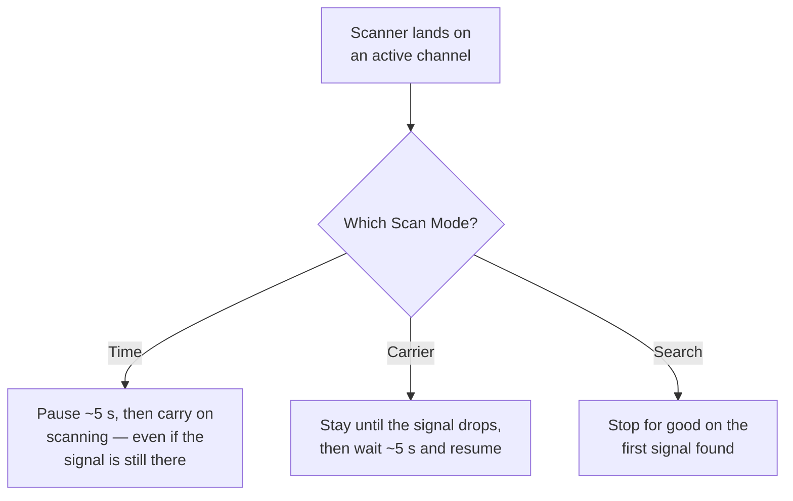
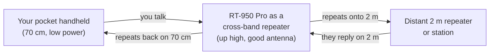

# The radio menu

The **Radio** group is the biggest and most mixed of the menus, and it is where the radio's real personality lives. Everything here shapes how you sound, how you behave on a shared channel, and how far the radio can be pushed — from the squelch you nudge every day to the cross-band repeater that turns a pocket handheld into a station with reach. Take it item by item and none of it is hard; skip it and this is exactly where a budget radio earns its reputation for baffling people.

Each item below carries the same one-glance verdict used throughout: ✅ set it and forget it · ⭐ genuinely useful, depends how you operate · ⚠️ advanced, understand it first · ❌ leave it off. Reach any of them with **MENU/OK → move → MENU/OK → save → Exit**, as covered in [Getting Started](outpost:entry/logbook73.guide.rt-950-pro/getting-started).

## Squelch, power and bandwidth — the daily three

These three you will touch far more than the rest. They decide whether you hear anything at all, how much energy you throw into the air, and how wide a slice of the band your voice occupies.

### SQL — ✅ 3–5

The squelch threshold: how strong a signal has to be before the radio lets any sound through.

- **Does:** sets a gate between the receiver and the loudspeaker. Below the threshold the speaker stays silent; a signal strong enough to cross it opens the gate and you hear it. `0` disables the gate (constant hiss); `9` demands a strong signal.
- **Inside:** with no station present, a receiver produces a steady background hiss — the sound of amplified noise. The squelch circuit measures that noise (or the signal-to-noise ratio) and mutes the audio whenever it looks like noise rather than a real transmission. The number you choose is where that trip point sits.
- **Why it exists:** without squelch, an FM handheld hisses constantly, which is exhausting and drains the battery through the speaker. Squelch keeps the radio quiet until there is genuinely something to hear.
- **Values:** OFF (`0`) to Level 9.
- **UK recommendation:** ✅ **3–5** suits most portable use. Start at 3 and raise it a notch only if the squelch keeps chattering open on noise; lower it if you suspect you are missing weak signals.
- **Example:** on a `145.500 MHz` calling-channel watch, level 4 stays silent through the everyday RF murmur but opens the moment a station appears. On a hilltop with a big antenna and lots of ambient noise, you might need 5 or 6 to stop it flickering open.
- **Common mistakes:** cranking squelch to 9 "to keep it quiet", then wondering why distant repeaters never open the radio — the bar is so high only local signals clear it. The opposite, leaving it at 0, buries every real signal under hiss.
- **Related:** the **Monitor** function (assign it to a side key in [Keys & Settings](outpost:entry/logbook73.guide.rt-950-pro/menus-system)) briefly forces the squelch fully open so you can hear whether a weak signal is really there; _Radio → Busy Lockout_, which uses the same busy/quiet judgement.
- **Should you change it?** Yes, in small steps, as a live adjustment — it is one of the few settings worth tuning by ear to your surroundings.

### Trans Power — ⭐ lowest that does the job

Chooses how much transmit power the radio produces: High, Middle or Low.

- **Does:** switches the transmitter between three output levels for the current VFO.
- **Inside:** the final amplifier is run harder or softer. High drives it to its rated maximum; Middle and Low back it off. The tags `H`/`M`/`L` on each display row tell you which is set.
- **Why it exists:** the right power depends entirely on the job. Reaching a distant repeater from a valley wants everything you have; chatting to someone across town, or working through a repeater a mile away, does not — and running more power than you need flattens the battery, warms the radio, and raises the chance of splattering onto neighbouring channels.
- **Values:** High / Middle / Low. Independent bench testing has put the RT-950 Pro's "High" at roughly **6.5–8.5 W** across the bands, against its "10 W" specification — good honest power for a handheld, if short of the number on the box. Middle and Low are proportionally lower; the exact figures are not published.
- **UK recommendation:** ⭐ Run the **lowest power that reliably completes the contact**. This is not just courtesy — it is the operating discipline every licence asks for. Use Low for local simplex and nearby repeaters, Middle as a sensible default, High only when you genuinely need the reach.
- **Example:** talking to a friend three streets away, Low (a watt or so) is plenty and the battery lasts all day; trying to raise a repeater 40 km off from a summit, you switch to High and accept the faster drain.
- **Common mistakes:** leaving it on High "to be safe", then finding the battery flat by lunchtime; assuming more power fixes a contact really spoiled by a poor antenna — the antenna almost always matters more, as [RF Power](outpost:entry/logbook73.handbook/rf-power) explains.
- **Related:** _Radio → TOT_ (a long over on High is what overheats the radio); the antenna, which usually buys you more than a power step does.
- **Should you change it?** Yes — think of it as a per-contact choice, not a set-and-forget. Store your local, easy channels at Low.

### Bandwidth — ✅ match the channel

Sets how wide a slice of the band your FM signal occupies: Wide or Narrow.

- **Does:** switches the transmit deviation (and the receive filter) between wideband FM and narrowband FM.
- **Inside:** FM carries your voice as small wobbles of the transmit frequency. **Wide** lets those wobbles swing about ±5 kHz, filling roughly a 25 kHz channel; **Narrow** limits them to about ±2.5 kHz, squeezing into roughly 12.5 kHz. Narrow sounds a touch quieter and thinner; Wide sounds fuller. Mismatch it and the audio comes out either muffled and quiet (you narrow, they wide) or distorted and over-loud (you wide, they narrow).
- **Why it exists:** the airwaves have been getting more crowded for decades, and much of the world's land-mobile and amateur activity has migrated from 25 kHz channels to 12.5 kHz to fit twice as many in. The radio has to be able to do both.

```viz
{
  "type": "spectrum",
  "title": "Wide vs narrow FM — the same voice, two channel widths",
  "caption": "Wide FM spreads your signal across roughly a 25 kHz slot; narrow squeezes it into about half that, to fit tighter channel spacing. Match whatever the other station uses.",
  "components": [
    { "f": 28, "amp": 0.9, "label": "Wide (~25 kHz)", "width": 20, "tone": "primary" },
    { "f": 72, "amp": 0.9, "label": "Narrow (~12.5 kHz)", "width": 10, "tone": "ink" }
  ],
  "xLabel": "frequency across the channel"
}
```

- **Values:** Wide / Narrow.
- **UK recommendation:** ✅ **Match the channel or repeater.** [PMR446](outpost:entry/logbook73.handbook/uhf) is narrow (12.5 kHz) by law, and most modern UK amateur simplex and repeater channels are specified narrow too — but some older 25 kHz repeaters still expect wide. When in doubt on a repeater, use whatever its listing states; on simplex, match the person you are talking to. Elsewhere, check your national band plan.
- **Example:** you sound distant and faint to a friend on PMR446 — you are set Wide, they (and the channel) are Narrow. Switch to Narrow and your level jumps back to normal.
- **Common mistakes:** confusing bandwidth with **Step** (_VFO/CH → Step_) — Step sets where the dial lands, Bandwidth sets how wide you transmit; they are unrelated. Also, transmitting Wide on a Narrow PMR446 channel is both antisocial and outside the channel's rules.
- **Related:** _VFO/CH → Step_; [Modulation](outpost:entry/logbook73.handbook/modulation) for the underlying FM theory.
- **Should you change it?** Yes, to match — and then store it in the channel's memory so you never think about it again.

## Scrambling, standby and battery saving

A privacy feature you must not use, the tri-watch switch, and the receiver's power-saving sleep.

### Scramble — ❌ never on the amateur bands

An analogue voice scrambler that garbles your audio so only a matching radio can unscramble it.

- **Does:** inverts or shuffles your speech spectrum before transmit; a receiver set to the same Scram code puts it back. To anyone else it sounds like gibberish.
- **Inside:** simple frequency-inversion scrambling — the audio band is flipped around a pivot so high tones become low and vice versa. It is trivial to defeat and offers no real security, but it does render speech unintelligible to a casual listener.
- **Why it exists:** it is a stock feature of the commercial/PMR chipsets these radios are built on, aimed at business users who want a little privacy on shared channels.
- **Values:** OFF / Scram1–Scram8.
- **UK recommendation:** ❌ **Leave OFF.** Amateur radio must be sent in plain language that anyone can receive and understand — obscuring the meaning of a transmission is not permitted under amateur licence conditions anywhere. This is a licensing rule, not a matter of taste.
- **Common mistakes:** switching it on to "test it" on a live amateur channel; leaving it on by accident so nobody can understand you and you cannot work out why.
- **Related:** _CTCSS/DCS → Encryption_ (the digital equivalent, equally off-limits on ham); [Getting Licensed](outpost:entry/logbook73.handbook/getting-licensed) for why open, plain-language operation is a condition of the hobby.
- **Should you change it?** No — not on the amateur bands. It exists for the radio's commercial life, not yours.

### Standby Set — ✅ ON (this is the tri-watch switch)

Despite the name, this has nothing to do with power saving: **Standby Set is the tri-watch on/off switch** — the control that decides whether the radio listens to all its VFOs at once or only the one you have selected. The nine-page factory manual lists it as a bare OFF/ON with no explanation, which is exactly why it is so easily mistaken for a sleep setting; "standby" here is the budget-radio term for _multi-channel standby_ (dual/tri-watch), not receiver sleep.

- **Does:** turns multi-VFO monitoring on or off — the `TW` (tri-watch) or `DW` (dual-watch) tag on the display. **ON**, the radio keeps an ear on every active VFO and, the instant one hears a signal, locks onto it and mutes the others. **OFF**, only the highlighted VFO — the one you pick with the `A/B/C` key — is live; the other rows still show on screen but stay muted.
- **Inside:** it is one receiver time-slicing across the VFOs, hopping between them fast enough to catch a call on any one, not several receivers running at once. The tag counts how many VFOs are actually in the rotation: `TW` for three, `DW` for two — so parking one VFO on a band that sits outside the watch (CB in All Band Test Mode, for instance) drops the tag from `TW` to `DW`.
- **Why it exists:** the whole point of a three-VFO radio is watching several jobs together — airband, your local repeater and the calling channel all live at once. Without Standby Set ON you would hear only whichever row you last selected, and the other two would be for show.
- **Values:** OFF / ON.
- **UK recommendation:** ✅ **ON** for normal use — it is what makes tri-watch actually work. Switch it **OFF** only when you deliberately want to sit on a single frequency without the receiver wandering off to the other VFOs — working one station on a busy net, say, where every syllable on that one channel matters.
- **Example:** A on the airband, B on your nearest repeater, C on `145.500`; with Standby Set ON the radio answers to whichever comes alive first. Toggle it OFF and press `A/B/C` to hold hard on just the repeater.
- **Common mistakes:** blaming a "deaf" VFO when the radio is simply parked on another row with Standby Set OFF; reaching here for the receiver power-save — that is **Battery Save** (next), an entirely separate control.
- **Related:** tri-watch in [Getting Started](outpost:entry/logbook73.guide.rt-950-pro/getting-started); **Battery Save** (the real power-saving item); and the assignable `STANDBY SET` key in [Keys, Bluetooth, Signalling & Settings](outpost:entry/logbook73.guide.rt-950-pro/menus-system), handy for flipping tri-watch on and off without diving into the menu.
- **Should you change it?** Leave it **ON** unless you specifically want single-VFO operation.

### Battery Save — ✅ Normal

Lets the receiver take tiny naps to stretch the battery.

- **Does:** puts the receiver into a repeating micro-sleep when no signal is present — awake for a fraction of a second to listen, asleep for a fraction to save power, over and over.
- **Inside:** the receiver front end is briefly powered down on a duty cycle. The deeper the save, the longer the sleep between listens. The cost is a slight delay in catching a transmission: if a signal starts while the receiver is mid-nap, the first fraction of a second — sometimes the first syllable — can be clipped before it wakes and locks on.
- **Why it exists:** a handheld spends most of its life listening to nothing, and the receiver is the biggest idle drain. Sleeping through the silence can add hours to a charge.
- **Values:** OFF / Normal / Super / DEEP (progressively longer naps, more saving, slower to wake).
- **UK recommendation:** ✅ **Normal** is the sweet spot for everyday use. Choose **OFF** when catching the very start of a transmission matters — scanning, monitoring a busy net, or any time the radio is running from external power. Reserve **Super/DEEP** for long listening watches where saving the battery outweighs the odd clipped syllable.
- **Example:** monitoring the calling channel all afternoon on one battery, Normal keeps you going; switch on cross-band repeat or APRS and set it OFF so the radio never misses the opening of a packet.
- **Common mistakes:** blaming a "deaf" radio for missing the first word of every over when a deep nap is the real culprit; leaving DEEP on while scanning, so brief signals get skipped.
- **Related:** APRS and cross-band modes, which want this OFF; **Standby Set** — a different setting entirely (tri-watch, not power save), despite the similar name.
- **Should you change it?** Set Normal and forget it, dropping to OFF only for the specific jobs above.

## The good-manners safety nets

Three settings whose whole purpose is to stop you accidentally being the operator everyone complains about.

### Busy Lockout — ✅ ON

Refuses to let you transmit onto a channel that is already in use.

- **Does:** when on, pressing PTT while another signal is present on the channel is blocked — the radio will not key up until the channel is clear.
- **Inside:** the same busy/quiet detector that drives the squelch is checked at the moment you press PTT. If it says "occupied", the transmitter is held off and you usually get a warning beep instead of going on air.
- **Why it exists:** transmitting on top of an ongoing conversation — "doubling" — is the classic newcomer mistake, and on FM the two signals fight so neither is readable. Busy Lockout makes that mistake almost impossible.
- **Values:** OFF / ON.
- **UK recommendation:** ✅ **ON.** It is pure good manners with essentially no downside for normal operating, and it is one of the two settings (with low power) worth burning into memory.
- **Example:** you go to answer a call but someone else jumps in first; with Busy Lockout on, your PTT does nothing until they finish, sparing everyone a garbled double.
- **Common mistakes:** assuming it also protects **VOX** — it does not, so VOX can still transmit onto a busy channel (one more reason to leave [VOX](outpost:entry/logbook73.guide.rt-950-pro/menus-vfo) off). It can also feel like a fault when you are trying to break into a net; a tap of Monitor confirms the channel really is busy.
- **Related:** _Radio → SQL_ (sets the busy threshold); _VFO/CH → VOX_.
- **Should you change it?** Turn it **ON** and leave it. The only reason to disable it is a deliberate technique like emergency break-in, which is rare.

### TOT — ⭐ 180 s

The time-out timer: a hard limit on how long a single transmission can last.

- **Does:** cuts your transmission off after a set number of seconds, whether you have finished talking or not, and warns you first.
- **Inside:** a countdown starts the instant you key up and resets when you release. Reach zero and the transmitter shuts down automatically until you let go of PTT.
- **Why it exists:** two reasons. A **stuck PTT** — a radio wedged in a bag with the button pressed — would otherwise hold a channel or repeater open indefinitely, blocking everyone; the timer frees it. And **heat**: a handheld's little amplifier is not built to transmit flat-out for minutes on end, so the time-out forces breathing space.
- **Values:** OFF / 30 s to 240 s, in 30-second steps.
- **UK recommendation:** ⭐ **180 s** (three minutes) is a sensible ceiling — comfortably longer than any polite over, short enough to protect the radio and free a jammed channel. Many repeaters enforce their own time-out anyway, often around three minutes.
- **Example:** you get carried away describing an antenna project; at 180 s the radio beeps and drops you, a gentle reminder to hand over and let the other station in.
- **Common mistakes:** setting it OFF and then leaving a radio transmitting unattended when the PTT snags; setting it very short (30 s) so ordinary overs keep getting chopped off mid-sentence.
- **Related:** _Radio → TALL_ (the alarm as the timer runs out); _Radio → Trans Power_ (long overs on High are what cook the radio).
- **Should you change it?** Set it once to 180 s and leave it. OFF is only sensible in very specific fixed-station cases.

### TALL — ⭐ ON

The time-out alarm — a warning beep as the TOT countdown nears its end.

- **Does:** sounds a beep in the last few seconds before the time-out timer cuts you off, so the drop is never a surprise.
- **Why it exists:** being chopped off mid-word with no warning is jarring and can lose you the last of what you were saying; a heads-up lets you wrap up and unkey cleanly.
- **Values:** OFF / ON.
- **UK recommendation:** ⭐ **ON** if you use TOT at all — the warning is the whole point.
- **Should you change it?** Leave it ON alongside TOT; the two are meant to work as a pair.

## Tone bursts, scanning and roger beeps

Getting into repeaters the old-fashioned way, finding activity, and the beep that divides the hobby.

### R-TONE — ⭐ 1750 Hz where it is used

The repeater access tone burst: a short, audible tone the radio can send at the start of a transmission to wake a repeater.

- **Does:** sends a brief single tone — you choose 1000, 1450, 1750 or 2100 Hz — as you begin transmitting, which a tone-burst repeater listens for as its "open up" signal.
- **Inside:** the radio generates a fixed audio tone and transmits it for a fraction of a second at the front of your over. A repeater configured for burst access hears the tone and un-mutes to relay you. Unlike a [CTCSS](outpost:entry/logbook73.guide.rt-950-pro/menus-ctcss) sub-tone, a burst is sent once, up front, and is plainly audible.
- **Why it exists:** the tone burst was Europe's original repeater-access method before continuous CTCSS took over; **1750 Hz** became the UK and European standard, and other regions used the alternatives.
- **Values:** 1000 / 1450 / 1750 / 2100 Hz.
- **UK recommendation:** ⭐ Set **1750 Hz** — the historic UK/European burst tone, still accepted by many repeaters even though most have moved to CTCSS. Send it by keying up with the assigned tone-burst key (set one in [Keys & Settings](outpost:entry/logbook73.guide.rt-950-pro/menus-system)). North American repeaters use CTCSS instead, so the setting goes unused there. Check your national convention.
- **Example:** an older UK 2 m repeater that "will not answer" a CTCSS-only radio often springs to life with a 1750 Hz burst sent as you start your first over.
- **Common mistakes:** expecting the burst to replace a repeater's CTCSS requirement — most modern machines want a continuous sub-tone as well as, or instead of, a burst; setting the wrong tone for your region and wondering why nothing opens.
- **Related:** the [CTCSS/DCS menu](outpost:entry/logbook73.guide.rt-950-pro/menus-ctcss) (the modern access method); [Repeaters](outpost:entry/logbook73.handbook/repeaters) for how access tones fit the bigger picture.
- **Should you change it?** Set it to your region's tone once. Whether you ever use it depends on the repeaters near you.

### Scan Mode — ⭐ Carrier

Decides how the scanner behaves when it lands on an active channel.

- **Does:** governs what the radio does after a scan stops on a signal — pause and move on, wait for the signal to end, or stop for good.
- **Inside:** the scanner steps through channels (or frequencies) looking for activity. When it finds some it has to decide when to resume, and this setting picks the rule.



- **Why it exists:** different jobs want different behaviour. Sometimes you want to sample activity and keep sweeping; sometimes you want to hear a whole conversation; sometimes you just want the scanner to find one busy frequency and hand it to you.
- **Values:** Time / Carrier / Search (the flow chart above spells out each one).
- **UK recommendation:** ⭐ **Carrier** for everyday monitoring — it lets you follow a whole conversation rather than clipping in and out of it. Switch to **Search** when you are trying to locate an active frequency, and **Time** when you want to keep circulating.
- **Example:** scanning your repeaters over a coffee, Carrier keeps you on a live QSO until it ends; but when you are trying to work out which local simplex frequency a group is using, Search parks you on the first one it hears.
- **Common mistakes:** using Time and feeling like the radio "runs away" from conversations after five seconds; using Carrier on a channel with a constant carrier or heavy noise, which parks the scanner permanently.
- **Related:** _Radio → SQL_ (the scanner uses the squelch to decide "busy"); the memory zones you built in [Getting Started](outpost:entry/logbook73.guide.rt-950-pro/getting-started).
- **Should you change it?** Set Carrier as your default and switch modes to suit the task.

### ROGRE — ❌ OFF

The roger beep: a short beep transmitted at the end of every over to signal "I have finished, over to you".

- **Does:** appends an automatic beep to the end of each transmission when you release PTT.
- **Why it exists:** it comes from PMR and business radio, where a clear "I've stopped" cue helps on channels with lots of quick, short exchanges — and where family users rather like it.
- **Values:** OFF / ON.
- **UK recommendation:** ❌ **OFF** on the amateur bands. Amateur operators say "over" (or just stop) and identify by callsign; a beep after every over is widely considered irritating and unnecessary, and it adds a tone to every transmission that others have to sit through. It is perfectly at home on [PMR446](outpost:entry/logbook73.handbook/uhf) family channels, less so on a repeater.
- **Common mistakes:** leaving it on from a family outing and carrying it onto a repeater, where it quickly grates.
- **Related:** _Keys & Settings → Beep Prompt_ (the local key beep, which is separate and only you hear).
- **Should you change it?** Off for amateur use; a matter of taste for licence-free family channels.

## Turning the radio into a repeater

The last cluster is about the RT-950 Pro relaying signals — first hiding a repeater's tail, then acting as a repeater itself. This is the most advanced corner of the menu, so take it slowly.

### RP-STE — ⭐ on, if repeater tails bother you

Repeater squelch-tail elimination: mutes the little burst of noise you hear when a repeater drops its carrier.

- **Does:** holds your speaker muted for a short, set delay after an incoming signal disappears, so you do not hear the "kerchunk" of noise at the end.
- **Inside:** when a station stops transmitting, there is a brief moment where the carrier has gone but the far-end (or repeater) has not yet fully dropped — and your receiver, hearing pure noise again, blasts a short burst of hiss before its squelch closes. That burst is the **squelch tail**. RP-STE simply keeps the audio gated shut for the delay you choose, covering the tail.

```viz
{
  "type": "wave",
  "title": "The squelch tail RP-STE hides",
  "caption": "When the other station stops, the receiver briefly hears a burst of full-scale noise — the tail — before its squelch closes. RP-STE mutes the speaker through that moment.",
  "xLabel": "time",
  "traces": [
    { "kind": "points", "label": "what the speaker hears", "tone": "ink",
      "points": [[0,0],[0.05,0.3],[0.1,-0.25],[0.15,0.28],[0.2,-0.3],[0.25,0.25],[0.3,-0.28],[0.35,0.3],[0.4,-0.25],[0.45,0.28],[0.5,-0.2],[0.52,0.92],[0.54,-0.95],[0.56,0.9],[0.58,-0.93],[0.6,0.95],[0.62,-0.88],[0.64,0],[1,0]] }
  ]
}
```

- **Why it exists:** repeaters and some radios add a deliberate hang-time before they release, which makes the tail longer and more noticeable. Eliminating it makes conversations sound cleaner.
- **Values:** OFF / 100 ms to 1000 ms (the length of the mute).
- **UK recommendation:** ⭐ Set a modest delay — **around 100–300 ms** — if the tail on your local repeaters annoys you; leave it **OFF** if you would rather hear the carrier drop as a natural end-of-over cue. There is no wrong answer, only taste.
- **Example:** a busy repeater with a long hang-time greets every over with a half-second of hiss; a 200 ms RP-STE delay tidies that away without hiding the conversation itself.
- **Common mistakes:** setting the delay too long, so the first fraction of the next station's transmission gets swallowed along with the tail; confusing this receive-side setting with a transmit-side tail eliminator (RP-STE only affects what _you_ hear).
- **Related:** _Radio → SQL_; [Repeaters](outpost:entry/logbook73.handbook/repeaters).
- **Should you change it?** Optional. Try a short delay; keep it only if you prefer the result.

### RPT-RL — ⚠️ leave at default

The repeater relay (hang) delay used when the RT-950 Pro is acting as a cross-band repeater.

- **Does:** sets a short timing around how the radio holds and turns around a relayed transmission in repeat mode — in effect, how long it keeps repeating after the input signal drops before it releases.
- **Inside:** when the radio is relaying (next item), it needs a moment to switch cleanly from repeating one band to listening again, rather than chopping the tail of an over or clipping the start of a reply. This delay smooths that turnaround.
- **Why it exists:** without a small hang delay, a cross-band repeater can drop and re-key nervously on every pause in speech, mangling audio and hammering both channels.
- **Values:** OFF / 100 ms to 1000 ms.
- **UK recommendation:** ⚠️ **Leave it at the default** unless you are actively running cross-band repeat and can hear a specific problem (clipped tails or a jumpy relay). Then nudge it up a little to smooth the turnaround.
- **Related:** _Radio → RPT-Mode_ and _RPT-Speaker_ (the cross-band repeater); _Radio → RP-STE_.
- **Should you change it?** Only while tuning a working cross-band repeater. Otherwise ignore it.

### RPT-Mode (AB RPT-Mode) — ⚠️ off unless you need it

Cross-band repeat: turns the RT-950 Pro into a two-way repeater that listens on one band and retransmits on the other.

- **Does:** when on, anything the radio hears on one VFO's band it instantly retransmits on the other, and vice versa — so a signal arriving on 70 cm goes back out on 2 m, and a reply on 2 m comes back out on 70 cm.
- **Inside:** the radio dedicates one VFO to each band. Receive a signal on the first, and the firmware keys the transmitter on the second and pipes the audio straight across, in real time, until the input drops (then RPT-RL governs the turnaround). It is a full-duplex relay squeezed into a handheld.
- **Why it exists:** it extends the reach of a small, low-power radio. Put the RT-950 Pro somewhere high with a good antenna — a car roof, a window, a loft — and carry a tiny handheld in your pocket. Your pocket radio only has to reach the RT-950 Pro nearby; the RT-950 Pro does the hard work of reaching the distant repeater or station.



- **Values:** OFF / ON.
- **UK recommendation:** ⚠️ **OFF unless you specifically need it, and only when you can operate it properly.** Cross-band repeat is a genuinely useful tool, but switching it on makes you responsible for a repeater — with real obligations:
  - **Legality first.** Running a repeater, even a personal cross-band one, has to sit within your licence. In the UK, casual cross-band repeat should be **attended** (you present and in control) and correctly **identified** with your callsign; unattended or automatic repeater operation needs proper authorisation and is not something a Foundation licence covers. Check your own licence conditions first — this is not optional.
  - **You own everything it repeats.** The RT-950 Pro relays whatever it hears, cleanly or not, legal or not, and you are accountable for all of it.
  - **Heat and power.** Repeating means transmitting a great deal, which a handheld's amplifier and battery hate. Run it from external power, keep it ventilated, and expect it to get warm — the duty-cycle reasoning is in [RF Power](outpost:entry/logbook73.handbook/rf-power), the general concept in [Repeaters](outpost:entry/logbook73.handbook/repeaters), and more on why this radio can do it in [What the Settings Really Mean](outpost:entry/logbook73.guide.rt-950-pro/theory).
- **Example:** working in the garden out of range of your local `2 m` machine, you leave the RT-950 Pro in an upstairs window on external power, cross-band linking `70 cm` (to your pocket radio) and `2 m` (to the repeater). You identify with your callsign, keep an ear on it, and switch it off when you go in.
- **Common mistakes:** running it from the internal battery and finding it flat and hot within the hour; enabling it and wandering off, leaving it transmitting unattended; forgetting to identify; setting both VFOs to the same band, which cannot work.
- **Related:** _Radio → RPT-RL_ and _RPT-Speaker_; _Radio → Trans Power_ and _TOT_ (keep power modest and let the time-out protect the radio); the [VHF](outpost:entry/logbook73.handbook/vhf) and [UHF](outpost:entry/logbook73.handbook/uhf) bands it bridges.
- **Should you change it?** Only when you have a real need, external power, and confidence it is within your licence. Then, deliberately — and switch it off afterwards.

### RPT-Speaker — taste

Whether the loudspeaker stays live while the radio is acting as a cross-band repeater. **ON** lets you hear what is passing through, which is reassuring and helps you keep an eye on things; **OFF** keeps the repeater silent, which is quieter if it is sitting in a room with you. If you are operating attended as you should be, ON is the friendlier choice. It has no effect unless RPT-Mode is on.

## SOS Mode — the emergency alarm

An emergency alerting feature, with three quite different behaviours. It is worth understanding _before_ you ever trigger it by accident.

- **Does:** on a long-press of its assigned key, the radio raises an alarm. Which alarm depends on this setting:
  - **On Site** — a _local_ alarm only: the radio sounds a loud siren and flashes, to attract attention nearby. It does not transmit.
  - **Send Sound** — transmits an alarm tone on the current channel, cycling between sounding locally and sending the tone on the air, to alert others listening.
  - **Send Code** — transmits your identifying DTMF code (see [Signalling in Keys & Settings](outpost:entry/logbook73.guide.rt-950-pro/menus-system)), so a listening station or system can tell who is calling.
- **Inside:** the firmware ties the alarm to a key; the transmitting variants key up automatically and send a tone or a code sequence, interleaved with local alerting, until you cancel it.
- **Why it exists:** it is a stock safety feature of the commercial radios these are based on — a "man-down"/lone-worker style alert.
- **Values:** On Site / Send Sound / Send Code.
- **UK recommendation:** ⚠️ **Understand it first, and treat the transmitting modes with care.** Two honest points. This is **not a substitute for the emergency services** — a genuine emergency means dialling 999 or 112, not a radio alarm. And transmitting an alarm tone or code on a shared or amateur channel is a serious act: licences do permit communications in a real emergency, but firing an alarm as a test, or onto a channel where it will disrupt others, is misuse. If you keep SOS available at all, **On Site** (local siren, no transmission) is the safest default.
- **Example:** a lone operator on a hill sets SOS to On Site, so a stumble and a long-press summon help from anyone nearby with a loud siren rather than broadcasting an alarm across the band.
- **Common mistakes:** assigning SOS to an easily-pressed key and triggering a transmitting alarm by accident; believing the radio will somehow reach the emergency services — it will not.
- **Related:** the key-assignment menu in [Keys & Settings](outpost:entry/logbook73.guide.rt-950-pro/menus-system); [Getting Licensed](outpost:entry/logbook73.handbook/getting-licensed) for what "emergency use" means under a licence.
- **Should you change it?** Decide deliberately. Many operators leave SOS unassigned or set to On Site to avoid an embarrassing — or unlawful — accidental transmission.

## Key takeaways

- The three you will actually touch are **SQL** (squelch, 3–5 by ear), **Trans Power** (the lowest that does the job — discipline, not just courtesy), and **Bandwidth** (Wide or Narrow to match the channel; not the same thing as Step).
- **Busy Lockout ON** and **TOT ~180 s** are the good-manners safety nets — one stops you doubling, the other frees a jammed channel and protects the radio; **TALL ON** warns you before the time-out bites.
- **Scramble** and voice **Encryption** are off-limits on the amateur bands, and a **ROGRE** roger beep is best left OFF there too; all three belong to the radio's commercial life, not yours.
- **R-TONE 1750 Hz** is the UK/European repeater tone burst; **Scan Mode Carrier** lets you follow conversations; **Battery Save Normal** balances runtime against catching the start of an over — set it OFF for APRS, scanning or repeat.
- **Cross-band repeat (RPT-Mode)** is powerful but makes you a repeater operator: keep it OFF unless you need it, run it attended, identified, on external power, and only within your licence — the theory is in [What the Settings Really Mean](outpost:entry/logbook73.guide.rt-950-pro/theory) and [Repeaters](outpost:entry/logbook73.handbook/repeaters).
- **SOS Mode** is a safety feature, not the emergency services — understand it first, and prefer **On Site** to avoid an accidental transmission.

With the Radio menu tamed, the biggest and least-documented group is next: your callsign, the GPS, packet paths and the built-in digipeater in [APRS, GPS & Digipeater](outpost:entry/logbook73.guide.rt-950-pro/menus-aprs).
