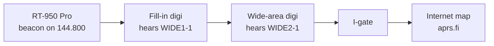
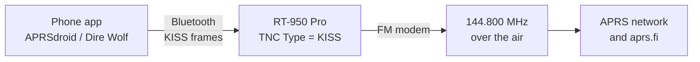

# APRS, GPS and digipeater

This is the chapter the factory manual is quietest about, which is exactly why it is the longest one here. The RT-950 Pro carries a complete little APRS station inside it — a GPS, a packet modem, a beacon transmitter and a one-hop digipeater — and the nine-page manual lists the menu items without explaining a single one. So this chapter does the opposite: it explains every field, radio-specifically, and tells you honestly which parts of the firmware work well and which are half-built.

The _general_ theory of APRS — what a packet is, how AX.25 addresses and digipeater paths work, what an I-gate does — lives in the main handbook, and is worth reading first: [APRS](outpost:entry/logbook73.handbook/aprs) and [Packet Radio](outpost:entry/logbook73.handbook/packet-radio). This chapter assumes you have met those ideas and concentrates on the right button presses on _this_ radio.

## What APRS is doing on this radio, in one picture

APRS (the Automatic Packet Reporting System) is, at heart, a way for radios to broadcast short bursts of data — most often "here is my callsign and where I am" — and for a volunteer network of relay stations to carry those bursts onward until an **I-gate** (a station with an internet connection) posts them to a public map such as `aprs.fi`. Your RT-950 Pro can play three roles: it can **beacon** (announce its own position), **receive** other stations, and **digipeat** (relay someone else's packet one hop further). Here is the journey a single beacon takes:

Everything in this menu configures one of those three roles. **GPS** and **Beacon Setup** build the packet you send; **Digi Setup** decides whether you relay other people's; **Advanced** covers timing, alerts, and the mode that turns the radio into a plain modem for a phone app. The verdict key is the one used across these reference pages: ✅ set and forget · ⭐ useful, depends · ⚠️ advanced · ❌ leave off.

> **Reaching the APRS screen quickly:** from the standby screen, a **long press on `V/M`** jumps straight to the APRS display (as noted in [Getting Started](outpost:entry/logbook73.guide.rt-950-pro/getting-started)). The settings themselves live under _Menu → APRS Set_, reached the usual way with **MENU/OK** and the direction keys.

## APRS ON/OFF — ⭐ on to use, off to save the channel

The master switch for the whole APRS engine.

- **Does:** turns the packet modem, beacon timer and digipeater on or off as a group. With it off, the radio is an ordinary voice handheld and the `APRS` tag disappears from the bottom status strip.
- **Inside:** enabling it wakes the internal TNC (terminal node controller — the modem that turns bytes into the warbling audio tones you hear on `144.800 MHz`) and starts the beacon-interval timer. Nothing transmits until a beacon is due, but the radio is now listening for and decoding packets.
- **Why it exists:** APRS shares a channel with every other packet station in earshot, so you want a clean way to leave it entirely when you are doing voice work.
- **Values:** OFF / ON.
- **UK recommendation:** ⭐ **ON** when you want to beacon or watch traffic; **OFF** otherwise. Leaving it on costs only a little battery, but there is no reason to run it when you are not using it.
- **Worked example:** you set off on a hilltop walk, switch APRS ON so friends can see your track on `aprs.fi`, and switch it OFF when you get back to the car and want the radio purely for the local repeater.
- **Common mistakes:** turning APRS on but never setting a callsign (see the legality note below); expecting position to appear with GPS still off.
- **Related:** GPS (below); TNC Type in Advanced.
- **Should you change it?** Yes — this is the on/off you use day to day.

## The GPS group — where the radio thinks it is

Six items decide whether the radio knows its own position and how it displays position data. Get GPS itself right; the rest are display taste.

### GPS — ✅ on to beacon your real position

- **Does:** powers up the internal satellite receiver so the radio can work out its latitude, longitude, altitude, speed and the correct time.
- **Inside:** a GPS module listens to the satellite constellation and computes a fix. The `GPS` icon at the top of the screen goes solid once enough satellites are locked; until then it blinks. A cold radio indoors may take a few minutes to find its first fix — give it a clear view of the sky.
- **Why it exists:** a _mobile_ or _portable_ APRS station is only interesting if it reports where it actually is. GPS is what makes your beacon track you.
- **Values:** OFF / ON.
- **UK recommendation:** ✅ **ON** for any portable or mobile use. Turn it OFF only for a fixed base whose position you have typed in by hand (see _Source Position_ and _My Position Set_), where a live fix would just waste battery.
- **Worked example:** walking a coastal path, GPS ON means each beacon carries your moving position and `aprs.fi` draws a breadcrumb trail; at home, GPS OFF plus a fixed position saves power.
- **Common mistakes:** wondering why beacons show no position while GPS is off; expecting an instant fix indoors.
- **Related:** Source Position (Fixed vs GPS); the top-bar `GPS` icon.
- **Should you change it?** Yes — on when you move, off when you are fixed.

### Position, Time Zone, and the three unit settings — ✅ set once, forget

These control _how position data is shown to you_. They do **not** change what you transmit — APRS always sends position in its own standard format on the wire — so treat them as display comfort only.

| Item          | Values                                              | What it changes                         | UK setting                                |
| ------------- | --------------------------------------------------- | --------------------------------------- | ----------------------------------------- |
| Position      | Degrees / Degrees+Minutes / Degrees+Minutes+Seconds | How coordinates read on the screen      | Degrees+Minutes (matches APRS convention) |
| Time Zone     | UTC−13 … UTC+13                                     | Offsets the GPS clock for local display | UTC+0 (add +1 for British Summer Time)    |
| Distance Unit | km / statute mile / nautical mile                   | Units for distance-to-station read-outs | km                                        |
| Altitude Unit | metre / foot                                        | Units for the altitude read-out         | metre                                     |
| Speed Unit    | km/h / knots / mph                                  | Units for the speed read-out            | km/h (or mph if you think in mph)         |

- **Why they exist:** GPS data is universal, but people read it in different units — a sailor wants knots and nautical miles, a hill-walker metres, a driver mph. The radio lets each reader pick.
- **Common mistake:** setting Time Zone to the summer offset in winter — the UK sits at **UTC+0** in winter and **UTC+1** in summer, and network timestamps are always UTC regardless of this setting.
- **Should you change them?** Set them once to taste. Nothing here affects another station.

## Beacon Setup — building the packet you send

This is the heart of the chapter. Beacon Setup assembles the packet that goes out under your callsign: who you are, where you are, what icon represents you, and — crucially — how far you are asking the network to relay you.

### Callsign — required, no exceptions

- **Does:** sets the station callsign your packets are sent under.
- **Inside:** the callsign becomes the AX.25 _source address_ of every packet — how the network, and the law, identifies you.
- **Why it exists:** APRS is amateur radio, and every amateur transmission must identify the licensed operator. There is no anonymous mode.
- **Values:** your issued amateur callsign, entered on the keypad (up to six characters, plus the SSID set separately below).
- **UK recommendation:** enter **your own callsign** exactly as issued — for a UK Foundation licensee that is your `M7xxx` (or `2E0xxx`, `M0xxx` as you progress). This field is **required**: transmitting APRS under a made-up or blank callsign is unlicensed operation. See [Getting Licensed](outpost:entry/logbook73.handbook/getting-licensed) if you are not yet licensed — you may still _receive_ APRS all day without one.
- **Worked example:** call `M7ABC` goes here; the `-7` that marks it a handheld is added in the SSID field next, giving `M7ABC-7` on the map.
- **Common mistakes:** typing a club or friend's callsign; leaving it blank and expecting the beacon to work.
- **Related:** SSID (below); the legality note at the end.
- **Should you change it?** Set it once to your own call and never touch it again.

### SSID — ⭐ which of your stations this is

The number appended after a dash to your callsign, `0` to `15`, that tells the network _which_ of your stations is beaconing.

- **Does:** distinguishes several stations sharing one callsign — your handheld, your car, your home base — on the map.
- **Inside:** the SSID is a four-bit sub-address in the AX.25 source field. `M7ABC` (SSID 0) and `M7ABC-9` are treated as separate stations, so they appear as separate icons and hold separate tracks.
- **Why it exists:** one operator often runs multiple APRS stations at once. Without SSIDs they collide into one confusing icon; with them, each has its own identity.
- **Values:** 0–15. There is a widely followed convention (not a rule, but good manners — it makes your station instantly legible to everyone else):

| SSID      | Conventional use                                  |
| --------- | ------------------------------------------------- |
| -0 (none) | Primary / fixed home station                      |
| -7        | Handheld (HT) — **the RT-950 Pro's natural home** |
| -9        | Primary mobile (in a vehicle)                     |
| -5        | Phones and other-network gateways                 |
| -10       | I-gate / internet                                 |
| -1, -2    | Fixed digipeaters                                 |
| -11       | Balloons, aircraft, high-altitude                 |
| -13       | Weather stations                                  |

- **UK recommendation:** ⭐ **-7** when you carry the radio (its most common role); **-9** if it lives in the car; **-0** (no SSID) or **-1** for a fixed base.
- **Worked example:** you use `M7ABC-7` on foot; if you later fit the radio in the car you switch to `-9`, so your walking and driving tracks stay as two clean, separate trails on `aprs.fi`.
- **Common mistakes:** running the same SSID on two radios (their tracks merge and jump around the map); using `-7` in the car where `-9` is expected.
- **Related:** Callsign (above); Stations Symbol.
- **Should you change it?** Set it to suit the role, then leave it.

### Path Choose — ✅ how far you ask to be relayed

This is the single most important — and most misunderstood — APRS setting, and the RT-950 Pro presents it as a short menu of pre-built options. The "path" is a request written into your packet asking digipeaters to relay it onward. Ask for too little and only stations in direct earshot see you; ask for too much and you clog the shared channel across the whole region.

The radio offers five choices. Here is exactly what each one means on the air:

| Path Choose     | What goes in the packet                    | What it asks for                                                    |
| --------------- | ------------------------------------------ | ------------------------------------------------------------------- |
| OFF             | _(no digipeater path)_                     | Direct only — no relaying requested                                 |
| WIDE1-1         | `WIDE1-1`                                  | One "fill-in" hop — a local home digi relays you once               |
| WIDE1-1,WIDE2-1 | `WIDE1-1,WIDE2-1`                          | The standard **two** hops — a fill-in digi, then one wide-area digi |
| PATH1           | your **Digi1** alias-SSID (from User Path) | A custom path you built by hand                                     |
| PATH2           | your **Digi2** alias-SSID (from User Path) | A second custom path you built                                      |

- **Does:** stamps a digipeater path onto every beacon, telling the network how many relay hops you want and of what kind.
- **Inside:** the path is a list of AX.25 _digipeater aliases_. `WIDE1-1` means "any fill-in digipeater, relay me once" — the alias `WIDE1` names the fill-in class, and the trailing `-1` is the hop count (one hop remaining, decremented to zero as it is relayed). `WIDE2-1` means "one wide-area digipeater hop". Chaining `WIDE1-1,WIDE2-1` asks for a fill-in hop _then_ a wide-area hop — two hops total. Each digi that relays you decrements the counter, so the packet naturally dies after the requested number of hops instead of echoing forever.
- **Why the two-hop default is the polite one:** `WIDE1-1,WIDE2-1` (often called "the new n-N paradigm") is the community-agreed standard for a mobile or portable station almost everywhere. The first element lets a nearby low-power _fill-in_ digi catch you and lift your signal to the local hilltop digi; the second lets that hilltop _wide_ digi carry you across the region to an I-gate. Two hops reach the internet from most places without flooding three counties of radios with your packet. Asking for more (older paths like `WIDE2-2`) is now considered inconsiderate — the APRS equivalent of shouting. The reasoning is set out in [APRS](outpost:entry/logbook73.handbook/aprs); when in doubt, two hops is right.
- **Values:** OFF / WIDE1-1 / WIDE1-1,WIDE2-1 / PATH1 / PATH2.
- **UK recommendation:** ✅ **WIDE1-1,WIDE2-1** for normal portable and mobile use — the courteous, effective default. Use **WIDE1-1** (one hop) in a dense urban area where a single hop already reaches an I-gate, to keep the channel even cleaner. Use **OFF** for close-range experiments or if you are transmitting to a digi you can hear directly. Leave **PATH1/PATH2** alone unless you have a specific reason to hand-craft a path.
- **Worked example:** on a moor with no digi in direct range, `WIDE1-1,WIDE2-1` lets a fill-in digi in the nearest village hear you and pass you up to the county's main hilltop digi, which reaches an I-gate — and you appear on `aprs.fi`. Set to OFF, the same beacon would vanish into the heather unheard.
- **Common mistakes:** setting a long path "to be sure I get out" (this floods the network and marks you as a newcomer); using OFF and then wondering why you never appear on the map; assuming PATH1 is standard — it is whatever _you_ typed into User Path, and is blank until you build it.
- **Related:** User Path (defines PATH1/PATH2); Routing in Digi Setup (the _other_ side of the same coin — whether you relay others).
- **Should you change it?** Set it to `WIDE1-1,WIDE2-1` and, for almost everyone, stop there.

### User Path — ⚠️ build a custom path (leave default for most)

Where you define the custom paths that Path Choose calls **PATH1** and **PATH2**.

- **Does:** lets you type your own digipeater aliases instead of the standard WIDE elements. It has four sub-fields: **Digi1 Path** and **Digi1 SSID** (which together form PATH1), and **Digi2 Path** and **Digi2 SSID** (which form PATH2).
- **Inside:** each pair builds one alias-and-SSID token, exactly as `WIDE2-1` is an alias (`WIDE2`) with a hop count. From the firmware's behaviour, PATH1 appears to carry the Digi1 token and PATH2 the Digi2 token — but the exact mapping is not documented, so if you build one, **verify by watching your own callsign on `aprs.fi`** to confirm the path went out as intended.
- **Why it exists:** occasionally you need a non-standard route — beaconing directly to a named digi's alias, a special-event digi, or a regional path that differs from WIDE.
- **Values:** an alias (a few characters) plus an SSID `0–15` for each of Digi1 and Digi2.
- **UK recommendation:** ⚠️ **Leave it blank** and use `WIDE1-1,WIDE2-1` unless you know precisely why you need a custom path. A hand-typed path that names a digi which is not there simply means your packet goes nowhere.
- **Common mistakes:** building a custom path but forgetting to select PATH1/PATH2 in Path Choose (so it is never used); typing a digi alias that does not exist in your area.
- **Related:** Path Choose (selects it); [Packet Radio](outpost:entry/logbook73.handbook/packet-radio) on how aliases work.
- **Should you change it?** Only if you have a specific, deliberate routing need — otherwise no.

### Source Position — ✅ live GPS, or a fixed point

- **Does:** chooses whether the beacon's position comes from the live **GPS** fix or from **fixed** coordinates you type in.
- **Inside:** with GPS Position, each beacon reads the current satellite fix; with Fixed Position, it reads the coordinates stored in _My Position Set_ and ignores the GPS entirely.
- **Why it exists:** a base station does not move, so a hand-entered position is more accurate (and lets you leave GPS off to save power); a portable or mobile station needs the live fix.
- **Values:** Fixed Position / GPS Position.
- **UK recommendation:** ✅ **GPS Position** for anything portable or mobile — the whole point of a handheld beacon is that it tracks you. **Fixed Position** only for a stationary base, paired with accurate coordinates in My Position Set.
- **Common mistakes:** leaving Fixed Position selected while out walking, so every beacon plots you at home; entering rough coordinates and appearing in the wrong street.
- **Related:** GPS; My Position Set (below).
- **Should you change it?** Yes — match it to whether the station moves.

### My Position Set — base stations only

The fixed coordinates used when Source Position is set to Fixed.

- **Does:** stores the latitude and longitude (and a fixed altitude) that a stationary station beacons. Sub-fields set the longitude degrees/minutes/seconds and its **W/E** hemisphere, the latitude degrees/minutes/seconds and its **N/S** hemisphere, and a fixed altitude.
- **Inside:** these numbers are written straight into the packet's position field when Fixed Position is active.
- **UK recommendation:** enter your **exact** coordinates for a base. The easiest way to find them is to let the radio get a good GPS fix at the location, read the position off the screen, then type those numbers in — or copy them from a mapping app. For the UK, latitude is **N** and longitude is usually **W** (a few eastern spots are **E**), so double-check the hemisphere fields.
- **Common mistakes:** getting the W/E or N/S hemisphere wrong (which throws you to the wrong side of the planet); entering the degrees/minutes/seconds in the wrong order.
- **Related:** Source Position (must be Fixed for this to be used); Position display format.
- **Should you change it?** Only when setting up a fixed station, and then just once.

### Stations Symbol — the icon you appear as

The little picture that represents you on the map.

- **Does:** chooses your APRS map symbol — the icon everyone sees on `aprs.fi`.
- **Inside:** every APRS symbol is a two-character code: a _table_ character (`/` primary or `\` alternate) plus a _symbol_ character. `/>` is a car, `/-` a house, `/b` a bicycle, `/[` a person, and so on. The radio offers a short menu of common ones plus a user-defined slot.
- **Why it exists:** the symbol tells other operators at a glance what kind of station you are — a walker, a cyclist, a car, a base — useful information on a busy map.
- **Values:** the built-in choices are **/L** (people), **/b** (bicycle), **/>** (car), **/RJ** (a vehicle symbol), and **USER** (a code you enter via Custom Icons).
- **UK recommendation:** pick the one that matches how you are travelling — the walker on foot, the bicycle when cycling, the car when driving. It costs nothing and makes the map honest.
- **Common mistakes:** leaving it as a car while walking (harmless but misleading); choosing USER without entering a valid code, leaving you with a blank or default icon.
- **Related:** Custom Icons (the USER code); SSID.
- **Should you change it?** Yes, to match your mode of travel — a two-second courtesy.

### Custom Icons — ⭐ your own symbol code

- **Does:** lets you enter a specific two-character APRS symbol code when the built-in choices do not fit — used with the **USER** option in Stations Symbol.
- **Inside:** you type the table character and symbol character directly, so you can select any of the hundreds of standard APRS symbols (a tent for camping, a boat, a jogger, a dot).
- **UK recommendation:** ⭐ handy if you want a symbol the menu does not list — look up the standard APRS symbol chart, find your two characters, and enter them. Otherwise the built-in icons are fine.
- **Common mistake:** entering an invalid combination and getting a fallback icon; forgetting to set Stations Symbol to USER so the custom code is never used.
- **Should you change it?** Only if you want a specific symbol the presets do not offer.

### MIC-E Type — ⭐ a compact status flag

- **Does:** attaches a short, standardised **status** to your beacon — "En Route", "Off Duty", "Emergency" and so on — using the efficient MIC-E encoding.
- **Inside:** MIC-E (Microphone Encoder) is a compact APRS format that packs position, course, speed and a status code into a very short packet, saving airtime. The "Type" you pick sets that status code; it does not change your position, only the label the network shows alongside you.
- **Why it exists:** it lets a moving station broadcast a one-word situation report at no extra channel cost — handy for public-service and event work.
- **Values:** Off Duty / En Route / In Service / Returning / Committed / Special / Priority / **EMERGENCY**.
- **UK recommendation:** ⭐ **En Route** is the sensible default for a moving station; **Off Duty** for a station on the map but not actively operating. Treat the others as situational.
- **Worked example:** marshalling a charity ride, set MIC-E to "In Service" while working and "Off Duty" when you finish, so net control sees your status without asking.
- **Common mistakes:** selecting **EMERGENCY** by accident — this flag triggers alarms and special handling across the network and on other operators' screens, so it is emphatically **not** casual. Only ever send it in a genuine emergency.
- **Related:** the SOS Mode setting in [The Radio Menu](outpost:entry/logbook73.guide.rt-950-pro/menus-radio) (a different, voice-side emergency feature); Message (below).
- **Should you change it?** Set En Route or Off Duty to taste; leave EMERGENCY strictly alone unless it is real.

### Message — ⭐ but honestly immature

- **Does:** in principle, sends and receives short APRS text messages between stations.
- **The honest position:** on current RT-950 Pro firmware, **station-to-station messaging is half-finished**. Position beaconing and digipeating are solid; the messaging side is buggy, its controls are buried, and owners report it does not work dependably — in keeping with the radio's young, fast-changing firmware.

> **How it tests:** independent owner reports agree the RT-950 Pro's APRS **beacon works well** but its **messaging is unreliable and incomplete** in current firmware (Charlotte ARC and RadioReference owner threads). Do not rely on it for anything that matters. For dependable APRS messaging, run the radio as a KISS TNC (below) and let a phone app handle messages — the app's messaging is mature where the radio's is not.

- **UK recommendation:** ⭐ experiment by all means, but treat messaging as a work in progress. For real two-way text, use TNC/KISS mode with an app.
- **Should you change it?** Explore it, but do not depend on it yet.

## Digi Setup — should you relay other people's packets?

A **digipeater** ("digi") is a station that hears someone else's packet and rebroadcasts it to extend their range. The RT-950 Pro can act as a simple _fill-in_ digi — genuinely useful from a good location, but only if you understand it, because a badly configured digi is a nuisance to everyone on the channel. For almost all users, the honest answer is **leave the digi off**.

### DIGI CH — ⚠️ which VFO the digipeater uses

- **Does:** selects which of the radio's VFOs the digipeater listens and repeats on: **CH A**, **CH B**, or **both** (CH A+CH B).
- **Inside:** the digi watches the chosen VFO for packets whose path it can fill, and rebroadcasts them there. "A+B" works across both at once.
- **Why it exists:** you need to tell the radio which receiver is tuned to the APRS frequency (`144.800 MHz` in Region 1) and should carry the digi.
- **UK recommendation:** ⚠️ only relevant if you run the digipeater (Routing on). Set it to whichever VFO you have parked on the APRS frequency. Most operators never touch this.
- **Related:** Routing (the switch that turns digipeating on); VFO tuning in [VFO, Steps, Zones & VOX](outpost:entry/logbook73.guide.rt-950-pro/menus-vfo).
- **Should you change it?** Only if you are deliberately setting up as a digi.

### Routing — ✅ leave OFF unless you are running a digi

The switch that decides whether — and how — you relay other stations.

- **Does:** turns the digipeater on and sets which paths it will fill. OFF means you never relay anyone; the other options define what you repeat.
- **Inside:** with Routing set, the radio inspects incoming packets and, if their path asks for a hop your setting covers, rebroadcasts them with the hop counter decremented. `WIDE1` makes you a _fill-in_ digi (you answer `WIDE1-1` requests — the polite, local role); `WIDE1,WIDE2` also acts on wide-area requests (a much bigger commitment); `PATH1` fills your custom alias.
- **Why it exists:** the whole APRS relay network is made of ordinary stations volunteering to digipeat. In a spot with a clear takeoff and no existing fill-in digi, running one genuinely helps local coverage.
- **Values:** OFF / WIDE1 / WIDE1,WIDE2 / PATH1.
- **UK recommendation:** ✅ **OFF** for essentially everyone. A handheld on a battery is not a good digipeater, and an ill-placed one just adds collisions. If you _do_ have a fixed station with a good antenna and location, **WIDE1** (fill-in only) is the responsible choice — never casually run **WIDE1,WIDE2**, which is wide-area territory that established hilltop digis already cover.
- **Worked example:** a home base with a rooftop 2 m antenna in an area of poor low-level coverage sets Routing to WIDE1, quietly filling in for local mobiles that cannot quite reach the county digi. A handheld in a rucksack leaves it OFF.
- **Common mistakes:** turning on WIDE1,WIDE2 "to help", and instead re-transmitting every wide packet for miles; running a digi from a walking handheld, where it helps no one and drains the battery.
- **Related:** DIGI CH; DIGI Tx Wait; Path Choose (the _sending_ side of the same mechanism).
- **Should you change it?** Only with a fixed, well-sited station — and then only to WIDE1. Otherwise, OFF.

### DIGI Tx Wait — ⭐ the polite pause before relaying

- **Does:** sets how long the digipeater waits before rebroadcasting a packet it has decided to relay, from **0 to 9 seconds**.
- **Inside:** a short deliberate delay staggers your relayed transmission so it is less likely to collide with the original station, or with another digi repeating the same packet at the same instant. Several digis often hear one packet; if they all repeat instantly they transmit on top of each other and destroy the very packet they meant to help. A small wait reduces that.
- **Values:** 0S–9S.
- **UK recommendation:** ⭐ a **short** wait — around **1–2 seconds** — is a sensible fill-in setting; 0 fires immediately (more collision-prone), long waits needlessly delay traffic. Only relevant if Routing is on.
- **Related:** Routing; APRS Tx Delay (a different timer, below).
- **Should you change it?** Only if you run the digi; a second or two is fine.

## Advanced — timing, alerts, and modem mode

The last group covers the modem's transmit timing, the incoming alerts, and — the important one — the mode that turns the whole radio into a plain KISS modem for a phone or PC.

### APRS Tx Delay — ⭐ the lead-in before each packet

- **Does:** sets a short burst of quiet lead-in tone the radio sends _before_ the data in every packet, from **100 to 1000 milliseconds**.
- **Inside:** when the transmitter keys up, receivers and repeaters need a moment to settle and lock on before the data starts; the TX delay (sometimes "TXD") is that settling flag. Too short and the first bytes are chopped off; too long and you waste airtime and battery on every packet.
- **Why it exists:** real transmitters take tens of milliseconds to stabilise, and any repeater or squelch in the path needs time to open. The lead-in guarantees your data starts _after_ everything is listening.
- **Values:** 100–1000 ms.
- **UK recommendation:** ⭐ the **default** (a few hundred milliseconds) is right for direct simplex APRS. Lengthen it only if your packets consistently miss their first characters, or if you key through a repeater that is slow to open.
- **Common mistakes:** cranking it very long "for safety" and hammering the channel with dead lead-in; setting it near 100 ms and losing the first byte on marginal paths.
- **Related:** DIGI Tx Wait (that one delays a _relay_; this one pads the _start_ of your own packet).
- **Should you change it?** Rarely — leave it at default unless you can see a first-byte problem.

### APRS Ringer — ⭐ beep on an incoming message

- **Does:** sounds a beep when an APRS message addressed to you arrives. Values OFF / ON.
- **UK recommendation:** ⭐ **ON** if you are actively using messaging so you notice replies; **OFF** if the beeping annoys you. (Given how immature messaging is, this matters less than it should.)
- **Should you change it?** Taste.

### RX Popup — ⭐ show received stations on screen

- **Does:** pops the details of a station you have just received onto the screen — callsign, distance and bearing — as packets come in. Values OFF / ON. With GPS on, the radio computes the distance and bearing from you to each station heard.
- **UK recommendation:** ⭐ **ON** is genuinely fun and useful — it turns the radio into a little "who's around me" display. Turn it **OFF** if the pop-ups interrupt voice work on another VFO.
- **Worked example:** driving with RX Popup on, the screen flashes "`M0XYZ-9  4.2 km  NE`" as you pass another APRS mobile — instant local awareness.
- **Should you change it?** ON while you are enjoying APRS; OFF if it gets in the way.

### RX Beacon Clear — housekeeping

- **Does:** wipes the radio's list of received stations. It is an action, not a setting.
- **UK recommendation:** run it to start a fresh list — for example at the beginning of an event or a new outing — so the "heard" list reflects only what is around you now.
- **Should you change it?** Use it as needed; it affects nothing but your own local list.

### TNC Type — ⭐ turn the radio into a modem for an app

This is the setting that unlocks the RT-950 Pro's most capable APRS mode, and the one to reach for when the built-in messaging lets you down.

- **Does:** switches the internal TNC between **OFF** (the radio runs APRS by itself) and **KISS** (the radio becomes a "dumb" modem controlled by an external app over Bluetooth or serial).
- **Inside:** **KISS** ("Keep It Simple, Stupid") is a tiny, standard protocol that lets a computer or phone drive a radio's modem directly. In KISS mode the RT-950 Pro stops making its own APRS decisions and just passes raw packets back and forth: it turns the app's data into FM tones on the air, and turns received tones back into data for the app. All the intelligence — beacon timing, messaging, mapping — moves to the app, which is exactly where the mature software lives.

- **Why it exists:** a phone or PC app (APRSdroid on Android, Dire Wolf and others on a computer) gives you a proper map, a real message inbox and easy configuration — everything the on-radio firmware does clumsily. KISS lets the radio be the good bit it _is_ (a working VHF FM modem) while the app is the good bit _it_ is.
- **Values:** OFF / KISS.
- **UK recommendation:** ⭐ **KISS** whenever you want reliable messaging, a live map on your phone, or bulk APRS work — pair the radio over Bluetooth (enable it in [Keys, Bluetooth, Signalling & Settings](outpost:entry/logbook73.guide.rt-950-pro/menus-system)), tune the VFO to `144.800 MHz`, and point APRSdroid at it. Set it back to **OFF** to let the radio beacon on its own again.
- **Common mistakes:** leaving TNC in KISS mode and wondering why the radio's own beacon has stopped (in KISS it waits for the app to tell it what to send); forgetting to enable Bluetooth first; trying to use the radio's built-in APRS _and_ an app at once — pick one owner of the modem.
- **Related:** Bluetooth in [menus-system](outpost:entry/logbook73.guide.rt-950-pro/menus-system); the whole Beacon Setup group (ignored while in KISS — the app takes over).
- **Should you change it?** Yes, whenever you want app-driven APRS — it is the radio's strongest APRS mode.

### Factory Setting — ⚠️ reset just the APRS config

- **Does:** resets **only** the APRS settings to their defaults, leaving your channels, zones and radio settings untouched.
- **UK recommendation:** ⚠️ a useful escape hatch if you have tangled the APRS menu into a state you cannot untie — it wipes callsign, path, symbol and the rest back to defaults so you can start clean. You will need to re-enter your callsign and preferences afterwards.
- **Common mistake:** running it and forgetting the callsign is now blank, then transmitting — always re-enter your call after a reset.
- **Should you change it?** Only as a deliberate "start the APRS config over" step.

## A word on legality

APRS is amateur radio, so the usual rules apply — and two matter especially here:

- **Your correct callsign is mandatory.** Every packet is identified by the Callsign field; it must be _your_ issued call, and the transmission counts as your station identifying itself. There is no anonymous or "test" mode that is legal on the air.
- **No encryption, no obscuring.** Amateur transmissions must be in the clear so anyone can identify and understand them. APRS is an open, public system by design — do not scramble or encrypt packets, and do not use the radio's voice-side scrambler or "encryption" features (warned against in [CTCSS, DCS & Sub-tones](outpost:entry/logbook73.guide.rt-950-pro/menus-ctcss)) on data either.

The APRS calling frequency is **`144.800 MHz` across Region 1** (Europe, UK, Africa, the Middle East) and **`144.390 MHz` in North America** — as ever, **check your national band plan** before you beacon, because both the frequency and the accepted paths vary by region. Beacon at the lowest power that reaches a digi, keep your path to two hops, and you are a good citizen of a shared channel.

## Key takeaways

- The RT-950 Pro's **beacon and digipeater work well; its built-in messaging does not** — for reliable messaging, run it as a **KISS TNC** over Bluetooth and let an app (APRSdroid, Dire Wolf) do the clever part.
- **Callsign is required** (your own, no encryption) and **SSID** tells the network which of your stations this is — **-7** for a handheld, **-9** for a mobile, **-0** for a base.
- **Path Choose** is the setting that matters most: **`WIDE1-1,WIDE2-1`** is the polite, effective two-hop default; **PATH1/PATH2** send the custom alias you build in **User Path** (verify it on `aprs.fi`); more hops than two is inconsiderate.
- **Source Position = GPS** for anything that moves, **Fixed** (with My Position Set) only for a base; the Position/units settings are display-only and change nothing on the air.
- **Digi Routing = OFF** for almost everyone — run a fill-in **WIDE1** digi only from a fixed, well-sited station, never **WIDE1,WIDE2** and never from a rucksack.
- Beacon on the correct frequency for your region (`144.800` in Region 1, `144.390` in North America), at the lowest power that works — **check your national band plan**.

Next, the settings that tie the whole radio together — the programmable keys, Bluetooth pairing (which you will need for KISS), DTMF signalling and the system options: [Keys, Bluetooth, Signalling & Settings](outpost:entry/logbook73.guide.rt-950-pro/menus-system).
