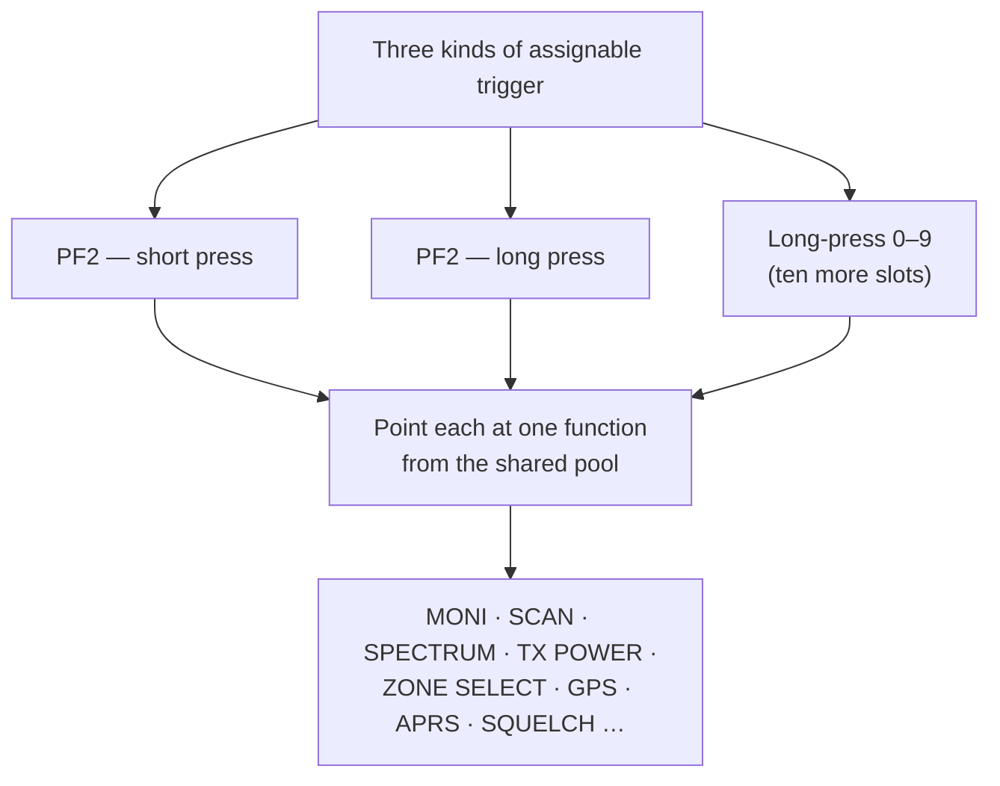
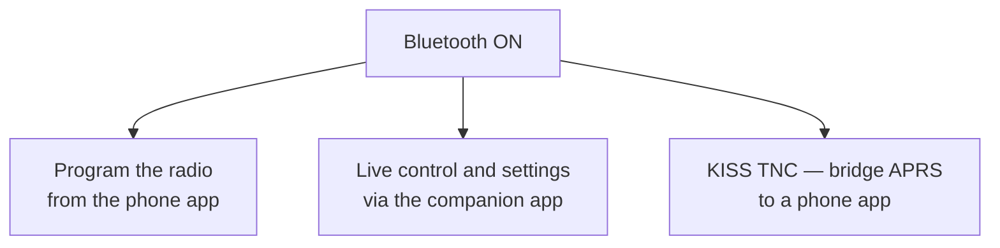
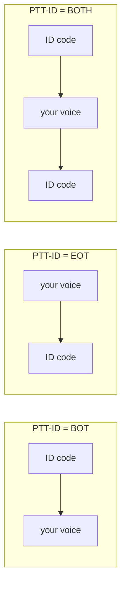

# Keys, Bluetooth, signalling and settings

This is the last of the menu-reference chapters, and it sweeps up the settings that do not belong to any one mode: the keys you can teach new tricks, the Bluetooth link to your phone, the DTMF signalling most amateurs never touch, and the housekeeping that makes the radio pleasant to live with day to day. Almost none of it changes how you sound on the air — but one or two of these settings quietly decide whether the radio feels like _yours_ or feels like a fight every time you pick it up.

The one-glance verdict key is the same as everywhere in this reference: ✅ set and forget · ⭐ useful, depending on how you operate · ⚠️ advanced, understand it first · ❌ leave off unless you have a reason. As before we name the **group** and the **item** (for example, _Setting → Back Light_), and you reach any of them with **MENU/OK**, the direction keys, and **MENU/OK** to save — the drill from [Getting Started](outpost:entry/logbook73.guide.rt-950-pro/getting-started).

## The User Key menu — making the radio yours

The RT-950 Pro has one dedicated programmable side key (labelled **PF2**, the key just below the three PTT buttons), and it gives you _three_ separate triggers to assign: a **short press** of PF2, a **long press** of PF2, and a **long press of each number key 0–9**. That is twelve shortcuts in all, each of which you can point at any function from a shared pool. It is the single biggest piece of personalisation the radio offers, and it turns a fiddly menu-diver into a radio you can drive one-handed.

### PF2 (short press) — ⭐ make it Monitor

The everyday shortcut, one quick press away.

- **Does:** fires whichever function you have assigned, instantly, from the standby screen.
- **Inside:** the firmware watches the key; a brief press runs the "short" action, a held press runs the "long" one (below), so the single key does two jobs.
- **Why it exists:** the things you do most — checking a channel is clear, cycling power, jumping to the spectrum view — are buried several menu presses deep. A hardware key brings the one _you_ use most out to your thumb.
- **Values:** any single entry from the assignable list (see the table below).
- **UK recommendation:** ⭐ **MONI (Monitor)**. Holding it opens the squelch so you can hear whether a weak station or a repeater is really there under the noise before you transmit — the most useful thing a spare key can do, and good operating manners besides.
- **Example:** you are about to call on a quiet repeater. A press-and-hold of PF2 (Monitor) lifts the squelch; you hear the faint hiss of the repeater's carrier, know it is up, and call.
- **Common mistakes:** assigning a function that transmits — TONE TX keys a tone burst on the air — to a key you will brush by accident; forgetting what you assigned months later and being startled when the radio does something. (The SOS alarm has its own home under _Radio → SOS Mode_ in [The Radio Menu](outpost:entry/logbook73.guide.rt-950-pro/menus-radio); it is not one of the spare-key slots.)
- **Related:** the long-press assignment below; _Radio → SQL_ (Monitor temporarily overrides the squelch you set there).
- **Should you change it?** Yes — this is a key that is wasted on its default. Set it to Monitor and you will use it every session.

### Long-press PF2 — ⭐ a second, calmer shortcut

Hold the same side key for roughly a second and it runs a _different_ assigned function, so one key carries two jobs — a fast one you tap and a deliberate one you hold.

- **Values:** any single entry from the assignable list.
- **UK recommendation:** ⭐ pick something you want occasionally but not by accident — **SPECTRUM** (the band-scope view) or **ZONE SELECT** (hop between channel folders) both suit a deliberate hold.
- **Example:** long-press PF2 set to Zone Select jumps you from your "Repeaters" zone to "Airband" with one held key, no menu.
- **Common mistakes:** assigning the same thing to short and long press, wasting the slot.
- **Should you change it?** Worth setting once to a function you reach for now and then.

### Long-press number keys 0–9 — ⭐ your personal function row

Each of the ten number keys can be given a function that fires on a long hold, on top of its normal job of typing digits — a quick tap still enters a number, a _held_ key runs its shortcut. The radio tells a tap from a hold, so digit and function never collide. That is a "function row" for the price of no new hardware.

- **Values:** each key takes one entry from the assignable list.
- **UK recommendation:** ⭐ assign only the handful you use. A tidy layout many owners like: **1** → TX POWER, **2** → CH-MEMORY, **3** → RX MODULATION (FM/AM for airband), **7** → GPS SWITCH, **8** → APRS SWITCH, **9** → SCAN. Leave the rest unassigned so a stray hold does nothing.
- **Example:** a local station calls on your repeater; you hold **1** to knock the power down to Low before answering, because they are strong and you are close.
- **Common mistakes:** assigning so many you cannot remember them; putting a transmit function like TONE TX where a stray hold keys the radio unintentionally.
- **Should you change it?** Assign three or four favourites; ignore the rest.

Here is the full pool you can assign to any of those triggers. The "Good on" column is a suggestion, not a rule.

| Function      | What a press does                                                                    | Good on             |
| ------------- | ------------------------------------------------------------------------------------ | ------------------- |
| RADIO         | Jump to the FM/AM/SW broadcast radio mode                                            | Long-press a number |
| MONI          | Hold the squelch open to hear weak signals                                           | PF2 short           |
| SCAN          | Start / stop scanning channels or frequencies                                        | Long-press a number |
| SEARCH        | Start a frequency sweep to find activity                                             | Long-press a number |
| SPECTRUM      | Open the band-scope display                                                          | PF2 long            |
| NOAA          | Tune the NOAA weather-radio channels (a US service — no such broadcasts in Region 1) | Long-press a number |
| SCAN QT       | Tone-scan: find the CTCSS/DCS sub-tone in use on a busy channel                      | Long-press a number |
| SQUELCH       | Adjust the squelch threshold from the key                                            | PF2 short           |
| FREQ STEP     | Cycle the tuning step size                                                           | Long-press a number |
| TX POWER      | Cycle High / Middle / Low                                                            | Long-press a number |
| CH-MEMORY     | Save the current VFO into a memory                                                   | Long-press a number |
| ZONE SELECT   | Switch which channel folder is active                                                | PF2 long            |
| STANDBY SET   | Toggle tri-watch (monitor all VFOs at once)                                          | Long-press a number |
| CTCSS DCS     | Jump to the sub-tone settings                                                        | Long-press a number |
| FREQ OFFSET   | Jump to duplex-offset entry                                                          | Long-press a number |
| FREQ DIR      | Cycle duplex direction (None / + / −)                                                | Long-press a number |
| RX MODULATION | Toggle FM / AM demodulation                                                          | Long-press a number |
| TONE TX       | Send the repeater access-tone burst                                                  | Long-press a number |
| TRANSFER      | Copy a channel back into the VFO to edit                                             | Long-press a number |
| GPS SWITCH    | Turn the GPS receiver on / off                                                       | Long-press a number |
| APRS SWITCH   | Turn the APRS engine on / off                                                        | Long-press a number |
| ROGER         | Toggle the end-of-transmission roger beep                                            | Long-press a number |

A few of these are worth a word. **TONE TX** sends the single tone burst set under _Radio → R-TONE_ (commonly **1750 Hz** in Europe) to wake a tone-access [repeater](outpost:entry/logbook73.handbook/repeaters); it is handy on a key if your local machines still use burst access. **TRANSFER** copies the contents of a memory channel back into the VFO so you can edit them — the everyday way round the "you can't retune a memory directly" rule from [Getting Started](outpost:entry/logbook73.guide.rt-950-pro/getting-started). **STANDBY SET** toggles tri-watch — whether the radio watches all its VFOs at once (`TW`/`DW`) or sits on the one you have selected — the same _Radio → Standby Set_ item, handy on a key if you flip between the two often.

## Bluetooth — the link to your phone

The RT-950 Pro has Bluetooth built in, and unlike a plain analogue handheld it puts that radio link to real work. This is a single on/off switch, but it is the gateway to three quite different things.

### Bluetooth (OFF / ON) — ⭐ on when you need it

- **Does:** enables the radio's Bluetooth so a phone can find and pair with it.
- **Inside:** the radio advertises itself as a Bluetooth serial device. The vendor's app opens a data channel to it; nothing about your audio or transmit goes wireless — this is a _control and data_ link, not a headset link.
- **Why it exists:** the RT-950 Pro is not CHIRP-compatible and its front-panel menus are slow to drive, so the phone app is the sane way to configure it. Bluetooth also lets the radio act as a modem for a phone-based APRS app without a cable.
- **Values:** OFF / ON.
- **UK recommendation:** ⭐ **ON** while you are programming or running a KISS session; **OFF** the rest of the time. Bluetooth draws a little current and is a small, needless attack surface left on permanently — and on a battery you carry all day, every milliamp counts.
- **The three jobs it does:**
  - **Programming.** Pair to the vendor's phone app and edit channels, zones and settings in a proper table, then write them back — an afternoon of menu-diving reduced to minutes. It is also how you take a **backup** before a firmware update (see Reset, below).
  - **Live control.** The same app shows and changes settings on the fly, which some operators prefer to the keypad.
  - **KISS TNC.** With _APRS → TNC Type_ set to **KISS**, the radio becomes a plain modem and hands raw packets to a phone app over Bluetooth — the phone does the maps and messaging, the radio does the radio. Covered fully in [APRS, GPS & Digipeater](outpost:entry/logbook73.guide.rt-950-pro/menus-aprs).
- **Common mistakes:** leaving Bluetooth on and wondering where the battery went; expecting it to carry _voice_ to a wireless earpiece (it is a data link, not an audio headset); running a KISS app without setting _TNC Type → KISS_, so the phone connects but hears no packets (see [Troubleshooting](outpost:entry/logbook73.guide.rt-950-pro/troubleshooting) if pairing fails).
- **Should you change it?** Turn it on for a task, off afterwards.

## Signalling — DTMF identity and call codes

Here is a menu almost every amateur can leave exactly as it ships. **Signalling** is a set of DTMF tools inherited from commercial and fleet radios, where a base station identifies handsets automatically. On the amateur bands you identify yourself the proper way — by **saying your callsign** — so the automatic version is redundant, and its little chirp of tones at the start of every over is, frankly, an annoyance to everyone else. We explain it so you understand what it is, and then leave it off.

First, two pieces of jargon. **DTMF** (Dual-Tone Multi-Frequency) is the "touch-tone" system your phone uses: each key sends a pair of audio tones the far end can decode back into a digit. **ANI** (Automatic Number Identification) is the trick of sending a short string of those tones to announce _which radio_ is transmitting — a machine-readable ID. **PTT-ID** is the RT-950 Pro's name for sending that ANI code automatically each time you key up or let go.

### S-CODE (Code 1–15) — ⚠️ leave on Code 1

Chooses which of fifteen stored DTMF code groups is active.

- **Does:** selects one of fifteen preset signalling groups, each holding an identity (ANI) code and its associated call codes.
- **Inside:** the radio stores fifteen slots so a fleet could give different handsets, or different jobs, different codes. Selecting an S-CODE tells PTT-ID which slot to transmit.
- **Why it exists:** commercial systems need many distinct IDs on one channel; fifteen presets let one radio play several roles.
- **Values:** Code 1 to Code 15.
- **UK recommendation:** ⚠️ leave it on **Code 1** and ignore it. It only matters if you have deliberately turned PTT-ID on, which for ham chat you should not.
- **Example:** irrelevant for normal amateur use — you would only touch it inside a private DMR-style commercial fleet, which is not what this radio is for on the ham bands.
- **Common mistakes:** changing it while experimenting and then forgetting, so a later PTT-ID experiment sends an unexpected code.
- **Related:** PTT-ID and DTMFST (below).
- **Should you change it?** No.

### PTT-ID (OFF / BOT / EOT / BOTH) — ⚠️ OFF for ham chat

Decides _whether and when_ the identity code is sent around your speech.

- **Does:** transmits the ANI/identity code at the **B**eginning **O**f **T**ransmission, the **E**nd **O**f **T**ransmission, both, or not at all.
- **Inside:** on BOT the radio sends the DTMF code the instant you press PTT and _then_ opens the microphone; on EOT it sends your voice first and the code as you release; BOTH does both. The manual notes the identity code is sent independently of the call code, and if the two conflict the identity code wins.

- **Why it exists:** so a controller or repeater can log which handset is talking without anyone speaking. Useful in a taxi fleet; pointless in a ragchew.
- **Values:** OFF / BOT / EOT / BOTH.
- **UK recommendation:** ⚠️ **OFF**. On the amateur bands you must identify by voice with your callsign anyway, so the DTMF burst adds nothing but a chirp that clips the front (or tail) of your audio and irritates listeners — and it does _not_ satisfy the requirement to identify by voice.
- **Example:** with PTT-ID on BOT, every time you key up the other station hears a quick "boo-beep-boop" before your first word — on a repeater, a small rudeness repeated all night.
- **Related:** S-CODE (which code it sends); DTMFST (whether _you_ hear the tones).
- **Should you change it?** No — this is the classic "leave it off" setting for amateur use.

### DTMFST (OFF / DT-ST / ANI-ST / DT+ANI) — taste

Whether the DTMF tones are played back to _you_ through the speaker as they are sent.

- **Does:** controls the **side tone** — the audible confirmation you hear locally when DTMF is transmitted. `DT-ST` sounds the tones you key manually; `ANI-ST` sounds the automatic ID code; `DT+ANI` sounds both; `OFF` keeps you in silence.
- **Inside:** it only routes the tones to your own speaker for feedback; it does not change what goes out over the air.
- **Why it exists:** so you can _hear_ that a code was sent, which is reassuring when you are dialling DTMF by hand (for example to control a linked repeater or an autopatch).
- **Values:** OFF / DT-ST / ANI-ST / DT+ANI.
- **UK recommendation:** taste. If you never send DTMF, **OFF** is quietest. If you do occasionally key tones by hand, **DT-ST** is a helpful confirmation.
- **Example:** sending a DTMF sequence to control a gateway, DT-ST lets you hear each digit register so you know the string went out.
- **Common mistakes:** blaming a "beeping radio" on this when it is really the key-press Beep Prompt (below).
- **Related:** PTT-ID; Beep Prompt.
- **Should you change it?** Only if the side tones bother you or you want them for hand-dialled DTMF.

## Setting — the housekeeping menu

These are the comfort settings: beeps, backlight, timeouts and language. They do not touch the RF at all, but they are the difference between a radio that feels considered and one that feels cheap. Most are set-and-forget.

### Beep Prompt (OFF / ON) — ✅ ON

The confirmation beep on each key press. ✅ Leave it **ON** while you are learning — the feedback tells you a press registered. Turn it **OFF** for quiet operation (a nature reserve, a meeting, a sleeping house). One line, no drama.

### Voice (OFF / ON) — taste

Spoken prompts that announce menu items and channels aloud. Handy if you operate without looking at the screen (mobile, or with limited vision); a chatterbox otherwise. Set to taste — most owners leave it **OFF**. On the RT-950 Pro the voice is English or Chinese to match the Language setting.

### Keypad Lock (OFF / 0.5 s–15 s) — ⭐ 5–10 s auto-lock

Automatically locks the keypad after a period of no key presses.

- **Does:** disables the keys (a padlock icon appears on the display) after the delay you set, so pocket-presses cannot retune the radio or, worse, key it up.
- **Inside:** an inactivity timer; any deliberate unlock sequence (typically holding a designated key) frees the keypad again.
- **Why it exists:** a handheld in a pocket or bag is a keypad pressed against fabric all day. Auto-lock stops "pocket transmit" and accidental channel changes.
- **Values:** OFF, or a delay from 0.5 s up to 15 s.
- **UK recommendation:** ⭐ **5–10 s**. Long enough that a quick two-handed adjustment is not interrupted, short enough that the radio locks itself soon after you pocket it. If you find the lock intrusive on the bench, set OFF while programming and back on before you go out.
- **Example:** you set 10 s, drop the radio in a jacket pocket, and ten seconds later it locks itself — no more discovering you have been transmitting into your coat lining.
- **Common mistakes:** setting OFF and then leaving the radio unlocked in a bag (the "pocket transmit" that holds a channel open and drains the battery); forgetting the unlock sequence and thinking the radio has frozen.
- **Related:** the lock icon in the status strip (see [Getting Started](outpost:entry/logbook73.guide.rt-950-pro/getting-started)); _Radio → TOT_ (the time-out timer, a second line of defence against a stuck transmit).
- **Should you change it?** Yes — an auto-lock of a few seconds is one of the quiet must-haves.

### Back Light (Bright / timed) — ⭐ a short timeout

How long the colour screen stays lit after a key press.

- **Does:** either keeps the backlight permanently on (**Bright**) or lights it for a set time after each press, then dims to save power.
- **Inside:** the colour LCD's backlight is one of the biggest current draws on the radio; timing it off between presses meaningfully extends run time.
- **Why it exists:** a lit colour screen is lovely and thirsty. A timeout keeps the display readable when you are using it and dark when you are not.
- **Values:** Bright (always on), or a timeout from roughly 0.5 s up to 3 minutes.
- **UK recommendation:** ⭐ a **timed** value of about **30–60 s** for portable use — you see what you are doing, then it sleeps. Use **Bright** only on charge or as a base station where battery life is irrelevant.
- **Example:** at 30 s the screen lights when you tune, stays readable while you set a repeater, and dims itself once you pocket the radio, saving hours of standby life over a day.
- **Common mistakes:** leaving it on Bright and being surprised the battery is flat by lunchtime; setting it so short (0.5 s) that the screen is dark before you have read it.
- **Related:** _Radio → Battery Save_ (the other big lever on run time).
- **Should you change it?** Yes, if you value battery life — a 30–60 s timeout is a sensible default the radio does not ship with.

### Menu OutTime (0.5 s–60 s) — ⭐ 15–30 s

How long the menu waits, with no key presses, before it gives up and returns to the standby screen (without saving whatever you were part-way through). ⭐ Set it to **15–30 s** — long enough to read an item and think, short enough that a forgotten menu tidies itself away. Too short (a second or two) and it snaps shut while you are still reading; at 60 s a forgotten menu sits there with the backlight burning. It works with **Back Light** to decide how long a set-down radio stays lit.

### Power On Display (Picture / Voltage) — taste

What the radio shows for a moment as it boots. **Picture** shows the vendor splash or a stored image; **Voltage** shows the battery voltage — genuinely useful, because a quick number at switch-on tells you how much charge you have before you rely on it. Set to taste; **Voltage** is the more practical choice.

### Language (English / Chinese) — ✅ English

The menu and voice-prompt language. ✅ **English** for this guide's readers. One line.

## Reset — the two ways to start over, and why you back up first

Two levels of reset live here, and both are safe _provided you have a backup first_. The RT-950 Pro is programmed only through the vendor software or phone app, so a reset with no saved file means re-entering every channel, zone, tone and offset by hand — an evening you will not enjoy.

| Item          | What it wipes                                                                                      | When you'd use it                                                                               |
| ------------- | -------------------------------------------------------------------------------------------------- | ----------------------------------------------------------------------------------------------- |
| **VFO Reset** | The VFO (frequency-mode) settings back to defaults; your stored **memory channels are left alone** | The radio is behaving oddly in VFO mode and you want a clean slate without losing your channels |
| **Reset All** | _Everything_ — channels, zones, tones, APRS, keys, settings — back to factory                      | You are selling the radio, starting completely fresh, or clearing a corrupted configuration     |

**VFO Reset** (⚠️) returns the frequency-mode settings — steps, offsets, VFO tones, bandwidths — to their defaults while preserving your memory channels and zones. It is a reasonable first step if the radio misbehaves in VFO mode, and because your channels survive, the risk is low. Take a backup first anyway; it is free insurance.

**Reset All** (⚠️) wipes the radio back to factory — every channel, zone, tone, key assignment, APRS setting and comfort tweak gone, with **no undo**. Use it for resale, or to clear a configuration so tangled that fixing it by hand is slower than starting over.

- **Always save a backup with the phone app or software before you do this:** Bluetooth ON, connect, read from radio, save the file. With a backup, a full reset is a two-minute round trip — reset, then write your saved file back. Without one, it is a lost evening re-entering everything by hand.
- **Example:** a setting somewhere makes the radio transmit oddly and you cannot find it; you save a backup, Reset All, write the backup back, and the gremlin is gone — or, if not, you re-enter cleanly.
- **Common mistakes:** resetting to "fix" a problem with no backup and losing a hand-built channel list; confusing Reset All with the separate _APRS → Factory Setting_, which resets only the APRS block (see [Troubleshooting](outpost:entry/logbook73.guide.rt-950-pro/troubleshooting)).

> **A firmware word of caution.** The RT-950 Pro's bootloader does no integrity check on a firmware flash, so a bad update can brick the radio — and a reset will not save you from that. Update firmware deliberately, on a good battery, and keep a configuration backup regardless. This is the young-firmware reality flagged in the [overview](outpost:entry/logbook73.guide.rt-950-pro/overview), not a reason to avoid updates — just to make them calmly.

## About Machine — the read-only page

The last item is a nameplate, not a setting: three read-only lines you cannot change but occasionally need.

| Line         | What it tells you                        | Why it matters                                                                                                                          |
| ------------ | ---------------------------------------- | --------------------------------------------------------------------------------------------------------------------------------------- |
| **Software** | The firmware version currently installed | The RT-950 Pro's firmware updates often; this is how you check whether you are due one before a trip                                    |
| **Hardware** | The hardware revision of your unit       | Early and later boards differ (there have been at least two revisions), which explains some unit-to-unit variation in receive behaviour |
| **ANI Code** | The radio's stored identity (ANI) code   | The DTMF ID that PTT-ID would send — read-only here, and irrelevant unless you have (against this guide's advice) turned PTT-ID on      |

There is nothing to set. Note the **Software** version when you ask for help or read release notes, and note the **Hardware** revision if you are comparing your receiver's quirks with another owner's — the [research on this radio](outpost:entry/logbook73.guide.rt-950-pro/overview) shows behaviour can genuinely differ between board revisions.

## Key takeaways

- The **User Key** menu gives you twelve shortcuts — PF2 short, PF2 long, and a long-press on each of 0–9 — each pointing at any function in a shared pool; assign **MONI to PF2** and a few favourites (TX Power, Zone, GPS, APRS, Scan) to number keys, and leave the rest unassigned.
- **Bluetooth** is a data link, not an audio one: turn it **ON** to program from the phone app, take a backup, or run a **KISS TNC** for [APRS](outpost:entry/logbook73.guide.rt-950-pro/menus-aprs); turn it **OFF** afterwards to save battery.
- **Signalling** (S-CODE, PTT-ID, DTMFST) is a commercial-fleet DTMF hangover: on the amateur bands you identify **by voice**, so leave **PTT-ID OFF** and the rest at defaults.
- The **Setting** menu is comfort and battery life: **Beep ON** while learning, **Keypad Lock ~5–10 s** against pocket-transmit, **Back Light timed ~30–60 s** and **Menu OutTime ~15–30 s** to spare the battery, **Voltage** boot screen for a charge check at switch-on.
- **Reset** has two levels — **VFO Reset** keeps your channels, **Reset All** wipes everything — and both are only safe with a **backup saved first**, because this radio has no CHIRP fallback.
- **About Machine** is read-only: note the **Software** version for updates and the **Hardware** revision to make sense of unit-to-unit differences.

That is every menu on the radio explained. Now we step back from the _what_ to the _why_ — the handful of ideas the whole menu rests on, told plainly: [What the Settings Really Mean](outpost:entry/logbook73.guide.rt-950-pro/theory).
