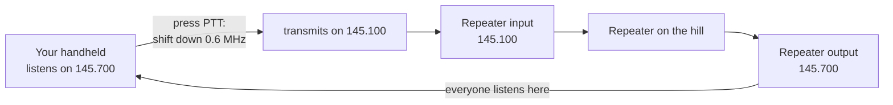
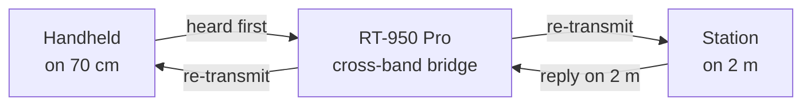

# What the settings really mean

The menu chapters told you _what_ each setting does and _where_ to find it. This one tells you _why_ it exists at all. Almost every option on the RT-950 Pro is an answer to a physics problem or a courtesy problem — a way of keeping a shared, invisible resource usable for everyone on it. Understand the handful of ideas underneath, and the menus stop feeling like a list of arbitrary switches and start reading like a set of sensible engineering decisions you happen to be allowed to change.

We will take the concepts one at a time — squelch, tones, offsets, bandwidth, power, cross-band repeat, the housekeeping timers, the noises the radio makes, and finally why two of the settings must stay off — and link out to the main [handbook](outpost:entry/logbook73.handbook) whenever you want the full story.

## Squelch — the gate that keeps the hiss out

Tune an FM receiver to an empty frequency and it roars white noise at you — the endless hiss you heard when you opened the monitor function in [Getting Started](outpost:entry/logbook73.guide.rt-950-pro/getting-started). That hiss is the receiver honestly reporting that it is hearing _nothing but noise_, amplified to full volume. Nobody wants to sit through that between transmissions, so every FM radio has a gate on the audio called **squelch**, set on the RT-950 Pro by _Radio → SQL_ (0–9).

Here is the trick the radio uses. An unmodulated FM signal — a real carrier from a real transmitter — is _quiet_ in a very particular way: it pushes the background hiss down, because the receiver's limiter locks onto the strong carrier instead of amplifying noise. So the radio does not measure "is there a signal?" directly. It measures **how much high-frequency noise is present**, and reasons backwards: lots of noise means no signal (stay muted), little noise means a carrier has arrived (open the speaker). The `SQL` number sets where that threshold sits.

```viz
{
  "type": "wave",
  "title": "Squelch — a gate set on received level",
  "caption": "While the received level sits below the threshold (dashed) the speaker stays muted. A real signal lifts it above the line and the audio opens; drop below and it closes again.",
  "xLabel": "time",
  "traces": [
    { "kind": "points", "label": "received level", "tone": "primary", "points": [[0,-0.6],[0.08,-0.52],[0.16,-0.63],[0.24,-0.5],[0.31,-0.58],[0.37,0.42],[0.45,0.56],[0.53,0.5],[0.61,0.58],[0.69,0.46],[0.75,-0.55],[0.83,-0.6],[0.91,-0.5],[1,-0.58]] },
    { "kind": "points", "label": "squelch threshold", "tone": "danger", "style": "dashed", "points": [[0,0],[1,0]] }
  ]
}
```

The number is a compromise, and it is worth feeling the two failure modes rather than memorising a value. A **low** threshold (say `SQL 1`) is _sensitive_: it opens for the faintest, noisiest signals, so you catch a weak distant station — at the cost of the speaker crackling open on random noise bursts. A **high** threshold (say `SQL 8`) is _deaf on purpose_: it stays shut unless a signal is strong and clean, giving you silence between overs — at the cost of missing the very weak ones. On a quiet band a middling `SQL 3–5` is the sweet spot: silent when nothing is there, but not so tight that it swallows a distant repeater. There is more on how a receiver actually separates signal from noise in [Receivers](outpost:entry/logbook73.handbook/receivers).

Two habits follow from this. First, when you are hunting for a weak signal, _open_ the squelch (drop it, or hold the monitor function) so the gate cannot hide it. Second, if a channel "goes deaf" for no reason, suspect the squelch before you blame the radio — a number nudged up to 9 is the single most common cause of "it stopped receiving."

## CTCSS and DCS — a private knock on a shared door

Squelch keeps _noise_ out, but it cannot keep _other people_ out. On a busy shared channel — a club calling frequency, a PMR446 channel at a rally — plain squelch opens for every transmission on that frequency, whether or not it is meant for you. What you want is a squelch that only opens for _your_ group. That is what **CTCSS** and **DCS** provide (_CTCSS DCS → RX/TX CTCSS/DCS_ on the radio).

CTCSS — Continuous Tone-Coded Squelch System — works by having every transmitter in your group add a single steady tone underneath its audio, somewhere between **67.0 and 254.1 Hz**. That is deliberately _below_ the roughly 300–3000 Hz band your voice occupies, so it is sub-audible: you never consciously hear it, but a receiver told to listen for it can. Set your receiver to open only when it detects, say, `88.5 Hz`, and every transmission carrying that tone unlocks your speaker while every other conversation on the frequency stays politely muted.

```viz
{
  "type": "spectrum",
  "title": "A CTCSS tone rides below your voice",
  "caption": "The sub-audible tone (here 88.5 Hz) sits under the 300–3000 Hz voice band, so a matched receiver detects it while your ear never notices it.",
  "xLabel": "audio frequency",
  "components": [
    { "f": 3, "amp": 0.65, "label": "CTCSS 88.5 Hz", "tone": "primary" },
    { "f": 48, "amp": 0.8, "width": 78, "label": "voice 300–3000 Hz", "tone": "muted" }
  ]
}
```

**DCS** — Digital-Coded Squelch — does the same job with a slow digital codeword (a continuous ~134 bit-per-second pattern, the `D023`–`D754` codes in the menu, each in a Normal or Inverted variant) instead of a single tone. It gives you many more distinct codes than CTCSS has tones, which matters when lots of groups share a small band. Functionally, for you, the two are interchangeable: pick whichever the repeater or group specifies.

Two points keep people out of trouble. First, a tone is **not** privacy — anyone with plain squelch, or the RT-950 Pro's own _Scan SubCode_ feature, hears your whole conversation; a sub-tone only decides whose speaker _opens automatically_, not who _can_ listen. Second, **most repeaters require a CTCSS tone on your transmit** to open them at all (`TX CTCSS`), quite separately from any tone you set on receive. Set the transmit tone the repeater lists or your signal, however strong, simply will not key it. The full menu treatment — receive versus transmit tones, and finding an unknown tone with a scan — is in [CTCSS, DCS & Sub-tones](outpost:entry/logbook73.guide.rt-950-pro/menus-ctcss), and the etiquette of tones lives in [Repeaters](outpost:entry/logbook73.handbook/repeaters).

## Duplex and offset — why a repeater needs two frequencies

A [repeater](outpost:entry/logbook73.handbook/repeaters) is a radio on a hill (or a tall building) whose entire job is to listen to weak handhelds down in the valleys and re-transmit them at height and power, so two stations that could never hear each other directly can talk across a whole county. But there is an obvious problem: a radio cannot listen and transmit on the _same_ frequency at the _same_ time — its own powerful transmitter would deafen its own receiver. So a repeater listens on one frequency (its **input**) and simultaneously transmits on another (its **output**), a fixed distance away. That gap is the **offset** (or "shift"), and operating with it is called working **duplex**.

Your handheld has to mirror that split exactly, and this is what _VFO&CH → Direction_ and _Offset_ set up. You _listen_ on the repeater's output. When you press PTT, the radio must instantly jump to the repeater's _input_ — the output shifted by the offset — transmit there, and jump back the moment you release. `Direction` sets whether that jump is up (`+`) or down (`−`); `Offset` sets how far.



A worked example on 2 m: a repeater with output `145.700 MHz` in a region using a `0.600 MHz` shift needs `Direction −` and `Offset 0.600`, so your transmit lands on `145.100`, the input, and you drop back to `145.700` to listen. The exact figures are set by your national band plan, and the 70 cm shift in particular varies a lot (around `1.6 MHz` in much of Europe, `5 MHz` in North America) — so **check your national band plan** rather than copying numbers across borders. The good news, as the [menus-vfo chapter](outpost:entry/logbook73.guide.rt-950-pro/menus-vfo) stresses, is that once you save a repeater as a memory channel the offset, direction and tone are all remembered for you; you set this by hand only when adding a new machine. Set `Direction None` for **simplex** — talking directly to another station on a single frequency, no repeater involved — which is most of what a new licensee actually does.

## Wide and narrow FM — how much room your voice takes

FM carries your voice by wobbling the transmit frequency slightly up and down in step with the sound. How _far_ it wobbles is the **deviation**, and it sets how much spectrum your signal occupies. The RT-950 Pro's `Bandwidth` menu offers two settings: **Wide** (deviation up to about ±5 kHz) and **Narrow** (about ±2.5 kHz). This is not a volume control and it is not the tuning `Step` — it is how big a slice of the band your transmission spreads across.

```viz
{
  "type": "spectrum",
  "title": "Wide and narrow FM — the same voice, a different footprint",
  "caption": "Narrow FM (±2.5 kHz, the tall spike) packs your voice into roughly 11 kHz; wide FM (±5 kHz, the broad block) spreads the same words across about 16 kHz.",
  "xLabel": "frequency across the channel",
  "components": [
    { "f": 50, "amp": 0.55, "width": 44, "label": "wide FM ±5 kHz", "tone": "muted" },
    { "f": 50, "amp": 0.9, "width": 20, "label": "narrow FM ±2.5 kHz", "tone": "primary" }
  ]
}
```

A rough rule (Carson's, if you want the name) says an FM signal needs about `2 × (deviation + highest audio frequency)` of room. For wide FM with 3 kHz of audio that is `2 × (5 + 3) ≈ 16 kHz`; for narrow it is `2 × (2.5 + 3) ≈ 11 kHz`. Narrow fits more channels into the same band — which is exactly why the world has been migrating land-mobile radio, and licence-free services, towards it. The trade is a little less audio "punch" and slightly more hiss on weak signals, because the smaller deviation gives FM less of the noise-beating advantage it earns from swinging further.

The practical rule is simply **match the channel**. Use **wide** on the amateur 2 m and 70 cm bands where the plan expects it, and **narrow** where it is mandated — notably [PMR446](outpost:entry/logbook73.handbook/uhf) (and its North American cousin FRS), which are 12.5 kHz narrow-FM channels. The classic mistakes are audible: transmit _wide_ on a _narrow_ channel and you splatter into the neighbours and sound distorted to them; transmit _narrow_ where everyone else is _wide_ and you arrive sounding quiet and muffled. The full mechanics of FM live in [Modulation](outpost:entry/logbook73.handbook/modulation).

## AM, and why the airband needs a different detector

FM is not the only way to stamp a voice onto a carrier. The oldest method, **AM** (amplitude modulation), varies the carrier's _strength_ rather than its frequency, and it is still what civil aviation uses worldwide. That is why `VFO&CH → RX Modulation` exists: point the radio at an airfield on `118–137 MHz` with the detector set to `FM` and you will hear a faint, unintelligible whisper, because an FM detector cannot make sense of an amplitude-modulated signal. Switch `RX Modulation` to `AM` and the same signal comes through clearly. One radio receives across services that made different modulation choices, so it needs to be told which decoder to use.

AM matters for one aviation-specific reason too: when two aircraft transmit at once, AM produces a distinctive heterodyne squeal and you can tell a "double" happened, whereas FM's _capture effect_ would simply hand the channel to the stronger station and hide the weaker one entirely — not what you want in air traffic control.

The RT-950 Pro goes further still, adding SSB and CW detectors for shortwave listening down on the HF bands, a genuinely unusual feature at this price. Two honest caveats belong here. Its wide receive coverage comes from a deliberately broad, less selective front end, so on medium wave and in strong-signal spots it can serve up **image and ghost signals** — a station appearing where it is not really transmitting — a limitation common to inexpensive wideband handhelds and explained in [Overload and Ghost Signals](outpost:entry/logbook73.handbook/overload-and-ghost-signals). And owners report a weak-to-deaf patch around 250–275 MHz on some units. None of this spoils the fun; it just means the receiver is broad rather than fussy, and worth knowing when something odd appears.

## Power levels — why low is usually right

`Radio → Trans Power` offers **High**, **Middle** and **Low**, and the instinct of every new operator is to leave it on High "to get out better." Resist it. On the RT-950 Pro the High setting has been measured by independent reviewers at roughly **6.5–8.5 watts** (against a "10 W" specification — a normal, honest gap for a budget handheld); Middle and Low step down from there, with Low around a watt (the exact figures for the lower steps are not published). But raw watts are a poor lever on the result, because signal strength falls off steeply with distance: doubling your power lifts the far-end signal by only 3 dB — half an S-point — which almost never turns an unworkable contact into a workable one. If a station cannot hear you on Low, High rarely rescues it; a better [antenna](outpost:entry/logbook73.handbook/antennas), or a few metres higher, or a clearer takeoff usually will.

Meanwhile there are solid reasons to run the _lowest power that does the job_, a principle worth adopting for life:

- **Battery.** Transmit is by far the biggest drain. Halving power can noticeably extend a day's operating from one charge.
- **Interference and heat.** More power means more chance of overloading nearby receivers, and a hot power amplifier on a long over — the manual itself warns to keep transmissions under a 50% duty cycle.
- **Your own exposure.** A handheld is a transmitter beside your head; less power is less RF into you. See [RF Power](outpost:entry/logbook73.handbook/rf-power) for the (undramatic) reasoning.
- **Courtesy and licence.** You transmit **within your licence conditions**, and "no more power than you need" is both good manners and, in many licences, an actual condition.

The worked habit: talking to someone across town through a strong local repeater? Low is plenty. Reaching for a distant simplex contact on a hilltop? Try Middle, and only step to High if the other end genuinely struggles. Let the far station's report, not your nerves, choose the level.

## Cross-band repeat — turning the radio into a bridge

`Radio → AB RPT-Mode` turns the RT-950 Pro into its own miniature repeater. With one VFO on 2 m and another on 70 cm, the radio listens on both; whichever band hears a valid signal first, the radio re-transmits it out on the other band. A handheld that only reaches a 70 cm hilltop from your garden can, via a cross-band unit left in an upstairs window, talk to a 2 m station it could never hear directly — the radio bridges the two bands.



It is a clever trick, but it makes _you_ a repeater operator, with the responsibilities that carries — so treat it as advanced (⚠️) and read [Repeaters](outpost:entry/logbook73.handbook/repeaters) first. In particular: **you are responsible for everything your radio re-transmits**, so it must not be left keying up on interference or relaying traffic you cannot account for; your **callsign identification** obligation still applies to the bridged signal; it works only across two _different_ bands (it cannot repeat 2 m onto 2 m); a long relay session will warm the PA, so keep power sensible; and `RPT-Speaker` lets you mute the local speaker so the bridge does not chatter at you all day. Set it up deliberately, use it for a purpose, and switch it off when you are done.

## The housekeeping timers — saving power, and preventing a stuck key

A cluster of settings do quiet background jobs, and each earns its place.

**Battery Save** (`OFF / Normal / Super / Deep`) tackles the fact that a receiver _listening_ still draws current even when nothing is happening. It puts the receiver into a rapid micro-sleep between quick "is anyone there?" checks — awake perhaps a fraction of each second, asleep the rest — which meaningfully stretches battery life. The trade is that a sleeping receiver can clip the very _start_ of a transmission it wakes into the middle of; the deeper the save, the more it clips. `Normal` is the everyday compromise; reserve `Deep` for long listening watches where you would rather miss a syllable than a whole afternoon of charge. (Do not confuse it with the similarly-named **Standby Set**, which has nothing to do with power — it is the tri-watch switch, covered in [The Radio Menu](outpost:entry/logbook73.guide.rt-950-pro/menus-radio).)

**TOT — the time-out timer** (`OFF / 30–240 s`) exists for one nightmare: a stuck PTT. If your radio is sat on in a car seat or its transmit button jams, without a time-out it will transmit _continuously_ — flattening the battery, cooking the power amplifier, and (worst of all) holding a repeater or channel open so **nobody else can use it**, indefinitely. The time-out timer simply cuts your transmission after a set maximum, forcing a release. A value around `180 s` is generous for any legitimate over yet still catches a genuinely stuck key. **TALL** sounds a warning tone as the limit approaches, so a long-but-legitimate transmission gets a heads-up before it is cut rather than a silent chop. Both are courtesies to everyone sharing the channel — leave TOT on.

## Roger beep, DTMF and ANI — the sounds a radio makes

Three features make deliberate _noises_, and all three are commonly misused, so it is worth knowing what each is really for.

**Roger beep** (`Radio → ROGRE`) appends a short tone the instant you release PTT, signalling "I have finished, over to you." It has real value where turn-taking is otherwise ambiguous — weak simplex, or noisy group work — because it confirms your over ended and was not just a dropout. On everyday amateur voice, though, it adds nothing that saying "over" does not, and many operators find a beep after every transmission grating. Leave it **off** by default and reach for it only when the situation genuinely benefits.

**DTMF** — Dual-Tone Multi-Frequency — is the "touch-tone" sound of an old telephone keypad: each digit is a pair of audio tones the far end can decode reliably. In radio it is a _control_ and _signalling_ language, not a chat feature. It can command a repeater (open a link, trigger an autopatch), or address a _selective call_ to one station whose radio stays quiet until it hears its own code. The RT-950 Pro handles this through the `Signalling` menu — `S-CODE` chooses which of fifteen stored code groups is active, and `DTMFST` decides whether _you_ hear the tones as you send them.

**ANI and PTT-ID** are the automatic side of that. **ANI** (Automatic Number Identification) is a DTMF code identifying your radio, and **PTT-ID** (`OFF / BOT / EOT / BOTH`) sends it automatically at the _beginning_ or _end_ of each transmission — the little burst of digital chirps you sometimes hear top-and-tail an over on commercial systems. It is essential on managed fleet or trunked networks that log which radio keyed up; it is **actively unhelpful on amateur voice**, where you identify by _speaking your callsign_ — a DTMF chirp is not your legal identification and only adds noise and a chance of collision. For ordinary amateur chat, keep `PTT-ID OFF`. (Your radio's own ANI code, incidentally, is shown read-only under _About Machine_.) The [system-menu chapter](outpost:entry/logbook73.guide.rt-950-pro/menus-system) has the full field-by-field treatment.

## Encryption and scrambling — and why both stay off

Two settings must simply stay off for amateur use, and it is worth understanding _why_ rather than just being told. **Scramble** (`Scram1–8`) is analogue **voice inversion**: it flips your audio spectrum top-to-bottom so speech becomes an unintelligible Donald-Duck warble to anyone without a matching descrambler. **Encryption** (`ON/OFF`) is the digital equivalent — a proprietary scheme that renders your transmission unreadable without the key. Both exist because the radio is sold into commercial and security markets where hiding the content of a message is the point.

Amateur radio is built on the opposite principle. A foundational rule, common to licences worldwide and rooted in the international radio regulations, is that you must **not obscure the meaning** of your transmissions — no ciphers, no codes intended to hide content. The band is a _shared, open, self-policing_ space: anyone must be able to listen, understand who is transmitting and what is being said, and flag interference. That openness is precisely what makes the amateur service trusted with so much spectrum, and it is why scrambling and encryption of amateur voice are simply **not permitted**. (For completeness: it is largely this "does more than it should" capability — including out-of-band transmit — rather than emission cleanliness that has drawn regulators' attention to radios of this class over the years; the fix is the same either way — operate in-band, in the clear, within your conditions.)

There are practical reasons too, even where a rule did not forbid it: both features degrade your audio, break interoperability with everyone else's receivers, and offer no real security against anyone determined. On any licence-free service such as PMR446 they are equally off-limits — those channels must carry plain, clear analogue speech. So the recommendation is unambiguous: **leave `Scramble` off and `Encryption` off**, on this radio and every amateur radio. The one time you will meet them legitimately is on a commercial system you are separately authorised to use — never on the amateur bands.

## Try it yourself

With a charged battery, the antenna fitted, and no intention of transmitting where you should not:

1. **Feel the squelch threshold.** Open _Radio → SQL_ and, while listening to a quiet frequency, walk it from `1` up to `9`. Hear the hiss break through at low numbers and the channel fall silent at high ones. Leave it where the silence begins — that is _your_ radio's noise floor.
2. **Hunt a hidden tone.** On a shared or repeater frequency you can legally receive, use the `Scan SubCode` feature (long-press `A/B/C`) to reveal the CTCSS or DCS a signal is carrying. You have just watched a "private" tone turn out to be perfectly readable — proof that a sub-tone is squelch control, not privacy.
3. **See wide versus narrow.** If you have a second receiver or an SDR, listen to a narrow-FM transmission (a PMR446 channel) then a wide-FM one, and notice how the narrow signal sounds quieter and thinner for the same voice.
4. **Prove the offset.** Put a repeater in a VFO with its `Direction` and `Offset` set, then press PTT (into a dummy load or with the antenna, briefly and legally) and watch the displayed frequency jump to the input and back. The duplex shift, made visible.
5. **Turn power into distance — or not.** On a simplex contact, ask the other station for a signal report on Low, then High. Most of the time the report barely changes: proof that watts are the weakest lever you have.

Nothing here transmits where it should not, and `Exit` always brings you home.

## Key takeaways

- **Squelch** (`SQL`) is a gate driven by _noise_, not signal — low is sensitive and crackly, high is deaf-on-purpose; `3–5` suits a quiet band, and a nudged-up value is the usual cause of a "deaf" radio.
- **CTCSS and DCS** add a sub-audible tone or code so only your group's speakers open — control, not privacy — and most repeaters need a matching _transmit_ tone to key at all.
- **Direction + Offset** mirror a repeater's two-frequency (duplex) split so you listen on the output and transmit on the input; save repeaters as memories and check your _national_ band plan for the figures.
- **Wide vs narrow FM** is how much spectrum your voice occupies (~16 kHz vs ~11 kHz) — match the channel; narrow for PMR446, wide where the plan expects it — and set `RX Modulation` to **AM** for the aviation airband.
- **Run the lowest power that works**: watts are a weak lever (double power = +3 dB), and low saves battery, heat, interference and your own RF exposure — always within your licence conditions.
- **Leave `Encryption` and `Scramble` off** on any amateur band: obscuring the meaning of a transmission is not permitted, and the open, listenable band is the whole point. Keep roger beep and PTT-ID/ANI off for ordinary chat too.

With the _why_ under your belt, the settings stop being a maze — so let's put them to work with copy-and-go setups in [Ready-made Configurations](outpost:entry/logbook73.guide.rt-950-pro/configs).
