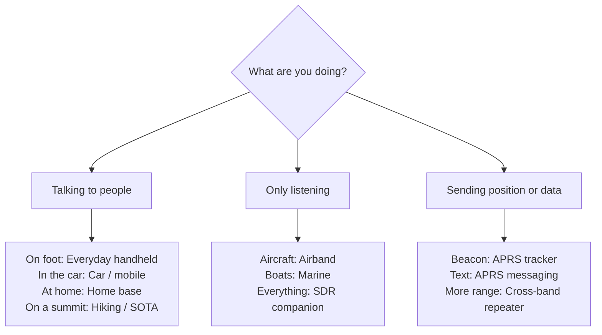
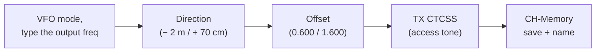
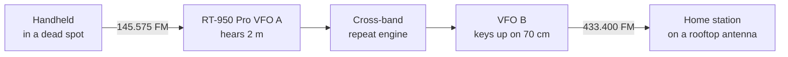

# Ready-made configurations

You have read what every setting does; now here is where they come together. This chapter is a cookbook — a dozen ready-made setups you can copy straight onto the radio, each one a short "why you'd want it" and a table of menu items with the values to enter. Pick the recipe that matches what you are about to do, apply it, and you are on the air correctly the first time. Nothing here is exotic; it is just the settings from the [menu chapters](outpost:entry/logbook73.guide.rt-950-pro/menu-reference) arranged into working stations.

## How to use these recipes

Every table names a setting the way the rest of this guide does: the menu **group** then the **item** — for example _Radio → Busy Lockout_. Reach any of them with **MENU/OK**, the direction keys or the channel knob, and **MENU/OK** again to save, exactly as in [Getting Started](outpost:entry/logbook73.guide.rt-950-pro/getting-started). Two habits make all of this painless:

- **Build it in VFO mode, then save it.** Most per-channel settings — frequency, tone, offset, bandwidth, modulation — can only be edited in frequency mode. Dial the recipe in on a VFO, then use _VFO/CH → CH-Memory_ to store the whole snapshot into a named [zone](outpost:entry/logbook73.guide.rt-950-pro/menus-vfo). Do it once and you never touch the menus again.
- **Or type it into software.** For anything past a handful of channels, the vendor app (cable or Bluetooth) turns an afternoon of thumb-work into five minutes, and lets you keep a backup — cheap insurance against a fumbled reset.

### The house defaults every recipe assumes

Rather than repeat the same dozen lines in every table, set these once as your baseline. They are the "good operator" defaults from the menu chapters, and every recipe below inherits them unless it says otherwise.

| Setting                      | Value  | Why                                                                     |
| ---------------------------- | ------ | ----------------------------------------------------------------------- |
| _Radio → SQL_                | 3      | Silences the hiss but still lets weak signals through                   |
| _Radio → Busy Lockout_       | ON     | Refuses to transmit onto a channel someone else is using                |
| _Radio → Trans Power_        | Low    | The lowest power that does the job — see [RF Power](outpost:entry/logbook73.handbook/rf-power) |
| _Radio → TOT_                | 180 s  | Cuts a stuck transmission before it hogs the channel                    |
| _Radio → Standby Set_        | ON     | Tri-watch — keep all VFOs monitored at once (not a power save)          |
| _Radio → Battery Save_       | Normal | Sensible micro-sleep for receive                                        |
| _Radio → ROGRE_ (roger beep) | OFF    | No courtesy beep on amateur voice                                       |
| _VOX → VOX Switch_           | OFF    | You decide when to transmit, not a cough                                |
| _Setting → Beep Prompt_      | ON     | Confirms key presses                                                    |
| _Setting → Keypad Lock_      | 10 s   | Stops pocket-dialling the menu                                          |
| _Setting → Back Light_       | 30 s   | Screen off when idle, to save the battery                               |
| _APRS → APRS ON/OFF_         | OFF    | On only for the data recipes below                                      |
| _Radio → RPT-Mode_           | OFF    | On only for the cross-band recipe                                       |

Everything that follows changes just the handful of settings that make each station what it is.

## Everyday operating

These four recipes cover almost all normal amateur use: chatting on foot, in the car, from home, and on a hilltop. They all live on the 2 m (144 MHz) and 70 cm (430 MHz) [VHF](outpost:entry/logbook73.handbook/vhf)/[UHF](outpost:entry/logbook73.handbook/uhf) amateur bands in FM — the bands the RT-950 Pro transmits on, and where a new licensee spends nearly all their time.

### The UK Foundation starter

If you have just passed your Foundation assessment and unboxed the radio, this is your first zone — five channels that get you listening and talking straight away. Build a zone called "Starter" and store these into it. The only one you will personalise is the repeater: replace `GB3xx` with your nearest machine, taken from your national society's repeater list.

| Name      | Frequency   | Mode   | Shift    | Tone          | Notes                                                                 |
| --------- | ----------- | ------ | -------- | ------------- | --------------------------------------------------------------------- |
| 2m Call   | `145.500`   | FM     | None     | none          | 2 m FM calling channel (Region 1) — call here, then move off          |
| 70cm Call | `433.500`   | FM     | None     | none          | 70 cm FM calling channel                                              |
| GB3xx     | `145.700`   | FM     | −0.6 MHz | CTCSS 77.0 Hz | Your local 2 m [repeater](outpost:entry/logbook73.handbook/repeaters); tone from its listing |
| PMR446-1  | `446.00625` | FM (N) | None     | none          | **Receive only** — see the note below                                 |
| Airfield  | `118.xxx`   | AM     | None     | none          | Nearest airfield tower, receive only ([Airband](#airband-listening))  |

A few things worth knowing as you enter these:

- **The calling channels are for calling.** `145.500` and `433.500` are where you announce yourself and arrange to move to a working frequency — think of them as a doorway, not a room to sit in.
- **The repeater is the fiddly one.** A UK 2 m repeater listens 0.6 MHz below its output, so _VFO/CH → Direction_ is `−` (Minus) and _Offset_ is `0.600`. Nearly all UK repeaters need a [CTCSS sub-tone](outpost:entry/logbook73.guide.rt-950-pro/menus-ctcss) to open them — set _CTCSS → TX CTCSS_ to the value the keeper publishes (77.0 Hz is common in parts of the UK, but it varies by region, so check). Some 2 m repeaters and machines abroad still respond to a **1750 Hz** access burst; if so, set _Radio → R-TONE_ to `1750hz` and press the side key to send it.
- **PMR446 is listen-only on this radio.** The licence-free PMR446 service requires a type-approved set with a fixed antenna at 0.5 W — which the RT-950 Pro, with its removable antenna and higher power, is not. You may _receive_ those channels freely; for licence-free voice, use a proper PMR446 handset. On air with the RT-950 Pro, stay on your amateur allocations.
- **Transmit power.** Low is roughly 1 W from the handheld — plenty for a repeater a few miles off. The point is habit: run the lowest power that gets you in cleanly, and reach for High only when a contact genuinely needs it.

**Programming a repeater, step by step.** Doing it by hand is the same short ritual every time — do your tuning and toning in VFO mode, then save the finished snapshot to a memory channel:

| Step                | Where                | Set to                                                                                     |
| ------------------- | -------------------- | ------------------------------------------------------------------------------------------ |
| 1 · Tune the output | VFO mode, keypad     | The repeater's **output** frequency (e.g. `145.700`)                                       |
| 2 · Shift direction | _VFO/CH → Direction_ | `−` on 2 m, `+` on 70 cm (UK)                                                              |
| 3 · Offset size     | _VFO/CH → Offset_    | `0.600` on 2 m, `1.600` on 70 cm (UK)                                                      |
| 4 · Access tone     | _CTCSS → TX CTCSS_   | The exact CTCSS the listing gives (or _Radio → R-TONE_ = `1750hz` for a toneburst machine) |
| 5 · Bandwidth       | _Radio → Bandwidth_  | As the listing states (most UK machines are narrow)                                        |
| 6 · Save it         | _VFO/CH → CH-Memory_ | A slot in your "Repeaters" zone — then name it                                             |

Listen first to confirm the machine is there and idle, then key up briefly with your callsign to test access. The offsets and tones above are UK conventions — always check the individual repeater's listing (the RSGB ETCC list in the UK, RepeaterBook elsewhere), which is the final word. The whole subject, control by control, is in [VFO, Steps, Zones & VOX](outpost:entry/logbook73.guide.rt-950-pro/menus-vfo) and [CTCSS, DCS & Sub-tones](outpost:entry/logbook73.guide.rt-950-pro/menus-ctcss).

### The everyday handheld

Once you are past the first day, this is the working configuration for a 2 m/70 cm simplex contact — a direct radio-to-radio chat with no repeater in between. It is simply the house defaults plus the tuning that suits a shared FM channel.

| Setting                  | Value    | Why                                                              |
| ------------------------ | -------- | ---------------------------------------------------------------- |
| _VFO/CH → Step_          | 12.5 kHz | The channel grid for UK 2 m/70 cm                                |
| _VFO/CH → RX Modulation_ | FM       | Amateur FM                                                       |
| _VFO/CH → Direction_     | None     | Simplex — transmit and receive on the same frequency             |
| _Radio → Bandwidth_      | Wide     | Traditional 2 m/70 cm FM; set Narrow to match a 12.5 kHz channel |
| _CTCSS → RX CTCSS_       | OFF      | Hear everyone on the channel, not just one group                 |
| _Radio → Trans Power_    | Low      | Raise to Mid/High only if you are not making the contact         |
| _Radio → Busy Lockout_   | ON       | Don't transmit over an in-progress QSO                           |

**Worked example.** You and a friend agree to meet on `145.575` FM. Both of you dial it in VFO mode, leave Direction on None, tone off, power Low, and call. If your friend fades, step up to Mid before High — most of the time Low across a town is fine, and [RF Power](outpost:entry/logbook73.handbook/rf-power) explains why "as low as works" is both polite and kinder to your battery. Store the channel afterwards so tomorrow it is one twist of the knob away.

**Common mistake:** leaving a duplex Direction or a TX tone set from a repeater channel, then wondering why nobody answers on simplex — you are transmitting 0.6 MHz away, or only opening a repeater that is not there. Direction None, tone off, for direct contacts.

### Car / mobile

A handheld in the car is a different animal: more road noise, a bigger antenna on the roof, and you want the display readable at a glance. This recipe leans on higher power (the roof antenna earns it) and an [APRS](outpost:entry/logbook73.handbook/aprs) SSID that marks you as mobile.

| Setting                 | Value                               | Why                                                      |
| ----------------------- | ----------------------------------- | -------------------------------------------------------- |
| _Radio → Trans Power_   | High                                | An external antenna and road distance justify it         |
| _Radio → Bandwidth_     | Wide                                | Match the repeater/simplex channel                       |
| _Setting → Back Light_  | Bright                              | Readable in daylight; screen on while driving            |
| _Setting → Keypad Lock_ | 10 s                                | Stops a knock re-tuning you                              |
| _VOX → VOX Switch_      | OFF (ON only with a proper headset) | Road noise trips VOX constantly otherwise                |
| _APRS → SSID_           | -9                                  | The convention for a mobile station                      |
| _Radio → TOT_           | 180 s                               | A dropped mic under the seat won't hold the channel open |

**Safety and licence notes.** Keep the antenna feeder and the radio clear of your head — the manual asks for at least 2.5 cm between the unit and your body on transmit, and with a roof antenna that is easy. Operate hands-free and in line with your local driving-and-radio laws. A magnetic-mount whip on the roof will out-perform the rubber duck by a wide margin, but read [Antennas](outpost:entry/logbook73.handbook/antennas) and check your [SWR](outpost:entry/logbook73.handbook/swr) once fitted — a badly matched car antenna wastes power and stresses the transmitter.

**Front-end caution.** A big antenna feeds the receiver far more signal, including everything the [wide front end](outpost:entry/logbook73.handbook/overload-and-ghost-signals) struggles to reject. Near a city's paging or cellular masts you may hear "repeaters" that are not there — that is intermod, not a discovery. Suspect it before you believe it, and a modest antenna often hears the real traffic more clearly than a giant one.

### Home base

Set up on the desk with a rooftop antenna and mains-charged, the RT-950 Pro makes a capable little base station. The extra height and gain are a real upgrade; the trade is that a fixed antenna is exactly where a wide receiver overloads, so this is the one recipe where a filter earns its keep.

| Setting                  | Value            | Why                                           |
| ------------------------ | ---------------- | --------------------------------------------- |
| _Radio → Trans Power_    | High             | Feed the antenna properly from a fixed spot   |
| _Radio → Bandwidth_      | Wide             | Match your channels                           |
| _APRS → Source Position_ | Fixed Position   | A base doesn't move, so beacon a fixed grid   |
| _APRS → My Position Set_ | your coordinates | Enter latitude/longitude once                 |
| _APRS → SSID_            | -0 (or none)     | Convention for a home station                 |
| _Radio → Battery Save_   | OFF              | On mains power, keep the receiver fully awake |
| _Setting → Back Light_   | Bright           | Desk visibility                               |

**Filter only after identifying the interference.** At a fixed site, a suitable band-pass filter ahead of the receiver can reject out-of-band energy that overloads a wideband front end. Match it to the operating band and power level, and remember that it deliberately sacrifices the radio's wideband receive while fitted. Measure or compare reception before and after rather than assuming one filter solves every [ghost signal](outpost:entry/logbook73.handbook/overload-and-ghost-signals). See [Receivers](outpost:entry/logbook73.handbook/receivers) for why selectivity, not sensitivity, is often the limiting factor in a strong-RF environment.

## Portable and outdoor

Away from mains power, the priorities flip: battery life beats brightness, and reliability beats features. Two recipes cover the ground.

### Hiking / SOTA

For a day on the hills — [Summits on the Air](outpost:entry/logbook73.handbook/vhf) or just a walk with the radio — you want the battery to last, the screen to sip power, and enough VFOs working to hear a call from any direction. From a summit your Low-power signal travels remarkably far, so start low and only climb if you must.

| Setting                 | Value           | Why                                                     |
| ----------------------- | --------------- | ------------------------------------------------------- |
| _Radio → Battery Save_  | Super (or DEEP) | Deeper receive sleep stretches a day's operating        |
| _Radio → Trans Power_   | Low             | Height does the work; raise only to complete a contact  |
| _Setting → Back Light_  | 5 s             | Screen dark between glances                             |
| _Setting → Keypad Lock_ | 5 s             | Locks quickly in a rucksack                             |
| _VFO/CH → Step_         | 12.5 kHz        | 2 m/70 cm grid                                          |
| Tri-watch (`TW`)        | ON              | Watch A, B and C at once — call, repeater, working freq |
| _APRS → SSID_           | -7              | Convention for a portable/pedestrian station            |

**Worked example.** On a summit you put VFO A on `145.500` (the calling channel), B on your day's working frequency, and C on a distant repeater, then switch on tri-watch so the radio hops between all three. You call CQ on A at Low power; because you are 600 m up with a clear horizon, stations 80 km away answer you on 1 W. That is [propagation](outpost:entry/logbook73.handbook/propagation) doing the heavy lifting — the reason SOTA activators rarely need High.

**Battery note.** DEEP save extends standby dramatically but adds a moment's lag before the receiver wakes on a signal, so you can clip the first syllable of a call. Super is a good middle ground for an active session; save DEEP for long listening watches. Carry a spare battery or a USB power bank and the Type-C lead — cold weather flatters no lithium cell.

### Emergency go-bag

A radio kept for when the power or the phones are down should be configured for **weeks of readiness, then hours of use** — maximum standby, minimum fuss, and a couple of features you'd otherwise leave off. Programme it, charge it, and let it sleep.

| Setting                         | Value                         | Why                                                          |
| ------------------------------- | ----------------------------- | ------------------------------------------------------------ |
| _Radio → Battery Save_          | DEEP                          | Longest possible standby between checks                      |
| _Radio → Trans Power_           | Low                           | Conserve the battery; raise only when you must reach someone |
| _Setting → Back Light_          | 5 s                           | Every second of screen costs charge                          |
| _User Key → PF2_                | Monitor                       | One-press squelch-open to dig out a weak signal              |
| _User Key → Long Press PF2_     | Squelch                       | Quick access to open/adjust squelch                          |
| _Radio → SOS Mode_              | On Site (understand it first) | Local audible alarm without transmitting blindly             |
| Local calling/repeater channels | pre-stored                    | No menu-diving in a crisis                                   |

**Notes.** Store your area's calling channels and the two or three most useful repeaters in a zone called "Emergency", named so you can find them by feel. Understand _Radio → SOS Mode_ before you rely on it: "On Site" sounds a local alarm without transmitting, while the transmit options send a tone or code — never trigger a transmitting alarm as a test on a live channel. Keep a spare charged battery, the charging lead, a written copy of your key frequencies and your callsign in the bag, and top the battery up every few months. In a real emergency, [monitor first, transmit briefly, and stay within your licence](outpost:entry/logbook73.guide.rt-950-pro/best-practices) — a working radio you know how to use beats a clever one you don't.

## Listening (receive only)

The RT-950 Pro receives far more widely than it transmits, and every recipe here is legal for anyone, licensed or not — receiving is not transmitting. Do not key up on any of these frequencies; they are not amateur allocations.

### Airband listening

Aircraft and control towers use AM — [amplitude modulation](outpost:entry/logbook73.handbook/modulation) — on the VHF aviation band, roughly `118–137 MHz`. Get the modulation and step right and a good chunk of the sky opens up. The RT-950 Pro's airband receive is one of its genuine pleasures.

| Setting                  | Value    | Why                                                         |
| ------------------------ | -------- | ----------------------------------------------------------- |
| _VFO/CH → RX Modulation_ | AM       | Airband is AM; FM here is unintelligible mush               |
| _VFO/CH → Step_          | 8.33 kHz | The European civil airband grid                             |
| _Radio → SQL_            | 4–5      | AM signals are quieter; a touch more squelch calms the hiss |
| Transmit                 | never    | Receive only — not an amateur band                          |

**Worked example.** To hear your local tower on `118.325`, set the VFO to AM, step 8.33 kHz, and tune. If your radio never lands exactly on the frequency, your step is wrong — an 8.33 kHz channel cannot be reached on a 25 kHz grid. Older or non-European channels sit on 25 kHz, so keep a second airband channel with _Step_ `25.0 kHz` for those.

**A reported weak patch.** Owners report the UHF military aviation band around `250–275 MHz` as weak-to-deaf on some units — signals recover higher up — so do not judge the receiver by that stretch (it seems to vary between batches). Civil VHF airband, where most listeners spend their time, is a strong point.

### Marine listening

Coastal and harbour traffic lives on the marine VHF band, `156–162 MHz`, in FM on a 25 kHz grid. You may listen freely; transmitting on marine channels needs a marine radio licence and a marine set, not an amateur one, so this recipe is receive-only.

| Setting                  | Value     | Why                                                 |
| ------------------------ | --------- | --------------------------------------------------- |
| _VFO/CH → RX Modulation_ | FM        | Marine VHF is FM                                    |
| _VFO/CH → Step_          | 25.0 kHz  | The marine channel grid                             |
| _Radio → SQL_            | 3–4       | Standard squelch for FM                             |
| Channel 16               | `156.800` | The international calling and distress channel      |
| Transmit                 | never     | Amateur radios must not transmit on marine channels |

**Worked example.** Store Channel 16 (`156.800`) and your nearest coastguard or marina working channel, and you can follow harbour movements and safety broadcasts. Because marine channels are 25 kHz-spaced FM, one channel entry per frequency is all it takes — the numbers you want are in any marine channel chart.

### SDR companion

Here the RT-950 Pro plays a supporting role — a dedicated ears-on-the-band monitor alongside a computer or an SDR dongle. Two flavours: a **hands-off scanner/monitor** watching several frequencies, and a **KISS modem** feeding decoded data to software over Bluetooth.

| Setting                       | Value                           | Why                                               |
| ----------------------------- | ------------------------------- | ------------------------------------------------- |
| Tri-watch (`TW`)              | ON                              | Monitor A, B and C together                       |
| _User Key → PF2_              | Monitor                         | Open the squelch to hear beneath the threshold    |
| _Radio → Scan Mode_           | Carrier                         | Pause on activity, resume when it clears          |
| Spectrum (long-press MENU/OK) | as needed                       | Eyeball a band segment for activity               |
| Sweep (long-press Exit)       | VHF 136–174 / UHF 400–520 MHz   | Find the frequency and tone of an unknown carrier |
| _APRS → TNC Type_             | KISS                            | Bridge to a phone/PC app for data decode          |
| _Bluetooth_                   | ON                              | Carry the KISS link to the app                    |
| Transmit                      | off unless licensed and in-band | Monitoring is receive-only                        |

**How it earns its place.** Point a wideband SDR at a whole band for the picture, and let the RT-950 Pro sit on the one channel you care about with real, clean audio — its receiver is often nicer to _listen_ to than a cheap dongle. The built-in **sweep** is a neat trick: long-press Exit and it scans the transmitter's frequency and any CTCSS/DCS tone of a nearby signal, then offers to save it — perfect for identifying an unknown local repeater. In **KISS** mode (_APRS → TNC Type → KISS_, Bluetooth on) the radio becomes a plain modem, handing raw packets to an APRS app on your phone or a terminal on your laptop, which does the decoding and mapping. See [Packet Radio](outpost:entry/logbook73.handbook/packet-radio) for what a TNC actually is.

## Data and location

The APRS engine is the RT-950 Pro's most ambitious feature and the one the factory manual explains least — [its own chapter](outpost:entry/logbook73.guide.rt-950-pro/menus-aprs) is the full story. Two recipes here get you beaconing correctly and, with honest caveats, messaging.

### APRS position tracker

This is the mainstream, well-working use of APRS: your radio periodically transmits its GPS position so it appears on the [APRS](outpost:entry/logbook73.handbook/aprs) map. The one setting people get wrong is the path — get it right and you are a good network citizen; get it greedy and you clog every digipeater for miles.

| Setting                       | Value                   | Why                                       |
| ----------------------------- | ----------------------- | ----------------------------------------- |
| _APRS → APRS ON/OFF_          | ON                      | Master switch for the engine              |
| _APRS → GPS → GPS_            | ON                      | Beacon your live position                 |
| _APRS → Callsign_             | your callsign           | Required to transmit APRS legally         |
| _APRS → SSID_                 | -7 portable / -9 mobile | Marks the kind of station you are         |
| _APRS → Path Choose_          | WIDE1-1,WIDE2-1         | The standard, polite two-hop path         |
| _APRS → Source Position_      | GPS Position            | Beacon where you actually are             |
| _APRS → Mic-E Type_           | En Route                | Compact status shown with your beacon     |
| _APRS → Digi Setup → Routing_ | OFF                     | You are a tracker, not a digipeater       |
| _APRS → TNC Type_             | OFF                     | On-air beaconing, not a KISS bridge       |
| VFO frequency                 | `144.800`               | The Region 1 APRS frequency               |
| _Radio → Bandwidth_           | Wide                    | Standard 1200-baud packet needs the room  |
| _Radio → Busy Lockout_        | ON                      | Wait for a clear channel before beaconing |

**Why `WIDE1-1,WIDE2-1`.** The path is a request to be relayed: `WIDE1-1` asks the nearest fill-in digipeater to repeat you once, and `WIDE2-1` asks one wide-area digipeater to carry you further — two hops total. It is the agreed default because it gets a portable heard without stamping on the network. Longer paths (three or four hops) from a handheld are the APRS equivalent of shouting, and experienced operators frown on them. On `144.800` in Region 1 (North America uses `144.390`), Wide bandwidth, Busy Lockout on so you slot into a gap rather than over someone, you will show up cleanly on aprs.fi within a beacon or two.

**Common mistakes:** forgetting to enter your callsign (the radio won't legally beacon without it); leaving _Routing_ on, which quietly turns your tracker into a digipeater; or setting the beacon interval so short that you flood the channel — a walking pace needs an update only every minute or two.

### APRS messaging

Station-to-station **text messaging** over APRS is the feature to approach with clear eyes. On current RT-950 Pro firmware it is **immature**: position beaconing (above) works well, but reliably composing, sending and receiving free-text messages between stations is unfinished, and behaviour varies between firmware versions. Set it up if you like to experiment, but do not rely on it — treat beaconing as the feature that works and messaging as a preview.

| Setting                             | Value           | Why                                       |
| ----------------------------------- | --------------- | ----------------------------------------- |
| _APRS → APRS ON/OFF_                | ON              | Engine on                                 |
| _APRS → Callsign_ + _SSID_          | yours           | Identity for messages                     |
| _APRS → Message_                    | as needed       | Compose/read text (immature — see caveat) |
| _APRS → APRS Ringer_                | ON              | Beep on an incoming message               |
| _APRS → RX Popup_                   | ON              | Show received stations/messages on screen |
| _APRS → Path Choose_                | WIDE1-1,WIDE2-1 | Same polite path as beaconing             |
| _APRS → Busy Lockout_ (via _Radio_) | ON              | Don't transmit over live packets          |

**The honest picture.** If a message goes through, you will hear the ringer and see it pop up; if it silently fails, that is the firmware, not you. For dependable text over radio today, a phone running a full APRS app bridged to the radio in **KISS** mode (see the [SDR companion](#sdr-companion) recipe) does the messaging far more reliably than the radio's own menus — the app supplies the maturity the firmware lacks. Watch the vendor's [firmware updates](outpost:entry/logbook73.guide.rt-950-pro/troubleshooting), which are frequent and have been steadily improving this corner of the radio, and keep a backup before you flash: a bad update can brick the unit.

## Repeater in a box

### Cross-band repeater

The RT-950 Pro can listen on one band and re-transmit on the other, turning itself into a low-power repeater — handy for reaching a handheld from a weak spot by relaying through a better-placed radio. It is genuinely useful and genuinely advanced, so it comes with responsibilities: you are now running a station that transmits without a person on the mic, and that carries duty-cycle, identification and licensing obligations.

| Setting                        | Value         | Why                                                          |
| ------------------------------ | ------------- | ------------------------------------------------------------ |
| _Radio → RPT-Mode_             | ON            | Enable cross-band repeat (the `Z` icon appears)              |
| VFO A                          | `145.575` FM  | The band/frequency it listens on and repeats from            |
| VFO B                          | `433.400` FM  | The other band it repeats onto                               |
| _Radio → RPT-Speaker_          | OFF           | Quieten the local speaker while it relays                    |
| _Radio → RP-STE_               | 100–200 ms    | Trim the squelch-tail noise on each relay                    |
| _Radio → RPT-RL_ (relay delay) | default       | The hand-off delay between the two sides                     |
| _Radio → Trans Power_          | Low or Middle | Keep it modest — this is a personal link, not infrastructure |
| _Radio → Busy Lockout_         | ON            | Don't relay onto an occupied channel                         |

**How it decides which way to relay.** Both VFOs sit listening. Whichever one first hears a valid signal becomes the receiver, and the radio re-transmits on the _other_ one — so a call arriving on 2 m (VFO A) goes out on 70 cm (VFO B), and vice versa. That is why the two VFOs **must be on different bands**: a cross-band repeater cannot relay a band onto itself.

**Operate it responsibly.** Three things matter. First, **duty cycle and heat** — a repeating radio can transmit for long, unbroken stretches, and the manual asks you to keep transmission to about 50% of the time; a handheld run hard as a repeater gets hot, so keep power modest and give it air. Second, **identification** — an automatically transmitting station must still identify with your callsign under your licence, and in some countries an unattended or automatically operating station needs specific authorisation. Third, **stay in-band on both sides** and choose quiet simplex frequencies so you are not sitting on top of other users. Used thoughtfully — Low power, quiet channels, short sessions, your callsign given — it is a clever way to stretch coverage; used carelessly it is a nuisance. Check your national licence conditions before you leave it running.

## Key takeaways

- Set the **house defaults** once — Busy Lockout ON, Trans Power Low, VOX off, SQL 3, TOT 180 s — and every recipe inherits good manners; each config then changes only the few settings that define it.
- **Build in VFO mode, then save with _CH-Memory_ into a purpose-named zone** (or program in software and keep a backup) — do the work once, recall it forever.
- **Transmit only on 2 m/70 cm amateur channels** at the lowest power that works; the airband, marine, PMR446 and broadcast recipes are **receive-only** and legal for anyone.
- **On a big or fixed antenna, add a band-pass filter** — it is the most effective cure for the overload and [ghost signals](outpost:entry/logbook73.handbook/overload-and-ghost-signals) a wideband front end is prone to.
- **APRS beaconing works well** with `WIDE1-1,WIDE2-1` and your callsign set; **messaging is immature** in current firmware — bridge a phone app over KISS if you need reliable text.
- **Cross-band repeat is powerful but advanced** — two different bands, modest power, your callsign given, duty cycle watched, and within your licence conditions.

When a recipe doesn't behave — no transmit, no repeater access, ghost signals, a stubborn APRS beacon — the next chapter is your first stop: [Troubleshooting](outpost:entry/logbook73.guide.rt-950-pro/troubleshooting).
