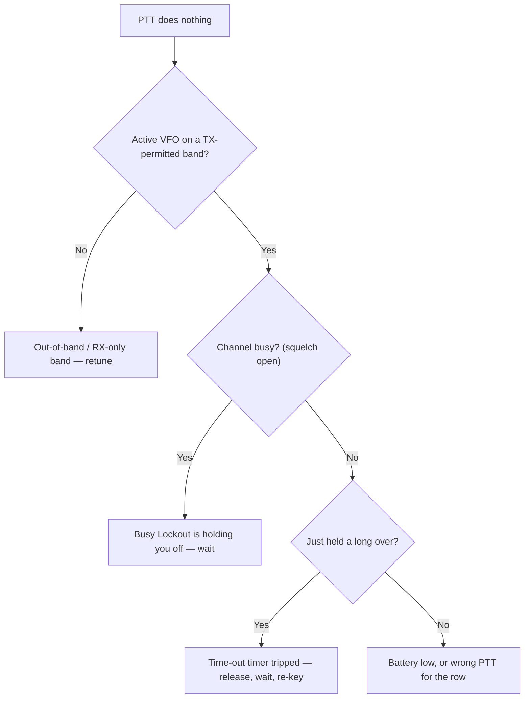
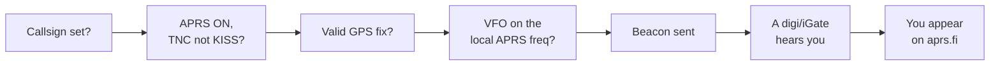

# Troubleshooting

Almost every "my radio is broken" moment on the RT-950 Pro turns out to be a setting in the wrong place, not a fault in the metal. That is genuinely good news: a configuration problem is one you can fix in thirty seconds once you know where to look. This chapter is a calm, symptom-first field guide to the questions that send people to forums at midnight — why it won't transmit, why the repeater ignores you, why your APRS beacon never appears — with the likely cause and the fix for each.

## How to troubleshoot without panic

Two habits make everything below faster.

First, **read the display before you touch a menu.** The RT-950 Pro tells you an enormous amount at a glance: the highlighted VFO, the power tag, the tone tags (`CT`/`DCS`), a duplex `+`/`−`, and the bottom feature strip (`VOX`, `APRS`, `MO`, `TW`, lock). Nine times in ten the answer is already on the screen — a stray `VOX`, a tone you forgot to clear, the wrong row highlighted. Learn to read it the way you learned in [Getting Started](outpost:entry/logbook73.guide.rt-950-pro/getting-started).

Second, **know your firmware version.** Menu → _About Machine_ shows the software and hardware revision. Several quirks in this chapter are firmware-specific — they exist on some builds and not others — so that version number is the single most useful fact you can quote about a problem. The radio has shipped on a fast-moving series of firmware releases and at least two board revisions, so "which build?" and "which hardware?" are always fair first questions.

Everything below follows the same shape: **symptom → likely cause → fix.** Work down the causes in order; they are roughly ranked by how often they are the culprit.

## "Why won't it transmit?"

You press the PTT and nothing happens — no LED, no power bar, silence. On a radio this loaded with safety interlocks, a dead PTT is usually the radio protecting you or someone else, not a failure. Walk the checks in order.



**You are on a receive-only frequency.** The radio receives far more widely than it may legally transmit, and it will flatly refuse to key up outside its transmit-permitted ranges — the aviation [airband](outpost:entry/logbook73.handbook/vhf), the FM broadcast band, most of the HF spectrum, and the odd sliver outside the amateur allocations. This is a feature, not a fault: it is exactly what keeps you legal. Tune the active VFO back to 2 m (144–146 MHz in Region 1) or 70 cm (430–440 MHz) and the PTT comes back to life. _Never_ look for a way to defeat this — transmit only where your [licence](outpost:entry/logbook73.handbook/getting-licensed) permits.

**Busy Lockout is doing its job.** If _Radio → Busy Lockout_ is `ON` (and it should be — good manners in one setting) the radio will not transmit onto a channel that is already occupied. If the squelch is open — you can hear a signal, or the `MO` monitor tag is up holding it open — the transmitter stays locked. The fix is to wait for the channel to clear. If it _never_ clears, your squelch may be set too low and hearing noise as a "signal"; nudge _Radio → SQL_ up a notch. Full detail on both lives in [The Radio Menu](outpost:entry/logbook73.guide.rt-950-pro/menus-radio).

**The time-out timer has tripped.** After a continuous transmission longer than the _Radio → TOT_ period (say 180 seconds), the radio cuts your carrier and will not let you re-key for a moment. This stops a stuck PTT — a radio wedged in a rucksack — from holding a repeater or channel open indefinitely. Release the PTT, pause, and key again. If you keep hitting it in normal conversation, your overs are too long; leave gaps for others anyway.

**The battery is nearly flat.** When the pack is almost depleted the battery icon's outer frame flashes and _transmit is prohibited outright_ — a dying battery makes for a dirty signal. Receive still works, which can be confusing. Charge it.

**You are pressing the wrong PTT for the row you want.** This one is unique to the three-VFO layout. The _main_ PTT transmits on the **active** (highlighted) VFO — so if A is highlighted but you meant to answer on C, the main button sends on A. Either press the `A/B/C` key to move the highlight, or simply use the dedicated **PTT C** on the side, which always transmits on its own VFO regardless of what is highlighted. If your active VFO happens to be parked on airband or broadcast, the main PTT will seem dead for the "out-of-band" reason above while the other two work fine.

## "Why won't the repeater open?"

You can hear the [repeater](outpost:entry/logbook73.handbook/repeaters) perfectly, you transmit, and… nothing comes back. The machine can almost certainly hear your voice — but a repeater is a fussy doorman, and it only opens for the right knock. There are three things to get right, and they fail independently.

**The access tone is wrong or missing.** Most modern repeaters will not relay you unless your transmission carries a specific, quiet sub-audible tone — a **CTCSS** tone (an analogue pitch, 67.0–254.1 Hz) or a **DCS** code. It rides _underneath_ your voice, below the range your ear notices, and the repeater's decoder listens only for it.

```viz
{
  "type": "spectrum",
  "title": "The access tone sits under your voice",
  "caption": "The repeater ignores your speech and listens for the quiet CTCSS tone below it — send the wrong tone (or none) and the door stays shut even though it can hear you clearly.",
  "components": [
    { "f": 5, "amp": 0.55, "label": "CTCSS access tone", "tone": "primary" },
    { "f": 55, "amp": 0.8, "label": "Your voice (≈300–3000 Hz)", "width": 62, "tone": "muted" }
  ],
  "xLabel": "Audio frequency (low → high)"
}
```

Set _CTCSS DCS → TX CTCSS_ (or TX DCS) to the exact tone the repeater's listing specifies — your national repeater directory gives it for every machine (the RSGB listing in the UK, the ARRL repeater guide in the US, and so on). A tone that is close but not identical fails just as completely as no tone at all. Some older machines instead want a **1750 Hz toneburst** to open — for those, set _Radio → R-TONE_ to `1750hz` and give the assigned key a quick press as you start. When you store the repeater as a memory channel, the tone travels with it, which is why programming repeaters as channels saves so much grief. The whole subject is in [CTCSS, DCS & Sub-tones](outpost:entry/logbook73.guide.rt-950-pro/menus-ctcss).

**The offset direction or size is wrong.** A repeater listens on one frequency and transmits on another; your radio must shift on transmit to land on the machine's _input_. If _VFO&CH → Direction_ or _Offset_ is wrong, you transmit on the wrong frequency entirely and the repeater simply never hears you. In the UK that is `−0.600 MHz` on 2 m and `+1.600 MHz` on 70 cm; elsewhere the 70 cm shift in particular varies (±5 MHz in the US, −7.6 MHz across much of Europe), so **check your national band plan**. A quick sanity check: use the frequency-reverse function to listen on the _input_ — if you can hear other people there, your transmit frequency is right and the problem is the tone; if you cannot, your offset is wrong.

**Your receive tone squelch is muting the reply.** This is the sneaky one that makes a healthy repeater look dead. If you have set _CTCSS DCS → RX CTCSS_ or _RX DCS_ and the repeater does not send that exact tone on its _output_, your speaker stays silent even when the repeater is answering you. You transmit, it relays, and you hear nothing — so you assume you failed. Clear the RX tone (leave the TX tone in place) and the audio returns.

If all three are right and it still will not open, the mundane causes remain: you may be out of range (try higher power, or a better [antenna](outpost:entry/logbook73.handbook/antennas)), the repeater may be off, or the input may be swamped by a stronger station. Lowest power that reliably opens it is the courteous choice — more in [Best Practices & Etiquette](outpost:entry/logbook73.guide.rt-950-pro/best-practices).

## "My APRS beacon isn't appearing"

You have GPS, you have [APRS](outpost:entry/logbook73.handbook/aprs) switched on, and yet you never show up on `aprs.fi`. A beacon has to clear a whole chain of conditions before it reaches the internet, and any one broken link stops it silently — the radio rarely tells you _which_ link failed. Check them in this order.



| Link in the chain      | What goes wrong                   | Fix                                                                                                                                       |
| ---------------------- | --------------------------------- | ----------------------------------------------------------------------------------------------------------------------------------------- |
| **Callsign**           | Blank or a placeholder            | Set _APRS Set → Beacon Setup → Callsign_ to your real callsign — the radio will not transmit APRS without it, and it must be yours by law |
| **APRS master switch** | `APRS ON/OFF` is off              | Turn _APRS Set → APRS ON/OFF_ to `ON`                                                                                                     |
| **TNC mode**           | Set to `KISS`                     | Set _APRS Set → Advanced → TNC Type_ to `OFF` for the radio's own beacon (see the next section)                                           |
| **GPS fix**            | No lock yet, so no valid position | Wait for a solid GPS icon under clear sky — or use a fixed position                                                                       |
| **Frequency**          | VFO not on the APRS channel       | Put the beaconing VFO on `144.800 MHz` (Region 1) / `144.390 MHz` (North America) — check your national APRS frequency                    |
| **Path**               | Empty or exotic                   | Use the polite default `WIDE1-1,WIDE2-1` via _Path Choose_                                                                                |
| **Infrastructure**     | No digipeater or iGate in range   | Not your fault — you need something to hear and relay you                                                                                 |

The two that catch people most often are worth spelling out. **A missing GPS fix** means the radio has no position to send; if _Source Position_ is set to `GPS Position` and the fix has not come in yet, the beacon either does not go out or goes out with no useful location. (For a base station, set a `Fixed Position` under _My Position Set_ instead, and it will beacon with no GPS at all.) And **the last link is out of your hands**: even a perfect beacon only reaches the map if a digipeater or an internet gateway (iGate) is close enough to hear it. In a remote valley with no infrastructure, you can do everything right and still not appear — that is the network's coverage, not your radio.

To test the chain deliberately, assign **Beacon TX** to the side key (PF2, via [Keys, Bluetooth, Signalling & Settings](outpost:entry/logbook73.guide.rt-950-pro/menus-system)) so you can fire a single beacon on demand rather than waiting for the timer. Watch the LED flash as it goes out, then check `aprs.fi` for your callsign. The full APRS walk-through — paths, SSIDs, symbols, digipeating — is in [APRS, GPS & Digipeater](outpost:entry/logbook73.guide.rt-950-pro/menus-aprs).

## "Why is my GPS taking ages to get a fix?"

You switch on outdoors, wait, and the GPS icon just blinks. This is almost never a fault — it is physics. GPS signals arrive from satellites 20,000 km up at a whisper of a level (around −125 dBm), and the receiver has to find several of them and download timing data before it can compute a position. How long that takes depends entirely on how much it already knows.

| Start type | When it happens                                                                 | Typical time to first fix              |
| ---------- | ------------------------------------------------------------------------------- | -------------------------------------- |
| **Cold**   | Brand-new radio, flat battery for weeks, or moved hundreds of km since last use | 1–5 minutes, occasionally up to ~12–15 |
| **Warm**   | Used within a day or two, near the same place                                   | 30–90 seconds                          |
| **Hot**    | Had a fix only minutes ago                                                      | A few seconds                          |

A **cold start** happens when the radio has forgotten where the satellites are — no recent almanac, no memory of its last position. It must rebuild that picture from scratch, and the data trickles in slowly. Be patient the first time you use it each day, especially after a long trip. Two things speed every fix:

- **Give it a clear view of the sky.** Indoors, in a car, under dense trees or between tall buildings, the already-faint signals are blocked or bounced. Step outside, into the open, and hold the radio upright.
- **Stand still for the first fix.** Movement makes the initial lock harder; once it has locked, tracking while you walk or drive is easy.

If it genuinely never locks outdoors under open sky after several minutes, check that GPS is actually enabled (_APRS Set → GPS → GPS = ON_), then power-cycle the radio to force a fresh start.

## "Turning on KISS stopped my APRS — is it broken?"

No — this is KISS working exactly as designed, and it surprises almost everyone the first time. It is worth understanding rather than fighting.

The radio contains its own **TNC** — the modem-and-brains that turns [packets](outpost:entry/logbook73.handbook/packet-radio) into tones and back — and normally that TNC runs the radio's built-in APRS _engine_: it reads the GPS, builds your beacon, sends it on the timer, decodes stations it hears, and can digipeat. **KISS** mode changes the TNC's job entirely. In KISS, the TNC becomes a _dumb modem_ — it stops thinking for itself and simply passes raw packets back and forth to an external application (APRSdroid, YAAC, PinPoint APRS and friends) over Bluetooth or USB. All the intelligence — when to beacon, what to say, messaging, the map — now lives in the app.

So when you switch _TNC Type_ to `KISS`, the radio's own APRS engine deliberately **steps aside** and hands the modem to whatever is connected. If nothing is connected, nothing beacons, because the part that used to decide _when_ to beacon is no longer in charge. Not a bug — a handover.

Choose based on how you want to operate:

| You want…                                      | Set TNC Type to | Who runs APRS          |
| ---------------------------------------------- | --------------- | ---------------------- |
| Standalone APRS, no phone                      | `OFF`           | The radio's own engine |
| A phone app to do everything (maps, messaging) | `KISS`          | The connected app      |

If your goal was "the radio beacons on its own", set _TNC Type_ back to `OFF`. If your goal was "my phone app drives it", set `KISS` and make sure the app is actually connected and configured. You cannot sensibly have both at once.

## "The receiver goes deaf for 20–60 seconds"

Every so often the audio simply stops — the radio goes quiet for anywhere from twenty seconds to a minute, then comes back as if nothing happened. If you have seen this, you are not imagining it and your unit is not faulty: **it is a documented firmware behaviour** reported on some builds of the RT-950 Pro, not a hardware defect. It is exactly the kind of rough edge you accept on a young, fast-evolving budget platform, and Radtel's rapid firmware releases have been chipping away at issues like it.

A few practical steps:

- **Rule out the innocent explanations first.** A very brief mute is normal battery-save micro-sleep (_Radio → Battery Save_) or squelch closing on a marginal signal — those are sub-second and expected. The known bug is the _longer_, deaf-for-most-of-a-minute dropout.
- **Note your firmware version** (_Menu → About Machine_) and check whether a newer release addresses it. Because the fix — if there is one — is a firmware update, read the next section first and update _deliberately_.
- **As a stop-gap**, some owners find that turning off battery save and standby, or disabling features they are not using (a busy APRS decoder, for instance), reduces how often it bites. Treat these as experiments, not cures.

Be honest with yourself about it: it is an annoyance on affected builds, not a reason to distrust the radio, and it is the sort of thing that firmware maturity tends to iron out over time.

## "I think I bricked it updating the firmware"

First: breathe. This is the one problem in the chapter with real teeth, so let us be straight about it. The RT-950 Pro's bootloader performs **no integrity check** — no CRC, no signature — on the firmware you write to it. That means a flash that is interrupted, uses the wrong file, or targets the wrong hardware revision can leave the radio unable to boot. At least one owner has bricked a unit this way. It is the single most serious self-inflicted wound available on this radio.

The overwhelmingly best defence is **not to be there in the first place:**

- **You almost never need to flash firmware at all.** Do it only to fix a specific, named bug that is biting you — not for its own sake. A radio that works does not need a new firmware.
- **Match the hardware revision.** There are at least two board revisions in the wild; a firmware image for the wrong one is a classic way to brick. Confirm your revision in _About Machine_ and load only an image known to match it.
- **Back up first.** Save your configuration (codeplug) with the programming software before you touch firmware, and keep the known-good firmware file you are currently running. A backup turns a disaster into an inconvenience.
- **Full battery, no interruptions.** Charge fully, do not unplug, do not let the app or the cable drop mid-write.

If you have already flashed and the radio seems dead, do not declare it scrap yet — many "bricks" are recoverable. The flasher can often force the chip back into its download/bootloader mode (typically by holding a key while applying power) so you can re-write a known-good image over the top. The community firmware repositories and the vendor's own tools document the exact key combination and host the images; find the recovery procedure for _your_ hardware revision and try re-flashing a matching, known-good build. A genuine, unrecoverable hard-brick is rare — but there is no cast-iron guarantee, which is exactly why the backup and the "only flash when you must" rule matter so much.

## A grab-bag of quick fixes

Smaller symptoms, each a one-liner once you know the cause:

| Symptom                                              | Likely cause                                         | Fix                                                                                                                                                           |
| ---------------------------------------------------- | ---------------------------------------------------- | ------------------------------------------------------------------------------------------------------------------------------------------------------------- |
| `V/M` seems to do nothing                            | No channels stored yet                               | Store at least one channel in VFO mode; memory mode then appears                                                                                              |
| Airband is silent though the frequency is right      | RX Modulation on `FM`                                | Set that VFO's _RX Modulation_ to `AM`                                                                                                                        |
| Menu items are greyed out and won't change           | You're in channel (memory) mode                      | Switch to VFO mode, change it there, re-save the memory                                                                                                       |
| Speaker dead but the signal bar shows a station      | RX CTCSS/DCS tone squelch is set                     | Clear _RX CTCSS_ / _RX DCS_ on that VFO                                                                                                                       |
| Radio keys up on its own                             | `VOX` left on (check the display strip)              | Turn _VOX Switch_ off                                                                                                                                         |
| A "repeater" appears on an odd frequency near a mast | Front-end overload / intermod, not a real signal     | Lower power isn't it — reduce input: shorter antenna, step away, add a band-pass filter; see [Overload & Ghost Signals](outpost:entry/logbook73.handbook/overload-and-ghost-signals) |
| Weak, quiet or missing receive                       | Squelch too tight, or narrow/wide bandwidth mismatch | Nudge _SQL_ down a step; match _Bandwidth_ to the channel                                                                                                     |
| Fully charged yet won't transmit                     | Tired battery reading "full", or a dirty contact     | Clean the terminals; if it sags under load, the pack is worn                                                                                                  |

## Try it yourself

Prove the two things people most often get wrong, so you never have to wonder in the field:

1. **Prove your transmitter works — legally and cleanly.** With the active VFO on a clear simplex frequency in your amateur allocation and power set to `Low`, ask a friend on another radio (or a nearby monitor) to confirm they hear you as you give your callsign. Watch the LED light as you key. You have now confirmed the PTT, the VFO selection and the band are all right — the exact checks from the "won't transmit" section, run in reverse.
2. **Prove your APRS beacon reaches the world.** Set your callsign, wait for a solid GPS fix under open sky, confirm _TNC Type_ is `OFF` and the VFO is on your national APRS frequency, then fire a single **Beacon TX** from the side key. Open `aprs.fi` on a phone and search your callsign. If it appears, every link in the chain is sound; if it does not, you now know exactly which link to inspect.

Both drills take five minutes and turn the abstract checklists above into muscle memory.

## Key takeaways

- **Read the display and note your firmware version first** — most "faults" are a visible setting or a build-specific quirk, and the version number is the most useful thing you can quote about a problem.
- **A dead PTT is usually the radio protecting you**: out-of-band, Busy Lockout, the time-out timer, a low battery, or the wrong VFO highlighted — work down that list in order.
- **A silent repeater is almost always tone, offset or direction** — and a set RX tone squelch can make a perfectly healthy repeater look dead.
- **An invisible APRS beacon fails somewhere in a chain**: callsign, APRS on, TNC not KISS, GPS fix, right frequency, sane path — and finally, a digi or iGate in range, which is out of your hands.
- **KISS is not broken** — it hands the modem to an external app and the radio's own beacon engine steps aside by design; use `OFF` for standalone, `KISS` for app-driven.
- **GPS delay is physics, not failure** — cold starts take minutes; give it open sky and stand still. The 20–60 s receive dropout is a known firmware behaviour on some builds, not your unit.
- **Flash firmware only when you must**, matched to your hardware revision, with a backup and a full battery — the bootloader does no integrity check, but most bad flashes can be recovered by forcing download mode and re-writing a known-good image.

With the radio behaving, the last thing left is the operator — how to sound good, stay legal and be welcome on any channel: [Best Practices & Etiquette](outpost:entry/logbook73.guide.rt-950-pro/best-practices).
