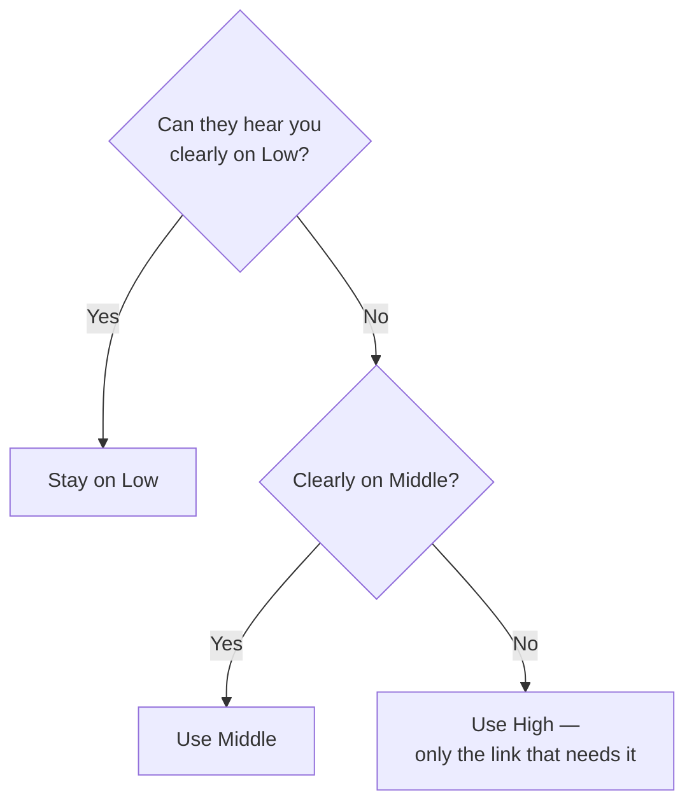
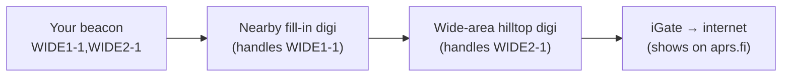

# Best practices and etiquette

Almost everything in this chapter costs you nothing and gives something back to everyone else on the channel. That is really all etiquette is: a handful of small habits that keep a shared resource pleasant for the next person, and that quietly mark you out as someone who knows what they are doing. The RT-950 Pro will happily let you be a thoughtful operator or an accidental nuisance — the difference is a few settings and a way of thinking — and this last chapter is about both. The good news is that courtesy is the one area where a budget handheld is exactly as capable as a rig ten times the price.

## Sharing the air

A radio frequency is a commons. When you key up, you are borrowing a slice of spectrum that everyone within range must share — nobody else can use that channel while you are transmitting, and a careless signal can spill into the channels either side of it too. None of that is a reason to be nervous; it is just a reason to be considerate, the same way you would be in any shared space.

The habits below all point the same way: **use the least of everything that does the job.** The lowest power that reaches the other station, the shortest APRS path that gets your beacon home, the smallest footprint on the channel. Operators who think like this are a pleasure to share a band with, and — this is the encouraging part — they are made, not born. Every setting here lives in a menu you have already met, and you can get all of them right in about ten minutes. None of it is about rules for their own sake; it is about being a good neighbour on a channel you share with people you will never meet. Do it well and nobody notices, which is rather the point.

## Run the lowest power that does the job

The single most useful habit on any transmitter is power discipline, and it is worth understanding _why_ before we touch the menu. More power does not make your signal clearer once the other station can already hear you well — it just makes you louder to everyone you were not talking to, drains your battery faster, and (on a broad-front-end radio like this one) makes your own receiver more prone to trouble. The full reasoning is in [RF Power](outpost:entry/logbook73.handbook/rf-power); here is the operator's version.

The RT-950 Pro offers three levels — **High**, **Middle** and **Low** — under _Radio → Trans Power_ (covered in full in [The Radio Menu](outpost:entry/logbook73.guide.rt-950-pro/menus-radio)). Independent measurement puts High at roughly 6.5–8.5 W depending on band; Middle and Low step down from there (the radio does not publish exact figures for them). The right level is not the highest one that works — it is the **lowest** one that works.



A worked example makes it concrete. Suppose your local [repeater](outpost:entry/logbook73.handbook/repeaters) sits on a hill five kilometres away and you can already open it with a full, hiss-free signal on **Low**. Reaching for High buys you nothing the other stations can hear — they were already getting perfect audio — while it roughly quadruples the current you pull and warms the radio for no benefit. Save High for the moment you actually need it: a weak repeater from a valley, a distant simplex contact, a marginal path where the other operator says you are getting scratchy.

One more real case: talking across a car park or a rally field to someone a few hundred metres away, Low is not just enough, it is _better_ — two handhelds close together on High can overload each other's front ends and sound worse than they would on Low. Low is not a compromise you settle for; much of the time it is the correct answer.

## Leave the roger beep off

At the end of every over, the radio can send a short "beep" to tell the other station you have finished — the **roger beep**, set under _Radio → ROGRE_. It is on by default on many budget radios, and turning it off is one of the first things a considerate operator does.

- **What it is doing:** the moment you release PTT, the firmware transmits a brief tone before dropping the carrier, as an audible "over to you".
- **Why leave it off:** amateur voice practice is to hand over with your words ("...back to you, G7XYZ") and a natural pause, not a tone. On a repeater the machine itself usually provides a courtesy tone, so yours arrives on top of it as clutter. Worse, that extra fraction of a second of carrier can clip the start of the next station's reply and encourage "doubling". It marks you, fairly or not, as someone who has not read past the default settings.
- **Where it is genuinely useful:** hands-free or noisy work between two people who have agreed to use it — climbing, marshalling, a work party — where an audible end-of-over helps. That is a deliberate choice between two operators, not something to leave running on the calling channel.
- **Set it:** _Radio → ROGRE → OFF._ ❌

The same spirit applies to a couple of neighbours in the same menu. Keep **Busy Lockout ON** so the radio refuses to transmit onto a channel that is already in use — good manners in a single setting — and leave the **time-out timer (TOT)** at a sensible value (around 180 seconds) so a stuck PTT in your pocket cannot hold a repeater hostage. Both are covered in [The Radio Menu](outpost:entry/logbook73.guide.rt-950-pro/menus-radio); both are pure courtesy.

## Be a considerate APRS neighbour

[APRS](outpost:entry/logbook73.handbook/aprs) is where good manners matter most, because a single badly-configured radio can quietly degrade a shared channel for a whole region. The 2 m APRS channel (`144.800 MHz` in Region 1, `144.390 MHz` in North America) is _one frequency_ shared by everybody in earshot, and every beacon you send — and every beacon you ask other stations to repeat — takes up airtime nobody else can use while it is on the air. The full settings walk-through is in [APRS, GPS & Digipeater](outpost:entry/logbook73.guide.rt-950-pro/menus-aprs); this is the etiquette layer on top.

### The courteous path

When your beacon goes out, it carries a **path** — a little instruction that says "please relay me, and how far". You choose it under _APRS Set → Path Choose_, and for a portable station almost everywhere the right answer is `WIDE1-1,WIDE2-1`. Here is what that path actually does:



`WIDE1-1` asks a nearby "fill-in" digipeater — often a home station covering a local dead spot — to repeat you once. `WIDE2-1` then asks one wide-area digipeater, usually on a hill with good coverage, to repeat you once more. Two hops is almost always enough to reach an **iGate** that puts you on the internet map, which is the goal. It is generous enough to get you heard and modest enough to be polite.

Now the important part: **do not ask for more than you need.** A path like `WIDE2-2` or `WIDE1-1,WIDE2-2` asks for extra hops, and each extra hop multiplies your beacon across more digipeaters and more airtime. In a busy area a single station beaconing on a long path, every minute, can be repeated a dozen times over — the radio equivalent of shouting the same sentence in every room of the building because you want to be sure the far end heard. The channel is finite; long paths are how it gets clogged. If you can already see yourself on the map with two hops, two hops is your answer.

While you are in there, keep your **beacon interval** sensible. A walker or cyclist moving slowly does not need to beacon every thirty seconds; every few minutes tells the same story with a fraction of the airtime. Set your **SSID** honestly (`-7` for a handheld, `-9` for a vehicle) and your **Mic-E status** to something meaningful, so other operators can read your beacon at a glance without you sending extra text.

### Do not switch on digipeating by accident

The RT-950 Pro can act as a **digipeater** itself — a station that listens for other people's packets and rebroadcasts them. That is a genuinely useful thing to run _on purpose_, from a fixed location with a known-good antenna and a reason to fill a gap. It is a genuinely antisocial thing to run _by accident_ from a handheld on your belt, because a moving, poorly-sited digipeater repeats packets erratically and adds noise to the very channel it is meant to help.

The control is _APRS Set → Digi Setup → Routing_. Leave it **OFF** unless you have deliberately set out to run a digipeater and understand what your `Routing` and `Digi CH` choices do. It is easy to enable while exploring the menu and never notice; if other local operators mention duplicate or oddly-timed packets, your own digipeater setting is the first thing to check. When in doubt: `Routing → OFF`. Beaconing your own position is being a good citizen; silently repeating everyone else's packets from a pocket is not.

## Look after the battery

A radio that is flat is no use to anyone, and a little discipline here means the RT-950 Pro is still with you at the end of a long day. None of this is about babying the radio — it is about spending charge where it counts.

- **Let the receiver nap.** _Radio → Battery Save_ puts the receiver into a brief micro-sleep between listens, waking often enough that you rarely miss a call. **Normal** is the sensible default; the deeper settings (**Super**, **DEEP**) save more but can clip the first fraction of a weak signal. Leave it on Normal and forget it.
- **Power is the big lever.** As above, transmitting on Low instead of High is by far the largest saving you can make — transmit is where the current really goes, so power discipline and battery life are the same habit seen from two directions.
- **Dim and lock the screen.** A colour display is a lovely thing and a steady drain. Set _Setting → Back Light_ to a short timeout (30–60 seconds) rather than always-on, and let _Setting → Keypad Lock_ engage after a few seconds so a pocket press cannot wake the screen or key the radio. Both live in [Keys, Bluetooth, Signalling & Settings](outpost:entry/logbook73.guide.rt-950-pro/menus-system).
- **Mind the extras.** GPS and Bluetooth both cost power. Beaconing all day needs GPS on — that is fine — but if you are only listening, turning GPS and Bluetooth off stretches a charge considerably.
- **Charge kindly.** The radio takes a Type-C charge or sits in the optional dock; the indicator glows red while charging and green when full. Avoid running the pack flat to nothing every cycle, keep the contacts clean, and store the radio around half-charged if it is going in a drawer for months rather than fully flat or fully full.

## RF safety, without the scare stories

A handheld is a small transmitter held close to your body, and the sensible precautions are genuinely small too — this is a section to read once and then not worry about. The manufacturer's own guidance is a fair summary: keep transmissions to no more than about a **50% duty cycle** (you spend at least as long listening as talking, which is normal amateur practice anyway), and keep a **minimum of about 2.5 cm between the radio and your body** while transmitting. In practice, holding a handheld at your face to speak already does this.

Two habits matter more than any number:

1. **Never transmit into a missing or damaged antenna.** This is the one hard rule. A transmitter needs somewhere for its power to go; with no antenna, or a broken one, that energy has nowhere to radiate and reflects straight back into the final amplifier, which can cook it. Fit the antenna finger-tight before you key up, and if it is cracked, bent at the base or the connector is loose, replace it before transmitting. The reflected-power story is [SWR](outpost:entry/logbook73.handbook/swr); any replacement must suit the intended band, connector and operating environment — see [Antennas](outpost:entry/logbook73.handbook/antennas).
2. **Keep the antenna clear of your face and eyes on High.** The tip of the antenna is where the field is strongest. Holding the radio a few centimetres from your cheek — as you naturally would — and using Low power where it works keeps exposure trivially small. The reasoning, and why higher frequencies and higher power change the sums, is in [RF Power](outpost:entry/logbook73.handbook/rf-power).

That really is the whole of RF safety for a radio this size. It is a handheld, not a mast; treat it with ordinary care and there is nothing here to lose sleep over.

## Update firmware deliberately, and keep a backup

The RT-950 Pro's firmware is young and moves fast — early public builds climbed through several versions in a matter of months — and each update can genuinely improve the radio. It can also, handled carelessly, ruin your day, so this is a place to be deliberate rather than eager.

The specific risk owners have run into: the radio's bootloader does **no integrity check** on the firmware it receives (no CRC, no signature), which means a corrupted or interrupted flash can leave the radio unable to boot — a "brick" — with no built-in way to recover. This is not scaremongering; at least one owner has reported bricking a unit on a particular build. It is simply the reality of a fast-moving budget product, and it is entirely manageable:

- **Before you flash, save a backup** of your current configuration with the vendor software (the radio is not CHIRP-compatible, so you use Radtel's own tool). A backup means a fumbled update or a factory reset costs you nothing but a few minutes to restore. Keep the backup somewhere you will find it again.
- **Read what the update changes.** Flash to fix something you are actually experiencing or to gain a feature you want — not reflexively because a new number exists. Note your current version under _About Machine → Software_ first so you know where you started.
- **Flash on a full battery, on a stable connection, and do not interrupt it.** Most bad flashes come from a cable knocked loose or a battery dying mid-write. Give it a clean run and leave it alone until it finishes.

Handled this way, firmware updates are a benefit, not a gamble. The reset and backup tools live in [Keys, Bluetooth, Signalling & Settings](outpost:entry/logbook73.guide.rt-950-pro/menus-system), and [Troubleshooting](outpost:entry/logbook73.guide.rt-950-pro/troubleshooting) covers what to do if an update does go wrong.

## Stay in-band and legal

This is the shortest section and the least negotiable, so it can be blunt and warm at once: **transmit only where your licence permits.** For a UK Foundation licensee that means your 2 m (144–146 MHz) and 70 cm (430–440 MHz) amateur allocations, in FM, at your permitted power — and nothing else. Elsewhere the edges differ by ITU region, so check your national band plan and licence conditions; the principle is universal even where the numbers are not. If you are not yet licensed, everything you receive is legal to listen to — receiving is not transmitting — and [Getting Licensed](outpost:entry/logbook73.handbook/getting-licensed) is the friendly next step.

Like most radios of its kind, the RT-950 Pro _can_ be made to transmit outside the amateur bands. Do not. It is worth knowing the history here, because the internet routinely garbles it: the 2018 FCC action against Baofeng-type radios concerned their **out-of-band transmit capability and how they were marketed**, not their harmonics, and it did **not** ban licensed amateurs from using such radios on the ham bands. So the takeaway is not "these radios are illegal" — they are not — it is "keep your transmissions inside your allocation".

Two more legal points specific to this radio's menus. The **Encryption** and **Scramble** functions must stay off on amateur bands: amateur transmissions must be in the clear, and obscuring their content is not permitted. And keep **identifying with your callsign** as your licence requires — a good habit and a legal one. Clean, legal, in-band operation is not a burden the radio imposes on you; it is the thing that makes the whole shared system work.

## A band-pass filter for fixed and repeater use

We were honest in the [overview](outpost:entry/logbook73.guide.rt-950-pro/overview) about this radio's front end: the wide coverage that makes it fun comes with less selective filtering than a premium handheld, so in a strong-RF spot — near a broadcast, paging or cellular site, or on a big outdoor antenna at a fixed station — it can overload and serve up [ghost signals](outpost:entry/logbook73.handbook/overload-and-ghost-signals) that are not really there. Out portable on the supplied antenna you will rarely meet this. But if you set the radio up permanently on a rooftop aerial, or use it through a repeater from a fixed location, an external **band-pass filter** is the clean fix.

A band-pass filter sits between the antenna and the radio and passes only the band you care about, rejecting the strong out-of-band signals that were overloading the front end:

```viz
{
  "type": "spectrum",
  "title": "What a 2 m band-pass filter does",
  "caption": "The filter passes the 2 m amateur band and rejects the strong broadcast, pager and cellular signals that overload a wideband front end.",
  "components": [
    { "f": 18, "amp": 0.9, "label": "FM broadcast", "tone": "danger" },
    { "f": 33, "amp": 0.8, "label": "Pager", "tone": "danger" },
    { "f": 52, "amp": 0.55, "label": "2 m ham", "tone": "success" },
    { "f": 80, "amp": 0.85, "label": "Cellular", "tone": "danger" }
  ],
  "noiseFloor": 0.05,
  "mask": { "kind": "bandpass", "from": 44, "to": 60 },
  "xLabel": "Frequency →"
}
```

There is an honest trade to understand. A band-pass filter cures overload by throwing away everything _outside_ the passband — which includes all the wideband receive (airband, shortwave, broadcast) that made you buy the radio in the first place. So it is the right tool for a **single-band fixed or repeater installation** — a 2 m or 70 cm filter for a station that lives on the ham band — and the wrong tool for a portable "scanner" role where you want to hear everything. Match the filter to the band you actually operate, fit it inline at the antenna, and a station that was drowning in intermod becomes quiet and usable. For portable use, the simpler answer is often a modest antenna rather than a high-gain outdoor one, which feeds less out-of-band energy in to begin with.

## Try it yourself

Fifteen minutes turns the ideas above into muscle memory:

1. **Find your minimum power.** On a repeater you can reliably open, drop to **Low** and ask another station (or listen to your own signal on a second receiver) whether your audio is full and clean. If it is, that repeater is now a "Low" contact for you. Note how rarely you actually need High.
2. **Kill the beep.** Set _Radio → ROGRE → OFF_, confirm **Busy Lockout ON**, and make an over — notice how the handover feels cleaner with your words doing the work instead of a tone.
3. **Check your APRS path.** Open _APRS Set → Path Choose_ and confirm it reads `WIDE1-1,WIDE2-1`. Then open _Digi Setup → Routing_ and confirm it reads **OFF**. Beacon once and look yourself up on `aprs.fi` — two hops was almost certainly plenty.
4. **Trim the battery drain.** Set the backlight to a short timeout, enable the keypad auto-lock, and note your current firmware under _About Machine → Software_ so you have a reference before any future update.
5. **Save a backup.** Connect the vendor software and export your configuration to a file. You now have an undo button for the rest of your ownership.

Nothing here can harm the radio, and every one of these habits is free.

## Key takeaways

- **Use the least of everything that works:** the lowest power that reaches the other station, the shortest APRS path that gets home, the smallest footprint on a shared channel. It is the whole of etiquette in one sentence.
- **Turn the roger beep off**, keep Busy Lockout on and the time-out timer sensible, and hand over with your words — courtesy that costs nothing and shows immediately.
- On [APRS](outpost:entry/logbook73.guide.rt-950-pro/menus-aprs), **`WIDE1-1,WIDE2-1` is the polite path**; longer paths clog a shared channel, and you should never leave the built-in **digipeater (`Routing`) on by accident**.
- **RF safety is small and manageable:** never transmit into a missing or damaged antenna, keep the tip clear of your face, favour Low power, and mind the 50% duty cycle — no scare stories required.
- **Update firmware deliberately and keep a backup** — the bootloader does no integrity check, so a good backup turns any bad flash into a five-minute recovery.
- **Transmit only where your licence permits**, keep Encryption and Scramble off, and remember the 2018 FCC action was about out-of-band capability, not a ban on licensed amateur use.
- For a **fixed or repeater station** in strong RF, a single-band **band-pass filter** cures overload — at the price of the wideband receive, so match it to the band you actually operate.

That is the operator this guide set out to help you become: someone who runs a budget radio so cleanly and considerately that, on the air, nobody could tell it cost a fraction of the rig next to it. When a setting puzzles you from here on, everything you need is one click away in the [Menu Reference](outpost:entry/logbook73.guide.rt-950-pro/menu-reference) — the map you will keep coming back to.
