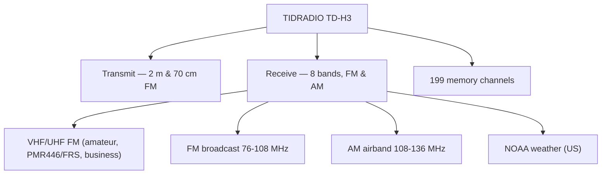
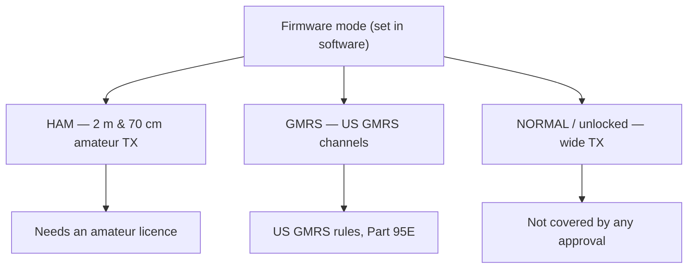
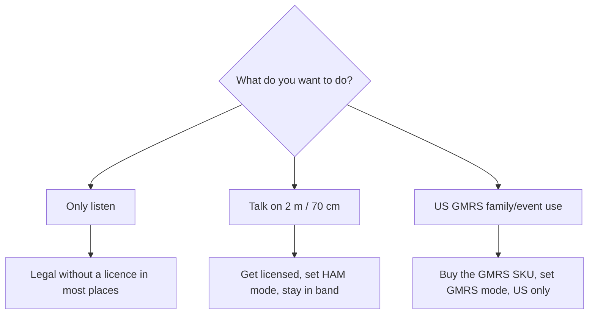

# Why this guide — what the TD-H3 really is

The TIDRADIO TD-H3 is one of a new wave of budget colour-screen handhelds that promise broad receive coverage, a torch and Bluetooth programming. It is a capable little radio, but it is also a slightly confusing one: it ships in two different guises, its firmware modes affect available transmit settings, and online descriptions often blur those boundaries. This guide is reviewed against the model scope, manuals and firmware basis shown on its contents page; where sources disagree or behaviour is version-dependent, the text labels that uncertainty.

## Why a cheap radio deserves a careful book

The TD-H3 comes with a slim printed manual that lists its menu and then stops. It will tell you a menu item exists and offers a handful of values, but not what the setting actually does, why the feature exists, or which value to leave it on. That gap — between _listing_ a setting and _explaining_ it — is exactly the gap this guide fills. For every item on the radio we answer the questions the manual skips: **what it does, what the radio is doing inside, why the feature exists, sensible values, and whether you should touch it at all.**

There is a second reason to take a budget radio seriously, and it is the more important one. A radio like this is often somebody's _first_ transmitter. The difference between a newcomer who understands duplex offsets, [CTCSS tones](outpost:entry/logbook73.handbook/repeaters), bandwidth and power discipline and one who does not is the difference between a good operator and an accidental nuisance — and that difference is made entirely by whether anyone bothered to explain it. A cheap radio that teaches you properly is worth more to the hobby than an expensive one left in its box because its owner is afraid of it.

## A note for experienced operators

If you have been licensed for years you may wonder why a careful reference should exist for a radio you might never reach for first. Fair — so let us be honest. The TD-H3 is not a lab-grade set. To hit its price it uses a wide, lightly filtered front end, which is what lets it hear eight bands but also leaves it vulnerable to [overload and "ghost" signals](outpost:entry/logbook73.handbook/overload-and-ghost-signals) near strong transmitters — the classic weakness of every inexpensive wideband handheld. Its transmit is fine for amateur use when kept in band and turned down, but it is not on a par with a well-engineered Yaesu, Icom or Kenwood, and independent bench measurements of it are still thin on the ground.

But two things are also true. First, radios like this bring people _into_ the hobby, and this guide's job is to make sure they arrive transmitting cleanly and legally, with tones set correctly and good manners on shared channels. Second, the skills transfer: an operator who can explain why you run the lowest power that does the job is a good operator on any equipment. So wherever this guide makes a recommendation it leans the same way — in-band only, lowest sensible power, tones set right, and always within your [licence conditions](outpost:entry/logbook73.handbook/getting-licensed).

## What the TD-H3 actually is

At heart the TD-H3 is a **dual-band handheld transceiver** for the 2 m (144 MHz) and 70 cm (430 MHz) amateur bands, transmitting in **FM only**, with **199 memory channels**. In the hand it is a compact set — a little smaller than a Baofeng UV-5R — with a **1.44-inch colour screen**, a top knob for on/off and volume, a couple of side keys, a numeric keypad and a built-in white LED torch. It charges over **USB-C** (a port on both the radio body and the battery pack) from a **2500 mAh lithium-ion** pack, and the antenna screws on through an **SMA-F** connector.



The word marketing leans on hardest is **"8-band"**, and it refers to _receiving_, not transmitting. The radio listens across eight slices of spectrum:

| Band (receive) | Coverage    | What lives there                    |
| -------------- | ----------- | ----------------------------------- |
| Low VHF FM     | 50–76 MHz   | Older business/utility FM           |
| FM broadcast   | 76–108 MHz  | Music and news (wide FM)            |
| AM airband     | 108–136 MHz | Aviation voice (AM)                 |
| VHF            | 136–174 MHz | 2 m amateur, marine, PMR/business   |
| VHF upper      | 174–350 MHz | Mixed services                      |
| UHF lower      | 350–400 MHz | Mixed services                      |
| UHF            | 400–470 MHz | 70 cm amateur, PMR446/FRS, business |
| UHF upper      | 470–600 MHz | Mixed services                      |

Two details matter more than the headline number. First, the radio can **demodulate AM** on the aviation airband and **wide FM** on the broadcast band — a real step up from FM-only budget sets that hear only their own two bands. Second, **it receives far more widely than it transmits**. On the factory amateur firmware the transmitter is specified for **136–174 MHz and 400–470 MHz** only — the ranges that contain the 2 m and 70 cm bands. (Those transmit limits change with the firmware mode; more on that shortly.)

```viz
{
  "type": "spectrum",
  "title": "Wide to listen, narrow to talk",
  "caption": "The TD-H3 receives across eight bands but transmits only in two narrow amateur segments (highlighted).",
  "xLabel": "Frequency (50-600 MHz, not to scale)",
  "components": [
    {"f": 8, "amp": 0.4, "width": 4, "label": "FM bcast", "tone": "muted"},
    {"f": 13, "amp": 0.4, "width": 4, "label": "Airband AM", "tone": "muted"},
    {"f": 16, "amp": 0.95, "width": 5, "label": "TX 2 m", "tone": "primary"},
    {"f": 45, "amp": 0.4, "width": 20, "label": "RX only", "tone": "muted"},
    {"f": 70, "amp": 0.95, "width": 7, "label": "TX 70 cm", "tone": "primary"},
    {"f": 90, "amp": 0.4, "width": 16, "label": "RX only", "tone": "muted"}
  ]
}
```

On power, the honest position is that there are **two levels, high and low** — there is no distinct "mid". High power is rated at **5 W**. The _low_ figure is where sources part company: the manufacturer's manual states 2 W, retail listings and reviews often say 1 W, and the one independent bench test we found measured somewhere in between. We would rather tell you that plainly than print a number that might be wrong; treat "low" as "a couple of watts, roughly a quarter of high" and check your own unit's menu.

The signalling toolkit is the usual amateur set: **50 CTCSS tones, 105 DCS codes, a 1750 Hz repeater tone** and DTMF. There is dual-watch (two frequencies monitored at once), several kinds of scan, VOX (voice-activated transmit), an alarm/SOS function and a roger beep. In the US it also carries a **NOAA weather** receiver. What it does _not_ have is any digital voice mode: **the TD-H3 is analogue FM only — no DMR, no D-STAR, no System Fusion.** If a channel you want is digital, this is the wrong radio.

## The two things that trip everyone up

Most of the confusion around the TD-H3 comes from two facts that the marketing blurs together. Getting them straight now will save you a great deal of head-scratching later.

### It ships as two different radios

The TD-H3 is sold as **two distinct products with the same outward shape**:

- a **Ham variant** — internal model **TD831**, certified in the US as FCC ID `2A4FBTD831`; and
- a **GMRS variant** — internal model **TD831G**, certified as FCC ID `2A4FBTD831G`.

These are not the same radio with a sticker swapped. GMRS (the General Mobile Radio Service) is a **US-specific** licensed service with its own rules, and the GMRS SKU is certified for it under the FCC's Part 95E; the Ham SKU is not. Neither variant is certified for commercial land-mobile (Part 90) use. When you buy, you are choosing which service the radio is _approved_ for — so pick the SKU that matches how you actually intend to use it. Outside the US, GMRS has no equivalent; your licence-free options are things like [PMR446](outpost:entry/logbook73.handbook/uhf) in Europe, and the "GMRS" framing simply will not apply — check what your national regulator (Ofcom in the UK, the FCC in the US, and so on) actually permits.

### Its firmware can change what it transmits

On top of the SKU, the radio's **firmware mode is field-switchable** — you change it in software (CHIRP or the maker's ODMaster app), not with a physical switch — between three states:



This is the single most misunderstood thing about the radio. **HAM** mode limits transmit to the amateur allocations. **GMRS** mode restricts it to the US GMRS channels. **NORMAL** — often called "unlocked" — opens transmit far more widely. That last mode is the source of most of the trouble: transmitting out of band is **not covered by any certification**, and it is generally illegal unless the frequency happens to fall within the privileges of a licence you actually hold. The radio being _able_ to do a thing is never the same as you being _allowed_ to. Set the mode that matches your licence and your intended service, and leave "unlocked" alone unless you know exactly why you are using it and that you are permitted to.

## What it is not

Knowing a tool's limits is part of using it well, so here is the honest list.

- **It is not a digital radio.** No DMR, D-STAR or Fusion — analogue FM only. Digital talkgroups and hotspots are out of reach.
- **It is not the "Plus", and there is no "Mini".** The only sibling model is the **TD-H3 Plus**, which adds Bluetooth PTT and wireless audio. The **base H3's Bluetooth does programming only** — it lets you configure the radio wirelessly from the ODMaster app, but you cannot use a Bluetooth earpiece to talk through it. Despite what some listings imply, there is **no "TD-H3 Mini"** in this family.
- **It is a broad receiver, not a fussy one.** The wide front end that hears eight bands has little filtering, so near a broadcast, paging or cellular site — or, counter-intuitively, on a _better_ outdoor antenna — it can overload and serve up [ghost signals](outpost:entry/logbook73.handbook/overload-and-ghost-signals) that are not really on the frequency you are tuned to. In everyday pocket use you will rarely notice; if a "repeater" appears on an odd frequency near a mast, suspect intermodulation before you believe it.
- **It is not weatherproof.** No source gives it an IP water-resistance rating, and one review states plainly that it is not water-resistant. Treat it as a fair-weather or under-cover radio.
- **It will transmit where it should not, if you let it.** As above, "unlocked" firmware opens out-of-band transmit that no certification covers. **Transmit only where your licence permits.**

## Being straight about what we could not confirm

This guide's whole premise is that we do not guess, so here — openly — is what we could _not_ pin down, and how we have handled it:

- **The exact low-power figure.** Sources give 1 W, 2 W and a measured value in between. We describe it as "roughly a couple of watts" rather than quote a single number.
- **The exact dimensions.** Two reputable sources disagree on the height by about a centimetre (probably body-only versus with-knob measurement). We say "compact, a little smaller than a UV-5R" and leave precise millimetres to your own tape measure. The weight — around **220–230 g** with battery — _is_ cross-confirmed.
- **The keypad's exact layout.** Reviews describe it slightly differently — some emphasise app-based frequency entry, others describe direct numeric entry. We will show you what your unit does in [Getting Started](outpost:entry/logbook73.guide.td-h3/getting-started) rather than assert one layout here.
- **Menu-item counts, squelch levels and channel steps.** These appear in only a single source each and may shift with firmware, so the [menu reference](outpost:entry/logbook73.guide.td-h3/menu-reference) treats specific numbers as "check on your radio" rather than gospel.
- **Whether NOAA weather gives an automatic alert tone** or is only a manual scanner — sources disagree, so we describe it as a weather _receiver_ and flag the uncertainty.

None of these are safety-critical, and every one of them is the kind of detail the forums state with false confidence. Telling you where the ground is soft is part of keeping the rest of the guide trustworthy.

## Who this guide is for, and what people use it for

You are welcome here whether you have just unboxed one of these, are weighing up a first radio, are a listener exploring what it can hear (receiving is legal without a licence almost everywhere — it is _transmitting_ that needs one), or are an old hand who just wants a menu reference that finally explains everything.

Where a decision matters — above all, "am I allowed to transmit here?" — it usually comes down to what you are trying to do:



The common uses, and why the TD-H3 suits each:

- **A first licensed amateur radio.** Cheap enough that a fumbled setting is no tragedy, capable enough to work your local repeaters and simplex, and — because it teaches offsets, tones, bandwidth and power discipline — it makes you a better operator before you spend real money. Choose the **Ham SKU** and set **HAM** firmware mode.
- **A listener's / scanner radio.** With no licence you can legally _listen_ to the amateur bands, marine and business FM, the broadcast FM band, the AM airband and (in the US) NOAA weather. The eight-band receive and AM airband make it a more interesting scanner than an FM-only handheld.
- **US GMRS family and event use.** For unlicensed family members you need type-approved radios on the right service; in the US that is the **GMRS SKU (TD831G)** in **GMRS** mode. Outside the US, use your region's licence-free radios ([PMR446](outpost:entry/logbook73.handbook/uhf) in Europe, FRS in North America) — the amateur SKU is not approved for those.
- **A go-bag backup.** Small, USB-C-charged and inexpensive enough to leave in a rucksack with your local repeaters programmed in.

A word on slant: recommendations here lean towards clean, considerate amateur practice, with band edges given by [ITU region](outpost:entry/logbook73.handbook/appendix) and regulators named only as examples. The underlying theory is universal — take the concepts and check your own national band plan and licence conditions.

## Try it yourself

Before you change a single setting, do two quick checks that cost nothing and tell you exactly which radio you are holding:

1. **Find the model on the label.** Slide off the battery and read the model designation — **TD831** is the Ham variant, **TD831G** is the GMRS one. That one line tells you which service your radio is certified for, and therefore which firmware mode you should be running.
2. **Note what it can hear versus what it can send.** Tune the FM broadcast band (76–108 MHz) and an aviation airband frequency (108–136 MHz, AM) and confirm it receives them — proof of the wide, multi-mode front end. Then remember the flip side: those bands are receive-only. Your transmit lives in the 2 m and 70 cm amateur segments (or the GMRS channels), and nowhere else.

Keep a note of the model and the firmware mode somewhere — you will want both when you reach [Getting Started](outpost:entry/logbook73.guide.td-h3/getting-started).

**A quick safety note.** A handheld is a transmitter next to your head. Keep the antenna a few centimetres from your face when transmitting, use the lowest power that does the job, and **never key up without an antenna attached** — a transmitter with nowhere to send its power can damage itself. That is the whole of RF safety for a radio this size; [RF Power](outpost:entry/logbook73.handbook/rf-power) has the reasoning.

## Key takeaways

- The TD-H3 is a compact, inexpensive **dual-band (2 m / 70 cm) analogue-FM-only** handheld with **199 memories**, a **colour screen**, USB-C charging and **eight-band receive** (including AM airband and broadcast FM) — but **no digital voice** of any kind.
- It ships as **two distinct SKUs**: a **Ham** variant (model **TD831**, FCC ID `2A4FBTD831`) and a US **GMRS** variant (model **TD831G**, FCC ID `2A4FBTD831G`). Buy the one that matches how you will use it.
- Its **firmware is field-switchable** between **HAM**, **GMRS** and **NORMAL/"unlocked"** modes, which change what it may transmit. "Unlocked" out-of-band transmit is covered by no certification and is generally illegal unless it falls within your actual licence privileges.
- The only sibling is the **TD-H3 Plus** (which adds Bluetooth PTT and audio); the base H3's Bluetooth is for **programming only**. There is **no "TD-H3 Mini".**
- It **receives far more widely than it transmits**: factory amateur transmit is 136–174 and 400–470 MHz, while receive spans 50–600 MHz — and that wide, cheap front end trades filtering for coverage, so it can overload in strong RF.
- Where sources disagree — the low-power figure, exact dimensions, the keypad layout, menu counts — this guide says so rather than guessing. That honesty is the point.

Ready? Let's pick it up and learn our way around it — [Getting Started: Layout, Display & Modes](outpost:entry/logbook73.guide.td-h3/getting-started).
