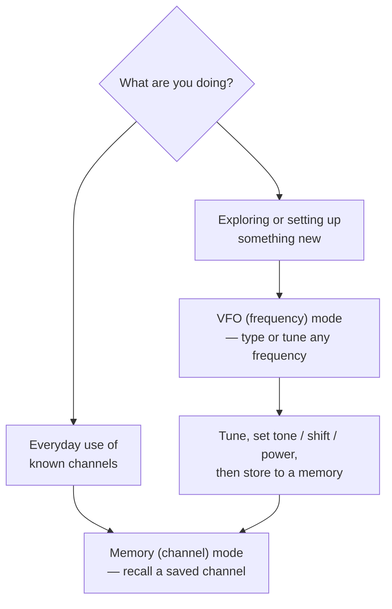
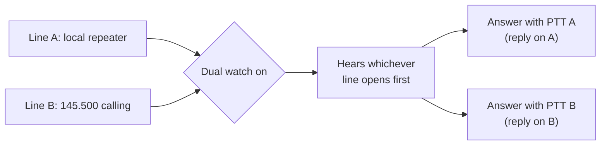
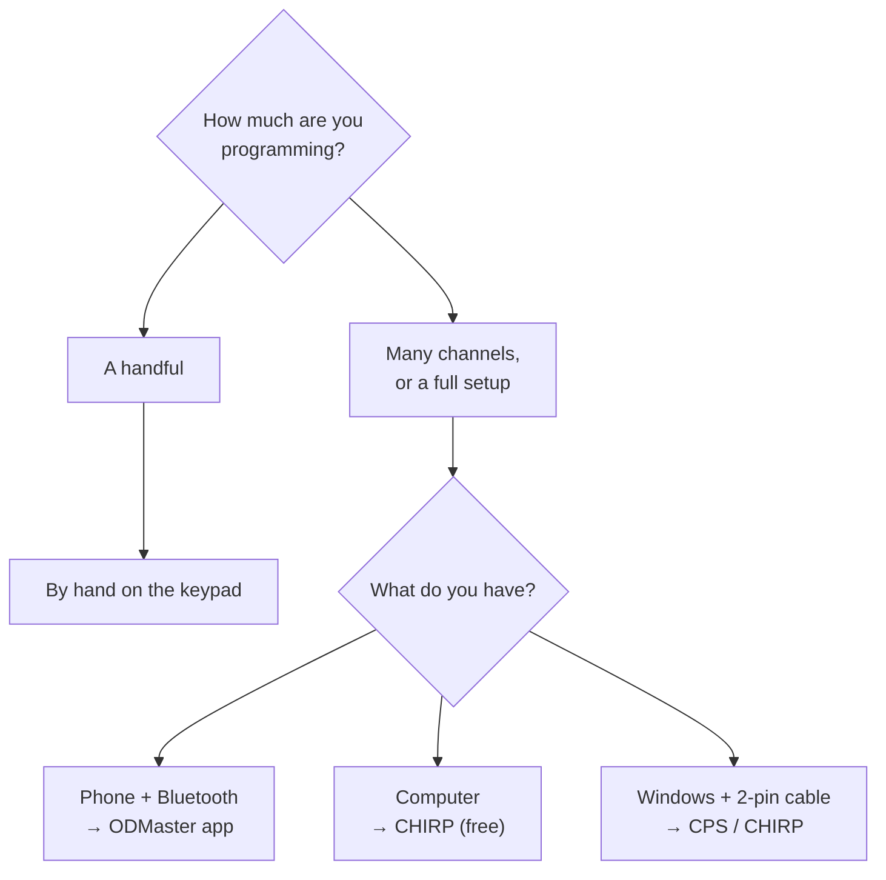

# Getting started: layout, display and modes

The quickest way to fall out with a new handheld is to press something in the first five minutes, land somewhere baffling, and have no idea how to get home. The TD-H3 is friendlier than most about this — it has a colour screen that tells you more than the old two-line sets ever did — but it still rewards a slow, deliberate first look. So before we open a single menu, let's get properly oriented: what every control does, what that colour display is telling you, and the two or three ideas the whole radio is built around. Twenty unhurried minutes here and the rest of this guide will feel obvious.

If you have not yet read [Why This Guide](outpost:entry/logbook73.guide.td-h3/overview), a one-line reminder: the TD-H3 is an **analogue FM only** dual-band handheld (no DMR, no C4FM), sold in two variants — a **ham** version (model TD831) and a **GMRS** version (model TD831G) — whose mode can be switched in software. Everything below describes the base **TD-H3**; where a feature belongs only to the **TD-H3 Plus**, it is called out as such.

## The front panel

There is not much to the front panel — a knob, a screen, a numeric keypad and a small cluster of function keys — and, unusually, **two** push-to-talk buttons rather than one. Don't try to memorise everything; just get a feel for what does what as we walk down the radio, top to bottom.

1. **Antenna (SMA-Female).** The socket on the radio is a **female SMA**, and the supplied "rubber duck" is the matching male plug that screws in finger-tight. Never force it, and **never transmit without an antenna fitted** — a transmitter with nowhere to send its power can damage its own output stage. Two things worth knowing early: this is the same gender arrangement as most budget handhelds but the _opposite_ of Yaesu, Icom and Kenwood sets, so their antennas need an adapter; and any replacement must suit the intended band, connector and operating environment — see [Antennas](outpost:entry/logbook73.handbook/antennas).
2. **Flashlight (LED torch).** A white LED torch on the top edge, driven by a dedicated top button (the manual calls it the **LAMP / customised key**, because programming software can reassign it). Genuinely handy in a dark shack or footwell. It runs off the main battery, so treat it as a torch of convenience, not a survival tool.
3. **Power / volume knob.** The knob on the top switches the radio on with an audible click and sets the volume — clockwise for on and louder, anticlockwise to the click for off. That is _all_ it does; there is no separate power button, and the click is the on/off.
4. **Indicator LED.** A small light near the top of the front glows **red while you transmit** and **green when the squelch opens** on an incoming signal. A glance confirms you are actually transmitting — reassuring when you are not sure the PTT has taken.
5. **Colour display.** A 1.44-inch **colour** screen — the headline difference from the monochrome sets it competes with. It shows two frequency lines at once with a ring of status tags, and it earns its own section next.
6. **PTT A and PTT B (two push-to-talk keys).** This is the TD-H3's signature quirk: **two** transmit buttons on the left edge. The manual is explicit — hold **PTT A** to talk on the A line, hold **PTT B** to talk on the B line. On a single-PTT radio you must first select which line is active and then key up; here you simply press the button for the line you want. Build two habits from day one: run the **lowest power that does the job**, and keep the antenna a few centimetres from your face while you key up. Transmit only where your [licence](outpost:entry/logbook73.handbook/getting-licensed) permits.
7. **Menu / BL key.** A **short press** opens the menu (and confirms a choice inside it); a **long press** activates or resets **Bluetooth programming** — the wireless link the phone app uses, which we come back to at the end of the chapter.
8. **VFO/MR (also Exit).** This key swaps between **frequency (VFO) mode** — where you dial any frequency by hand — and **memory (channel, "MR") mode**, where you recall channels you saved earlier. It doubles as the **Exit / back** key inside the menu. It is the single most important key to understand, and it has its own section below.
9. **A/B key.** Chooses which of the two on-screen lines is the **active** one for tuning and for menu changes. (Because there are two separate PTT buttons, you do not need A/B just to pick which line _transmits_ — but the arrows and most settings still act on the active line.)
10. **Up / down arrows (∧ / ∨).** Scroll the menu, tune the active line, and change values. Hold an arrow in VFO mode to tune quickly.
11. **Numeric keypad (0–9, ✳, #).** In VFO mode you **type a frequency directly**, which is far quicker than winding the arrows; in memory mode the number keys jump to channel numbers; and on transmit they send DTMF touch-tones. A short press of **✳** opens the DTMF interface, and a long press of it **locks the keypad** (long-press again to unlock).

> **The single most useful habit:** when you get lost, press **VFO/MR / Exit** a couple of times. It walks you back to the standby screen without changing anything. There is no menu so deep you cannot escape it.

One honest caveat about the keypad. The manual describes a full numeric pad you can type frequencies on, and that matches how most owners use it — but a few reviewers have described the layout as more limited and preferred entering frequencies through the phone app. Treat the keypad as your quick-entry tool, but **check your own unit** before assuming a particular key does a particular thing.

## Understanding the display

The standby screen can look busy because it is showing you two radios at once, wrapped in a ring of little status tags. The good news is that it is in colour and the layout is generous, so once you learn the anatomy of one line you have learned both.

```viz
{
  "type": "display",
  "title": "TD-H3 — the standby display",
  "caption": "Two frequency lines, A on top and B below. The active line (the one the arrows tune and menu changes apply to) is highlighted. Each has its own frequency, power, bandwidth, shift and tone. There are two PTT buttons, so either line can transmit directly.",
  "screen": {
    "rows": [
      { "vfo": "A", "freq": "434.325", "power": "H", "bw": "N", "shift": "+", "tone": "CT", "active": true },
      { "vfo": "B", "freq": "145.500", "power": "L", "bw": "W", "tone": "DCS" }
    ],
    "topIcons": ["S", "BT", "100%"]
  },
  "callouts": [
    { "n": 1, "x": 14, "y": 3, "label": "Status icons", "side": "left" },
    { "n": 2, "x": 5, "y": 16, "label": "Line A (active)", "side": "left" },
    { "n": 3, "x": 40, "y": 16, "label": "Frequency", "side": "left" },
    { "n": 4, "x": 90, "y": 16, "label": "Line tags", "side": "right" },
    { "n": 5, "x": 8, "y": 33, "label": "Sub-tone: CT / DCS", "side": "left" },
    { "n": 6, "x": 90, "y": 33, "label": "Channel number (MR)", "side": "right" },
    { "n": 7, "x": 92, "y": 3, "label": "Battery gauge", "side": "right" }
  ]
}
```

1. **Status icons** run along the top. A **signal-strength (S-meter)** graph appears when a station is breaking squelch, and a **battery** indicator sits in the corner. If Bluetooth programming is armed you will see that flagged too, and a padlock appears when the keypad is locked. If the radio ever misbehaves — keying up on its own, say — this strip usually explains why.
2. **The two lines, A and B.** They behave like two little independent radios sharing one speaker, one antenna and one set of controls. Each has its own frequency, band, tone, bandwidth and power level. The **A/B** key chooses which one the arrows and menu act on.
3. **The frequency** is the big number on each line. In VFO mode you can overtype it from the keypad; in memory mode it shows the frequency stored in the current channel.
4. **The line tags** sit around each frequency and save you diving into menus to check a setting: a **power** marker (high or low), a **bandwidth** marker (wide or narrow), and a **duplex-shift** marker (`+` or `−`) that appears when the line is set up for a [repeater](outpost:entry/logbook73.handbook/repeaters).
5. **The sub-tone tag** shows `CT` when a **CTCSS** analogue sub-tone is active on that line, or `DCS` for a digital code. These are the quiet sub-audible signals that keep your speaker silent until the right station calls, and open many repeaters — a whole chapter of their own later.
6. **The channel number** appears in **memory (MR) mode** — the slot you are sitting on, from a set of **199 memory channels**. In VFO mode this space is blank because you are on a raw frequency, not a stored channel.
7. **The battery gauge.** The 2500 mAh pack is shown as an icon in the top strip. What the radio can display alongside the frequency — the frequency itself, a channel number, or a channel _name_ — is set by a pair of "display mode" menu items (one for line A, one for line B); we map those exactly in [Menu Reference](outpost:entry/logbook73.guide.td-h3/menu-reference).

## VFO and memory: the two ways to tune

Almost everything on this radio hangs off one basic question: are you **dialling a frequency by hand**, or **recalling one you saved earlier**? Those are the two **modes**, and the `VFO/MR` key swaps between them.



**VFO (frequency) mode** — the screen shows raw frequencies with no channel number — gives you the whole band to roam. Type a frequency on the keypad or step it with the arrows, and the radio goes there. This is where you _set things up_: find a repeater, add its shift and tone, choose a power level, then store the lot into a memory so you never do it again. When you type a frequency, the radio fills in the decimal point for you according to the current tuning step, so you key the digits and it formats them.

**Memory (channel) mode** — a channel number appears — recalls those stored channels. A memory is not just a frequency: one recall restores the frequency, the duplex shift, the CTCSS/DCS tones, the bandwidth, the power level and (if you named it in software) a label. This is where you live day to day: step to your local repeater and everything is already correct.

Two things trip people up. First, **memory mode is thin until you store channels** — a radio with nothing saved has little to recall, so switching to MR may look as if it does nothing. Second, **you cannot freely re-tune a memory channel in place.** A memory is a saved snapshot; to change its frequency or tone you go back to VFO mode, make the change there, and store over the channel.

### Storing a channel by hand

The keypad route, in outline, is: tune the frequency you want in VFO mode, set its shift, tone, bandwidth and power, then use the **store-to-memory** menu item to write it into a numbered channel. On current firmware that store function is **menu item 25**, which is corroborated across sources — but menu numbers can shift between firmware versions, so confirm it against the on-screen label rather than trusting a number blindly. We give the full keystroke-by-keystroke procedure, with the exact menu labels, in [The Menu in Depth](outpost:entry/logbook73.guide.td-h3/menus-1).

## Dual watch and the two PTT buttons

Because the two lines are effectively two radios, the TD-H3 can keep an ear on both at once. Turn on **dual watch** (in the manual, the `D.Wait` item — around menu 9 on current firmware, though as ever check the label on your unit) and the radio hops between line A and line B, catching a call on either. It is not true simultaneous reception — while one line is busy the other is deaf for that moment — but for everyday monitoring it is exactly what you want. Park A on your local [repeater](outpost:entry/logbook73.handbook/repeaters) and B on the 2 m calling channel `145.500 MHz`, switch on dual watch, and you will hear whichever comes alive.

Here the two PTT buttons come into their own. On a single-PTT radio, answering a call means first checking which line is "active" and possibly pressing A/B before you key up — a classic newcomer trip-up. On the TD-H3 you just **press PTT A to answer on A, or PTT B to answer on B.** The button _is_ the choice.



## Charging and first power-on

The TD-H3 charges over **USB-C**, and there is a USB-C socket on **both** the radio body and the battery pack itself — so you can top up with the radio assembled, or charge a spare pack on its own. A full charge from the wall adapter takes roughly three hours. An optional desktop cradle exists but is **not** in the base kit; it comes bundled only with the dual-battery set, and charges more slowly than direct USB-C.

The base kit contains the 2500 mAh battery (pre-installed), the stock antenna, a USB-C cable, a wall adapter, a belt clip, a lanyard and a printed manual. Before the first power-on:

1. **Fit the antenna** finger-tight — never transmit without it.
2. **Charge fully** the first time. Plug the USB-C cable into the radio or pack; the indicator shows charging and the battery icon fills.
3. **Switch on** by rotating the top knob clockwise until it clicks, and set a comfortable volume.
4. **Choose the right mode for you.** The ham (TD831) and GMRS (TD831G) variants ship configured for their band plan; the firmware can also be switched between HAM, GMRS and NORMAL ("unlocked") states, which changes what the radio may legally transmit. Stay within your own [licence](outpost:entry/logbook73.handbook/getting-licensed) and your national band plan — an unlocked radio does not grant you unlocked privileges. Regulators differ (Ofcom in the UK, the FCC in the US, and so on), and the licence-free options differ too (PMR446 in Region 1, FRS/GMRS in the US), so match the mode to _your_ situation.

> **A word on RF safety.** A 5-watt handheld is low-powered, but the antenna sits close to your head. Key up only when you mean to, hold the radio so the antenna clears your face, and prefer the low power setting when the other station is easy to reach. There is nothing to be alarmed about here — just sensible habits. More in [RF Power](outpost:entry/logbook73.handbook/rf-power).

## Four ways to programme it

You can load channels and settings into a TD-H3 **four** ways, and which is right depends mostly on **how many channels** and **what you have to hand**.



**1. By hand, on the keypad.** Fine for a few channels — your two local repeaters and a couple of simplex frequencies. Tune in VFO mode, set the shift and tone, choose the power, then store to a channel. It is worth doing once so you understand what a memory contains, but hand-programming a couple of hundred channels is an afternoon of thumb-ache. Use it to learn, not to bulk-load.

**2. The phone app over Bluetooth — ODMaster.** This is the TD-H3's standout convenience. The manufacturer app is called **ODMaster**, runs on **iOS and Android**, and talks to the radio **wirelessly over Bluetooth** — no cable at all. You arm the wireless link with a long press of the **Menu / BL** key, pair, and edit your channels on the phone. There is also a web version (web.odmaster.net) and a PC version. Worth being precise here, because it is a common point of confusion: on the **base TD-H3**, Bluetooth is used for **programming only**. Bluetooth **PTT and wireless audio** — talking through a Bluetooth earpiece — is a feature of the **TD-H3 Plus**, not the base H3.

**3. CHIRP on a computer.** [CHIRP](outpost:entry/logbook73.handbook/building-your-first-station) is the free, open-source, cross-platform programming tool that most experienced operators reach for, and recent **CHIRP-next** builds support the TD-H3 directly (with separate entries for the TD-H3, TD-H3 Plus and TD-H8). Think of it as a spreadsheet for your radio: one row per channel, one column per field, and you write the whole table in a single pass. CHIRP can also switch the radio's operating mode between **HAM / GMRS / NORMAL**. The documented cable path for CHIRP is the traditional 2-pin cable (next point); whether CHIRP will talk over the USB-C port is not something we could confirm cleanly across sources, so if in doubt use the 2-pin cable that CHIRP's own instructions describe.

**4. The 2-pin (Kenwood-style) cable.** The radio has a **2-pin Kenwood "K1" style accessory port** — the same twin-plug jack used for speaker-mics and older programming leads. For computer programming down this port, TIDRADIO's own cable is the **TD-CH340**, which uses a CH340 USB chip and needs the CH340 driver installed (Windows). This is the path for the Windows **CPS** software (downloaded from the manufacturer's software site) and the traditional route for CHIRP. The counterfeit-cable problem that plagues cheap handhelds applies here too: a genuine cable with a real driver chip saves real frustration.


Whichever software route you take, one rule stands above the rest: **read from the radio first and keep that file.** It is your backup. A fumbled setting or a factory reset then costs you nothing, because you can write the good copy straight back. Ready-made channel plans to copy live in [Ready-made Configurations](outpost:entry/logbook73.guide.td-h3/configs).

## Try it yourself

With a charged battery and the antenna fitted finger-tight:

1. **Power on and set the volume** with the top knob until it clicks. Watch the colour screen wake up and note the two frequency lines, A over B.
2. **Go to VFO mode.** Press `VFO/MR` until the channel number disappears, then **type `145500`** on the keypad and let the radio format the decimal for you. That is the 2 m FM calling channel in Region 1 — listen for a few minutes at a busy time.
3. **Give the two lines two jobs.** Set line A to your nearest repeater's output and line B to `145.500`, press `A/B` to feel the active line move, then switch on **dual watch** and let it hop between them.
4. **Feel the two PTT buttons.** With dual watch running, press **PTT A** then **PTT B** (into a dummy load or with power low and briefly) and notice that each keys its _own_ line — no A/B juggling needed.
5. **Toggle `VFO/MR`** back and forth and watch the screen: the channel number appears in memory mode and vanishes in frequency mode.
6. **Try the app.** Long-press **Menu / BL** to arm Bluetooth, install **ODMaster** on your phone, pair, and read the radio's channels into the app. You have just made your first backup.

Nothing here can harm the radio, and `VFO/MR` (Exit) always brings you home.

## Key takeaways

- The **knob** does on/off and volume; there are **two PTT buttons** — PTT A talks on line A, PTT B on line B — so you rarely need `A/B` just to choose which line transmits.
- The **colour display** shows two lines, A over B, each with its own frequency, power, bandwidth, shift and tone tags, plus an S-meter and battery gauge along the top.
- **VFO mode** dials any frequency (for setting up); **memory mode** recalls saved channels (for daily use, up to 199 of them). Re-tune a channel by editing in VFO mode and storing over it.
- **Dual watch** keeps an ear on both lines; with two PTT buttons you simply answer on whichever button matches the line that called.
- It charges over **USB-C** (a socket on both the radio and the battery pack); the base **TD-H3** is **analogue FM only**, and its ham/GMRS/unlocked mode is firmware-switched — stay within your own licence and band plan.
- There are **four ways to programme it**: by hand on the keypad, the **ODMaster** phone app over **Bluetooth** (programming only on the base H3 — Bluetooth audio is a Plus feature), **CHIRP** on a computer, and the **2-pin (Kenwood-style) cable** with the **TD-CH340** lead for CPS/CHIRP. Whichever you use, **read a backup from the radio first**.

Now that you can find your way around, we can start decoding the settings themselves — beginning with the full map in [Menu Reference](outpost:entry/logbook73.guide.td-h3/menu-reference).
