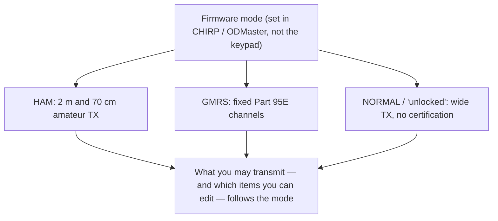

# Menu reference — documented options at a glance

The TIDRADIO TD-H3 hides most of its personality behind a single numbered list. Press `MENU`, and the little colour screen offers item after item with a short label — `Bandwidth`, `Vox Level`, `Tx CTCSS`, `RP-STE` — and the printed manual mostly just lists them without saying what any of it means or which value you should pick. This page is the map: every menu item the official manual documents, in the order the radio shows them, each with a one-line job and a sensible starting value, plus a link to the chapter that tells the whole story.

## Before you trust any number on this page

Two honest warnings, because the TD-H3 is not quite as tidy as a Baofeng UV-5R and pretending otherwise would only trip you up.

**The menu changes with the firmware mode.** The TD-H3 ships in one of two forms — a **HAM** variant (internal model TD831) and a **GMRS** variant (TD831G) — and its firmware is field-switchable between **HAM**, **GMRS** and **NORMAL** (sometimes called "unlocked") modes. That switch is made in the programming software (CHIRP or the manufacturer's ODMaster app), not from a keypad menu, and it changes what the radio may transmit and which per-channel settings you are allowed to edit. On GMRS-locked firmware, for instance, the channel bandwidth and frequency steps are fixed for you. So treat this list as the HAM/NORMAL picture; if an item is greyed out or missing on your unit, the firmware mode is the first thing to check. Why any of this matters — and why transmitting outside your licence is not a small thing — is covered in [Why This Guide](outpost:entry/logbook73.guide.td-h3/overview).

**The item numbers are firmware-specific and single-sourced.** The table below is transcribed from the TD-H3's official user manual as published online. It is the best documented source there is, but TIDRADIO revises firmware often, and different revisions renumber and rename items. Cross-checking against independent sources confirms a handful of anchors — storing a channel is Menu 25, the transmit tones sit at 12 and 13, the repeater offset at 23–24 — but the exact count and the position of the rarer items are not confirmed across two sources. Where the widely-agreed specification and this single manual disagree, this page follows the agreed specification and says so. Read the numbers as a strong guide, not gospel, and trust what your own screen shows.

## How to read this page

Use it two ways: as a **quick reminder** when a cryptic label has you stumped, and as an **index** into the two deep-dive chapters, where every item worth explaining gets the full treatment — what it does, what the radio is doing inside, sensible values, a worked example and the mistakes people make.

The **Set to** column is a starting point, not a rule — an "if in doubt, this" — and each recommendation carries a one-glance verdict:

| Symbol | Meaning                                                    |
| ------ | ---------------------------------------------------------- |
| ✅     | Set it like this and forget it — right for almost everyone |
| ⭐     | Genuinely useful, depending on how you operate             |
| ⚠️     | Advanced — understand it before you enable it              |
| ❌     | Leave it off unless you have a specific reason             |

Where a cell says "taste", "as needed" or "match the repeater", the honest answer is that there is no universal right value — the linked chapter explains how to choose. Recommendations lean towards amateur practice; the reasoning is universal, so wherever you are, take the concept and check your national band plan and licence conditions.

## How the TD-H3 menu works

The menu is a single list of numbered items, driven by just a few keys. The rhythm is the same for every setting:


- **`MENU`** opens the list, opens the highlighted item, and — pressed a third time, on the value — **saves** your choice.
- **`▲` / `▼`** step through the items, and step through an item's values once you are inside it.
- **Number keys** jump straight to an item: keying `2` `5` is far faster than scrolling to Menu 25.
- **`EXIT`** backs out one level and returns you to standby; the menu also times out on its own if you walk away.

Nothing commits until you press `MENU` on the value, so you can browse the whole list without changing a thing — a good way to learn the radio on a wet afternoon.

A few controls live off the menu, as key-combinations from the standby screen. These are drawn from the manual; if a combination does nothing on your unit, note that some are single-sourced and may vary by firmware:

- **Lock the keypad** — hold `*` for more than two seconds; hold again to unlock.
- **FM broadcast radio** — from frequency mode, press `MENU` then the `8` key to drop into the 76–108 MHz broadcast receiver, and the same way out.
- **Send the repeater tone** (the 1750 Hz burst some repeaters need to open) — hold `PTT` together with the lamp key.
- **Start a scan** — hold the scan key for more than two seconds.
- **Emergency alarm** — hold the `SOS` key for about three seconds; whether it sounds locally or transmits depends on the Alarm Mode item below.

## Which firmware mode am I in?

Because the mode governs so much, it is worth a picture. The three modes are not three menus — they are three sets of rules layered over the same menu, deciding what you may transmit and what you may edit.



If you are unsure which mode a unit is in, read it with CHIRP or ODMaster: the operating-mode setting there names it plainly. Programming, and switching modes, is covered in [Getting Started](outpost:entry/logbook73.guide.td-h3/getting-started).

## Find a setting by what you want to do

If you know the _job_ but not the number, start here, then read the item's full entry in the linked chapter.

| I want to…                        | Look at                                                          |
| --------------------------------- | ---------------------------------------------------------------- |
| Quiet the background hiss         | `Squelch` (1)                                                    |
| Turn the transmit power down      | `TX Power` (2)                                                   |
| Match a narrow (12.5 kHz) channel | `Bandwidth` (0)                                                  |
| Set up a repeater                 | `Direction` (23), `Offset` (24), `Tx CTCSS` / `Tx DCS` (13 / 12) |
| Only hear my own group            | `Rx CTCSS` / `Rx DCS` (11 / 10)                                  |
| Stop talking over people          | `Busy Lockout` (21)                                              |
| Stretch the battery               | `Power Save` (3), `Backlight` (5)                                |
| Watch two frequencies at once     | `D.Wait` (9), `TX-SEL` (15)                                      |
| Store or tidy a memory            | `Memory` (25), `Delete` (26)                                     |
| Read the airband or FM broadcast  | `AM_BAND` (48), plus `MENU` + `8`                                |
| Start again from factory defaults | `Reset` (35)                                                     |

## A few honest notes before you dive in

- **Two power levels, not three.** The single manual page lists a third step, but every cross-checked source agrees the TD-H3 switches between **High (rated 5 W)** and **Low** only — there is no genuine medium. Run Low whenever it reaches the other station; it is easier on the battery and kinder to the band. The exact Low figure is genuinely unclear — the manual says 2 W, retail listings say 1 W, an independent bench test measured around 1.6 W — so take "Low ≈ 1–2 W" as the honest range. [RF Power](outpost:entry/logbook73.handbook/rf-power) explains why lowest-that-works is good manners as well as good sense.
- **It is analogue FM only.** For all its "8-band" marketing, the TD-H3 transmits plain narrow/wide FM — there is no DMR, no C4FM, no D-STAR anywhere in this menu. The extra bands are **receive** coverage: FM broadcast, AM airband, and wide VHF/UHF listening.
- **Some items are receive-only or informational.** `AM_BAND`, `Version` and the FM broadcast receiver do nothing for transmit; they shape what you _hear_.
- **The TD-H3 Plus is a different radio.** If a guide mentions Bluetooth PTT or wireless audio, that is the **Plus**. The base TD-H3's Bluetooth does wireless _programming_ only. Don't go hunting the menu for a pairing item that isn't there.

## Menus 0–25 — everyday operating, tones and repeaters

These are the items you actually touch: bandwidth, squelch, power, tones, dual-watch and the repeater settings. Full explanations, item by item, in [The Menu in Depth, Part 1](outpost:entry/logbook73.guide.td-h3/menus-1). Values shown are as the official manual lists them; the confirmed multi-source facts are noted where they differ.

| No. | Item           | What it does                                                                                          | Set to                |
| --- | -------------- | ----------------------------------------------------------------------------------------------------- | --------------------- |
| 0   | `Bandwidth`    | Wide or narrow FM deviation for the channel (Wide ≈ 25 kHz / Narrow ≈ 12.5 kHz)                       | ✅ match the channel  |
| 1   | `Squelch`      | Mutes the background hiss until a signal is strong enough to cross it (0 open … 9 tightest)           | ✅ 3–5                |
| 2   | `TX Power`     | Transmit power — **High (5 W) or Low (≈1–2 W)** only, despite the manual implying a third             | ⭐ Low where it works |
| 3   | `Power Save`   | Receiver battery-save micro-sleep to stretch the charge (Off / 1:1 … 1:8, per the manual)             | ✅ on (e.g. 1:2)      |
| 4   | `Step`         | How far the frequency moves per click (2.5 – 50 kHz list, per the manual)                             | ✅ 12.5 or 25 kHz     |
| 5   | `Backlight`    | How long the display stays lit (Bright / a timed period, per the manual)                              | ⭐ a few seconds      |
| 6   | `Beep`         | The confirmation chirp on each key-press (On / Off)                                                   | ✅ on (taste)         |
| 7   | `Vox Level`    | Transmit hands-free when it hears your voice; number sets sensitivity (Off / 1–5, 1 = most sensitive) | ❌ Off                |
| 8   | `TOT`          | Time-out timer — cuts a transmission that runs on too long (Off / timed)                              | ⭐ a few minutes      |
| 9   | `D.Wait`       | Dual watch — keep an ear on both A and B and receive on whichever wakes up (On / Off)                 | ⭐ on                 |
| 10  | `Rx DCS`       | Only open the squelch when a matching digital code arrives (Off / 105 DCS codes)                      | ⭐ shared channels    |
| 11  | `Rx CTCSS`     | Only open the squelch for a matching analogue sub-tone (Off / 50 CTCSS tones)                         | ⭐ shared channels    |
| 12  | `Tx DCS`       | Send a digital sub-tone on transmit, e.g. to open a repeater                                          | match the repeater    |
| 13  | `Tx CTCSS`     | Send an analogue CTCSS sub-tone on transmit (67.0–254.1 Hz)                                           | match the repeater    |
| 14  | `Voice`        | Speaks menu numbers and actions aloud as you press keys (On / Off)                                    | ❌ off (taste)        |
| 15  | `TX-SEL`       | While dual-watching, which channel the PTT transmits on (Main / Busy)                                 | ⭐ Main               |
| 16  | `Scan Add`     | Add or remove the current channel from the scan list (On / Off)                                       | ⭐ as needed          |
| 17  | `Scan Mode`    | How a scan resumes: on a timer, when the carrier drops, or search-and-hold                            | ⭐ carrier-operated   |
| 18  | `FM-DW`        | Whether FM-broadcast listening interrupts for radio traffic (On / Off) — see note below               | ⭐ taste              |
| 19  | `MDF-A`        | What the A line shows: frequency (with channel number) or name                                        | ⭐ frequency or name  |
| 20  | `MDF-B`        | The same choice for the B line                                                                        | ⭐ frequency or name  |
| 21  | `Busy Lockout` | Refuse to transmit onto a channel already in use (On / Off)                                           | ✅ on                 |
| 22  | `AUTO LK`      | Lock the keypad automatically after a spell with no key-presses (On / Off)                            | ⭐ on                 |
| 23  | `Direction`    | Repeater offset direction (Plus / Minus / None)                                                       | ⭐ None for simplex   |
| 24  | `Offset`       | Size of the repeater duplex shift, in MHz                                                             | ⭐ match band plan    |
| 25  | `Memory`       | Store the current setup into a numbered memory channel                                                | ✅ as needed          |

> **On `FM-DW` (18):** the exact behaviour of this item is described only in the single manual and may differ on your firmware; treat the label as a starting point and confirm on your own unit.

## Menus 26–51 — housekeeping, signalling and the advanced end

The back half handles memory tidying, the alarm, DTMF signalling, display polish and the reset. Many of these you will set once and never revisit. Full explanations in [The Menu in Depth, Part 2](outpost:entry/logbook73.guide.td-h3/menus-2). Several items here are single-sourced from the manual and are flagged as such.

| No. | Item         | What it does                                                                                  | Set to              |
| --- | ------------ | --------------------------------------------------------------------------------------------- | ------------------- |
| 26  | `Delete`     | Delete a stored memory channel                                                                | ⭐ housekeeping     |
| 27  | `Alarm Mode` | What the SOS alarm does: sound locally ("On Site") or transmit it ("TX Alarm")                | ⚠️ understand first |
| 28  | `SEEK CTC`   | Scan a frequency to detect the CTCSS tone in use                                              | ⭐ as needed        |
| 29  | `SEEK DCS`   | Scan a frequency to detect the DCS code in use                                                | ⭐ as needed        |
| 30  | `TAIL`       | Squelch-tail elimination on simplex — trims the noise burst as the other station unkeys       | ✅ on               |
| 31  | `ROGER`      | A "roger" beep at the end of every transmission (On / Off)                                    | ❌ off              |
| 32  | `R-TONE`     | Which repeater-access burst the PTT+lamp combo sends; the manual lists 1750 Hz among them     | ⭐ 1750 Hz          |
| 33  | `Language`   | Display language                                                                              | ✅ your language    |
| 34  | `Hopping RX` | A frequency-hopping option (On / Off) — single-sourced; leave off unless you know you need it | ❌ off              |
| 35  | `Reset`      | Restore defaults (VFO / channels / All, per the manual)                                       | ⚠️ keep a backup    |
| 36  | `SYNC`       | Single-display / dual-band presentation option (On / Off) — single-sourced                    | ⭐ taste            |
| 37  | `PTT-ID`     | Send an identifying code at the start and/or end of a transmission (Off / BOT / EOT / Both)   | ❌ off for ham chat |
| 38  | `DTMFST`     | Whether you hear the DTMF tones as the radio sends them (On / Off)                            | ⭐ taste            |
| 39  | `ANI-ID`     | The radio's automatic ID code (a short digit string)                                          | ⚠️ leave default    |
| 40  | `RP-STE`     | Repeater squelch-tail elimination delay (Off / 1–10)                                          | ⭐ default          |
| 41  | `RPT-RL`     | Repeater squelch-tail delay (Off / 1–10)                                                      | ⚠️ default          |
| 42  | `Version`    | Firmware/software version — read-only                                                         | ✅ information      |
| 43  | `Breath Led` | Standby LED "breathing"/flash behaviour — single-sourced                                      | taste               |
| 44  | `PONMSG`     | Boot screen: off, a welcome message, or an icon                                               | taste               |
| 45  | `MIC GAIN`   | Microphone gain / audio drive (0–9, per the manual)                                           | ✅ mid              |
| 46  | `Scramble`   | Voice-inversion "scramble" — single-sourced; see the caution below                            | ❌ off              |
| 47  | `Dec. code`  | Read out the CTCSS/DCS a nearby signal is using — single-sourced                              | ⭐ as needed        |
| 48  | `AM_BAND`    | Switch the airband (108–136 MHz) to AM demodulation for aviation listening                    | ✅ AM for airband   |
| 49  | `DCD`        | Enable DTMF decoding (On / Off) — single-sourced                                              | ❌ off              |
| 50  | `D-HOLD`     | How long a decoded DTMF display holds before it resets — single-sourced                       | ✅ default          |
| 51  | `D-RSP`      | How the radio responds to a decoded DTMF string (Null / Ring / Reply / Both) — single-sourced | ✅ Null             |

> **On `Scramble` (46):** voice inversion is _not_ encryption in any meaningful sense, and — more importantly — transmitting scrambled or obscured speech is prohibited under most amateur licence conditions. Leave it off on the amateur bands. It is listed here for completeness only.

## Reading the screen while you set things

Half of "using the menu" is reading what the display is telling you afterwards. The TD-H3's colour screen shows both channels at once — frequency, power level (H/L), bandwidth (W/N) and any tone — so a glance confirms your changes took:

```viz
{
  "type": "display",
  "title": "A typical dual-watch screen",
  "caption": "Two channels shown together: the active one (A) sends High-power narrow FM with a CTCSS tone; B waits on Low.",
  "screen": {
    "rows": [
      { "freq": "145.500", "vfo": "A", "power": "H", "bw": "N", "tone": "CT", "mode": "FM", "active": true },
      { "freq": "433.500", "vfo": "B", "power": "L", "bw": "N", "mode": "FM" }
    ],
    "topIcons": ["100%"],
    "bottomTags": ["D.Wait"]
  },
  "callouts": [
    { "n": 1, "x": 12, "y": 30, "label": "Active channel (transmits here)", "side": "left" },
    { "n": 2, "x": 78, "y": 30, "label": "H = high power, N = narrow FM", "side": "right" },
    { "n": 3, "x": 78, "y": 62, "label": "CT = a CTCSS tone is set", "side": "right" }
  ]
}
```

If a change you made in the menu doesn't show here, the usual cause is that you edited it against the wrong channel, or the firmware mode has that item locked — switch to the intended channel and try again.

## The handful that actually matter

Fifty-odd items looks daunting, but day to day only a few move the needle. Get these right and the rest is refinement:

- **`Squelch` (1)** — set it just high enough to silence the hiss and no higher. Too high and you miss weak signals; 3–5 suits most operators. It is the setting you reach for most often.
- **`TX Power` (2)** — run **Low** unless you genuinely need the reach. Easier on the battery, cleaner on the band, and the mark of a considerate operator.
- **`Bandwidth` (0)** — match the channel. Most modern 2 m and 70 cm channels are **narrow** (12.5 kHz); wide on a narrow channel splatters into the neighbours, narrow on a wide one sounds thin. See [modulation](outpost:entry/logbook73.handbook/modulation) for why deviation matters.
- **`Busy Lockout` (21)** — turn it **on**. It stops you keying up on top of a conversation already in progress — the easiest courtesy the radio can enforce for you.
- **`TOT` (8)** — leave it at a few minutes, so a PTT stuck down in your bag drops the transmitter before it holds a repeater hostage.

Everything else is a per-repeater detail (the tone and offset items), a personal preference (backlight, boot screen, beeps) or an advanced feature you will grow into. When one puzzles you, that is what the two deep-dive chapters are for.

## A word on power and exposure

The TD-H3's High setting is a rated 5 watts, held a hand's width from your face. That is a modest amount of RF, but two habits are worth keeping: transmit on **Low** whenever it reaches the other station — it is enough far more often than people expect — and hold the radio so the antenna is a little away from your head rather than pressed against it. Nothing here is alarming at these powers; it is simply the sensible default, the same way you would not stare into a torch you could just as easily angle away.

## Try it yourself

- **Take the safe tour.** From standby, press `MENU` and walk the whole list with `▲`/`▼` — _without_ pressing `MENU` on any value. Nothing changes until you confirm, so this is a risk-free way to see what your firmware actually calls each item and whether the numbers match this page.
- **Prove the number jump.** Press `MENU`, then key `2` `5`. If you land on the memory-store item, your unit follows the documented numbering; if not, jot down where you landed — that tells you your firmware has renumbered, and to trust your screen over the table.
- **Set the five that matter.** Work down the shortlist above — `Squelch` to 3–5, `TX Power` to Low, `Bandwidth` to match a local channel, `Busy Lockout` on, `TOT` to a few minutes — and log the before/after in your [LogBook73](outpost:entry/logbook73.handbook/getting-licensed) notes so you can undo anything you dislike.
- **Confirm your firmware mode.** Read the radio with CHIRP or ODMaster and find the operating-mode setting. Knowing whether you are in HAM, GMRS or NORMAL explains most "why is this item locked?" puzzles before they start.

## Key takeaways

- The official manual numbers the TD-H3 menu roughly **0–51**, but the numbers are firmware-specific and single-sourced — trust your own screen where it differs, and re-check after any firmware change.
- Drive the menu with **`MENU` → scroll or key the number → `MENU` → `▲`/`▼` → `MENU` to save**, `EXIT` to back out; nothing commits until you confirm, so browsing is safe.
- The **firmware mode (HAM / GMRS / NORMAL)** — set in CHIRP or ODMaster, not the keypad — governs what you may transmit and which items you can edit; check it first when something is locked.
- It is **analogue FM only**: the "8 bands" are receive coverage (FM broadcast, AM airband, wide listening), not extra transmit modes, and Bluetooth PTT belongs to the **Plus**, not the base H3.
- Power is **High (5 W) or Low (≈1–2 W)** — two levels only, despite the manual implying a third; the exact Low figure is genuinely disputed across sources.
- The five worth burning into memory: **`Squelch` 3–5, `TX Power` Low, `Bandwidth` to match the channel, `Busy Lockout` on, `TOT` a few minutes**.

Ready for the detail? Start with the everyday settings in [The Menu in Depth, Part 1](outpost:entry/logbook73.guide.td-h3/menus-1).
