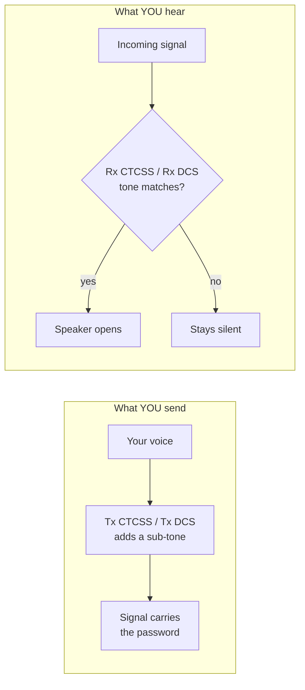

# The menu in depth, part 1

The TD-H3's colour screen shows you more than most budget handhelds, but the menu behind it still runs to roughly fifty numbered items, each named in a few cramped characters — you scroll to `SQL` or `W/N` and the radio assumes you already know what that means. This chapter decodes the half of that list you touch day to day: squelch, step, transmit power, the battery saver, bandwidth, dual watch, and the tones that open repeaters. For each substantial item we answer what the manual never does — what it does, what is happening inside, why the feature exists, sensible values, a recommendation, a worked example, the common mistakes, and whether to change it at all.

You met the mechanics in [Getting Started](outpost:entry/logbook73.guide.td-h3/getting-started): press **MENU**, type the item number or scroll with the arrows, **MENU** to open it, arrows to change the value, **MENU** to save, and the back/EXIT key to leave. Nothing in this chapter can harm the radio. For a one-line-per-item overview first, see the [Menu Reference](outpost:entry/logbook73.guide.td-h3/menu-reference); this is the first of two deep-dive chapters, and [The Menu in Depth, Part 2](outpost:entry/logbook73.guide.td-h3/menus-2) covers the rest — display, memory, scanning, repeater tails and the DTMF signalling tail.

## A note on menu numbers

The menu numbers below are taken from TIDRADIO's own user manual, and two independent copies of that manual agree on the ones that matter (transmit power at `2`, power save at `3`, VOX at `7`, receive CTCSS at `11`, transmit DCS at `12`). But the TD-H3 is **field-switchable between HAM, GMRS and NORMAL ("unlocked") firmware modes**, and firmware revisions have been known to renumber or rename items. Treat the numbers as a reliable map, not gospel — if `4` is not step on your unit, the _name_ still is. When your screen and this page disagree, trust the name over the number and tell us which firmware you are on.

## How to read these pages

Each substantial item carries a one-glance verdict:

| Symbol | Meaning                                                    |
| ------ | ---------------------------------------------------------- |
| ✅     | Set it like this and forget it — right for almost everyone |
| ⭐     | Genuinely useful, depending on how you operate             |
| ⚠️     | Advanced — understand it before you enable it              |
| ❌     | Leave it off unless you have a specific reason             |

Two honesty notes. The TD-H3 is **analogue FM only** — there is no DMR, D-STAR or Fusion hiding in here, so every setting below concerns plain FM voice (plus AM and broadcast _receive_). And a handful of exact values in the manual are single-source: where the manufacturer's figures are not independently confirmed, this page says so rather than pretend to a precision the paperwork does not support.

## The four you reach for daily: squelch, step, power, save

### 1 · SQL — squelch level — ✅ 2–3

The control that silences the background hiss when no one is talking.

- **Does:** sets how strong a signal must be before the speaker opens. A low number leaves the channel wide open (constant hiss); a high number clamps so tightly that only a strong local signal gets through.
- **Inside:** the receiver measures the channel noise; squelch is a gate that mutes the audio below your threshold and opens it above. It is receive-only — it changes nothing you transmit.
- **Why it exists:** an FM receiver with no signal produces a loud, tiring hiss. Squelch mutes that between overs so the radio sits quiet until something arrives.
- **Values:** the manual lists **ten levels, `0`–`9`** (`0` = fully open). This exact count is stated by the manufacturer manual only, so if your firmware shows a different range, go by feel rather than the number.
- **Recommendation:** ✅ **Start at `2` or `3`.** Drop to `1` to chase weak signals on a quiet band; nudge up one step at a time until the hiss just stops, and no further.
- **Example:** on a hilltop straining for a faint simplex station, `SQL 1` lets them break through; back home beside a busy road, `SQL 4` keeps the radio silent between overs.
- **Common mistakes:** cranking it to `8`–`9` "to stop the hiss", then missing the weak repeater you could otherwise just hear. Hold the monitor/side key to force the squelch fully open when you want to listen underneath it.
- **Related:** the receiver's overload behaviour in [Overload & Ghost Signals](outpost:entry/logbook73.handbook/overload-and-ghost-signals).
- **Should you change it?** Yes — find your setting once by ear, then leave it.

### 4 · STEP — frequency step — ✅ match the service

How far the frequency moves for each press of the arrows in VFO (frequency) mode.

- **Does:** sets the tuning increment per arrow press.
- **Inside:** the synthesiser lands on a grid of frequencies; the step is that grid's spacing. It does **not** change your transmit bandwidth (that is menu `0`, `W/N`) — only where the dial stops.
- **Why it exists:** different services lay their channels on different grids; match the grid and every channel lands exactly on frequency.
- **Values:** the manual lists **`2.5` / `5` / `6.25` / `10` / `12.5` / `25` kHz** (some firmware builds add larger steps). The exact set is single-source, so glance at your own list. One honest limit worth flagging: the published list does **not** include an **8.33 kHz** step, so the European VHF airband's 8.33 kHz channels cannot be tuned dead-on — fine for casual listening, but it will not land exactly on every one.
- **Recommendation:** ✅ **`12.5` kHz** for the modern 2 m and 70 cm amateur bands; `25` kHz for a few legacy allocations.
- **Example:** a `12.5` kHz step lands exactly on the 2 m calling frequency `145.500` MHz; a `25` kHz step from `145.000` skips straight past channels you wanted.
- **Common mistakes:** blaming a "deaf" radio for missing a repeater when the real fault is a step that never lands right.
- **Related:** menu `0` `W/N` — bandwidth, a different thing entirely.
- **Should you change it?** Yes, to suit whatever you tune; `12.5` kHz is the home setting for amateur work.

### 2 · TXP — transmit power — ⭐ the lowest that works

Chooses between the radio's two power levels.

- **Does:** switches between **High** and **Low**. Both TIDRADIO's spec and independent reviews confirm **two levels only** — there is no distinct "mid".
- **Inside:** it changes how hard the final amplifier is driven. More power means a stronger signal at the far end — but a flatter battery, a warmer radio, and more of your signal spilling where you would rather it did not.
- **Why it exists:** you rarely need full power. Through a nearby repeater a watt is plenty; reaching a distant hilltop, you want everything the radio has.
- **Values:** High is rated at **5 W**. The **Low** figure is genuinely unclear: the manufacturer manual states **2 W**, retail listings say **1 W**, and one independent bench test measured about **1.6–1.75 W**. Sources disagree, so treat Low as _"roughly 1–2 W"_ and do not expect the "8 W" some marketing implies — the high setting is around 5 W, no more. See [RF Power](outpost:entry/logbook73.handbook/rf-power).
- **Recommendation:** ⭐ **Run Low wherever it works, High only when you must** — the single most useful habit of a considerate operator. It saves battery, keeps the radio cooler against your head, and spreads less energy around the band.
- **Example:** a repeater three miles away lifts you full-quieting on Low, so you stay Low all day; a simplex station 20 miles off reports you noisy, so you switch to High for that conversation only.
- **Common mistakes:** leaving High on permanently "to be safe", flattening the battery by lunchtime for no gain on channels that were fine on Low.
- **Related:** the firmware mode (HAM / GMRS / NORMAL) sets _what_ you may transmit; power only sets _how hard_. Keep both within your licence.
- **Should you change it?** Constantly. Treat Low as your default and High as a deliberate choice.

> **A word on RF exposure.** At a few watts into a handheld antenna the risk is small, but it is not zero, and the antenna is close to your head. The simple, effective habits are the two this page already recommends: use the **lowest power that does the job**, and hold the radio so the antenna is a little away from your face rather than pressed against it. More in [RF Power](outpost:entry/logbook73.handbook/rf-power).

### 3 · SAVE — battery saver — ✅ 1:2 or 1:3

Lets the receiver doze between checks to stretch the battery.

- **Does:** micro-sleeps the receiver while idle, waking briefly to check for a signal. The ratio sets sleep versus listen; a higher ratio saves more.
- **Inside:** rather than listening continuously, the radio powers the receiver down for a fraction of a second, wakes, samples the channel, and sleeps again. The catch: a call arriving _during_ a sleep window is not heard until the next wake, so the very start of a transmission can be clipped.
- **Why it exists:** idle listening dominates a handheld's battery drain, so this adds real standby time from the 2500 mAh pack for a setting you never notice.
- **Values:** the manual lists **Off / `1:1` / `1:2` / `1:3` / `1:4` / `1:8`** (this exact set is single-source). Higher ratios sleep longer between checks.
- **Recommendation:** ✅ **`1:2` or `1:3`** for everyday monitoring. Set it **Off** only when catching the very first syllable matters — net control, or listening for brief calls.
- **Example:** on `1:3` you occasionally hear a call start as "…nyone about?" because the first word landed in a sleep window.
- **Common mistakes:** chasing a phantom "the radio keeps missing the start of calls" fault when the cure is simply turning SAVE off.
- **Related:** dual watch (menu `9`) reduces the benefit, because the radio is already busy hopping between two lines.
- **Should you change it?** Set `1:2` and leave it; Off only for critical listening.

## Bandwidth and the daily switches: W/N, VOX, backlight, beep, dual watch, TOT

### 0 · W/N — wide / narrow bandwidth — ✅ match the channel

Sets how much room your FM signal takes up — and how the radio expects incoming signals to sound.

- **Does:** switches between **Wide** and **Narrow**, for both transmit and receive.
- **Inside:** FM carries your voice as swings in frequency; _deviation_ is how far the carrier swings. Wide swings roughly twice as far as narrow — louder, fuller audio, but twice the spectrum. On receive, the setting sets how wide a slice the radio listens to. See [Modulation](outpost:entry/logbook73.handbook/modulation).
- **Why it exists:** as bands filled, many services halved their channel spacing to fit twice the channels — so the radio must do both, and match the other station.

```viz
{
  "type": "spectrum",
  "title": "Wide vs narrow FM — the same voice, half the width",
  "caption": "The manual gives Wide = 25 kHz and Narrow = 12.5 kHz. Wide fills twice the room; match your setting to the channel or the audio comes out wrong.",
  "xLabel": "Channel width",
  "components": [
    { "f": 30, "amp": 0.85, "width": 24, "label": "WIDE — 25 kHz", "tone": "primary" },
    { "f": 72, "amp": 0.85, "width": 10, "label": "NARROW — 12.5 kHz", "tone": "ink" }
  ],
  "noiseFloor": 0.04
}
```

- **Values:** the manual gives **Wide = 25 kHz**, **Narrow = 12.5 kHz**.
- **Recommendation:** ✅ **Match the channel.** Modern amateur repeaters and simplex on the `12.5` kHz grid want **Narrow**; some legacy `25` kHz allocations want **Wide**. Licence-free services are fixed by regulation — [PMR446](outpost:entry/logbook73.handbook/uhf) is **Narrow**, and if you run the GMRS firmware, most GMRS channels are Wide while the low-power "interstitial" ones are Narrow. When in doubt on the amateur bands, Narrow is the safer modern default.
- **Example:** set Wide on a narrow repeater and your voice over-deviates — loud, distorted, splattering the channel above; switch to Narrow and it cleans up. Reversed, a narrow radio on a wide station sounds quiet and muffled.
- **Common mistakes:** transmitting Wide on PMR446 (illegal and rude); leaving everything Wide because "louder is better".
- **Related:** menu `4` `STEP` (the channel _grid_, a separate idea).
- **Should you change it?** Yes — store it correctly in each memory so you never think about it again.

### 7 · VOX — voice-operated transmit — ❌ normally off

Makes the radio transmit when it hears your voice, so you can talk hands-free.

- **Does:** above `Off`, the radio keys up when your voice crosses a loudness threshold and drops when you go quiet — no PTT.
- **Inside:** an audio-level detector watches the microphone; cross the threshold and the firmware keys the transmitter, then un-keys after a short built-in hang. The TD-H3 gives you one control — sensitivity — with no separate delay setting.
- **Why it exists:** genuine hands-free use — driving, climbing, both hands busy — and headset operation.
- **Values:** **Off, `1`–`5`** (six settings in all). On the TD-H3, **level `1` is the most sensitive** and `5` the least — the reverse of what you might guess, and confirmed across sources, so read it as "1 = hair-trigger".
- **Recommendation:** ❌ **Leave Off for general use.** VOX transmits without you deciding to, which on shared channels and repeaters annoys people — it sends background noise, wind, or half a conversation in the room, and it does **not** listen first, so it doubles straight over a station already talking.
- **Example:** a cyclist with an earpiece-and-boom headset sets VOX to `4` to answer without letting go of the bars; indoors at `1` the same radio keys every time a door closes.
- **Common mistakes:** leaving it on and wondering why the radio keys when you cough; setting it most-sensitive "so it always catches me" and transmitting every rustle.
- **Related:** a proper headset makes VOX far more usable than the built-in microphone.
- **Should you change it?** Only with a specific hands-free need and a decent headset.

### 5 · Backlight — screen timer — ✅ a few seconds

How long the colour screen stays lit after a keypress. The manual lists **Bright** (always on) plus a timed auto-off in the region of **1–30 seconds** (the exact range is single-source, so check your unit). The backlight is a steady drain on any handheld, so the radio lights it on activity and drops it to save power. ✅ **A few seconds** is a comfortable read without wasting much; choose the longest timeout only if you struggle to read it in time. A minor taste setting — pick once.

### 6 · Beep — keypad beep — ✅ On

The confirmation tone on each keypress. **On** gives useful feedback that a press registered (handy with gloves or in the dark); **Off** for silent operation on a quiet net. Purely taste — leave it On while you learn the radio.

### 9 · D.Wait — dual watch — ⭐ useful, with one trap

Lets the radio keep half an ear on both frequency lines at once.

- **Does:** when On, the receiver hops between the two on-screen lines (A and B) so it catches a call on either.
- **Inside:** the radio time-shares its single receiver, sampling each line many times a second; when one goes active it parks there for the conversation, then resumes hopping. It is **not** two receivers — two signals arriving at once still collide.
- **Why it exists:** you often want to watch two things — your repeater _and_ the calling channel — from one set.
- **Values:** Off / On.
- **Recommendation:** ⭐ **On** when you genuinely want two channels; Off for simplicity and slightly better battery life. **The trap:** which line the PTT transmits on can catch you out — an incoming call on the _other_ line can leave you keying up in the wrong place. The governing setting, **`15 TX-SEL`** (Main / Busy channel), lives in [Part 2](outpost:entry/logbook73.guide.td-h3/menus-2); until then, glance at the active-line marker before you key.
- **Example:** line A on `145.500` MHz, line B on your local repeater, dual watch on, and the radio watches both while you make coffee.
- **Common mistakes:** transmitting on the wrong line after an incoming call moved the radio's attention; expecting true simultaneous reception.
- **Related:** `15 TX-SEL` in [Part 2](outpost:entry/logbook73.guide.td-h3/menus-2); menu `18 FM-DW` governs dual watch while the broadcast FM radio plays.
- **Should you change it?** On when you need it, off when you do not — and learn `TX-SEL` before relying on it.

### 8 · TOT — transmission time-out timer — ⭐ set the ceiling

Cuts off an over-long transmission automatically.

- **Does:** limits continuous transmit time; reach the set value and the radio stops and beeps, even with the PTT held.
- **Inside:** a countdown starts when you key up and resets when you release. Hit zero and the firmware un-keys the transmitter regardless.
- **Why it exists:** a stuck or accidentally-pressed PTT (a radio sat on in a bag) would otherwise hold a channel or repeater open indefinitely — the classic "stuck mic" — and on repeaters it discourages hogging the channel.
- **Values:** the manual shows fairly short options (it lists values such as **15 / 30 / 45 seconds**); the full range is single-source, so check what your firmware actually offers.
- **Recommendation:** ⭐ **Set the longest value your radio offers** that is still comfortably shorter than you would ever hold a single over — long enough not to clip you mid-sentence, short enough to catch a stuck PTT. Many repeaters run their own timer too; treat this as your back-stop.
- **Example:** with the timer set, a radio pressed against a car seat with the PTT down cuts after its set interval rather than jamming the repeater all afternoon.
- **Common mistakes:** setting it so short that it cuts you off in the middle of a normal over.
- **Related:** repeater etiquette in [Best Practices](outpost:entry/logbook73.guide.td-h3/best-practices).
- **Should you change it?** Yes — pick a sensible ceiling once; it is a safety net you hope never to hear.

## The tone quartet: Rx DCS, Rx CTCSS, Tx DCS, Tx CTCSS

Menus `10`–`13` are four faces of one idea, and they cause more confusion than anything else on the radio — so it is worth slowing down. All four concern a quiet **sub-tone** riding under your voice that a radio uses as a password. There are two systems and two directions. **CTCSS** (Continuous Tone-Coded Squelch System) sends a single low pitch — one of **50 standard tones from `67.0` to `254.1` Hz**, down at the bottom of the audio range and filtered out before it reaches the speaker — continuously under your speech. **DCS** (Digital-Coded Squelch) does the same job with a slow digital code (**105 codes**, each with a Normal `N` or Inverted `I` variant, written `D023N`, `D754I`…). And the direction matters:

- **Tx** (transmit) menus add the tone or code to what **you send** — how you open a repeater that demands an access tone.
- **Rx** (receive) menus keep your radio **silent unless** an incoming signal carries the tone or code you set — "tone squelch", so your speaker stays quiet through everyone else on a shared channel.



The everyday case is a [repeater](outpost:entry/logbook73.handbook/repeaters). Most repeaters need a **CTCSS access tone** to open — a specific pitch for your area — so you set **`13 Tx CTCSS`** to that tone and your radio quietly sends it whenever you transmit. You usually leave the _receive_ tone (`11 Rx CTCSS`) **off**, so you still hear everything the repeater sends back. The tone your repeater wants is published in your national society's repeater listing (the RSGB directory in the UK, the ARRL / RepeaterBook and similar elsewhere) — and because tones are assigned by area, a repeater 50 miles away may want a different one.

### 11 · Rx CTCSS — receive CTCSS (tone squelch) — ⭐ for busy shared channels

Keeps your speaker silent unless an incoming signal carries the matching sub-tone.

- **Does:** sets a tone (`67.0`–`254.1` Hz) that an incoming signal _must_ carry for your squelch to open; signals without it stay muted even though the radio can hear them.
- **Inside:** on top of the ordinary noise-squelch the radio adds a tone detector — both gates must pass, enough signal _and_ the right tone. The tone is filtered out of the audio, so you never hear it.
- **Why it exists:** on a channel shared by several groups, tone squelch lets you sit quietly through everyone else's traffic and be alerted only when _your_ group calls. It gives **no privacy** — anyone can still hear you — it only manages what your speaker bothers you with.
- **Values:** Off / the 50 standard tones, `67.0`–`254.1` Hz.
- **Recommendation:** ⭐ **Off for general listening**; set it to match when a shared or noisy channel drives you mad with unwanted traffic. Never set it on a calling channel, where you _want_ to hear everyone.
- **Example:** a work party agrees on `88.5` Hz; `Rx CTCSS 88.5` keeps your radio quiet through a neighbouring group on the same PMR446 channel and opens only for your team.
- **Common mistakes:** setting a receive tone then thinking the radio is "dead" because nothing is sending it; confusing it with encryption — it offers no privacy.

```viz
{
  "type": "spectrum",
  "title": "The CTCSS sub-tone hides below your voice",
  "caption": "A continuous 67-254 Hz tone sits beneath the 300-3000 Hz speech band; the far radio checks for it but filters it out of what you hear.",
  "xLabel": "Audio frequency (0-3.4 kHz)",
  "components": [
    { "f": 3, "amp": 0.55, "width": 2, "label": "CTCSS tone (67-254 Hz)", "tone": "success" },
    { "f": 50, "amp": 0.85, "width": 44, "label": "Your voice (300-3000 Hz)", "tone": "primary" }
  ],
  "noiseFloor": 0.04
}
```

### 13 · Tx CTCSS — transmit CTCSS — match the repeater

Sends a sub-tone with everything you transmit.

- **Does:** adds a chosen CTCSS tone (`67.0`–`254.1` Hz) under your transmitted audio.
- **Inside:** the radio mixes a low, steady tone beneath your voice; a repeater set for tone access responds only if it is present and correct.
- **Why it exists:** repeaters use a required access tone so they are not triggered by noise, distant co-channel signals or interference — only the right tone wakes them.
- **Values:** Off / `67.0`–`254.1` Hz.
- **Recommendation:** **Set it to the tone your repeater requires**, from its published listing. Get it right once and store it _in the memory_ so it travels with the frequency.
- **Example:** a repeater requires `71.9` Hz, so `Tx CTCSS 71.9` makes it relay you; get the tone wrong and it ignores you, even with a perfect signal.
- **Common mistakes:** setting `Rx CTCSS` instead of `Tx CTCSS` and wondering why the repeater never opens.
- **Related:** an older way in to some Region-1 repeaters is a **1750 Hz tone burst** — a momentary tone, not the continuous CTCSS these menus produce. The TD-H3's `R-TONE` menu (in [Part 2](outpost:entry/logbook73.guide.td-h3/menus-2)) selects the burst frequency, and the manual describes sending it by holding the **PTT together with the lamp/flashlight key**; check that combination on your own unit before you rely on it.
- **Should you change it?** Yes, per repeater — and let your programming software store it in each memory.

### 10 · Rx DCS and 12 · Tx DCS — the digital versions — ⭐ if the channel uses them

`Rx DCS` and `Tx DCS` are the DCS equivalents of the two CTCSS menus above, used identically — `Rx DCS` is receive-side tone squelch, `Tx DCS` is what you send. The only difference is the coding: instead of a single pitch, DCS sends a continuous low-speed digital word, written with an `N` (Normal) or `I` (Inverted) suffix — `D023N`, `D754I`. A radio set for one system will not answer the other, so a channel is either CTCSS or DCS, never both. In amateur practice CTCSS dominates on repeaters; you meet DCS mostly on commercial and some licence-free setups. ⭐ Use only when the channel specifies a DCS code; otherwise leave Off. **Never set both a CTCSS and a DCS tone on the same line**, and never mix a code's `N` and `I` versions — they are not interchangeable.

## Try it yourself

- **Find your squelch threshold by ear.** Tune to a quiet part of the 2 m band, set `1 SQL` to `0`, and listen to the raw hiss. Step it up one level at a time until the hiss just disappears — that number, usually `2`–`3`, is your everyday setting. Now hold the monitor key and hear the channel open up again underneath it.
- **Prove the wide/narrow difference.** Ask a friend on a nearby simplex frequency to listen while you send one over on `0 W/N = Wide`, then repeat it on `Narrow`. They will hear the wide over as louder and the narrow one as quieter and cleaner — that is deviation in action.
- **Set up one repeater properly.** Look up a local repeater in your national society's directory, note its frequency, offset and CTCSS tone, and set `13 Tx CTCSS` to that tone. Key up and listen for the repeater's tail. Then log the contact in LogBook73 so you have a record of a channel that works.

## Key takeaways

- The four you touch daily: **`1 SQL`** (set by ear, `2`–`3`), **`4 STEP`** (`12.5` kHz for amateur work; there is no 8.33 kHz airband step), **`2 TXP`** (two levels only — run Low, High only when needed), **`3 SAVE`** (`1:2`–`1:3`, off when the first syllable matters).
- **`0 W/N`** must match the channel — Narrow for modern repeaters and PMR446, Wide for legacy 25 kHz — or the audio comes out distorted or muffled.
- **`7 VOX`** counts backwards — level `1` is the _most_ sensitive — and is best left Off unless you have a proper headset. **`8 TOT`** is your stuck-mic safety net; set a sensible ceiling.
- **`9 D.Wait`** dual watch is handy but has a "which line transmits" trap; learn `15 TX-SEL` in [Part 2](outpost:entry/logbook73.guide.td-h3/menus-2) before relying on it.
- The tone quartet (`10`–`13`) is one idea in two systems and two directions: **Tx** adds a password to what you send (your repeater's access tone), **Rx** silences your speaker until it hears one; CTCSS is a single pitch (50 tones), DCS a digital code (105 codes) — never mix them.
- Two figures the manual is coy about: **Low power is only "roughly 1–2 W"** (sources disagree), and several exact value lists are single-source — so trust your own screen where it differs from the paperwork.
- Above all: lowest power that works, correct bandwidth, tones stored in each memory.

With the everyday half of the menu decoded, we can tackle the rest — display colours, memory management, scanning, repeater tails, the alarm and the DTMF signalling tail — in [The Menu in Depth, Part 2](outpost:entry/logbook73.guide.td-h3/menus-2).
