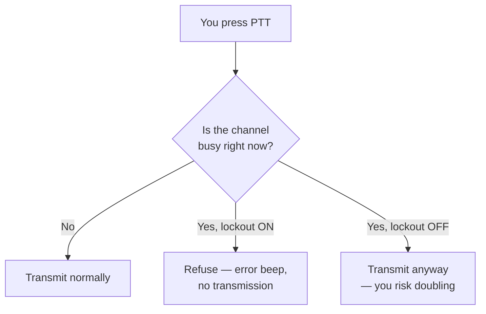
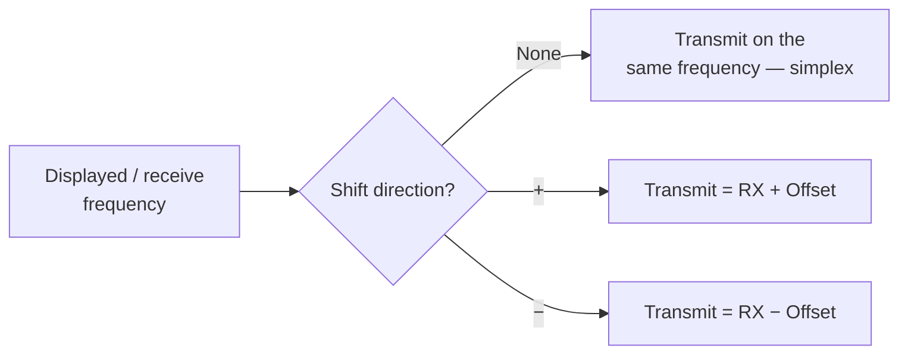
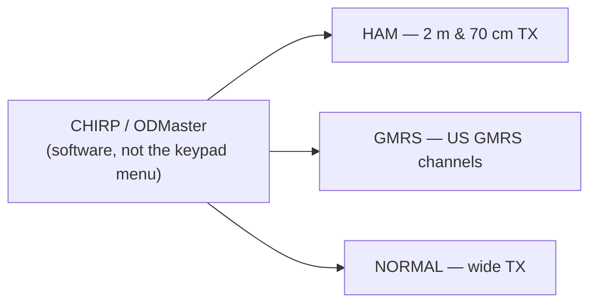

# The menu in depth, part 2

The second half of the TD-H3's menu is the housekeeping half: what the colour screen shows you, how the radio guards a channel someone else is already using, how it works out a repeater's transmit frequency, how you fold all of that into a memory, and the handful of finishing touches — backlight, roger beep, alarm, reset. None of it is glamorous, but three or four of these settings are the difference between a radio that behaves and one that surprises you. As in [the first half of the menu](outpost:entry/logbook73.guide.td-h3/menus-1), every substantial item gets the full treatment and the trivial on/off ones get a line — and, as ever in this guide, where the sources disagree we say so rather than invent a tidy answer.

## A word about menu numbers on this radio

One honest warning shapes this whole chapter: **the TD-H3's menu numbering is not stable across sources.** The two published manuals we can check disagree — one numbers the display-mode item at 19/20, the other puts a "display mode" at 36 — and only a couple of items (the repeater shift **direction** and the **store-to-memory** action) carry the same number in both. The numbering can also shift between firmware versions and modes.

So this chapter leads with each item's **name and behaviour**, which are consistent, and treats the number as a hint, not gospel. Scroll your own menu and read the labels; trust what your radio shows over any number printed here. This is exactly the soft ground the [menu reference](outpost:entry/logbook73.guide.td-h3/menu-reference) flagged.

Each item also carries a one-glance verdict, the same key used throughout the guide:

| Symbol | Meaning                                                    |
| ------ | ---------------------------------------------------------- |
| ✅     | Set it like this and forget it — right for almost everyone |
| ⭐     | Genuinely useful, depending on how you operate             |
| ⚠️     | Advanced — understand it before you enable it              |
| ❌     | Leave it off unless you have a specific reason             |

To reach any item, press **MENU**, move to it with the arrow keys, press **MENU** to open it, choose a value, and press **MENU** again to save; **EXIT** backs out without saving. The tidy workflow that runs through this half of the menu is the standard one for radios of this class: **build a channel in frequency (VFO) mode — its shift, offset, tones, bandwidth and power — then store the finished result into a memory.** Several items below only make sense in that light.

Here is the block at a glance:

| Item          | What it does                                    | Verdict          |
| ------------- | ----------------------------------------------- | ---------------- |
| MDF-A / MDF-B | Each row shows frequency or channel name        | ⭐ taste         |
| Busy Lockout  | Refuse to transmit onto an already-busy channel | ✅ ON (simplex)  |
| Auto lock     | Auto-lock the keypad after a pause              | ⭐ ON portable   |
| Direction     | Repeater shift direction (None / + / −)         | ⭐ per repeater  |
| Offset        | Size of the repeater shift, in MHz              | ⭐ per band plan |
| Memory        | Store the current VFO into a memory             | ✅               |
| Delete        | Delete a stored memory                          | ⭐ housekeeping  |
| Backlight     | Screen backlight and its timeout                | ⭐ taste         |
| Roger         | Roger beep at end of transmission               | ❌ OFF           |
| R-TONE        | Repeater burst-tone frequency                   | ⭐ 1750 Hz       |
| Alarm / SOS   | What the emergency alarm does                   | ⚠️               |
| Reset         | Restore defaults (VFO / CH / ALL)               | ⚠️               |
| PONMSG        | Power-on message                                | taste            |
| Mode switch   | HAM / GMRS / NORMAL — set in software, not here | ⚠️               |

## What each row shows — MDF-A and MDF-B

The TD-H3 can show two channels at once, an upper (A) and a lower (B) row. These two settings decide, independently, how each row labels its channel.

### MDF-A / MDF-B — ⭐ show frequency or name

- **Does:** independently sets whether the upper row (`MDF-A`) and the lower row (`MDF-B`) display, for the channel you are on, its **frequency** or its **name**. The manual lists just those two choices, so unlike some radios there is no separate "channel number" display option.
- **Inside:** nothing electrical changes — this is purely how a stored channel is drawn on the colour screen. A memory always holds its frequency; a name is optional extra text on the slot.
- **Why it exists:** operators think differently — some recognise a channel by its frequency, some by a name like `GB3xx`. Two independent rows let you have it both ways: a name on top, the raw number underneath.
- **Values:** frequency / name.
- **Recommendation:** ⭐ **frequency** while you are learning — seeing `145.500` as you scroll teaches you the band — then **name** once your channels are named.
- **Common mistakes:** setting a row to name and seeing a blank, because names are typically written by programming software ([CHIRP or ODMaster](outpost:entry/logbook73.guide.td-h3/getting-started)), not typed on the keypad. If you have never run software against the radio, name has nothing to show.
- **Should you change it?** A matter of taste — pick it once to suit how your brain files channels.

## Guarding the channel — Busy Lockout and Auto lock

### Busy Lockout (BCL) — ✅ ON for simplex

Refuses to let you transmit on top of a conversation already in progress.

- **Does:** when on, if the channel is currently busy — the squelch is open on a signal — pressing PTT does nothing but beep. As soon as the channel is clear, PTT works normally.
- **Inside:** the transmit routine first asks the receiver "is the squelch open right now?" If yes, it declines to key up and sounds a short error tone; if no, it transmits as usual.
- **Why it exists:** on a simplex channel you hear only one side of a distant conversation, so it is easy to key up blindly across someone you cannot hear and "double" — two stations transmitting at once, both unreadable. Busy Lockout checks the channel is free before it lets you speak.



- **Values:** off / on.
- **Recommendation:** ✅ **ON** for simplex channels — good manners in a single setting, and it costs you nothing.
- **Worked example:** you are on a 2 m calling frequency and someone just out of your range is mid-over. With the lockout on, your PTT beeps and refuses until they finish, so you never transmit across them. With it off, you would happily key up over a conversation you could not hear.
- **Common mistakes:** relying on it for **repeater** channels. A repeater is busy the instant it transmits back to you, so the lockout can refuse to let you use a machine that is legitimately answering. Turn it off on repeater memories and keep it on for simplex.
- **Related:** squelch (in [menus-1](outpost:entry/logbook73.guide.td-h3/menus-1)), whose "is the channel busy?" decision this feature reuses; the time-out timer, its housekeeping cousin, which caps how long a single transmission may last.
- **Should you change it?** Yes — on for simplex, off for repeaters, then forget it.

### Auto lock — automatic keypad lock — ⭐ ON portable

Locks the keypad on its own after a spell with no key-presses.

- **Does:** when on, the keypad locks itself after a period of inactivity, so a stray press in your pocket or bag cannot change anything. A padlock icon appears on the screen.
- **Inside:** an idle timer resets on every key-press; when it expires, the firmware ignores further keys until you unlock — exactly what the manual keypad lock does on demand.
- **Why it exists:** a handheld lives in a pocket, and the number keys will happily retune the VFO, wind up the power or start a scan if something leans on them. Auto-lock is the seatbelt.
- **Values:** off / on.
- **Recommendation:** ⭐ **ON** for anyone carrying the radio on a belt or in a bag. Leave it off only if the radio sits on a desk and the constant unlocking becomes a nuisance.
- **How to unlock:** the TD-H3's manual keypad lock is a **long press of the `*` key (hold it for more than two seconds)**; the same gesture releases the lock. So if the keypad seems "dead", it has almost certainly locked itself — hold `*` to free it. The PTT, the knob and the torch keep working whether the keypad is locked or not.
- **Related:** the manual `*`-hold lock (the same protection, on demand); the VFO controls it guards.
- **Should you change it?** Turn it on for portable use and leave it.

## The repeater shift — Direction and Offset

These two settings together are how the TD-H3 transmits on one frequency while it listens on another — the trick that lets you work a [repeater](outpost:entry/logbook73.handbook/repeaters). You set them in frequency (VFO) mode and then store the result as a memory. Encouragingly, the **shift direction is one of the very few items both published manuals number identically** (around menu 23), so it is a rare fixed point in the numbering.



### Direction — shift direction — ⭐ per repeater

- **Does:** tells the radio to transmit **above** (`+`) the frequency you are listening on, **below** it (`−`), or on the **same** frequency (None) for a simplex contact.
- **Inside:** on transmit the radio adds or subtracts the offset value; on receive it sits on the displayed frequency. Direction only chooses the sign of that jump.
- **Why it exists:** a repeater listens on one frequency and re-transmits on another a fixed distance away, so your radio has to mirror that split without you retuning by hand mid-over.
- **Values:** none / + / −.
- **Recommendation:** ⭐ **None** for simplex. For repeaters, follow your band plan: in many Region 1 countries that is **−** on 2 m and **+** on 70 cm, but the sense varies by region — [check your national band plan](outpost:entry/logbook73.handbook/repeaters).
- **Common mistakes:** leaving a shift set on a simplex channel, so you transmit off-frequency and nobody answers; picking `+` where your band plan wants `−`.
- **Related:** Offset (below); the transmit CTCSS/DCS tone in [menus-1](outpost:entry/logbook73.guide.td-h3/menus-1), since most repeaters also need an access tone.
- **Should you change it?** Only when adding a new repeater by hand — a stored memory then remembers the direction for you.

### Offset — the size of the shift — ⭐ per band plan

- **Does:** sets how far, in MHz, the transmit frequency moves from the receive frequency when Direction is `+` or `−`. Direction chooses the sign; Offset chooses the distance. It has no effect while Direction is None.
- **Why it exists:** every band standardises its repeater spacing, and the radio needs the exact figure to land on the repeater's input.
- **Values:** entered by keypad in MHz. The manual gives a very wide range — roughly `00.00000` up to about `69.99750` MHz — with fine step resolution, so you type the magnitude you need.
- **Recommendation:** ⭐ take the number from the repeater's own listing. Common figures are **0.6 MHz** on 2 m and, on 70 cm, **1.6 MHz** in much of Region 1, **5 MHz** in the US and **7.6 MHz** across much of continental Europe — so the 70 cm offset especially depends on where you are.
- **Worked example:** a 70 cm repeater heard on `433.000` with a `+1.6 MHz` shift needs Direction `+` and Offset `01.60000`; the radio then transmits on `434.600` while still listening on `433.000`.
- **Common mistakes:** typing `600` instead of `00.60000` (that would try to shift 600 MHz); copying a US 5 MHz offset onto a Region 1 repeater; setting a correct offset but forgetting the access tone.
- **Should you change it?** Only when programming a repeater in VFO mode; a saved memory carries it for you thereafter.

Here is how a finished repeater channel reads on the screen — offset and tone both showing at a glance:

```viz
{
  "type": "display",
  "title": "A programmed 70 cm repeater channel",
  "caption": "The '+' marks a positive shift, 'CT' shows a CTCSS access tone is set, and 'L' confirms low power — everything the memory stored, visible at once.",
  "screen": {
    "rows": [
      { "freq": "433.000", "vfo": "A", "power": "L", "shift": "+", "tone": "CT", "mode": "FM", "active": true }
    ],
    "topIcons": ["100%"]
  },
  "callouts": [
    { "n": 1, "x": 20, "y": 40, "label": "Receive frequency you are listening on" },
    { "n": 2, "x": 62, "y": 40, "label": "Shift direction (+): TX is offset above" },
    { "n": 3, "x": 80, "y": 40, "label": "CT: a CTCSS access tone is set" }
  ]
}
```

## Storing and deleting channels — Memory and Delete

### Memory — store to a channel — ✅

Takes everything about the current VFO and saves it as one recallable channel. This is the other item both published manuals agree on (around menu 25), so it is a number you can lean on.

- **Does:** writes the current frequency, shift direction, offset, tones, bandwidth and power into one of the TD-H3's **199 memory slots**, so recalling that channel restores the whole set-up in one step. From then on, memory mode reads back that snapshot rather than the live VFO.
- **Why it exists:** nobody wants to re-key a repeater's frequency, offset and tone every time. Memories are the point of the radio for day-to-day operating, and 199 of them is plenty for a personal channel list.
- **Recommendation:** ✅ save every frequency you use more than once. Before you store, make sure the VFO already holds the **lowest power that reaches the target** — the memory keeps whatever power was set, so store repeaters and locals at low power and save both your battery and your neighbours' receivers.
- **Worked example:** in frequency mode you set `433.000`, Direction `+`, Offset `01.60000`, the correct CTCSS tone and low power, then open the Memory item, choose a free slot, and press MENU to store.
- **Common mistakes:** saving before you have set the access tone, so the channel reaches the repeater but cannot open it; overwriting a slot you meant to keep.
- **Should you change it?** This is an action, not a setting — use it whenever you have a set-up worth keeping.

### Delete — delete a channel — ⭐ housekeeping

Removes a stored channel. Open the Delete item, choose the slot, and confirm.

- **Does:** empties a memory slot. There is no undo.
- **Recommendation:** ⭐ use it to tidy mistakes, but if you built your channels in [CHIRP or ODMaster](outpost:entry/logbook73.guide.td-h3/getting-started), the safe route is to fix the list on the computer or phone and write the whole lot back, so your backup file always matches the radio.
- **Should you change it?** Only as housekeeping — and keep a software backup so a slip costs you nothing.

## The finishing touches — Backlight, Roger and R-TONE

### Backlight — ⭐ taste

- **Does:** controls the colour screen's backlight. The manual describes a permanently-bright option plus a timeout of roughly **1 to 30 seconds** after which the light dims to save power — though that exact range appears in only one source, so treat the numbers as a guide and confirm what your unit offers.
- **Why it exists:** the backlight is one of the biggest idle drains on any handheld. A short timeout keeps the screen readable when you touch a key but stops it burning battery while the radio just listens.
- **Recommendation:** ⭐ a **short timeout** (a few seconds) is the sensible default for portable use — the screen lights when you need it and goes dark when you don't. Leave it permanently bright only when the radio is on charge or on a desk.
- **Should you change it?** Set a short timeout for battery life and forget it.

### Roger — roger beep — ❌ OFF

- **Does:** plays a short beep at the end of each transmission, so the other station hears a "beep" as you release PTT.
- **Why it exists:** the beep signals "I've finished, over to you" — a habit carried over from some commercial and PMR radios.
- **Values:** on / off.
- **Recommendation:** ❌ **OFF** for amateur operating. On the amateur bands a roger beep is widely considered unnecessary and mildly irritating — a clean release and "over" does the job — and on a repeater it can collide with the machine's own courtesy tone.
- **Common mistakes:** leaving it on from the factory and beeping at everyone on the calling channel.
- **Should you change it?** Turn it off and forget it.

### R-TONE — repeater burst tone — ⭐ 1750 Hz

- **Does:** sends a brief tone burst to "wake up" repeaters that use tone-burst access rather than a continuous CTCSS tone. The **1750 Hz** burst is the one the TD-H3 is confirmed to produce and the one common repeaters expect. The manual also lists other selectable burst frequencies (commonly quoted as 1000, 1450, 1750 and 2100 Hz), but that fuller list comes from a single source — if your menu offers a choice, **1750 Hz is almost always the value you want.**
- **Why it exists:** some older repeaters open on a short tone burst instead of, or as well as, a sub-audible CTCSS tone. This item sets which burst the radio sends.
- **Recommendation:** ⭐ leave it at **1750 Hz**. You send the burst by keying up in the usual way for your unit; most modern machines use CTCSS instead, so you may never need it.
- **Related:** the transmit CTCSS/DCS tone in [menus-1](outpost:entry/logbook73.guide.td-h3/menus-1), which is what the majority of repeaters actually require.
- **Should you change it?** Only if a specific repeater documents a different burst frequency.

## The alarm — Alarm / SOS — ⚠️

Not a numbered menu item so much as a dedicated function, but it belongs here because it can transmit.

- **Does:** triggered by holding the **SOS key for about three seconds**, the alarm can behave in one of two ways. **On Site** sounds a loud siren from the radio's own speaker and transmits nothing. **TX Alarm** transmits an alarm signal on your current frequency as well as sounding locally.
- **Why it exists:** a personal-safety attention-getter — a local noise to attract help nearby, or an over-the-air alert to a group monitoring the channel.
- **Values:** On Site / TX Alarm.
- **Recommendation:** ⚠️ understand it before you choose **TX Alarm**. It _transmits_, so it is only appropriate on a channel where the people who might respond have agreed to it — never a shared calling channel or a repeater, where an unannounced alarm is disruptive and pointless. Prefer **On Site** for general use.
- **Common mistakes:** triggering it by accident with a long SOS press and transmitting across a channel; treating it as a real emergency system — it is an attention-getter, not a substitute for a phone or a proper alerting scheme.
- **Should you change it?** Leave it on the local-only setting unless you have a specific, agreed use for on-air alerting.

> **A short safety note.** The TX Alarm mode keys the transmitter automatically and can run for a while — so it puts RF next to your body without you holding PTT. Keep the radio a little away from your head if you ever test it, use the lowest power, and never transmit (alarm or otherwise) without the antenna attached. The reasoning is in [RF Power](outpost:entry/logbook73.handbook/rf-power).

## Starting over — Reset — ⚠️

The panic button. The TD-H3's reset offers more scope than a simple on/off, so read the choices before you pick one.

- **Does:** restores factory defaults. The manual describes a **VFO** reset (operating settings only), a **CH** reset (touching channel data), and an **ALL** reset (everything, menu settings _and_ stored channels). Because the exact wording and what each level clears can vary by firmware, read the on-screen label carefully before confirming.
- **Why it exists:** a clean escape when the settings have got into a tangle you cannot unpick — a stuck tone, a mystery lock, a menu you cannot find your way out of.
- **Values:** VFO / CH / ALL (labels may differ on your unit).
- **Recommendation:** ⚠️ reach for the **VFO** reset first — it clears operating confusion without wiping the channels you spent an evening programming. Use **ALL** only as a last resort, and **only if you have a software backup**, because it deletes every channel with no undo.
- **Related:** [CHIRP or ODMaster](outpost:entry/logbook73.guide.td-h3/getting-started) — read the radio to a file _before_ you ever consider a full reset, and recovery becomes a two-minute restore rather than an evening of re-programming.
- **Should you change it?** Only deliberately, and back up first.

## Cosmetic and radio-specific items

### PONMSG — power-on message — taste

- **Does:** sets what the screen shows briefly at switch-on — a boot logo or a short custom message (a couple of characters set in programming software).
- **Why it exists:** cosmetic, plus a small practical use — some owners put their callsign in the message so a found radio can be returned.
- **Recommendation:** taste. If you can set the text in [software](outpost:entry/logbook73.guide.td-h3/getting-started), your callsign is a nice touch; otherwise it makes no difference.

### The HAM / GMRS / NORMAL mode switch — ⚠️ not on this menu

This is the item newcomers most often hunt for in the menu — and it is not there. The TD-H3's operating mode — **HAM** (2 m and 70 cm amateur transmit), **GMRS** (the US General Mobile Radio Service channels), or **NORMAL / "unlocked"** (wide transmit) — is a **firmware setting changed in software, not a front-panel menu item.** You set it in [CHIRP](outpost:entry/logbook73.guide.td-h3/getting-started) (which exposes an operating-mode drop-down) or in the maker's ODMaster app, over the cable or over Bluetooth.



Because it decides what the radio is legally allowed to transmit, it matters far more than any menu item on this page. **Match the mode to your licence and your SKU** — the Ham variant (model TD831) in HAM mode, the GMRS variant (TD831G) in GMRS mode within the US — and leave "unlocked" alone unless you know exactly why you are using it and that the frequencies fall within a licence you actually hold. Transmitting out of band is covered by no certification and is generally illegal. The full picture is in the [overview](outpost:entry/logbook73.guide.td-h3/overview) and, generically, in [Getting Licensed](outpost:entry/logbook73.handbook/getting-licensed).

## Try it yourself

Two five-minute exercises that use only this half of the menu:

1. **Programme one real repeater and save it.** In frequency (VFO) mode, tune your nearest 70 cm repeater's output, set the shift **Direction** and **Offset** from its published listing, add its CTCSS tone (from [menus-1](outpost:entry/logbook73.guide.td-h3/menus-1)), drop the power to low, then open the **Memory** item and store it to a free slot. Recall it in memory mode and confirm the screen shows the `+`/`−` shift and the tone flag — proof the whole set-up travelled into the channel in one go.
2. **Prove the lockout and the keypad lock.** With a friend on a simplex frequency, turn **Busy Lockout** on and try to key up while they transmit — your PTT should refuse with a beep. Then hold `*` for a couple of seconds to lock the keypad, watch the padlock appear, press a few number keys to confirm they do nothing, and hold `*` again to release it. Two of the most useful safety features on the radio, tested in a minute.

## Key takeaways

- **Read the label, not the number.** The TD-H3's menu numbering differs between published manuals and firmware versions; only the shift **direction** and **store-to-memory** carry a stable number. Trust what your unit shows on screen.
- **Busy Lockout ON for simplex, OFF for repeaters** — it stops you doubling across a busy channel, but it will lock you out of a repeater that is answering you.
- **Direction plus Offset make the repeater shift** — set them from the repeater's own listing (70 cm offsets in particular vary by region), then use **Memory** to store the finished channel; names come from software.
- **The keypad lock is a long press of `*`** (over two seconds), and the same gesture releases it — so a "dead" keypad is almost always just locked. Auto-lock does it for you when the radio is pocketed.
- **Roger beep off, R-TONE left at 1750 Hz, and the alarm understood before use** — the TX Alarm transmits, so keep it to the local-only setting unless a group has agreed otherwise.
- **The HAM / GMRS / NORMAL switch lives in software, not this menu**, and it decides what you may legally transmit — match it to your licence and SKU, and leave "unlocked" alone.
- **Reset only with a backup** — try the VFO-level reset first; a full reset wipes every channel with no undo, so read the radio to a file before you ever reach for it.

That is the whole menu decoded. Next we turn from _what_ each setting does to _why_ it works the way it does — the handful of ideas the settings all rest on, in [What the Settings Really Mean](outpost:entry/logbook73.guide.td-h3/theory).
