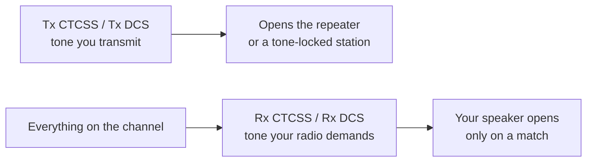
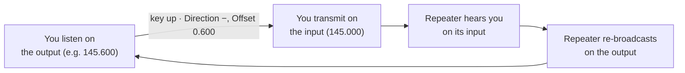

# What the settings really mean

The TD-H3's colour screen and plain-English menu names make it friendlier than a monochrome Baofeng — you see `Squelch` and `Bandwidth` spelled out, not cryptic four-letter codes. But a readable label still hides the physics underneath, and the manual lists each item without ever saying what the setting _does_, what the radio is doing inside, or which value to leave it on. This chapter is the _why_; the [menu reference](outpost:entry/logbook73.guide.td-h3/menu-reference) is the _what_ and _where_. Read them together and the little radio stops being a wall of options and becomes a set of tools you reach for on purpose.

One note before we start. The menu **numbers** quoted below are what the manual we checked prints, but TIDRADIO's numbering can shift between firmware versions and between the radio's [HAM / GMRS / NORMAL modes](outpost:entry/logbook73.guide.td-h3/overview) — so trust the item **name** over the number, and let the [menu reference](outpost:entry/logbook73.guide.td-h3/menu-reference) be your map. The physics never changes: a squelch gate works the same on every radio ever built.

## The gate on the hiss: squelch (`Squelch`)

Leave a receiver switched on with nothing to hear and it does not fall silent — it hisses. That hiss is random radio noise (and the receiver's own electronics) with no signal to override it, and listening to it for hours would drive anyone to distraction. **Squelch** is the gate that mutes it. Think of it as a bouncer on the speaker: it measures how strong the incoming signal is and only opens the door when something crosses a set loudness. Below the threshold — just noise — the speaker stays shut. Above it — a real signal — the speaker opens and you hear the traffic.

On the TD-H3 the `Squelch` menu (the manual we checked lists it as **Menu 1**) sets where that threshold sits. The manual gives ten levels, `0` to `9` — a single-source figure, so confirm the range on your own firmware — where `0` wedges the gate permanently open so you hear raw hiss all the time, and `9` demands a strong, clean signal before it lifts.

```viz
{
  "type": "wave",
  "title": "What squelch actually does",
  "caption": "The speaker opens only where the received signal (solid) rises above the squelch threshold (dashed). The weak blip in the middle never crosses, so it stays muted; the two strong signals open the gate.",
  "xLabel": "time →",
  "traces": [
    { "kind": "points", "label": "received signal", "tone": "primary", "points": [[0,0.12],[0.08,0.15],[0.16,0.1],[0.24,0.14],[0.3,0.4],[0.36,0.45],[0.44,0.42],[0.5,0.13],[0.58,0.11],[0.66,0.4],[0.74,0.72],[0.82,0.68],[0.9,0.22],[1,0.13]] },
    { "kind": "points", "label": "squelch threshold", "tone": "danger", "style": "dashed", "points": [[0,0.55],[1,0.55]] }
  ]
}
```

The trap is that squelch cuts both ways. Set it too low and you put up with hiss; set it too high and you silence exactly the weak, distant stations you most want to hear — a repeater on the edge of its range, a friend just making it in from the next valley. **The right setting is the lowest number that reliably mutes the hiss where you are** — often around `3`–`5` — and when you are chasing something faint, drop it. Many radios of this type also let you assign a "monitor" hotkey that forces the gate open; the TD-H3 lets you assign functions to its side keys, so check what yours is set to in [Getting Started](outpost:entry/logbook73.guide.td-h3/getting-started).

## Tones that keep your speaker quiet: CTCSS and DCS

Picture a single [repeater](outpost:entry/logbook73.handbook/repeaters) channel shared by three groups across a city, each unaware of the others because a hill sits between them. Left to plain squelch, your speaker would burst open every time _any_ of them transmitted, filling your day with conversations that are nothing to do with you. The fix is a quiet code ridden underneath the voice — a **sub-audible tone** — and a radio that keeps its speaker shut unless that code is present. The TD-H3 supports both systems that do this: it carries **50 CTCSS tones** and **105 DCS codes**.

**CTCSS** (Continuous Tone-Coded Squelch System, often called a "sub-tone" or by the trade name PL) sends one low, steady tone the whole time you transmit — one of fifty standard frequencies from `67.0` to `254.1` Hz. It sits _below_ the range your ear cares about (speech lives roughly 300 Hz to 3 kHz), so the far radio's tone decoder hears it perfectly while you never do.

```viz
{
  "type": "spectrum",
  "title": "A CTCSS tone hides below your voice",
  "caption": "The sub-audible tone (here 71.9 Hz) sits below the 300 Hz-3 kHz speech band, so the far radio's decoder detects it but your ear never notices it.",
  "xLabel": "audio frequency →",
  "components": [
    { "f": 4, "amp": 0.95, "label": "CTCSS 71.9 Hz", "tone": "primary" },
    { "f": 52, "amp": 0.5, "label": "your voice", "tone": "muted", "width": 72 }
  ]
}
```

**DCS** (Digital-Coded Squelch) does the same job with a continuous stream of low-speed digital data instead of a single tone — codes written like `D023N` (the `N` is "normal", `I` is "inverted"). It is simply a different, slightly more selective dialect of the same idea. Whichever the channel uses, the principle is identical: a code you cannot hear decides whether your speaker opens.

### The part everyone gets wrong: receive tone versus transmit tone

Here is the single most important idea in this chapter, and the reason the TD-H3 splits tones into **four** separate menu items — `Tx CTCSS`, `Rx CTCSS`, `Tx DCS` and `Rx DCS` (Menus 13, 11, 12 and 10 on the firmware we checked, but trust the names). Receiving a tone and transmitting a tone are two completely independent jobs.



- **The transmit tone (`Tx CTCSS` / `Tx DCS`) is the key you send out.** Most repeaters will not relay you at all unless your signal carries the correct sub-tone — it is how they reject interference and stray carriers. Set the tone the repeater's listing specifies and it lets you in.
- **The receive tone (`Rx CTCSS` / `Rx DCS`) is the lock on your own speaker.** Set it and your radio stays silent unless an incoming signal carries a _matching_ tone — this is what mutes the other two groups on that shared channel.

The two are separate on purpose. To simply _use_ a busy repeater you usually set only the **transmit** tone — you want to hear everyone on the machine, so you leave the receive side open. To hide from co-channel groups on a _simplex_ frequency (talking directly, radio to radio) you set **both** to the same tone, so your team hears each other and nobody else. Worked example: your local repeater lists an access tone of `71.9` Hz. Set `Tx CTCSS` to `71.9`, leave `Rx CTCSS` off, and you are in.

One honest warning: a tone is **not** privacy and **not** encryption. It only decides whose signal opens _your_ speaker; anyone listening with their tone-squelch off, or with plain squelch, hears every word. Use tones for tidiness and repeater access, never for secrecy.

## Working a repeater: duplex, offset and shift direction

A repeater is a radio on a hill that listens on one frequency and re-transmits everything it hears on another, giving two low-powered handhelds a shared high point to talk through. To do that it listens and talks at the same time — using **two** frequencies at once — and your radio has to mirror the split: transmit on the repeater's input, but sit on its output to listen. Doing that by hand every time would be miserable, so the radio automates it with two settings.

`Direction` (shift direction, Menu 23 on the firmware we checked) tells the radio whether to transmit **above** (`+`), **below** (`−`) or on the same frequency (`None`, for simplex) as the one on the screen. `Offset` (Menu 24) sets _how far_ it jumps, in MHz. Together they mean you tune to the frequency you _hear_, and the radio quietly moves to the input the instant you press the key.



Worked example, 2 m: suppose your local machine's output is `145.600`, so you tune the radio there. Set `Direction` to `−` and `Offset` to `0.600`, and every time you press the key the radio drops to `145.000` — the input — then hops back to `145.600` to listen. **These figures are regional** — the common 2 m shift is 600 kHz in many band plans, while the 70 cm shift is ±1.6 MHz in much of Europe but ±5 MHz in the US — so check your national band plan (from your national society, e.g. RSGB, ARRL or DARC) and, better still, let a memory channel remember it all for you. For simplex you set `Direction` to `None`: transmit and receive land on the same frequency.

One extra key on the way in: some older repeaters, common across Europe, historically expected a short **1750 Hz tone burst** to wake them up. The TD-H3 has a repeater-tone function (listed around Menu 32) and can send it — the manual we checked describes triggering it by holding the PTT together with the lamp/side key. Most machines have since moved to CTCSS access, but confirm the exact key combo on your unit, as it is a single-source detail.

## How much of the channel you fill: wide versus narrow FM (`Bandwidth`)

The TD-H3 transmits in FM ([frequency modulation](outpost:entry/logbook73.handbook/modulation)) — it carries your voice by wagging the transmit frequency up and down in time with the sound. How _far_ it wags is the **deviation**, and that determines how much of the band your signal occupies. The `Bandwidth` menu (Menu 0 on the firmware we checked) offers **Wide** and **Narrow**. The manual states these as roughly **25 kHz** and **12.5 kHz** of channel width — a single-source figure, so treat it as indicative — matching the industry norm: wide FM swings about ±5 kHz and fills more spectrum, narrow only about ±2.5 kHz and fits into less.

```viz
{
  "type": "spectrum",
  "title": "Wide and narrow FM, side by side",
  "caption": "Wide FM (larger deviation, more spectrum) sounds louder but is hungrier for channel space; narrow FM (smaller deviation) packs more conversations in but sounds quieter. Mismatch the two and the audio comes out wrong.",
  "xLabel": "frequency across two channels →",
  "components": [
    { "f": 28, "amp": 0.85, "label": "Wide", "tone": "primary", "width": 28 },
    { "f": 74, "amp": 0.85, "label": "Narrow", "tone": "success", "width": 15 }
  ]
}
```

Why offer both? Spectrum is finite. As bands filled up, many services were squeezed onto tighter channel spacing, and narrow FM lets more conversations sit side by side without treading on each other. The cost is a little audio level: narrow moves the frequency less, so it arrives quieter.

The setting matters because a **mismatch sounds broken**. Transmit wide to a radio expecting narrow and your voice arrives loud and over-driven; transmit narrow to a radio expecting wide and you sound thin and distant — and each side will blame the other's radio. Many 2 m and 70 cm band plans now sit on a **12.5 kHz** grid where **narrow** is the modern norm, though older wide-FM gear is still on the air and some legacy allocations remain wide; licence-free [PMR446](outpost:entry/logbook73.handbook/uhf) is narrow by regulation. So don't assume: match whatever the channel specifies, copy its bandwidth when you copy its frequency, and if a contact sounds distorted for no obvious reason, a `Bandwidth` mismatch is a prime suspect.

## Turning it down: power levels (`TX Power`)

The honest position on the TD-H3's power is that there are **two levels, high and low** — there is no distinct "mid", even though the menu wording can be muddled about it. High is rated at **5 W**. The _low_ figure is where sources part company: the manufacturer's manual says 2 W, retail listings and reviews often say 1 W, and one independent bench test measured somewhere in between — so treat "low" as "roughly a couple of watts, about a quarter of high" and read the number your own menu shows rather than trusting any single claim.

Set it in the `TX Power` menu (Menu 2 on the firmware we checked). The instinct of every new operator is to leave it on high "to be sure", and it is almost always wrong. There is a golden rule in amateur radio — **use the lowest power that does the job** — and four reasons stand behind it.

- **Battery.** Transmitting is the thirstiest thing the radio does; dropping from 5 W to low power noticeably stretches a day's operating on the 2500 mAh pack — which matters most in the moment you would least like a flat battery.
- **Interference.** Your signal does not stop at the person you are talking to. Excess power splashes further than you need, reaching stations you cannot even hear. Low power is being a considerate neighbour.
- **RF exposure.** A handheld transmits centimetres from your face. Less power means less energy near your head — the reasoning is in [RF Power](outpost:entry/logbook73.handbook/rf-power) — and it costs you nothing when the contact works fine anyway.
- **Cleanliness.** Budget wideband transmitters run cleanest when they are not pushed to their limit, and the TD-H3's lightly filtered design is no exception. Lower power, kept firmly in band, is part of keeping your signal tidy.

You can often hit a repeater a few miles away on low power with a full, quiet signal — so use it, and step up to high only if a station struggles to hear you. Reach for power last, not first, and always transmit within your [licence conditions](outpost:entry/logbook73.handbook/getting-licensed) and only in the modes your firmware permits.

**A quick safety note.** None of this is cause for alarm at these power levels, but two habits are worth keeping: hold the radio so the antenna is a few centimetres from your face when you transmit, and **never key up without an antenna attached** — a transmitter with nowhere to send its power can damage itself.

## Listening to two channels: dual-watch (`D.Wait`)

The TD-H3 keeps two VFOs on screen at once — an upper and a lower — and `D.Wait` (dual watch, Menu 9 on the firmware we checked) lets it keep half an ear on **both**, so you can monitor your local repeater and a simplex calling channel at the same time. Switch it on and the radio rapidly flips between the two, sampling each for activity. Catch a signal on either and it stops there and lets you listen until that station finishes, then resumes hopping.

It is genuinely useful, but understand what it is _not_: it is not two receivers. The radio can only truly listen to one frequency at a time, so it time-shares — flicking back and forth many times a second — which means it can **miss the opening moment of a call** on one channel while it samples the other, and it cannot follow two overlapping conversations. For a calm pair of channels it works well; for two busy ones it will feel like it is dropping syllables, because it is.

There is one trap worth burning in. When dual-watch catches a signal, _which_ channel does your PTT transmit on? The radio marks one VFO as active — that is the one it transmits on — so if you reply while the wrong VFO is selected, your signal goes out on the channel it was merely watching, and nobody hears you. If dual-watch ever leaves you talking to yourself, check which VFO is active first; the [menu reference](outpost:entry/logbook73.guide.td-h3/menu-reference) shows how your firmware indicates and switches it.

## Guards and good manners: `TOT`, `Busy Lockout`, `Roger`, `Tail` and `Vox`

A cluster of small settings exist purely to protect the radio, protect the channel, and make you a tidier operator.

**`TOT` — the time-out timer (Menu 8).** This caps how long a single press of the key can transmit. It protects the radio — transmitting continuously heats the power transistors, and a runaway key-down (a PTT jammed against your rucksack) can cook them — and it protects the channel, stopping one long-winded over from hogging a repeater. The manual does not state the TD-H3's exact range, so set a sensible cap on your own unit: a few minutes is plenty for any reasonable over, and short enough to save you from a stuck button.

**`Busy Lockout` — busy channel lockout (Menu 21).** With this on, the radio **refuses to transmit onto a channel that is already busy** — if a signal strong enough to break squelch is present, the key will not work until it clears. That is plain courtesy: it stops you doubling on top of a conversation you can hear. The useful subtlety: on a channel where groups use different CTCSS tones, your speaker might be _muted_ by your own tone-squelch even though someone is transmitting — and busy lockout will still spot the carrier and hold you back, stopping you stamping on a conversation you cannot even hear.

**`Roger` — the roger beep (Menu 31).** When on, the radio sends a short beep at the end of every transmission — a "roger, over to you" marker. It has its place in noisy fleet and family-radio use, but on the amateur bands it is widely felt to be clutter, since a courteous "over" in your own voice does the job, so the usual advice is to **leave it off**.

**`Tail` — squelch-tail elimination (Menu 30).** When you release the key on a tone-squelched simplex channel your carrier collapses, and in the fraction of a second before the far radio's tone decoder realises the tone has gone and shuts the gate, it plays a brief burst of noise — the _squelch tail_, that little "kssht" at the end of an over. `Tail` cures it: at the end of your transmission the radio sends a quick reversed-phase tone that tells the receiving radio to close its squelch _instantly_, turning the "kssht" into a clean click. It works radio-to-radio, so it earns its keep **on simplex** and does nothing useful through a repeater.

**`Vox` — voice-activated transmit (Menu 7).** VOX keys the transmitter when it hears you speak, so you can talk hands-free. The TD-H3 offers six settings — `Off` and levels `1`–`5`, where level `1` is the most sensitive. Sensitivity is the whole game: too sensitive and background noise trips it, too dull and it clips the first word of every sentence. Leave it `Off` unless you have a reason to use it.

## Talking to machines: DTMF and identity codes

Not everything the radio "says" is speech. **DTMF** (Dual-Tone Multi-Frequency) is the touch-tone system — press a key while transmitting and the radio sends the matching pair of audio tones. It is how you send commands to a repeater (to link or unlink it) or dial a node number into an internet-linked gateway. For ordinary conversation you never need it; it waits on the keypad for the day you do. And since you identify with your callsign in your own voice as your licence requires, if your firmware offers an automatic transmit-identity feature, leave it off rather than peppering every over with tones nobody needs.

## Try it yourself

With the radio charged and a real antenna fitted:

1. **Feel the squelch.** Tune to a quiet channel, open the `Squelch` menu and set it to `0`. Listen to the raw hiss — that is your receiver with the gate wide open. Now step it up one number at a time until the hiss just disappears. That number, for where you are, is your squelch.
2. **Set an offset by hand.** In frequency mode, tune to a local repeater's output. Set `Direction` and `Offset` from its listing, key up briefly (at low power, within your licence), and watch the displayed frequency jump to the input while you transmit, then snap back to listen.
3. **Prove the power rule.** Work a repeater on low power and listen to your own signal on a second radio or an [SDR](outpost:entry/logbook73.guide.td-h3/getting-started). If it is full and clean, you have just demonstrated that a couple of watts was plenty — and saved your battery doing it.
4. **Match a bandwidth.** Copy a repeater's frequency _and_ its Wide/Narrow setting into a memory, then try the same channel on the wrong bandwidth and hear how the audio changes. That is why you always copy the bandwidth with the frequency.

Nothing here can harm the radio, and stepping out of any menu without confirming undoes nothing you did.

## Key takeaways

- **Squelch** is the gate that mutes the hiss; set it to the lowest number that reliably silences the noise where you are, or you will mute the weak stations you most want to hear. (The TD-H3's exact level count is single-source — check your firmware.)
- **CTCSS and DCS** are inaudible codes that decide whose signal opens your speaker — and the TD-H3 keeps **transmit tone** (`Tx CTCSS`/`Tx DCS`, the key you send a repeater) firmly separate from **receive tone** (`Rx CTCSS`/`Rx DCS`, the lock on your own speaker). Tones are for tidiness and access, never privacy.
- **Duplex** is two settings: `Direction` (± or None) and `Offset` (size in MHz) make the radio transmit on a repeater's input while you listen on its output — the common 2 m shift is 600 kHz, but 70 cm and other regions differ, so check your band plan.
- **Wide vs narrow (`Bandwidth`)** is how much channel you fill; match the service or the audio comes out distorted or thin. The radio's stated 25 / 12.5 kHz figures are single-source, so treat them as indicative.
- **Power (`TX Power`):** two levels only, 5 W high and roughly a couple of watts low (the exact low figure is disputed). Use the lowest that does the job — it saves battery, cuts interference, lowers RF exposure and keeps a wideband transmitter cleaner.
- **Dual-watch (`D.Wait`)** time-shares between two channels rather than truly hearing both, so it can miss the start of a call — and you must know which VFO is active before you transmit.
- The good-manners cluster — `TOT` (anti-runaway), `Busy Lockout` (no talking over others), `Roger` (leave off for ham), `Tail` (kill the simplex "kssht") and `Vox` (hands-free, tuned carefully) — is small, but it is what separates a considerate operator from an annoying one.

Now that you understand what every setting is _for_, let's turn theory into practice with copy-and-go setups in [Ready-made Configurations](outpost:entry/logbook73.guide.td-h3/configs).
