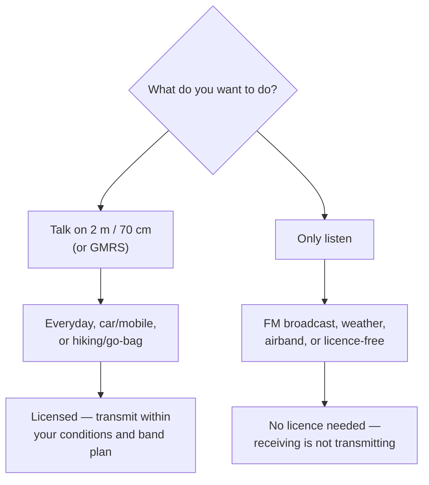
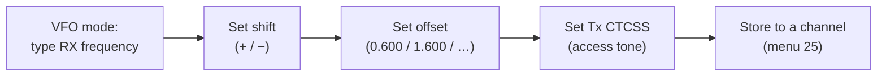
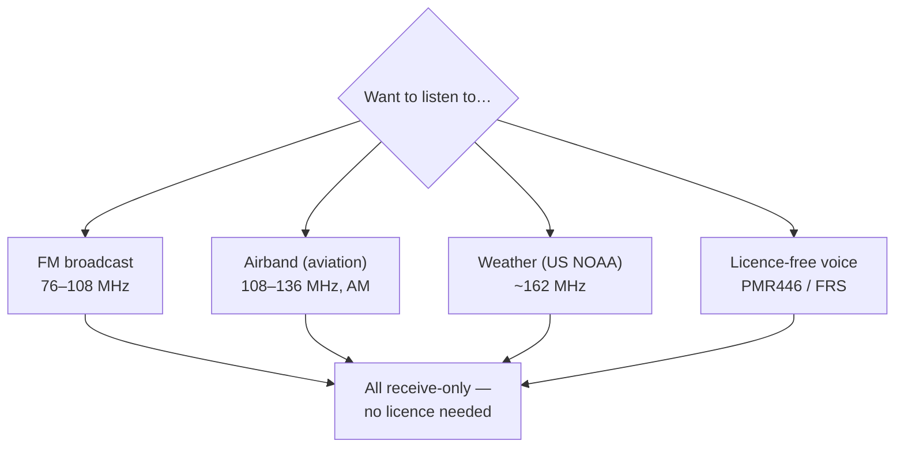

# Ready-made configurations

The quickest way to enjoy a TD-H3 is to stop reading menus and start using it — and the fastest route there is to copy a setup that already works. This chapter is a set of ready-made configurations: the everyday one, the one for the car, the one for a hilltop, and several receive-only setups for the things this radio genuinely does well — FM broadcast, weather, airband and licence-free monitoring. Each is a short table of menu items and values you can key straight in, with a note on what it is for and where it earns its keep.

## How to use these configs

Everything below is expressed as **menu item → value**, because that is how the TD-H3 thinks. To set any item, short-press `MENU`, step to the item with the `∧`/`∨` arrows (or key its number), press `MENU` again to open it, choose the value with the arrows, and press `MENU` once more to save. `VFO/MR` (which doubles as **Exit**) backs you out without changing anything. If that dance is unfamiliar, [Getting Started](outpost:entry/logbook73.guide.td-h3/getting-started) walks through it, and the full meaning of every item lives in the menu chapters — [Menu Reference](outpost:entry/logbook73.guide.td-h3/menu-reference) is the map, and [the](outpost:entry/logbook73.guide.td-h3/menus-1) [two](outpost:entry/logbook73.guide.td-h3/menus-2) in-depth chapters explain each one.

**One honesty note about menu numbers.** The TD-H3's firmware has been revised several times, and the exact number attached to each menu item is not stable across versions — different manuals and units disagree. So the tables here name items by their **on-screen label** (the thing that does not change), and I only quote a number where it is corroborated across sources — the store-to-memory function, which sits on **menu 25**. Everywhere else, **navigate by the label, not by a number you memorised from a table.** If your unit numbers things differently, that is expected, not a fault.

The other rule saves a lot of confusion. **In channel (memory) mode the TD-H3 refuses to change most per-channel settings** — the CTCSS/DCS tones, wide/narrow, busy-channel lockout and so on. So you set a channel up in **frequency (VFO) mode**, get every value right, and _then_ store it to a memory. Better still, do the whole job in software: **CHIRP** on a computer, or the **ODMaster** phone app over Bluetooth, both turn an afternoon of thumb-aching menu-diving into a five-minute table you can edit, reorder and back up. Every config here can be typed into CHIRP just as easily as into the radio — and with 199 channels to fill, you will want to.



## The universal baseline

Set these once and every config below inherits them. They encode the good manners this guide keeps pushing — lowest sensible power, busy-channel lockout on, no roger beep — plus a few quality-of-life choices. Where a config wants something different, it says so.

| Menu item            | Value                 | Why                                                                                                                                                                     |
| -------------------- | --------------------- | ----------------------------------------------------------------------------------------------------------------------------------------------------------------------- |
| Squelch              | `3`–`4`               | Silences the hiss but still opens for real signals; nudge up in strong RF, down to hear weak ones                                                                       |
| TX power             | `Low`                 | High is rated 5 W; Low is a fraction of that (sources disagree whether it is 1 W or 2 W) and does the job most of the time — save High for when you actually need reach |
| Power save           | `On` (a modest ratio) | Battery save on standby; there are several ratios — pick a middle one                                                                                                   |
| VOX                  | `Off`                 | Hands-free transmit trips on coughs and background noise — leave it off (levels 1–5 exist; 1 is most sensitive)                                                         |
| Backlight            | short timeout         | Long enough to read, short enough to save battery                                                                                                                       |
| Keypad beep          | `On`                  | The keypress confirmation is genuinely useful while you learn the radio                                                                                                 |
| Time-out timer (TOT) | `On` (e.g. 60 s)      | Cuts a stuck transmission if the PTT jams in a pocket — courtesy and battery in one                                                                                     |
| Busy channel lockout | `On`                  | Refuses to transmit on top of an occupied channel                                                                                                                       |
| Roger beep           | `Off`                 | The end-of-over beep adds nothing on the amateur bands and annoys people                                                                                                |

**Dual watch (`D.Wait`)** is deliberately left out of the baseline because the right answer depends on the config — on when you want to watch both lines, off when you want maximum battery life and minimum confusion. Each setup below tells you which. And get into the habit of **locking the keypad** when the radio goes in a pocket — a long press of `✳` locks it, another long press unlocks it — so nothing gets nudged off-frequency.

A word on **power**, because it runs through everything here. The TD-H3 offers only two levels, High (rated 5 W) and Low. Both sit comfortably inside any amateur allowance — you will have far more headroom than the radio can use — so "run low power" is never about the licence, it is about good practice: less battery drain, less interference to distant users sharing the channel, and a cleaner signal. Turn it up only when Low genuinely will not reach. The reasoning is in [RF Power](outpost:entry/logbook73.handbook/rf-power).

> **A word on RF safety.** A 5-watt handheld is low-powered, but the antenna sits close to your head. Key up only when you mean to, hold the radio so the antenna clears your face, and prefer Low power when the other station is easy to reach. Nothing to be alarmed about — just sensible habits, covered in [RF Power](outpost:entry/logbook73.handbook/rf-power).

## 1 · Your first licensed setup

This is the "do this first" configuration for the **ham (TD831) variant**: the sensible defaults above, plus the handful of channels a newly licensed operator actually uses. Programme your local [repeaters](outpost:entry/logbook73.handbook/repeaters) and the calling channels, and you are on the air properly.

| Menu item             | Value                                                | Notes                                                                                    |
| --------------------- | ---------------------------------------------------- | ---------------------------------------------------------------------------------------- |
| Wide/Narrow           | `Narrow`                                             | Most 2 m/70 cm FM is now 12.5 kHz narrow-band in Region 1; check your national band plan |
| Step                  | matches the grid                                     | 12.5 kHz suits the Region 1 channel grid; other regions vary                             |
| Dual watch (`D.Wait`) | `On`                                                 | Watch the calling channel _and_ your local repeater at once                              |
| TX power              | `Low` around town, `High` to reach a distant machine |                                                                                          |

Then store these as memory channels (set up in VFO mode, or in CHIRP/ODMaster):

| Purpose              | RX freq        | Shift | Offset          | Tone                       |
| -------------------- | -------------- | ----- | --------------- | -------------------------- |
| 2 m FM calling       | `145.500`      | `Off` | —               | none                       |
| 70 cm FM calling     | `433.500`      | `Off` | —               | none                       |
| Local 2 m repeater   | e.g. `145.700` | `−`   | `0.600`         | Tx CTCSS = repeater's tone |
| Local 70 cm repeater | e.g. `430.xxx` | `+`   | `1.600`/`7.600` | Tx CTCSS = repeater's tone |

The calling channels above are the widely used Region 1 values; **2 m is 144–146 MHz in Region 1 and 144–148 MHz in Regions 2/3**, so confirm the calling frequencies and the repeater sub-band against your own band plan. Almost every repeater needs a **CTCSS access tone** — a sub-audible tone your radio sends to unlock it. The repeater's listing gives the figure; set it as the **Tx CTCSS** value (the radio has 50 CTCSS tones and 105 DCS codes to choose from). A few older machines instead want a **1750 Hz toneburst**, which the TD-H3 can send. The offsets shown are conventions — **−0.6 MHz on 2 m**, and **+1.6 MHz on 70 cm** in some regions, **−7.6 MHz** in much of Europe, **±5 MHz** in North America — so, again, check your national band plan. Programming a repeater by hand always follows the same order:



Transmit only on 2 m and 70 cm within your amateur allocation, at your licensed power. If you are not yet licensed you can programme and _listen_ to all of this legally — see [Getting Licensed](outpost:entry/logbook73.handbook/getting-licensed) when you are ready to talk.

## 2 · Everyday handheld

The daily driver: the same settings as above, but here is the _habit_ that makes it work. The TD-H3's two on-screen lines and **two PTT buttons** were built for this. Park **line A** on your busiest local repeater and **line B** on the 2 m calling channel `145.500`, switch on **dual watch (`D.Wait`)**, and you catch a call on either without touching the radio — then answer on the matching button: **PTT A replies on A, PTT B replies on B.** No fiddling with `A/B` first, which is the classic single-PTT trip-up.

```viz
{
  "type": "display",
  "title": "Everyday config — dual watch across two lines",
  "caption": "Line A on the local repeater (Low power, narrow, plus-shift, CTCSS access tone); line B on the 2 m calling channel. Answer whichever opens using its own PTT button.",
  "screen": {
    "rows": [
      { "vfo": "A", "freq": "145.700", "power": "L", "bw": "N", "shift": "-", "tone": "CT", "active": true },
      { "vfo": "B", "freq": "145.500", "power": "L", "bw": "N" }
    ],
    "topIcons": ["S", "100%"]
  },
  "callouts": [
    { "n": 1, "x": 8, "y": 16, "label": "A: repeater", "side": "left" },
    { "n": 2, "x": 8, "y": 33, "label": "B: 145.500 calling", "side": "left" },
    { "n": 3, "x": 90, "y": 16, "label": "shift + tone tags", "side": "right" }
  ]
}
```

Keep **TX power Low** — around town, a watt or two into a rooftop repeater a few miles away is plenty — and reserve High for when Low visibly will not make it. Two everyday tricks earn their keep: **reverse** temporarily swaps a repeater's transmit and receive frequencies so you can hear whether the other station is close enough to work **direct** (simplex) and spare the repeater; and **monitor** opens the squelch so you can hear a signal too weak to break it. If you never hear yourself through the repeater, the usual causes are a missing or wrong CTCSS tone, the wrong shift direction, or simply being out of range — all covered in [Troubleshooting](outpost:entry/logbook73.guide.td-h3/troubleshooting).

## 3 · Car / mobile

A handheld in a car is a compromise, but a good external antenna turns it into a genuinely useful mobile rig. The changes from the everyday setup are about **power, safety and an antenna on the roof**.

| Menu item             | Value  | Notes                                                                  |
| --------------------- | ------ | ---------------------------------------------------------------------- |
| TX power              | `High` | You want the reach, and the car keeps the battery topped up over USB-C |
| Power save            | `Off`  | Powered from the car — no need to micro-sleep the receiver             |
| Dual watch (`D.Wait`) | `On`   | Watch calling + local repeater as you drive through cells              |

The single biggest upgrade is a **mag-mount antenna on the roof** — the metal roof acts as a ground plane and lifts both transmit and receive dramatically over a rubber duck indoors. Fit it, then check it is a sensible match (see [SWR](outpost:entry/logbook73.handbook/swr)) before you lean on High power. One honest caveat: a bigger, higher antenna feeds the TD-H3's broad front end more of _everything_, so near masts and city-centre transmitter sites you may notice more [overload and ghost signals](outpost:entry/logbook73.handbook/overload-and-ghost-signals) than you did on the little stock whip. It is the classic budget-receiver trade-off, and a band-pass filter cures it for a fixed installation.

Two safety notes, briefly. **Programme before you drive, never during** — that is what CHIRP, ODMaster and pre-stored channels are for. And a proper **speaker-microphone** on the 2-pin accessory port (not VOX) keeps your hands and eyes where they belong.

## 4 · Hiking, SOTA and the go-bag

On a summit — or in a rucksack you charge and forget until you need it — the enemy is a flat battery, so this config is tuned to sip power and still get you heard from a good high location. Amateurs activating hills ([SOTA](outpost:entry/logbook73.handbook/vhf) and similar) live on 2 m FM simplex, where height does the work that watts cannot.

| Menu item             | Value                           | Notes                                                                     |
| --------------------- | ------------------------------- | ------------------------------------------------------------------------- |
| TX power              | `Low`, `High` for the long shot | From a summit, a watt goes a very long way                                |
| Power save            | deepest ratio                   | Squeeze the most standby out of the pack                                  |
| Backlight             | shortest / off                  | Every mA counts on the hill                                               |
| Dual watch (`D.Wait`) | `Off`                           | Watch one channel; dual watch keeps the receiver busier and drains faster |
| Squelch               | `4`–`5`                         | A touch higher so the speaker is not hissing away your battery            |

Primary channel: **`145.500` (2 m FM calling)**, where activators call before moving to a working frequency; keep `433.500` stored too. A **spare 2500 mAh battery kept warm in an inside pocket** is worth more than any setting — lithium cells lose capacity in the cold, and the TD-H3 takes a second pack readily. For the **go-bag** version of this setup, store your local repeaters and calling channels, keep the pack **charged to about half or two-thirds** (best for long-term storage) and top it up every few months, and drop the USB-C cable in the bag. Then remember the licensing reality: in an emergency you may always _listen_ on anything the radio can hear, but you may only _transmit_ within your licence — which is what turns this from a scanner into a communications tool. National emergency-communications groups (your national society — RSGB, ARRL, DARC and the like — can point you to them) publish local calling frequencies worth adding.

## 5 · Receive-only listening — where the TD-H3 shines

Here is the happy surprise, and the biggest single difference from the cheap monochrome sets. The TD-H3 has a **real AM detector and a wide receiver**, so several kinds of listening that defeat a basic handheld actually work on this one. None of it needs a licence — **receiving is not transmitting** — but note that what your unit can tune depends on its variant and firmware mode (HAM / GMRS / NORMAL), so if a band below is missing, that is why: **check your unit**.



### FM broadcast radio (76–108 MHz)

The TD-H3 has a genuine broadcast-FM receiver built in. Reach it by pressing **`MENU` then holding the `8` key** (the standby screen swaps to a broadcast display); press it again to return to the radio. Handy for news and weather bulletins, and it politely mutes for an incoming call on your radio channel.

### Airband (108–136 MHz, AM)

This is where the TD-H3 leaves a UV-5R-class radio behind. Aviation uses **AM**, and the TD-H3 has an **AM airband receive** mode covering roughly **108–136 MHz** — so, standing near an airfield, you can actually hear the tower and approach traffic properly, not as the weak distorted "slope-detected" mess a pure-FM radio produces. Tune the frequency in VFO mode with an open squelch (`0`–`1`, since AM speech will not always break a tight squelch). **Listening only** — you are never permitted to transmit on aviation frequencies.

### Weather (US NOAA)

In the United States, the National Weather Service broadcasts continuously on a handful of channels near **162 MHz**, and the TD-H3 comes with those **preprogrammed but switched off**. You enable them by assigning the **Weather** function to a programmable side-key long-press — most easily done in **CHIRP** (Settings tab → set a `PF` key's long-press to Weather), after which that key jumps you into the weather scanner. This is a **US system**; other countries broadcast marine and aviation weather differently, so outside North America there is nothing on these channels to hear.

## 6 · Licence-free voice — monitor, and know when you may talk

The licence-free bands are where global framing matters most, because the rules differ sharply by ITU region — and so does what the TD-H3 may legally do.

**Region 1 (Europe, Africa, much of Asia): PMR446.** [PMR446](outpost:entry/logbook73.handbook/uhf) is eight analogue channels around 446 MHz — 12.5 kHz narrow FM, a fraction of a watt, on a fixed antenna. The TD-H3 will **hear** them perfectly, which makes it handy for keeping an ear on a group, but it **may not legally transmit** there: PMR446 requires a type-approved radio with a non-removable antenna and a 0.5 W ERP limit, and the TD-H3 meets none of those. So in Region 1 this is monitoring and awareness only.

| Menu item             | Value    | Notes                                    |
| --------------------- | -------- | ---------------------------------------- |
| Wide/Narrow           | `Narrow` | PMR446 is narrow-band FM                 |
| Squelch               | `3`–`4`  | Enough to silence the hiss between overs |
| Dual watch (`D.Wait`) | `Off`    | One list, all attention on it            |

The eight analogue PMR446 channels (Region 1):

| Ch  | Frequency   | Ch  | Frequency   |
| --- | ----------- | --- | ----------- |
| 1   | `446.00625` | 5   | `446.05625` |
| 2   | `446.01875` | 6   | `446.06875` |
| 3   | `446.03125` | 7   | `446.08125` |
| 4   | `446.04375` | 8   | `446.09375` |

**The Americas (Region 2): FRS and GMRS** on 462/467 MHz — the same idea, another band plan. Here the TD-H3's split personality matters: the **GMRS variant (TD831G)** is **FCC-certified for GMRS (Part 95E)**, so in the US, with a GMRS licence, that variant may legally _transmit_ on GMRS — unlike almost every ham handheld. The **ham variant (TD831)** is not GMRS-certified, and running the firmware in its "unlocked"/NORMAL mode does **not** grant you privileges you do not hold: match the radio and the mode to your actual licence, and to your national regulator's rules (the FCC in the US, Ofcom in the UK, and so on). If you only want to _talk_ on the licence-free channels, the honest answer is often a cheap type-approved PMR446 or FRS handset — match the radio to the licence, not the other way round.

**Marine VHF** is worth a mention too: it is **FM and inside the radio's range**, so the TD-H3 receives it cleanly near the coast — channel 16 (`156.800`, distress and calling) and the ship-to-ship channels make a rewarding listen. But transmitting on marine channels needs a marine licence and an approved set, so treat it, like the rest of this section, as **receive only**.

## Try it yourself

Pick the one config that matches how you will use the radio today and build it now — it takes ten minutes:

1. **Set the universal baseline** (the table near the top) — nine menu items, navigated by their on-screen names, and every setup inherits them.
2. **Programme two channels in VFO mode:** `145.500` as a plain simplex channel, and your nearest 2 m repeater with the `−` shift, a `0.600` offset and its access tone as the Tx CTCSS value. Store each with **menu 25**.
3. **Switch to memory mode** and confirm you cannot change the tone there — proof of the "set it in VFO mode first" rule.
4. **Give the two lines two jobs** — repeater on A, `145.500` on B — turn on **dual watch (`D.Wait`)**, and answer a test call on the matching PTT button.
5. **Hear what a UV-5R can't:** press `MENU` then hold `8` for FM broadcast, then tune an airband frequency near a local airfield in AM with the squelch wide open.
6. **When you have more than a handful of channels**, stop doing it by hand — read the radio into **CHIRP** or **ODMaster**, type the lot in, reorder them, and keep the file as a backup a factory reset cannot touch.

## Key takeaways

- Every config is **menu item → value**; set the **universal baseline once** (busy-channel lockout on, Low power, roger beep off, VOX off) and each setup inherits it.
- **Navigate by the on-screen label, not by a menu number** — the TD-H3's numbering shifts between firmware versions; the one number worth trusting is **store-to-memory = menu 25**.
- Set channels up in **VFO mode then store** — memory mode will not let you change tones or bandwidth — and for anything past a few channels use **CHIRP** or **ODMaster** and keep a backup.
- The transmit setups (**first licensed, everyday, car, hiking/go-bag**) differ mainly in **power, dual watch and antenna**; the two PTT buttons mean you answer on whichever line called, with no `A/B` juggling.
- Unlike a basic handheld, the TD-H3 **receives properly**: FM broadcast (`MENU` + hold `8`), **AM airband** (108–136 MHz), US **NOAA weather** (enable a side-key for it), and licence-free voice — all **receive-only and licence-free to hear**.
- Know the licence line by region: in **Region 1 you may monitor PMR446 but not transmit** on it; in the **US the GMRS variant is certified to transmit on GMRS**, while an "unlocked" ham unit grants no extra privileges — match radio, mode and licence.

When one of these setups does not behave — no repeater, a dead channel, ghost signals — head to [Troubleshooting](outpost:entry/logbook73.guide.td-h3/troubleshooting), where every common "why won't it…" has an answer.
