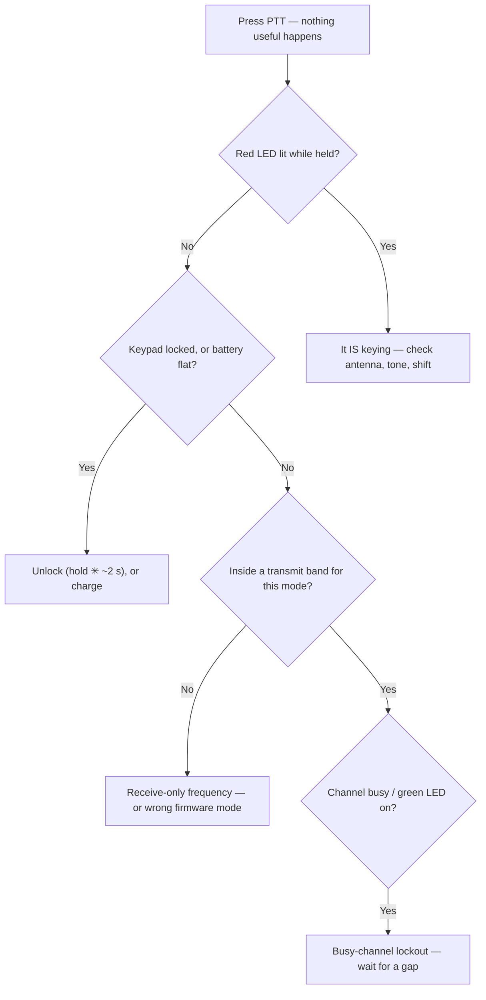
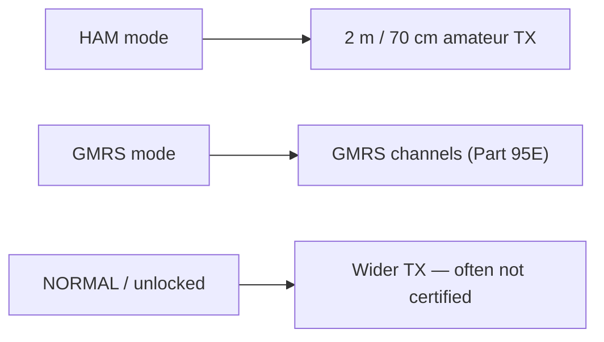
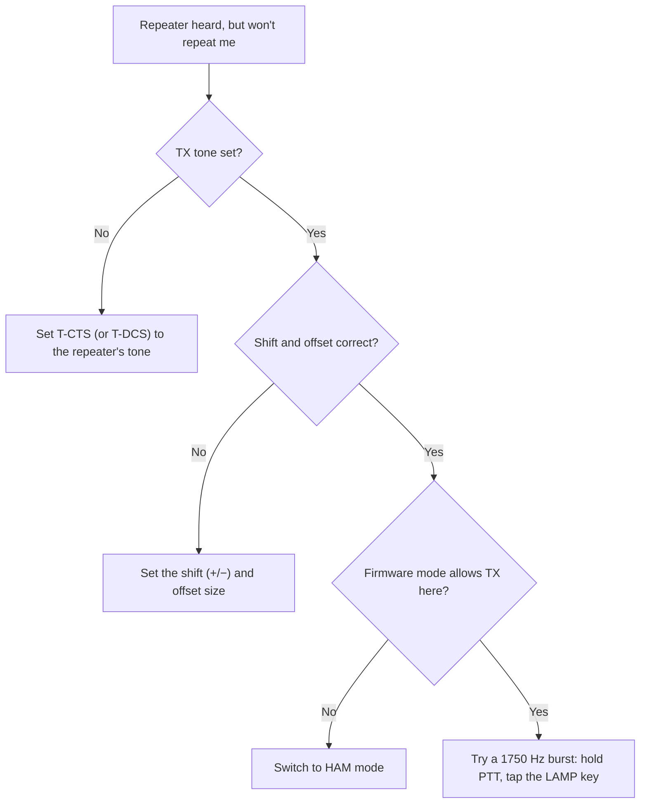
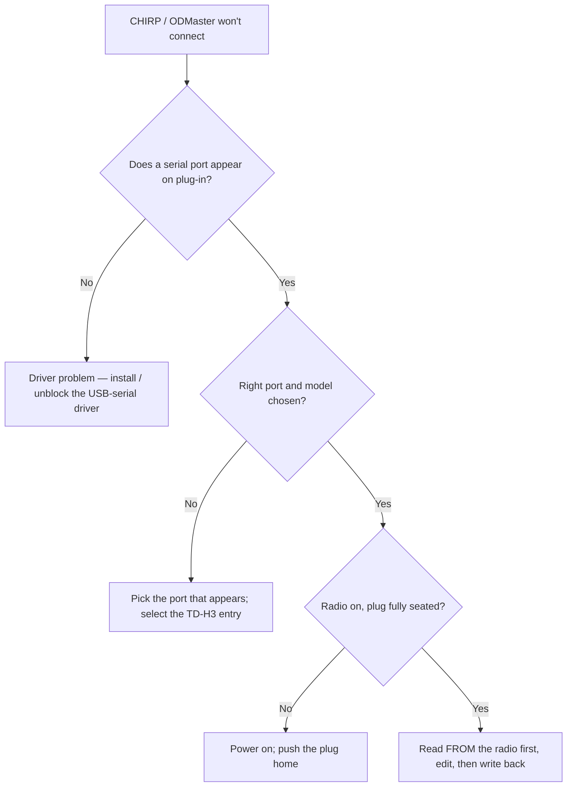

# Troubleshooting

Almost nothing that goes wrong with a TD-H3 is actually broken. It is a small, robust set, and what trips people up — over and over — is a setting left somewhere unexpected: a receive tone muting a perfect signal, a firmware mode that quietly forbids transmit, a memory channel with nothing stored. This chapter is a fault-finder built around the words you would really use — "it's gone silent", "it won't transmit", "CHIRP won't read it" — walking each from symptom, to cause, to fix.

One housekeeping note. The TD-H3's menu items are numbered, but the numbers have shifted between firmware versions and the sources disagree on them — so a menu item here is named by its **on-screen label first** (`SQL`, `R-CTS`, `TOT`) with the usual number in brackets. Trust the label on your own unit over any number.

## Before you panic: the thirty-second checks

Two habits solve most problems before you have properly begun to worry.

**First, read the status tags on the colour display.** As [Getting Started](outpost:entry/logbook73.guide.td-h3/getting-started) describes, the TD-H3 is honest about its own state. A padlock means the keypad is locked; a `CT` or `DCS` tag means a sub-tone is active; a `+` or `−` means a repeater shift is set. That ring of little tags has usually already confessed why the radio is "misbehaving" — and because the screen shows **two lines, A and B**, always check _which_ line you are looking at.

**Second, remember what a memory channel is.** A stored channel is a frozen snapshot — frequency, shift, tones, bandwidth and power, saved together. So a fault that follows one channel around but vanishes on another is baked into that snapshot, not a hardware fault; the cure is to fix it in VFO (frequency) mode and store it again.

If you ever feel truly lost, press **`VFO/MR` (Exit)** a couple of times to back out to standby. It changes nothing.

## "It's gone silent — hiss but no voices, or nothing at all"

This is the single most common panic, and it splits neatly into two very different faults. Work out which one you have and the fix is obvious.

**Fault A — total silence, not even background hiss.** Your **squelch** is set too high. Squelch is a noise-gate that keeps the speaker quiet until a signal is strong enough to be worth hearing; wind it up too far and it stays shut even on real signals. The squelch item (`SQL`, menu 1) runs from `0`, which holds the gate fully open so you hear everything including background noise, up to the tightest setting, which passes only strong signals. (Manuals describe roughly ten steps, but the exact count is not agreed across sources.)

- **The fix, and the diagnostic in one move:** open the menu, set `SQL` to `0`, and listen. The speaker should fill with white noise — that proves the receiver is alive. Then wind `SQL` back up to the lowest number that stays quiet between signals. If a fully open squelch produces _no_ hiss at all, suspect volume, antenna or speaker, not squelch — see the table at the end.

**Fault B — the radio is clearly busy but stays mute.** The tell-tale is that the LED glows green, or the S-meter jumps, yet no audio comes out. That is a **receive sub-tone** doing exactly what it was told. If the receive-CTCSS item (`R-CTS`, menu 11) or the receive-DCS item (`R-DCS`, menu 10) is set, the radio holds the speaker shut for every signal that does _not_ carry the matching sub-audible tone — even a loud, crystal-clear one.

```viz
{
  "type": "spectrum",
  "title": "Why a receive tone can silence a working radio",
  "caption": "A CTCSS sub-tone rides below your voice, too low to hear. Set the radio to listen for one and it keeps the speaker shut for every signal that doesn't carry the matching tone — even loud, perfect ones.",
  "xLabel": "audio frequency (low → high)",
  "components": [
    { "f": 4, "amp": 0.55, "label": "CTCSS sub-tone", "tone": "primary" },
    { "f": 48, "amp": 0.9, "width": 52, "label": "the voice you want to hear", "tone": "muted" }
  ],
  "noiseFloor": 0.04
}
```

- **How it happens:** you programmed the channel with a "tone squelch" option in [CHIRP](outpost:entry/logbook73.guide.td-h3/getting-started) or ODMaster, which quietly sets _both_ transmit and receive tone at once — or you nudged the receive one by mistake.
- **The fix:** set `R-CTS` and `R-DCS` to `Off`. Now the radio opens on any signal on the frequency. Keep a _transmit_ tone if your repeater needs one — that is a separate item (see below). A receive tone is only worth having on a busy shared channel where you want to ignore everyone not in your group.

## "It won't transmit"

You press a PTT and nothing goes out — no red LED, or a red light but nobody hears you. The TD-H3 refuses to transmit for several sensible reasons; step through them in order. One is unique to this radio and catches almost everyone, so it gets its own section next; the rest are here.



Walking the branches:

- **The keypad is locked.** A padlock tag and dead keys mean the lock is on (auto-lock can also arm it after about fifteen seconds). **Hold `✳` for roughly two seconds** to unlock — the single most common "dead radio".
- **You pressed the wrong PTT.** The TD-H3's signature quirk is its **two PTT buttons** — PTT A keys line A, PTT B keys line B. If you set up a repeater on line B but keep pressing PTT A, you are keying the wrong line. Press the button for the line you mean to use.
- **You are on a receive-only frequency.** The radio _receives_ across a huge span — broadcast FM, AM airband and more — but only _transmits_ on the segments its current firmware mode allows. Retune inside a band you are allowed to transmit on, and **never transmit out of band** — it is not just impolite, it is illegal (see [Getting Licensed](outpost:entry/logbook73.handbook/getting-licensed)).
- **Busy-channel lockout is on.** With `BCL` (menu 21) enabled, the radio will not key onto a frequency that already has a signal opening the squelch — a good-manners feature that stops you transmitting on top of a conversation. **Wait for a gap.** You can turn `BCL` off for a legitimate reason, but leave it back on afterwards.
- **Low battery.** Transmitting is thirsty — a pack that receives happily can be too flat to key at full power. If receive is fine but transmit is weak or dead, charge it. An aged pack behaves the same way even when the icon reads "full".
- **The time-out timer cut you off.** `TOT` (menu 8) stops an over that runs too long, to protect the output stage from overheating. If PTT suddenly drops carrier, release, let it reset, and keep overs shorter.

And one that is not the radio's fault at all: **never key up without the antenna fitted.** A transmitter with nowhere to send its power can damage its own output stage; the reasoning is in [SWR](outpost:entry/logbook73.handbook/swr). If you have swapped antennas, make sure the new one is finger-tight in the SMA socket.

## "It used to transmit there — now it won't": the firmware mode

This one is peculiar to radios like the TD-H3 and baffles people who have never met it. The set ships as **two SKUs** — a ham variant (model TD831) and a GMRS variant (model TD831G) — and its firmware can be switched between **HAM**, **GMRS** and **NORMAL** ("unlocked") modes. _Each mode changes what the radio is allowed to transmit._ Switch from HAM to GMRS and your amateur simplex channels may go quiet on transmit; switch back and the GMRS channels stop keying. Nothing is broken — the radio is enforcing the rules of whichever mode it is in.



- **How to tell:** if a frequency you _know_ you used to work now refuses to key while others still do, suspect the mode before the hardware.
- **The fix:** set the mode deliberately. The dependable route is [CHIRP](outpost:entry/logbook73.guide.td-h3/getting-started) — its driver exposes a HAM / GMRS / NORMAL setting — or the ODMaster app. Choose the mode that matches how you are licensed.
- **A word of caution.** "Unlocked" transmit is _not_ covered by the radio's certification, and being _able_ to key a frequency is not the same as being _allowed_ to. Stay within your own licence and band plan; regulators and licence-free options differ by region (Ofcom/FCC; PMR446 in Region 1, FRS/GMRS in the US). More in [Getting Licensed](outpost:entry/logbook73.handbook/getting-licensed).

## "I can hear the repeater, but it won't open for me"

Receiving a [repeater](outpost:entry/logbook73.handbook/repeaters) and _accessing_ one are two different jobs, and it is completely normal to do the first perfectly while failing at the second. Listening needs nothing special; getting the repeater to relay you needs three things to line up.



- **You are not sending the access tone.** Almost every modern repeater is guarded by a **transmit CTCSS tone** (occasionally DCS) your radio must send to be let in — the transmit-CTCSS item (`T-CTS`, menu 13) or transmit-DCS (`T-DCS`, menu 12). This is _separate_ from the receive tone earlier: to work a repeater you usually want a **transmit tone set and the receive tone off**, so you send the right code but still hear everyone. Set `T-CTS` to the listed tone (for example `77.0 Hz`), leave `R-CTS` off, and try again.
- **Your shift or offset is wrong.** A repeater listens on one frequency and transmits on another; your radio must mirror that with an offset-direction (`+`/`−`) and an offset-size item. In the UK that is **−0.6 MHz on 2 m** and **+1.6 MHz on 70 cm**; elsewhere, check your band plan — the 70 cm shift in particular varies (±5 MHz in the US, −7.6 MHz across much of Europe). Get it wrong and you transmit where the repeater is not listening. Storing it as a memory channel bakes both in for good.
- **The firmware mode forbids it.** If you are in GMRS or the wrong mode, the amateur repeater output will not key — switch to HAM mode.
- **Your repeater wants a tone-burst instead.** Some older European and UK repeaters open on a **1750 Hz tone-burst** rather than a continuous tone. The TD-H3 sends one when you **hold PTT and tap the LAMP key** (the top button); other burst frequencies (1000, 1450, 2100 Hz) can be selected in the menu.

If all of that is right and it still will not trigger, only then consider power and antenna — but reach is rarely the real problem. Chasing power before checking tone and shift is the classic new-operator wild-goose chase.

## "There's odd interference — signals that come and go near town"

The TD-H3 receives across a very wide span — roughly 50 to 600 MHz — and buying that breadth cheaply means a receiver less choosy than a premium single-band set about what it lets in. Like other wide-coverage budget handhelds, close to a strong transmitter site (broadcast, paging, cellular or taxi masts) it can be swamped: a little deaf to weak signals, and prone to manufacturing **["ghost" signals](outpost:entry/logbook73.handbook/overload-and-ghost-signals)** where nothing is really transmitting. Reports on how badly this model suffers vary, so treat it as a characteristic to recognise, not a verdict.

Three counter-intuitive things are worth knowing:

- **It may not be the frequency's fault.** If a "repeater" appears on an odd frequency near a mast, suspect intermodulation — a false signal made _inside_ your receiver — before you believe it is real.
- **A bigger antenna can make it worse.** More gain feeds more out-of-band energy into the front end, so the stock antenna can behave better than a big whip amid strong signals.
- **The cures are physical, not menu-driven.** Move away from the mast; use a shorter antenna in the worst spots; for a fixed station, a **band-pass filter** on the antenna lead for just 2 m or 70 cm restores sanity. The physics is in [Overload & ghost signals](outpost:entry/logbook73.handbook/overload-and-ghost-signals) and [Receivers](outpost:entry/logbook73.handbook/receivers).

## "Airband, weather or broadcast FM behaves oddly"

The receive-only bands have their own habits, and none is a fault:

- **AM airband (108–136 MHz) is listen-only and quieter than you expect.** Aircraft use **AM**, which sits at the noise until an aircraft keys up — long silences between short transmissions are normal, not a dead radio.
- **Broadcast FM (76–108 MHz)** is reached through the menu rather than by tuning (owners describe a menu action using the `8` key). It is a separate receiver, so your amateur channels will not appear while it runs.
- **NOAA weather channels (US)** are present but usually need a hotkey assigned first; whether the radio gives an automatic weather-alert tone or is only a manual scanner is described both ways across sources, so **check your own unit** before relying on it to alert you.

## "It's stuck — I can't change channel, or it won't leave one line"

This feels alarming and is almost always a harmless state.

- **Memory mode with nothing stored.** Switch to memory (`MR`) mode with no channels saved and there is nothing to recall, so the arrows and keypad appear dead. Press `VFO/MR` back to frequency mode and store some channels first.
- **You are editing the wrong line.** The `A/B` key chooses which of the two lines your tuning and menu changes apply to. If edits seem to do nothing, you may be watching one line while changing the other — press `A/B` so the highlight is on the line you mean to change.
- **You are in channel mode, changing channel-only settings.** A memory is a snapshot, so most per-channel settings are locked while you sit on a stored channel — to change tone, shift or bandwidth, go to VFO mode and store over the channel.
- **Dual watch is answering on the "wrong" line.** With dual watch on (`D.Wait`, around menu 9), the radio hops between A and B; reply with the PTT button for the line that called, or switch dual watch off when it matters.

## "CHIRP or ODMaster won't connect"

Nine times out of ten this is the _cable or driver_, not the radio or the software. The TD-H3 is one of the first handhelds to accept programming over its **USB-C** port, so it should be plug-and-go — but the port needs the right USB-to-serial driver, which is exactly where people come unstuck.



Work through it in this order:

1. **Get the port recognised.** If no new serial/COM port appears when you plug the USB-C cable in, the operating system has no driver for the radio's serial chip. On Windows this means installing the correct driver (Windows 11 can block an unsigned one — allow it in Device Manager); on macOS there is a long-standing CHIRP report of USB-C radios not being recognised without the right driver. No port, no connection.
2. **Fall back to the 2-pin cable.** If USB-C keeps fighting you, the TD-H3 also takes a traditional **2-pin Kenwood-style cable** — TIDRADIO's own **TD-CH340**, which uses a CH340 chip and driver. This is the well-trodden path for the Windows CPS software and for CHIRP when USB-C misbehaves.
3. **Pick the right port and model.** In CHIRP, choose the serial port that _appears_ when you plug in and _disappears_ when you unplug, and select the **TD-H3** entry (there are separate ones for the TD-H3, TD-H3 Plus and TD-H8 — the wrong one reads garbage).
4. **Or skip the cable — ODMaster over Bluetooth.** The base TD-H3's Bluetooth is for _programming_ via the ODMaster app: long-press the **Menu / BL** key to arm the link, pair, and edit on the phone. (Bluetooth _audio_ and PTT are a TD-H3 **Plus** feature, not the base H3.)
5. **Read before you write — always.** **Read the radio into the software first**, edit that image, write it back — and **save the first read as a backup**. A fumbled write or a mode switch then costs nothing to undo.

If it reads but errors on write, it is nearly always a loose plug or a flat battery mid-write. Reseat, charge, and try again.

## The quick-fix table: smaller gremlins

| Symptom                         | Likely cause                                             | Fix                                                                                                   |
| ------------------------------- | -------------------------------------------------------- | ----------------------------------------------------------------------------------------------------- |
| Won't switch on                 | Flat or badly seated battery                             | Charge over USB-C; slide the pack off and click it firmly back on                                     |
| Weak or no reception            | Volume down, antenna loose, or squelch closed            | Turn volume up, check the antenna is finger-tight, set `SQL` to `0` to prove the receiver             |
| Battery drains fast             | Power-save off, backlight/dual-watch on, or an aged pack | Set the power-save item (`SAVE`, menu 3); shorten the backlight (menu 5); replace a worn pack         |
| Keys up on its own              | VOX too sensitive                                        | Turn the `VOX` item (menu 7) `Off`, or lower its level                                                |
| A "roger beep" after every over | Roger tone enabled                                       | Turn the roger-beep item (menu 31) `Off` (leave it if you like the confirmation)                      |
| Keypad dead, padlock showing    | Keypad lock on                                           | Hold `✳` for about two seconds                                                                        |
| Settings locked / won't change  | You're in memory (MR) mode                               | Switch to VFO mode, edit, store over the channel                                                      |
| Audio muffled to others         | Wrong bandwidth for the channel                          | Match the channel's wide/narrow setting to the frequency's spacing                                    |
| Everything is tangled           | Settings beyond patience                                 | Last resort: the reset item (`RESET`, menu 35) — `VFO`, `CH` or `ALL` — then restore from your backup |

A word on that last row: a full reset erases your stored channels and returns the radio to defaults. It is a genuine cure for a hopelessly tangled radio — but only if you kept a CHIRP or ODMaster backup to reload, which is the best reason of all to make one.

## When it really is broken

Occasionally it genuinely is hardware: a **damaged or wrong antenna** (never key without one); a **PTT that sticks** or an accessory jack full of lint; a **battery pack that no longer holds charge**; or **water ingress** — the TD-H3 carries no official water rating, so treat it as _not_ weatherproof. If a full reset with a known-good battery and antenna does not restore normal behaviour, it may be time to retire that unit — and at this price, that is rarely a tragedy. Keep a backup file and a spare pack, and you are never far from being back on the air.

## Try it yourself

The best way to stop fearing a fault is to cause one deliberately and cure it. With a charged, antenna-fitted radio in VFO mode:

1. **Make it go silent on purpose.** Set `R-CTS` (menu 11) to a tone — say `88.5 Hz` — and find a busy local frequency. The green LED and S-meter jump, but you hear nothing: the "receiving but muted" fault, recreated.
2. **Prove the receiver is fine.** Set `SQL` to `0`. The speaker fills with hiss and audio — your diagnostic move for any "silent" radio.
3. **Cure it.** Set `R-CTS` back to `Off`. Normal listening returns, and you now own both halves of the most common TD-H3 mystery.
4. **Meet the mode.** In CHIRP or ODMaster, read your radio and note whether it is in HAM, GMRS or NORMAL mode — and see how that one setting decides what the PTT can and cannot do.

Nothing here can harm the radio, and `VFO/MR` (Exit) always brings you home.

> **A short safety note.** A 5-watt handheld is low-powered, but the antenna sits close to your head. Key up only when you mean to, hold the radio so the antenna clears your face, and prefer low power when the other station is easy to reach. Nothing here is alarming — just sensible habits, expanded in [RF safety](outpost:entry/logbook73.handbook/rf-safety).

## Key takeaways

- **Most "faults" are settings.** Read the status tags and check _which line_ (A or B) you are on first — the display usually names the problem — and remember a memory channel is a frozen snapshot you edit in VFO mode.
- **Silent radio?** Either squelch is too high (`SQL`, menu 1 — set it to `0` to prove the receiver) or a **receive tone** (`R-CTS`/`R-DCS`) is muting everything; fix the right one.
- **Won't transmit?** Check the keypad lock, the _right_ PTT button, that you are inside a transmit band, busy-channel lockout, the battery and the time-out timer — and, uniquely to this radio, the **firmware mode** (HAM / GMRS / NORMAL), which decides what may be transmitted at all.
- **Repeater won't open?** You almost certainly need a **transmit tone** (`T-CTS`) with the **receive tone off**, the right **shift and offset**, the correct firmware mode — or a **1750 Hz burst** (hold PTT, tap the LAMP key).
- **Odd interference near town** is likely receiver overload on a wide-coverage set, not breakage — it can get _worse_ on a bigger antenna, and the cures are physical.
- **Menu numbers renumber between firmware — trust the on-screen label.** Where this guide could not confirm a detail (squelch step count, the weather-alert tone, the exact FM-radio key), it says so; check your own unit.
- **CHIRP/ODMaster trouble is nearly always the driver** — get the USB-C port recognised, fall back to the 2-pin TD-CH340 cable if not, and always **read a backup from the radio before you write**.

Fixing problems is half the craft; the other half is never causing them — so let's turn to operating cleanly, legally and considerately in [Best Practices](outpost:entry/logbook73.guide.td-h3/best-practices).
