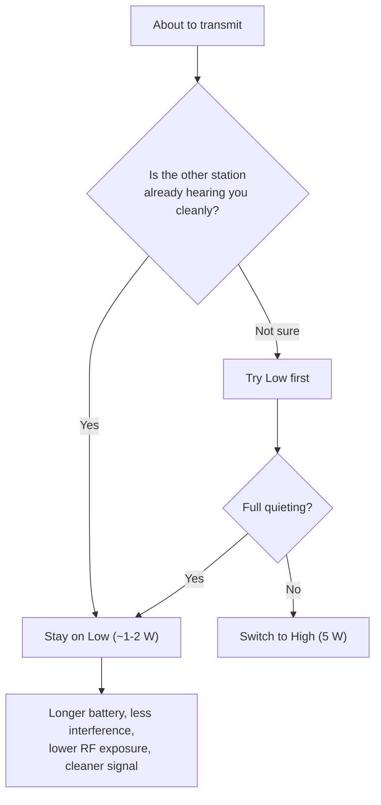
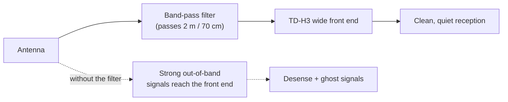
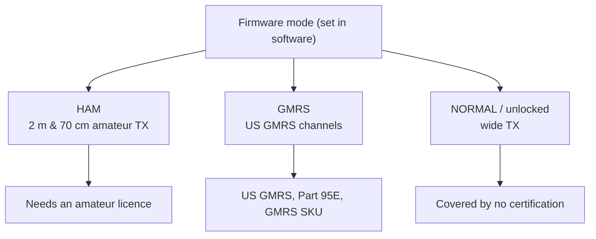

# Best practices

The TD-H3 is a capable budget radio that can get a licensed newcomer on the air quickly. What separates a TD-H3 that is a pleasure to own from one that annoys everyone within earshot is not the radio at all — it is a handful of habits. This last chapter gathers those habits in one place: how to get the best out of the set while being the sort of operator other people are glad to hear.

None of it is hard, and none of it costs much. A few menu changes, one small antenna upgrade, a backup file on your laptop, and a way of thinking about power and legality that will serve you on any radio you ever own.

## Run the least power that does the job

The single most useful habit on any handheld is **turning the power down**. The TD-H3 gives you two levels — there is no distinct "mid" — set through the **TX Power** menu item. **High** is rated at **5 W**. **Low** is where the sources genuinely part company: the manufacturer's manual says 2 W, retail listings and reviews often say 1 W, and one independent bench test measured somewhere in between. Rather than print a number that might be wrong, treat low as "roughly a couple of watts, about a quarter of high," and read the value your own unit actually offers. Most new operators leave the radio on High out of a vague sense that "more must be better." It usually isn't.

On the 2 m and 70 cm bands, communication is essentially line-of-sight, and getting into a [repeater](outpost:entry/logbook73.handbook/repeaters) or across town to another handheld is far more about your antenna and your take-off — are you in a dip or up on a rise? — than about raw watts. Going from 1 W to 5 W is only about 7 dB, barely one S-point, and if a signal is already fully quieting (clean and hiss-free) those extra watts change nothing the other station can hear. They just drain your 2500 mAh battery faster, warm the radio up, put more RF next to your head, and add needless energy to a shared channel.



**Worked example.** You want to work your local repeater, whose mast is 12 km away with a clear line-of-sight from your usual spot. Set the radio to Low and call. Nine times out of ten you will be full quieting on a couple of watts, because the path is open — the repeater's sensitive receiver and high antenna do the hard work. Only if you drop into a valley, or the repeater comes back weak and scratchy, do you reach for High. That is the whole discipline: **Low by default, High by exception.** It is better for your battery, better for everyone else, and — because a lower-power stage produces less spurious energy in absolute terms — it is genuinely a cleaner signal too. The reasoning behind watts, effective radiated power and exposure lives in [RF Power](outpost:entry/logbook73.handbook/rf-power).

## Tidy your transmissions: roger beep and squelch tails

Out of the box, many TD-H3s chirp a little "roger beep" at the end of every transmission — the **ROGER** menu item (menu number 31 on the manual, though item numbers can shift between firmware versions, so trust the label over the number). Switch it **off**. It adds nothing another operator needs: the moment your carrier drops, they already know you have finished. On a shared channel or through a repeater it is just one more piece of noise everyone has to sit through, over and over. Experienced operators read a roger beep the way you would read someone ending every spoken sentence with an audible "beep" — harmless once, wearing after ten times.

While you are in that part of the menu, two related settings make you a tidier presence. **Squelch tail elimination** — the **TAIL** menu item — sends a brief reverse-tone burst as your transmission ends, so the receiving radio mutes cleanly instead of coughing out a burst of noise (the "squelch crash") as your carrier drops. Both radios in the contact need it on for the effect, and it is standard courtesy on simplex. The separate **RP-STE** item does the equivalent job for the tail of a signal coming _back_ through a repeater, with an adjustable delay. Leave squelch-tail elimination on, set RP-STE to suit your local machine if its tail bothers you, and leave the roger beep off. Small things, but they are the difference between a radio that sounds considered and one that sounds like a toy. The [menu reference](outpost:entry/logbook73.guide.td-h3/menu-reference) shows exactly where each of these sits on your firmware.

## Program it in software — and keep a backup

You _can_ programme the TD-H3 from its keypad, but the printed manual is thin and the process is slow going. This is a radio designed to be set up by computer or phone, and it gives you an unusually generous choice of ways to do it:

- **CHIRP** — free, open-source and cross-platform — supports the TD-H3 natively in CHIRP-next. You lay your channels out in a spreadsheet-style table (frequency, offset, tone, name, power) and write them all in one pass. CHIRP also carries the setting that switches the radio's operating mode between **HAM**, **GMRS** and **NORMAL** — more on why that matters below.
- **ODMaster**, the manufacturer's own app, runs on a phone (over the base radio's **Bluetooth**, which does programming only), in a web browser and on a PC.
- Physically, you have two cable paths: the **USB-C side port** (the cable is in the box, and it charges as well as programmes), or the traditional **2-pin Kenwood-style port** using the separate TD-CH340 cable, which needs a CH340 driver on Windows.

Whichever you choose, two practical notes save a lot of grief. First, **the cheap clone cables are a lottery** — many use counterfeit serial chips that fight with modern drivers. If you go the 2-pin route, buy a cable from a reputable dealer or one that names a genuine chipset, and you will avoid the classic "the software can't see my radio" evening.

Second — and this is the habit that matters — **read the radio first, and keep that image as a backup.** Before you change a thing, download the radio's current contents and save the file. Now you have a known-good snapshot. If you ever fumble a reset (the **Reset** menu item offers **VFO**, **CH** and **ALL** — frequency-only, channel-only, or everything), muddle a channel, or just want to undo an experiment, you write the saved image back and you are exactly where you started. A TD-H3 with a backup on your laptop is a radio you can tinker with fearlessly; one without is a radio you are slightly afraid of. Keep a dated file, and re-save it whenever you make a change worth keeping. The field-by-field walk-through is in [Ready-made Configurations](outpost:entry/logbook73.guide.td-h3/configs).

## Match the antenna to the job

The stubby "rubber duck" that ships with the radio — around eight inches — is a compromise: compact and convenient, but less efficient than a resonant full-length whip. If you change it, choose an antenna specified for 2 m / 70 cm with the correct SMA connector, and verify its matching before transmitting. Do not assume longer is automatically better. A more efficient antenna can help in weak-signal conditions, but it can also feed more unwanted energy into this radio's lightly filtered receiver. The theory of why length and efficiency matter is in [Antennas](outpost:entry/logbook73.handbook/antennas), and the matching that makes an antenna resonant is in [SWR & Matching](outpost:entry/logbook73.handbook/swr).

A note on fitting: the TD-H3's socket is an **SMA female** (the pin is on the antenna side of the joint), so aftermarket whips for it are **SMA male**. Screw it in **finger-tight only** — never force it — and, as with any transmitter, **never key up without an antenna attached.** One more caution particular to this radio: it carries **no IP water-resistance rating**, and at least one review states plainly that it is not water-resistant, so treat antenna changes and the radio generally as fair-weather or under-cover work.

There is one honest caveat, and it leads straight into the next section. A bigger, more efficient antenna — especially a gain antenna up on a mast for fixed use — feeds the receiver _more_ of everything, including strong signals from services you never wanted. On a radio with a wide, lightly filtered front end, that can make overload **worse**, not better. For handheld use, a correctly matched whip may help; near strong transmitters or on a rooftop antenna, test rather than assume, and read on before you are surprised by ghosts.

## Live with the honest weakness: front-end overload

Here is the TD-H3's one real weakness, told straight. A receiver's "front end" is the first amplifier and mixer that everything arriving at the antenna passes through — think of it as the bouncer on the door of a club. A premium radio's bouncer is fussy: it lets the wanted band in and turns strong signals from neighbouring services away at the door. To hit its price and still hear eight bands, the TD-H3 uses a **wide front end with little filtering** — the bouncer waves almost everyone through — and relies on later stages to sort the wanted signal out. In a quiet radio environment you will never notice. Near a strong source — an FM broadcast mast, a paging transmitter, a mobile-phone site — those out-of-band signals flood the front end and cause two symptoms:

- **Desense:** the receiver goes partially deaf, and weak signals you should hear vanish beneath the strong nearby energy.
- **Ghost (intermod) signals:** strong signals mix together inside the overloaded front end and produce phantom "stations" on frequencies where nothing is really transmitting.

This is characteristic of inexpensive wideband handhelds as a class — the full explanation and how to recognise it is in [Overload & Ghost Signals](outpost:entry/logbook73.handbook/overload-and-ghost-signals), with the receiver theory in [Receivers](outpost:entry/logbook73.handbook/receivers). If a "repeater" turns up on an odd frequency next to a transmitter site, suspect intermod before you believe it. The fix, where you need one, is an **external band-pass filter**: a small in-line device that passes the amateur band you care about and rejects everything either side _before_ it reaches the radio.

```viz
{
  "type": "spectrum",
  "title": "Why a band-pass filter transforms a wideband receiver",
  "caption": "The radio only wants the small signal in the middle. A band-pass filter passes that band and rejects the strong broadcast, paging and mobile carriers either side before they can overload the wide front end.",
  "components": [
    { "f": 12, "amp": 0.95, "label": "FM broadcast", "tone": "danger" },
    { "f": 30, "amp": 0.7, "label": "Paging", "tone": "danger" },
    { "f": 50, "amp": 0.28, "label": "Your repeater", "tone": "primary" },
    { "f": 78, "amp": 0.85, "label": "Mobile", "tone": "danger" },
    { "f": 90, "amp": 0.6, "label": "Other services", "tone": "muted" }
  ],
  "noiseFloor": 0.05,
  "mask": { "kind": "bandpass", "from": 42, "to": 58 },
  "xLabel": "Frequency across the band"
}
```



You do **not** need a filter for ordinary portable use — most people never fit one. It earns its place at a fixed station on an outdoor antenna, or if you happen to live in the shadow of a broadcast or paging site. If that is you, a band-pass filter for the band you use is a cheap, transformative accessory, and the dramatic improvement is itself the proof that the front end, not the radio's sensitivity, was the limit. [Filters](outpost:entry/logbook73.handbook/filters) explains how they work.

## A short word on RF safety

A handheld is a transmitter a few centimetres from your face, so a little common sense is worth stating plainly — and it is only a little, because this is a low-power radio, not a mast. When you transmit, keep the antenna a hand's-width from your head and away from your eyes, hold the radio slightly out rather than pressed to your cheek, and lean on the low-power habit from earlier: less power out is less exposure. And, once more, **never transmit into a missing or damaged antenna.** A transmitter needs somewhere to send its energy; with no proper antenna, that energy reflects back into the final amplifier and can cook it. If the whip is cracked, the connector is loose or the antenna has snapped, stay receive-only until you have replaced it. The reasoning — reflected power, why a bad match stresses the radio — is in [SWR & Matching](outpost:entry/logbook73.handbook/swr), and the exposure side in [RF Safety](outpost:entry/logbook73.handbook/rf-safety).

## Stay in-band, stay legal — and mind the firmware mode

The TD-H3, unusually, can be told _in software_ what it is allowed to transmit. Its firmware mode is field-switchable — set in CHIRP or ODMaster, not with a physical switch — between three states, and this is the single most misunderstood thing about the radio.



**HAM** mode limits transmit to the amateur allocations. **GMRS** mode restricts it to the US General Mobile Radio Service channels. **NORMAL** — often called "unlocked" — opens transmit far more widely, and that is where the trouble lives: transmitting out of band is **covered by no certification**, and it is generally illegal unless the frequency happens to fall within the privileges of a licence you actually hold. The radio being _able_ to do a thing is never the same as you being _allowed_ to.

So the rule is simple: **transmit only where your licence permits.** For an amateur that means your national 2 m and 70 cm allocations — 144–146 MHz and 430–440 MHz in ITU Region 1, 144–148 MHz and 420–450 MHz in Regions 2 and 3, so check your own band plan and licence conditions — at your permitted power, and nothing else. If you are not yet licensed, everything in the _receive_ half of this radio is legal to explore almost everywhere; see [Getting Licensed](outpost:entry/logbook73.handbook/getting-licensed) when you are ready to press the button.

Two points that the internet routinely garbles are worth getting right for this radio specifically:

- **The SKU matters.** The TD-H3 ships as a **Ham variant (model TD831)** or a **GMRS variant (model TD831G)**, each certified for its own service in the US and neither for the other; neither is certified for commercial land-mobile use. Buy — and set the firmware mode of — the one that matches how you will actually operate. Slide the battery off and read the model on the label to confirm which you have.
- **GMRS, PMR446 and FRS are separate services — the TD-H3 is not a licence-free radio.** GMRS is US-specific and licensed. In Europe the licence-free walkie-talkie service is **PMR446** on 446.0–446.2 MHz, using type-approved handsets limited to 0.5 W with a fixed, non-removable antenna; the North American equivalent, **FRS**, sits on different channels around 462/467 MHz with its own rules. A TD-H3 can be _tuned_ near those frequencies, but that does not make it a legal PMR446 or FRS set — it has a removable antenna, more power and no such type approval. If you want licence-free family radios, buy proper PMR446 or FRS handsets; if you want amateur radio, get licensed and stay in your allocation. The wider context on these UHF services is in [The UHF Bands](outpost:entry/logbook73.handbook/uhf).

## Be a good operator on repeaters and simplex

The last habit is the oldest one in the hobby: **listen before you transmit.** Give any channel a good few seconds — someone may be mid-conversation, or pausing for breath — before you call. From there, a short courtesy checklist covers you almost everywhere:

- **Identify with your callsign** as your licence requires — at the start and end of a contact, and periodically through a long one. Never "kerchunk" a repeater (key up briefly just to hear it respond) without identifying; it is both discourteous and, in most jurisdictions, against your licence conditions.
- **Leave gaps.** On a repeater, pause a second between overs so a station with traffic — or an emergency — can break in. That pause is also what lets the repeater's tail drop.
- **Access the repeater the way it expects.** Many machines open on a **CTCSS sub-tone** (set it as the channel's transmit tone via the menu); some, especially in Europe, instead want a **1750 Hz tone burst**. On the TD-H3 you send that burst by **holding PTT and pressing the LAMP key** — and it works even with the keypad locked.
- **Let the radio keep you honest.** Two menu items help: the **time-out timer** (TOT) cuts a transmission that runs past a set limit, so a stuck PTT in a rucksack cannot hold a repeater open; and **busy-channel lockout** stops the radio transmitting on a channel that is already in use. Both are worth having on.
- **On simplex,** call on your band's calling frequency, then _move off it_ to a working frequency once you have made contact, so the calling channel stays clear. Keep squelch-tail elimination on for a clean ending, and never transmit over the top of a contact already in progress.

None of this is stiff formality. It is nothing more than the behaviour that makes a shared, invisible resource pleasant for everybody on it — and an operator who does these things on an inexpensive handheld is a better operator than one who ignores them on a set costing fifty times as much. [Making Contacts](outpost:entry/logbook73.handbook/making-contacts) has the on-air detail.

## Try it yourself

Fifteen minutes with your radio, a laptop and a phone:

1. **Prove low power is enough.** Set the **TX Power** menu item to Low and call your local repeater. If you are full quieting — and you usually will be — leave it there. Only reach for High if it comes back scratchy.
2. **Tidy your tail.** Turn the **ROGER** beep off and confirm squelch-tail elimination (**TAIL**) is on. Have a friend listen: your transmissions now end cleanly and quietly.
3. **Take a backup.** Install CHIRP (or ODMaster), connect over the USB-C cable or Bluetooth, and _read from the radio_ before changing anything. Save the file with today's date. That single file makes every future experiment safe.
4. **Check which radio you have.** Slide the battery off and read the model — **TD831** (Ham) or **TD831G** (GMRS) — then confirm the firmware mode matches it. This is the difference between operating legally and not.
5. **Hear the front end work — and struggle.** Near an FM broadcast or paging mast, scan around your usual channels. Any "stations" on odd frequencies, or reception that goes deaf near the site, is overload in action — exactly what a band-pass filter tames.

## Key takeaways

- **Low power by default, High by exception** — a couple of watts is usually plenty on line-of-sight VHF/UHF, and it means longer battery, less interference, lower RF exposure and a cleaner signal. (High is rated 5 W; the low figure is disputed across sources.)
- **Tidy your transmissions:** turn the **ROGER** beep off and keep squelch-tail elimination (**TAIL** / **RP-STE**) on, and you instantly sound like a considered operator.
- **Programme in software and keep a dated backup** — CHIRP, ODMaster or the included USB-C cable all work; read from the radio first, avoid clone cables, and you can tinker fearlessly.
- **Match the antenna to the job** — the radio has an SMA-female socket, so a compatible SMA-male antenna must suit the band and be correctly matched. A bigger antenna in a strong-RF spot can worsen the wide front end's **overload**; a suitable band-pass filter may help a fixed, single-band setup but sacrifices wideband receive.
- **Never transmit into a missing or damaged antenna**, keep the whip a hand's-width from your head, and treat this non-waterproof set as a fair-weather radio.
- **Stay in-band and within licence, and mind the firmware mode.** HAM / GMRS / NORMAL change what the radio may transmit; "unlocked" out-of-band transmit is covered by no certification. Buy and set the SKU (TD831 Ham or TD831G GMRS) that matches your use; PMR446 and FRS are separate, type-approved services the TD-H3 is not.
- **Listen first, identify with your callsign, leave gaps, and move off the calling channel** — and let the time-out timer and busy-channel lockout keep you honest. Good manners are the same on any radio.

That is the radio, end to end: how it is built, what every menu does, how to set it up and how to be a credit to the hobby while you use it. When a setting or a key combo puzzles you from here on, the fastest way home is the one-page map in the [Quick Reference](outpost:entry/logbook73.guide.td-h3/quick-reference).
