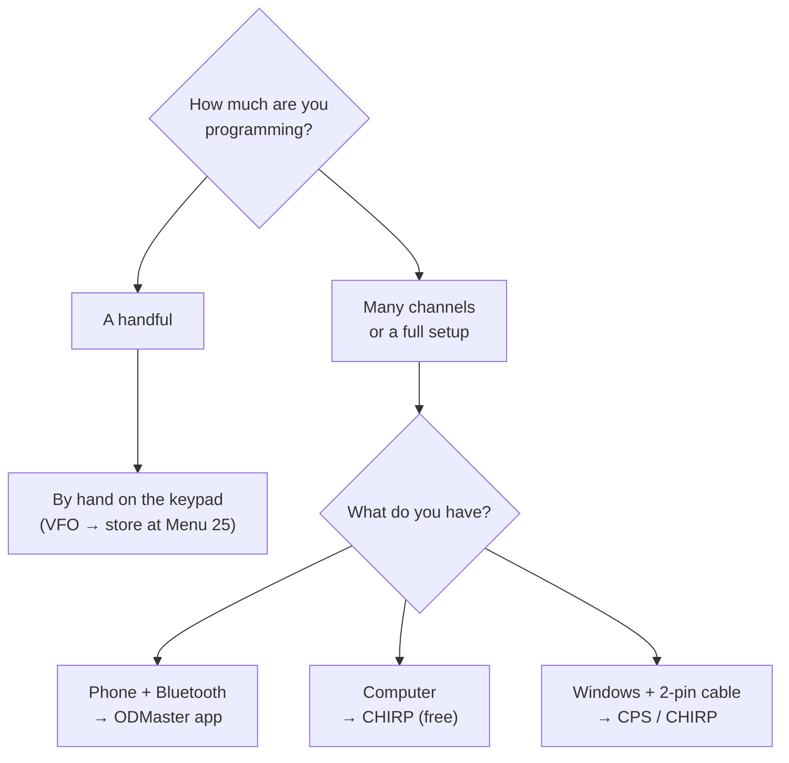
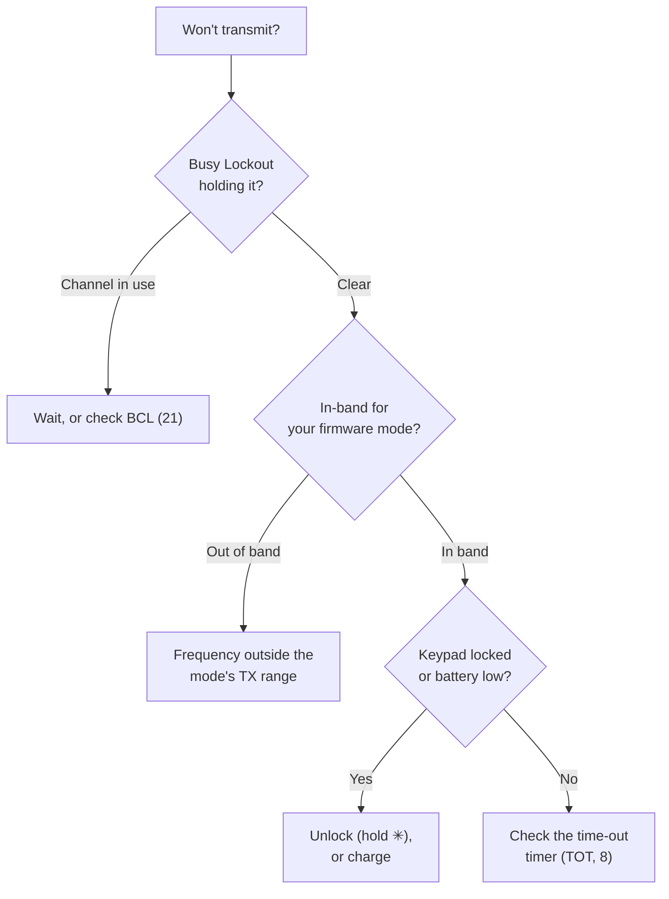

# Quick reference

_The whole guide folded onto one page: the key combos, the menus worth memorising, the verified facts, programming at a glance, and the first thing to check when the radio misbehaves. Print it, fold it, and keep it with the set._

This is a reference card, not a lesson — every line here is explained in full somewhere earlier in the guide, and the links point you back to that explanation when you want the "why". Two honest health-warnings before you lean on any number below, because the TD-H3 is less tidy than it looks. First, the **menu item numbers are firmware-specific and drawn from a single manual** — TIDRADIO revises firmware often and renumbers as it goes, so trust the label on your own screen over the number in a table. Second, **what the radio may transmit depends on its firmware mode** (HAM / GMRS / NORMAL), set in software, not on this page. With those two caveats in mind, here is the radio on a single sheet.

## Key combos and shortcuts

These are the controls that live _off_ the menu, as presses from the standby screen. They are drawn from the official manual; where a combination does nothing on your unit, the firmware revision is the likely reason, so treat the list as a strong guide and confirm on your own set.

| Action                                           | Keys                                                                           |
| ------------------------------------------------ | ------------------------------------------------------------------------------ |
| Menu rhythm                                      | `MENU` → item number (or `▲`/`▼`) → `MENU` → `▲`/`▼` → `MENU` to save → `EXIT` |
| Escape from anywhere                             | Press `VFO/MR` (Exit) a couple of times — changes nothing                      |
| Open the menu                                    | Short press `MENU`                                                             |
| Arm Bluetooth programming                        | **Long** press `MENU` (the `BL` function)                                      |
| Flashlight (LED torch)                           | The top `LAMP` / customised key                                                |
| FM broadcast radio on/off                        | `MENU` then the `8` key                                                        |
| Emergency alarm (may transmit — treat with care) | Hold the `SOS` key for about three seconds                                     |
| 1750 Hz repeater toneburst                       | Hold `PTT`, tap the `LAMP` / monitor key                                       |
| Start a scan                                     | Hold the `SCAN` key for more than two seconds                                  |
| Change scan direction                            | `▲` / `▼` while scanning                                                       |
| VFO (frequency) ↔ memory (MR) mode               | `VFO/MR`                                                                       |
| Choose the active line (A / B)                   | `A/B` — settings and the arrows act on the active line                         |
| DTMF keypad                                      | Short press `✳`                                                                |
| Keypad lock / unlock                             | Hold `✳` for more than two seconds                                             |

Two things the base TD-H3 does **not** have that other handhelds do: there is no confirmed dedicated momentary-monitor (force-squelch-open) button, and no confirmed one-key high/low power toggle from standby — set power in the menu instead (item 2 below). And Bluetooth here is for _programming only_; Bluetooth PTT and wireless audio belong to the **TD-H3 Plus**, a different radio.

## The menu rhythm

Every setting on the radio is reached the same way, so learn the rhythm once and the whole menu opens up. Nothing commits until you press `MENU` on the _value_, so you can browse the entire list without changing a thing.

## Factory reset

Reset lives at **Menu 35** and offers three depths. Reach for **VFO** first; keep **ALL** for when you have a software backup to restore from, because it takes your memories with it and there is no undo.

| Option                  | What it wipes                                           |
| ----------------------- | ------------------------------------------------------- |
| `VFO` — frequency reset | Operating settings only; **keeps** your stored channels |
| `CH` — channel reset    | Clears the stored memory channels                       |
| `ALL`                   | Every setting **and** every memory channel — no undo    |

## Menus worth memorising

You edit per-channel settings in **VFO mode**, then store the result to a channel — most values are frozen once they are in a memory. The numbers below follow the numbering in this guide's [Menu Reference](outpost:entry/logbook73.guide.td-h3/menu-reference); a few (store-to-channel = 25, the transmit tones at 12/13, the offset at 23/24) are cross-checked, but the rest come from one manual and may shift on your firmware. Read the label, not just the number.

| No. | Item           | Set to                                                                      |
| --- | -------------- | --------------------------------------------------------------------------- |
| 0   | `Bandwidth`    | Match the channel — **narrow** (≈12.5 kHz) for most modern amateur channels |
| 1   | `Squelch`      | 3–5 — the lowest number that reliably mutes the hiss                        |
| 2   | `TX Power`     | **Low** by default, High by exception (two levels only)                     |
| 3   | `Power Save`   | On (e.g. 1:2) to stretch the battery                                        |
| 4   | `Step`         | 12.5 or 25 kHz to land on band-plan channels                                |
| 8   | `TOT`          | A few minutes — the stuck-mic safety net                                    |
| 9   | `D.Wait`       | On, to keep an ear on both lines                                            |
| 11  | `Rx CTCSS`     | **Off** for general listening (it mutes non-matching signals)               |
| 13  | `Tx CTCSS`     | The repeater's published access tone                                        |
| 21  | `Busy Lockout` | **On** — refuses to key up over a conversation                              |
| 23  | `Direction`    | Repeater offset direction (Plus / Minus / None)                             |
| 24  | `Offset`       | Size of the repeater shift, in MHz — match your band plan                   |
| 25  | `Memory`       | Store the finished VFO setup to a numbered channel                          |
| 30  | `TAIL`         | On — trims the squelch-tail noise burst on simplex                          |
| 31  | `ROGER`        | **Off** — no roger beep on the amateur bands                                |
| 48  | `AM_BAND`      | AM demodulation for the 108–136 MHz airband                                 |

## The radio in one glance — verified facts

Everything in this box is confirmed across two or more independent sources. Where a figure is disputed, the dispute is shown rather than hidden.

|                  |                                                                                                                                                       |
| ---------------- | ----------------------------------------------------------------------------------------------------------------------------------------------------- |
| Type             | Dual-band VHF + UHF handheld, **analogue FM only** (no DMR / C4FM / D-STAR)                                                                           |
| Variants         | **HAM** (model TD831) and **GMRS** (model TD831G); firmware-switchable HAM / GMRS / NORMAL. No "Mini" exists — the only sibling is the **TD-H3 Plus** |
| FCC IDs          | Ham `2A4FBTD831`; GMRS `2A4FBTD831G`                                                                                                                  |
| Factory TX (ham) | VHF 136–174 MHz, UHF 400–470 MHz — _changes with firmware mode_                                                                                       |
| RX coverage      | Eight bands: 50–76, FM bc 76–108, AM air 108–136, 136–174, 174–350, 350–400, 400–470, 470–600 MHz                                                     |
| Power            | High **5 W** (rated) / Low **≈1–2 W** — two levels only. Low figure is disputed (manual 2 W, listings 1 W, one bench test ≈1.6 W)                     |
| Channels         | **199** memory channels                                                                                                                               |
| Tones            | **50** CTCSS · **105** DCS · **1750 Hz** repeater burst · DTMF encode                                                                                 |
| Display          | 1.44-inch **colour** screen, dual-line                                                                                                                |
| Battery          | **2500 mAh** Li-ion, charges over **USB-C** (port on radio _and_ pack)                                                                                |
| Antenna          | **SMA-Female** on the radio                                                                                                                           |
| Programming      | Keypad · **ODMaster** app over Bluetooth · **CHIRP** · 2-pin (K1) cable                                                                               |

The exact dimensions, the precise Low-power figure, channel steps and bandwidth in kHz, and the full menu-item count are **not** cross-confirmed between sources, so this card states none of them as fact. Where you see "≈", that is the honest range, not a rounded certainty.

## Go-to frequencies

Frequencies and allocations differ by **ITU region**, so treat these as a starting point and check _your_ national band plan. The core FM calling channels are widely shared; the repeater offsets are the item that varies most.

| Use               | Frequency                                       | Notes                                                                                     |
| ----------------- | ----------------------------------------------- | ----------------------------------------------------------------------------------------- |
| 2 m FM calling    | `145.500` (Region 1) · `146.520` (US, Region 2) | Call, then move to a working frequency                                                    |
| 70 cm FM calling  | `433.500` (Region 1) · `446.000` (US)           | Simplex, usually no tone                                                                  |
| 2 m repeaters     | Output frequency                                | `Direction` −, `Offset` ≈`0.600` MHz in most regions; access tone in `Tx CTCSS`           |
| 70 cm repeaters   | Output frequency                                | `Direction` +; `Offset` ≈`1.600` MHz (Region 1) or `5.000` MHz (US) — check the band plan |
| FM broadcast      | 76–108 MHz                                      | **Receive only** — `MENU` then `8`                                                        |
| Airband           | 108–136 MHz                                     | **Receive only**, AM — set `AM_BAND` (48) to AM                                           |
| NOAA weather (US) | 162.400–162.550 MHz                             | **Receive only** — assign a weather hotkey to enable                                      |
| PMR446 (Region 1) | 446.00625–446.09375 MHz                         | Licence-free band in Region 1; the US equivalent is FRS/GMRS                              |

A word on that last row: whether you may _transmit_ on any licence-free channel depends on the radio's variant, its firmware mode, and your national rules — a ham TD-H3 is not certified for PMR446/FRS, and an "unlocked" radio does not grant you unlocked privileges. Listen freely; transmit only where you are licensed and the equipment is certified. The rules live with your national regulator (Ofcom in the UK, the FCC in the US, and so on).

## Programming at a glance

Four routes in, chosen mostly by _how many_ channels you are loading. Whichever you pick, the golden rule is the same: **read the radio first and keep that file** — it is your backup and your undo button.

- **CHIRP** — supported in recent **CHIRP-next** builds, with separate entries for the TD-H3, TD-H3 Plus and TD-H8. It reads, writes, and can switch the operating mode HAM / GMRS / NORMAL. The documented cable is the 2-pin lead; whether CHIRP talks over the USB-C port is not confirmed across sources, so use the 2-pin cable its own instructions describe if in doubt.
- **ODMaster** — the manufacturer's app, on iOS, Android (over Bluetooth), web and PC. Arm the link with a long press of `MENU`, pair, edit.
- **2-pin (Kenwood "K1") cable** — TIDRADIO's own lead is the **TD-CH340**, which needs the CH340 driver (Windows). This is the path for the Windows **CPS** software and the traditional route for CHIRP.

Full detail lives in [Getting Started](outpost:entry/logbook73.guide.td-h3/getting-started).

## When things go wrong

The first checks, in the order that solves the most cases fastest. The full treatment is in [Troubleshooting](outpost:entry/logbook73.guide.td-h3/troubleshooting).

- **Totally silent, no hiss** → squelch too high: drop `Squelch` (1) to `3`. If the label matches an unlisted monitor function on your firmware, use it to prove the receiver is alive.
- **Signal bars jump but no audio** → a receive tone is muting it: set `Rx CTCSS` (11) and `Rx DCS` (10) to `OFF`.
- **Won't transmit** → work through the flow below.
- **Hears the repeater but can't open it** → set the access tone in `Tx CTCSS` (13), check `Direction`/`Offset` (23/24), and try the 1750 Hz burst (`PTT` + `LAMP`).
- **A menu item is greyed out or missing** → the **firmware mode** has locked it. Read the radio in CHIRP or ODMaster to see whether you are in HAM, GMRS or NORMAL.
- **An item's number doesn't match this card** → your firmware has renumbered it. Trust the on-screen label; the numbers here are single-sourced.
- **Ghost signals near a tall mast** → front-end overload, not a fault; the cures are physical (distance, a smaller antenna, a band-pass filter), never a menu.
- **CHIRP won't connect** → almost always the cable, driver or port. Confirm the right model entry, and always read _from_ the radio before you write _to_ it.
- **Everything tangled** → `Reset` (Menu 35) → `VFO` first; only use `ALL` with a backup to restore from.

## Try it yourself

- **Make the backup.** Before you touch anything, read the radio into CHIRP or ODMaster and save the file. Every experiment below is now reversible.
- **Prove the number jump.** Press `MENU`, then key `2` `5`. Land on the store-to-memory item and your firmware follows this card's numbering; land elsewhere and you have just learned to trust your screen over the table.
- **Set the five that matter.** `Squelch` (1) to 3–5, `TX Power` (2) to Low, `Bandwidth` (0) to match a local channel, `Busy Lockout` (21) on, `TOT` (8) to a few minutes.
- **Walk one repeater in.** In VFO mode set an output frequency, add `Direction`, `Offset` and `Tx CTCSS`, then store it at Menu 25 — and hear it come alive in memory mode.

## Key takeaways

- The menu rhythm is always **`MENU` → number or scroll → `MENU` → `▲`/`▼` → `MENU` to save → `EXIT`**; nothing commits until you confirm the value, so browsing is safe.
- **Menu item numbers are firmware-specific and single-sourced** — trust the label on your own screen, and re-check after any firmware update.
- The radio is **analogue FM only** in two variants (HAM/TD831, GMRS/TD831G) with a firmware-switched HAM / GMRS / NORMAL mode that governs what it may transmit — check the mode first when something is locked.
- Power is **High (5 W) or Low (≈1–2 W)**, two levels only; the exact Low figure is genuinely disputed across sources.
- The five to burn into memory: **`Squelch` 3–5, `TX Power` Low, `Bandwidth` to match the channel, `Busy Lockout` on, `TOT` a few minutes**.
- Whatever you program with — keypad, **ODMaster** over Bluetooth, **CHIRP**, or the **TD-CH340** 2-pin cable — **read a backup from the radio first**; it is your one-step undo.
- `Reset` is **Menu 35**: `VFO` keeps your channels, `ALL` wipes everything — never reach for `ALL` without a saved file.

That is the whole radio on a page. To go deeper on any line, start back at [Why This Guide](outpost:entry/logbook73.guide.td-h3/overview) and work forward — every number here is explained there in full.
