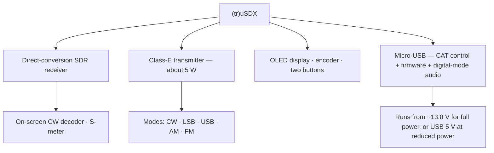

# Why the (tr)uSDX (a station in a shirt pocket)

Every so often the hobby produces a machine that seems to break the rules. The (tr)uSDX is one of them: a five-band, five-watt HF transceiver that does SSB, CW, AM and FM, measures its own SWR, talks to your logging software over USB — and fits in the palm of your hand. It weighs `140 g`. It runs from almost any DC source you can scrounge, down to a phone-charger USB lead. And it exists not because a factory's marketing department wanted it, but because two radio amateurs — Manuel, DL2MAN, and Guido, PE1NNZ — designed it in the open and gave the design to the community. This guide is the manual it deserves: the controls decoded, each documented menu item explained in plain English, the calibration and firmware story told honestly, and the operating know-how the official pages assume you already have.

## What the (tr)uSDX actually is

Strip away the novelty and the (tr)uSDX is a **five-band HF QRP transceiver built around a single small microcontroller and a very clever transmitter idea**, packed onto two stacked circuit boards inside a case the size of a bar of soap.

Unpacked into plain terms:

- **It transmits on five HF bands, chosen by the filter board you fit.** The standard build — the one the radio was designed around — covers **80, 60, 40, 30 and 20 m**. Alternative filter-board configurations cover the higher bands (**20/17/15/12/10 m**) or a "classic" spread (**80/40/20/15/10 m**). One radio, three published recipes; [chapter 6](outpost:entry/logbook73.guide.trusdx/calibration) explains how the firmware is told which one it is wearing.
- **It works the modes that matter at QRP.** CW and SSB are its bread and butter; AM and FM exist in the firmware as well, though on this hardware they are curiosities rather than headline acts. Digital modes such as [FT8](outpost:entry/logbook73.handbook/ft8) work beautifully — and uniquely, recent firmware can carry the _audio_ as well as the control data over the one USB cable, so a laptop and a wire antenna are genuinely the whole station.
- **It is astonishingly frugal.** The receiver draws about `80 mA`; transmit at full power draws about `500 mA` from a `13.8 V` supply. The transmitter is a **class-E** design with a typical efficiency around 85% — most of your battery becomes radio waves, not heat. [The theory chapter](outpost:entry/logbook73.guide.trusdx/theory) explains why that number is remarkable.
- **It carries its own microphone, speaker, SWR bridge and metering.** There is a tiny speaker and a microphone on the board itself, plus hardware to measure supply voltage, current, forward power and SWR — a whole test bench's worth of awareness in something pocket-sized.
- **It is operated through one knob and two buttons.** A rotary encoder and two push-buttons drive everything, through short presses, double presses, and holds. That economy takes an evening to learn and then becomes second nature; [chapter 1](outpost:entry/logbook73.guide.trusdx/getting-started) is that evening.

## Where it came from (and why that matters)

The (tr)uSDX did not appear from a factory catalogue. It grew out of the **uSDX** movement — an open experiment started when PE1NNZ showed that a humble ATmega328 microcontroller (the chip in an Arduino Uno) could be taught to demodulate and _generate_ single sideband entirely in software, first as a firmware hack for the QRP Labs QCX kit and then as a family of home-built transceivers. DL2MAN's contribution was to take that firmware lineage and design a tiny, manufacturable, two-board radio for it — the "(tr)u" in the name is a wink at how _small_ the uSDX idea could get.

Three practical consequences follow from that heritage, and they shape the whole ownership experience:

1. **The design is open, but protected.** Schematics, board layouts and firmware are published under a Creative Commons **Attribution-NoDerivatives** licence: anyone may build and even sell the radio unmodified, but derivatives are not permitted. Official group buys and listed sellers support the project; unlicensed lookalikes exist in numbers, and quality varies. Buy from the sellers listed on the official site if you want the radio the designers actually shipped.
2. **The firmware is personal.** Official firmware downloads are generated _for your radio's serial number_ from the project site. Your radio shows that serial number briefly at power-on. This is the project's answer to cloning, and it means firmware updates are tied to a genuine board.
3. **It is a kit culture radio.** You can buy it assembled or build it from a kit — winding five bands' worth of toroids yourself. Early production batches (2022-era kits from various vendors) had teething problems, particularly around filter-coil winding and PA efficiency, and the official assembly notes now lean heavily on careful filter tuning. An assembled unit from a listed seller sidesteps all of this; a kit teaches you more.

## Who this radio suits

The (tr)uSDX optimises for exactly two things — **size and efficiency** — and accepts real compromises everywhere else. That makes the "who is it for?" question unusually easy to answer.

- **The walker, traveller and minimalist.** For [SOTA](outpost:entry/logbook73.handbook/sota), [POTA](outpost:entry/logbook73.handbook/pota) and holiday operating, this is close to the theoretical minimum station: radio, wire, battery, done. It disappears into a jacket pocket. Nothing else with a microphone and five bands comes close to its size and weight.
- **The CW operator.** CW is where a five-watt constant-envelope transmitter shines, and the radio's keyer, decoder and message memories make it a genuinely capable little Morse machine.
- **The FT8-from-anywhere operator.** One USB lead to a laptop carries control _and_ audio on current firmware. Weak-signal digital modes forgive QRP power levels more than any other mode.
- **The experimenter.** This is a radio you are allowed to understand. The schematic is published, the firmware lineage is public, and the design decisions are documented and discussed in the open. If you enjoy knowing _why_ your radio works, few rigs reward curiosity like this one.

It suits you less well as a _first and only_ station if you mainly want relaxed SSB conversation from home: five watts of sideband is hard work, and the receiver and audio are built to a size, not to a luxury standard. It is a brilliant _second_ radio, and a uniquely portable first one for the right temperament.

## What it is, and what it is not

Honesty is cheaper than disappointment, so here is the straight list.

**What it is:**

- A real five-band, all-mode-that-matters HF transceiver of genuinely pocketable size and weight.
- Extraordinarily power-efficient, happy from about `13.8 V` for full output — and able to limp along usefully at about half a watt from a USB `5 V` supply.
- Self-aware: SWR bridge, power metering, voltage and current measurement, and an on-screen CW decoder, all built in.
- Digital-mode friendly to a degree unusual at any size: CAT control (Kenwood TS-480 protocol) and, on current firmware, audio over the same USB cable.

**What it is not:**

- **It is not a big-signal receiver.** The receiver is a direct-conversion design doing its filtering in software on a small microcontroller. It is far better than it has any right to be, but strong adjacent signals, summer band noise and crowded contest weekends will show you its limits. The attenuator settings exist for a reason; [chapter 3](outpost:entry/logbook73.guide.trusdx/everyday-operating) shows you how to use them.
- **It is not a hi-fi audio device.** The onboard speaker is tiny and quiet — think "confirmation the band is alive", not "armchair listening". Earphones or a small external speaker transform it; the moment you plug them in, the internal speaker is disconnected automatically.
- **It is not a linear amplifier with a gentle nature.** SSB is generated by an unusual polar-modulation technique that is brilliant when driven correctly and rough when it is not. Getting clean SSB out of it means spending five minutes with [chapter 4](outpost:entry/logbook73.guide.trusdx/ssb) rather than shouting at the deck.
- **It has no antenna tuner and only your discipline for SWR protection.** It expects a resonant antenna or an external tuner, and it repays a mismatch with heat and, in the worst case, dead output transistors. [Chapter 7](outpost:entry/logbook73.guide.trusdx/antennas-swr) is not optional reading.
- **Its menus move.** The firmware is alive and actively developed; menu items have been added, removed and renumbered between versions, and the official manual page itself carries a disclaimer that its information may lag behind. This guide documents the stable documented baseline and flags the moving parts explicitly, with the firmware series noted wherever behaviour differs.

## A word on safety and the licence

The same short list that applies to any transmitter, sized for this one:

- **Licence first.** Transmit only with the appropriate amateur licence, only inside the bands and modes your licence allows, and mind that the fitted filter board defines which bands the _radio_ supports — your licence defines which bands _you_ may use. The 60 m band in particular is a patchwork of national permissions and channels; check yours before calling. [Getting Licensed](outpost:entry/logbook73.handbook/getting-licensed) covers the path if you are not yet there.
- **Antenna always.** Never transmit without an antenna or dummy load; a class-E PA driven into nothing or into a bad mismatch can destroy its output transistors. Check [SWR](outpost:entry/logbook73.handbook/swr) before running power.
- **Sane supply.** The radio is designed around a nominal `13.8 V` DC supply for full output, and community documentation quotes a working DC-input range topping out around sixteen volts. Stay comfortably below that ceiling, never apply AC, and never reverse the polarity. USB power alone is safe and gives about half a watt out.
- **Respect duty cycle.** Constant-carrier modes (FT8, and long CW sessions) work the PA hard. The radio is efficient, which helps enormously, but give it airflow and breaks on hot days.

## How this guide is organised

[Getting started](outpost:entry/logbook73.guide.trusdx/getting-started) tours the hardware, controls and display. The [menu and button reference](outpost:entry/logbook73.guide.trusdx/menu-reference) is the whole control system in one scannable table. Chapters [3](outpost:entry/logbook73.guide.trusdx/everyday-operating) to [8](outpost:entry/logbook73.guide.trusdx/digital) then take the menus a group at a time — receiver and tuning, SSB, CW, calibration, antennas and digital modes. [Firmware](outpost:entry/logbook73.guide.trusdx/firmware) covers the bootloader and update ritual, [theory](outpost:entry/logbook73.guide.trusdx/theory) explains the genuinely unusual engineering underneath, and the guide closes with [ready-made configurations](outpost:entry/logbook73.guide.trusdx/configs), [troubleshooting](outpost:entry/logbook73.guide.trusdx/troubleshooting), [best practices](outpost:entry/logbook73.guide.trusdx/best-practices) and a [quick-reference card](outpost:entry/logbook73.guide.trusdx/quick-reference).

## Try it yourself

You need no licence to start; the receiver is yours from the first minute.

1. **Power it from anything.** Try it on a USB power bank, then on a `12`–`13.8 V` supply, and watch the reported supply voltage on the display. A radio this flexible about power changes how you think about portable operating.
2. **Listen to 40 m in the evening.** Select LSB, tune around `7.1` to `7.2 MHz`, and get used to the encoder's tuning-rate system — it is the single skill that makes this radio pleasant.
3. **Watch the CW decoder.** Find a steady CW signal around `7.0`–`7.03 MHz`, switch to CW mode, and watch the radio print what it hears. It is an honest teacher: it decodes clean senders and garbles poor ones, exactly as your ear eventually will.
