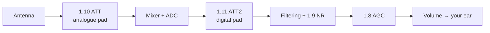

# Tuning, bands, modes and the receiver

This chapter is about the receiving and tuning half of the radio — the part you use ninety per cent of the time. It takes menu group 1 item by item, in the order you meet them in real operating: getting around the bands, choosing modes, and then the little stack of controls that turn a noisy band into a readable signal.

## Bands: what the radio has, and how to move

The (tr)uSDX transmits on the five bands of its fitted filter board — `80/60/40/30/20 m` on the standard "Lo" build, `20/17/15/12/10 m` on the "Hi" build, `80/40/20/15/10 m` on the "Classic" build. **Double-press the encoder** to hop bands; each band remembers a sensible stored frequency to land on. (Menu `1.4 Band` does the same thing with more ceremony.)

Two truths hide behind that simple picture:

- **The VFO tunes far beyond the ham bands** — the tuning range runs from long wave up to VHF numbers on the dial. Receiving outside the five filter-matched bands is possible but increasingly deaf, because the receive path runs through band filtering optimised for the built bands. Treat out-of-band tuning as a curiosity, not a broadcast receiver.
- **Transmit belongs only where you are licensed.** The radio will make RF wherever its filters allow; the low-pass filter for each band is what keeps your harmonics legal, and your licence is what keeps _you_ legal. Both matter. Never transmit outside the amateur allocations, and mind national quirks — 60 m especially is a patchwork of channels and permissions that differs country by country. Your national band plan is the authority; the [HF chapter](outpost:entry/logbook73.handbook/hf) explains how the bands behave, and [Propagation](outpost:entry/logbook73.handbook/propagation) explains when each one is worth your time.

A practical band-choice rule of thumb for the standard Lo build: **40 m is the daytime-and-evening workhorse; 80 m owns the late evening and night; 20 m opens continents by day; 30 m is a quiet CW/digital haven; 60 m (where permitted) bridges the 80/40 gap when both misbehave.**

## Tuning rate: the skill that makes the radio

One encoder, ten orders of magnitude of frequency — the tuning-rate system is how that works. **A short encoder press** steps the active digit (`1 kHz` → `100 Hz` → …), and the display shows which digit is live. The rhythm to learn:

1. **Coarse cruise** at `1 kHz` (SSB) or `500 Hz`/`1 kHz` (CW) until you hear something.
2. **Fine netting** at `100 Hz` (SSB) or `10`–`100 Hz` (CW) until it sounds natural.

That is all HF tuning is. Menu `1.5 Tune Rate` sets the same thing; the button is faster. A longer press jumps to a coarse rate for leaping across a band.

## Modes, and which sideband when

**The right button cycles modes**; menu `1.2` lists them all: LSB, USB, CW, AM, FM.

- **SSB** is the voice mode of HF. Convention (and the radio's own defaults) put **LSB below 10 MHz** (80/60/40 m) and **USB above** (30/20 m and up). [Modulation](outpost:entry/logbook73.handbook/modulation) explains why sideband voices sound like ducks until tuned exactly.
- **CW** — Morse — is the (tr)uSDX's happiest mode, with a whole chapter ([5](outpost:entry/logbook73.guide.trusdx/cw)) of its own.
- **AM and FM** exist in the firmware and have come and gone from beta builds. On five watts of HF they are niche: AM for listening to broadcasters with the filter wide, FM for the 10 m FM segment on Hi/Classic builds when the band is open. Nothing in this guide depends on them.

## The receiver stack: AGC, NR, ATT, ATT2

Here is the mental model that makes menu items `1.8`–`1.11` obvious. Signals arrive at wildly different strengths; the receiver's job is to hand your ear a _constant, comfortable_ level without drowning the weak stations or splattering on the strong ones. Four controls share that job, in order:

**`1.8 AGC` — leave it ON.** Automatic gain control rides the gain so a strong local and a weak DX station arrive at similar loudness. Turn it OFF only for special cases — some operators prefer manual control when digging at the noise floor, accepting that every strong signal will now slap them.

**`1.9 NR` — a little goes a long way.** The noise reduction is an averaging process: `0` is off, `8` is maximum smoothing. It genuinely tames hissy band noise, at the price of a watery, muffled quality that grows with the setting. Start at `0`; on a rough band try `1`–`3`. If you find yourself at `6`+, the real fix is usually the filter (`1.3`) or the antenna.

**`1.10 ATT` — the strong-signal valve.** A direct-conversion receiver this small has a finite appetite; a nearby contester or a big broadcaster can overload it, producing phantom signals and general mush ([Overload and Ghost Signals](outpost:entry/logbook73.handbook/overload-and-ghost-signals) explains the mechanism). The attenuator inserts loss _before_ the sensitive bits, in steps from `0` down to `−73 dB`. If the band suddenly sounds cleaner with `−13 dB` in, the attenuator wasn't costing you signals — it was saving you from distortion. On 80/40 m at night, a step of attenuation is often pure improvement.

**`1.11 ATT2` — the digital trim.** This scales the signal _after_ digitisation, `0–16` in 6 dB steps. It is a rescue lever for extreme cases (very strong stations that still overload the maths) rather than an everyday control. Default `0`.

## Filters: `1.3` and the double-press

Menu `1.3 Filter BW` (or a **double-press of the right button**) sets the audio passband: `Full`, `3000`, `2400`, `1800 Hz` for voice work; `500`, `200`, `100`, `50 Hz` for CW. The narrower the filter, the more of the band's chaos is simply _gone_ — at the cost of a boxier sound and, at the CW extremes, a ringing quality and unforgiving tuning.

Working defaults: **`2400 Hz` for SSB** (drop to `1800` in a crowd), **`500 Hz` for CW** (drop to `200` in a pile-up, `100`/`50` only for surgical cases). [Filters](outpost:entry/logbook73.handbook/filters) covers the theory.

## RIT: `1.7`, or hold the right button

RIT — receive incremental tuning — lets you move your _receive_ frequency while your transmit frequency stays put. **Hold the right button** to toggle it; tune; the other station hears you where you were. Use it when a station replies slightly off your frequency, or drifts. The eternal RIT rule: **switch it off after the contact**, or the next station you call will wonder why you cannot hear them. The display shows when RIT is active — believe it.

## Two VFOs and split: `1.6`

The radio keeps two full VFOs — A and B, each with its own frequency and mode. A **slow double-press of the right button** (or menu `1.6`) cycles VFO-A → VFO-B → **Split**.

Split is the DX tool: **you listen on VFO A, transmit on VFO B.** A rare station works "up 1" or "up 2" — listening a kilohertz or two above their own transmit frequency — precisely so callers don't bury them. Set A to the DX station, B to the calling frequency, engage split, and you are doing what the big rigs do. [Making Contacts](outpost:entry/logbook73.handbook/making-contacts) covers pile-up craft; the radio's part is just these three settings.

## The S-meter and the SWR meter: `1.12` and `1.13`

`1.12 S-meter` chooses how receive strength is shown: OFF, a **dBm** figure (honest and laboratory-flavoured), an **S**-number, or a classic **S-bar**. S-meters on all radios are polite fictions above and below their calibrated middle; treat yours as a _relative_ instrument — "you're two S-points stronger than yesterday" is meaningful, "you are exactly S9" is not. [Sensitivity](outpost:entry/logbook73.handbook/sensitivity) explains what the numbers pretend to mean.

On builds with transmit metering, `1.13 SWR meter` turns the onboard bridge's readings on: **FWD-SWR** shows forward power and SWR while you transmit (the mode you want), FWD-REF and VFWD-VREF show the rawer bridge quantities for diagnosis. This little instrument is one of the radio's quiet superpowers — a power meter and SWR check with zero extra grams in the pack. [Chapter 7](outpost:entry/logbook73.guide.trusdx/antennas-swr) puts it to work.

## The spectrum view (firmware 2.00t+)

**Hold the left button and turn the encoder**: the radio sweeps around your frequency and draws a small spectrum — activity as bumps, silence as floor. Your tuning-rate setting is the zoom: a coarse rate sweeps wide, a fine rate inspects close-in. It is slow and modest next to a waterfall on a big SDR ([FFTs and Waterfalls](outpost:entry/logbook73.handbook/ffts-and-waterfalls) shows what the luxury version looks like), but for "is anyone _on_ this band?" it answers in seconds what dial-twirling answers in minutes.

## Putting it together: a band in ninety seconds

A repeatable ritual for arriving anywhere:

1. **Double-press encoder** to the band. Mode check: LSB/USB per convention, or CW.
2. **Spectrum sweep** (hold left + turn) or a coarse cruise at `1 kHz`. Find life.
3. **Net the signal** at `100 Hz` or finer.
4. **Comfort pass:** filter to fit (`1.3`), a step of ATT if the band is loud and dirty, NR a notch if it is hissy.
5. Listen before transmitting — always — then work them.

Next: what actually happens when you press that PTT — [SSB on a five-watt digital transmitter](outpost:entry/logbook73.guide.trusdx/ssb).
