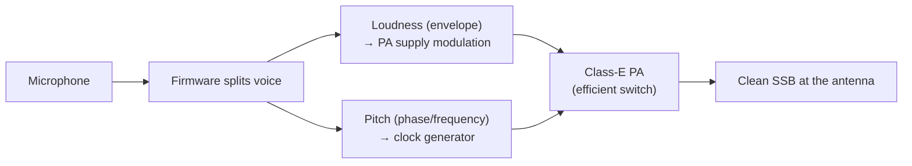

# SSB on a five-watt digital transmitter

Most transceivers make single sideband the conventional way: build a low-level SSB signal, then feed it through a chain of linear amplifiers that reproduce it faithfully at power. The (tr)uSDX does something genuinely different — its transmitter is a switching amplifier that is _never_ linear, and the firmware conjures SSB out of it by splitting your voice into loudness and pitch and controlling each separately, thousands of times per second. When it is set up well it sounds remarkably good and sips battery. When it is set up badly it sounds like a robot gargling. This chapter is about being in the first group, and every control in menu group 3 makes sense once you see the trick.

## The trick, in one diagram

The class-E PA is an on/off switch — brutally efficient (around 85% typical on this design), utterly unable to amplify "a bit less" or "a bit more" on its own. So the firmware measures your voice's **envelope** (how loud, moment to moment) and **phase** (which way the waveform is leaning) separately. The phase information steers the frequency of the clock-generator chip driving the PA; the envelope information throttles the PA's effective drive. Recombined at the antenna, the result is single sideband. Engineers call the family of techniques _polar modulation_ or EER; [the theory chapter](outpost:entry/logbook73.guide.trusdx/theory) goes deeper. What you need to remember at the microphone is simpler:

> **The transmitter reproduces the voice you give it — including every flaw, and including levels it cannot follow.** The controls below exist to hand it a clean, sane signal.

## Where your voice comes from

Three sources, in priority order:

- **The onboard microphone** — yes, really, on the main board. Speak across the case from a hand-span away. It is the "no kit at all" fallback and works better than it has any right to.
- **An external microphone/PTT** on the key/mic jack. Plugging one in disables the onboard mic. An electret headset or speaker-mic wired to the documented pinout gives you consistent mic distance, which matters more than mic quality here.
- **Audio from a computer** over the same jack or — on current firmware — over USB, which is the digital-modes story in [chapter 8](outpost:entry/logbook73.guide.trusdx/digital).

PTT keys the transmitter in voice modes. (In CW mode, the PTT line doubles as an emergency straight key — a documented party trick worth remembering the day your paddle cable dies.)

## `3.3 TX Drive` — the control that decides how you sound

TX Drive, `0–8`, sets how hard the firmware drives the modulator. It is the single most consequential voice setting on the radio, and it is worth understanding rather than memorising:

- **Too high**, and voice peaks ask the modulator for more than it has. The tops clip off; the signal splatters wider than its channel and sounds harsh. You will get "loud but distorted" reports and annoy the neighbours on frequency.
- **Too low**, and you are whisper-thin — clean, but buried in the band noise, wasting the few watts you have.
- **`8` is special: constant amplitude.** The envelope side is pinned to maximum — correct for CW and FM (which have no amplitude information) and useful for carrier tests, but _wrong_ for SSB, which is nothing but amplitude information.

Start SSB at a middle value (`4`–`6` is the community's usual landing zone), then do the honest test below. The right value depends on your voice, your mic distance and your build — which is exactly why it is a menu item and not a solder joint.

**The honest test:** find a quiet frequency, ask a friend (or your own second receiver, or a WebSDR in another tab) to listen, and speak normally. Raise TX Drive until reports say "full and clean", and the moment anyone says "a bit harsh on peaks", come down a step. With `1.13 SWR meter` showing forward power, watch the power dance with your voice — SSB power _should_ flutter with speech peaks; a needle nailed to maximum while you talk means you are clipping.

## `3.2 Noise Gate` — silence between words

The noise gate, `0–255`, sets the audio level below which the transmitter treats input as silence. On a polar transmitter this matters more than usual: without a gate, the modulator faithfully transmits your room — fan hum, wind, the dog — at low level between words.

Set it empirically: in a quiet room, raise the value until background sounds no longer produce transmit output between phrases, and no further — too high and it starts eating the soft beginnings of your words, a distinctive "clipped consonants" sound. Field operators in wind will want it higher than shack operators.

## `3.1 VOX` — hands-free keying

VOX switches to transmit automatically when audio arrives, using the noise-gate threshold as its trigger. For _voice_ use it is a convenience with a known price: the first syllable that trips it can get shortened, and every cough transmits. For **digital modes it is the standard tool** — the computer's audio starts, the radio transmits, the audio stops, the radio returns to receive; no CAT keying line needed. Leave it OFF for casual SSB; turn it ON deliberately, and turn it off again after ([chapter 8](outpost:entry/logbook73.guide.trusdx/digital) uses it properly).

## `3.4 TX Delay` — protecting the kit around you

TX Delay inserts up to `255 ms` between the radio keying and RF actually flowing. Barefoot — radio straight into antenna — leave it at `0`. Add delay when something electromechanical sits between you and the antenna: an external amplifier's changeover relay, an auto-tuner's latching relays, a remote antenna switch. Hot-switching a relay with RF is how contacts get pitted; `20–50 ms` of politeness is invisible to the ear and kind to the hardware.

## `3.5 MOX` — hearing yourself

On builds that offer it, MOX unmutes your own transmitted audio so you can hear roughly what you are sending. Use it in seconds-long bursts to sanity-check a new mic position or drive setting — then switch it off. Listening to yourself at length teaches you nothing new and invites feedback squeal with a speaker.

## A voice setup that works, start to finish

1. **Mode** per band convention (LSB on 80/60/40, USB on 20 and up). **Filter** `2400 Hz`.
2. **Noise Gate:** quiet room, raise until between-word silence is truly silent.
3. **TX Drive:** start `4`. Do the honest test; settle at "full and clean".
4. **VOX OFF, MOX 0, TX Delay 0** (until external kit says otherwise).
5. Check the metering: SWR under `1.5:1`, forward power moving with your voice.
6. Log the settings you settled on. After any firmware update they will be gone ([chapter 9](outpost:entry/logbook73.guide.trusdx/firmware) explains), and future-you will be grateful.

## Expectations, honestly set

Five watts of SSB is a real signal — evenings on 40 m and good days on 20 m will fill a log — but it is the hardest of the radio's modes, because voice spreads its energy wide and thin. The same watts go three times as far in CW and ten times as far in FT8, in felt terms. When SSB is hard going, that is not the radio failing; that is physics inviting you to [chapter 5](outpost:entry/logbook73.guide.trusdx/cw) or [chapter 8](outpost:entry/logbook73.guide.trusdx/digital). And when a five-watt voice contact _does_ cross an ocean on a wire you strung that morning — there is nothing else in the hobby quite like it.

One more expectation worth setting: **AM and FM.** Both exist in the mode list (`1.2`); AM transmit on a QRP polar rig is an inefficient novelty, and FM is only meaningful in the 10 m FM segment on Hi/Classic filter builds. The beta firmware series has removed and restored both modes at various points. Treat them as bonus features, and treat SSB, CW and digital as the radio's real voice.
