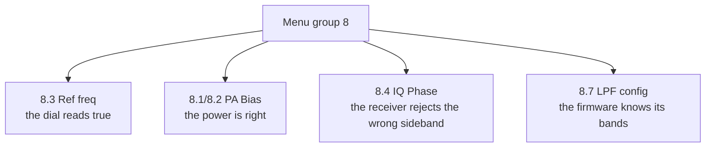

# Menu 8: calibration and the card that saves you

Menu group 8 is where the firmware learns the truth about your particular radio: exactly how fast its crystal runs, how hard its PA may be driven, how its receiver's two signal paths line up, and which filter board it is wearing. On an assembled unit these arrive with workable values; on a kit, setting them _is_ the last assembly step. Either way they are yours to protect — a firmware update or an accidental factory reset erases them, which is why this chapter's real deliverable is a filled-in card in your log book.

## Why calibration exists at all

Mass-market radios hide calibration in the factory. The (tr)uSDX cannot: every board's crystal is a few parts-per-million its own self, every hand-wound filter is slightly individual, and the whole design philosophy is that _you_ are trusted with the adjustments. None of them is difficult. All of them are set-once-and-write-down.

## `8.3 Ref freq` — making the dial honest

The clock-generator chip that creates every frequency in the radio is disciplined by a crystal that is _nominally_ 25-and-a-bit megahertz and _actually_ something a few dozen hertz away. `8.3 Ref freq` tells the firmware the crystal's true frequency, so the display and reality agree.

**The calibration:** tune to a transmission whose frequency is known absolutely — a standard-frequency station such as WWV (`10 MHz`) or a broadcast carrier of known channel, in AM or CW mode. If your dial reads exactly the known frequency when the signal is exactly zero-beat (the pitch of the carrier descending to nothing), you are done. If not, adjust `8.3` — the value is the crystal frequency in hertz — until zero-beat and the correct dial reading coincide. Patience beats haste: a few hertz of error at the crystal multiplies across bands.

A drifted reference shows up as: SSB stations only sounding natural when your dial is consistently a bit off the round numbers, and FT8 decodes clustering at one edge of the waterfall. Both cure instantly here.

**Write the final value down.**

## `8.1` / `8.2` PA Bias — setting the power window

These two numbers define the PWM window that drives the PA:

- **`8.1 PA Bias min`** — the drive level meaning "zero output". On current beta firmware this item is gone and fixed at `0`; on builds that still show it, it stays at the bottom of the range unless a specific procedure says otherwise.
- **`8.2 PA Bias max`** — the drive level meaning "full output". **This is your power control**, and the reason it is a calibration rather than a preset is heat: a class-E stage pushed past the point where output stops rising just converts the excess into temperature in the output transistors.

**The calibration:** into a dummy load, key a carrier (CW, or a TX-Drive-`8` test tone) with the SWR/power metering on — or an external power meter if you have one. Raise `8.2` in steps and watch forward power: it climbs, then flattens. **Set `8.2` at the beginning of the flat region, not beyond it.** Past-the-knee settings buy no watts and cook FETs. On the standard supply that lands you near the radio's typical five watts; on lower supply voltages the whole curve sits lower — the design trades output for supply gracefully, all the way down to USB power's half-watt.

Deliberately _lowering_ `8.2` is also the legitimate way to run reduced power — for QRPp experiments, for driving a transverter or external amplifier gently, or for licence classes with lower limits.

**Write the final value down.**

## `8.4 IQ Phase` — teaching the receiver left from right

The receiver is a direct-conversion design that separates the wanted sideband from its mirror image by combining two signal paths — I and Q — that must sit exactly ninety degrees apart ([I/Q Signals](outpost:entry/logbook73.handbook/iq-signals) tells the whole story). Component tolerances skew that angle slightly; `8.4 IQ Phase` trims it back. The reward is **opposite-sideband rejection**: how well a strong signal on the _wrong_ side of your dial stays inaudible.

**The calibration:** take a strong, steady signal (a nearby broadcast carrier, a friend with a dummy-load carrier, or a signal generator). Tune it in on the **wrong** sideband — for example, in USB mode, tune so the signal would appear as its unwanted mirror. Adjust `8.4` for **minimum audibility of the mirror**. A well-trimmed board makes the wrong-side ghost sink dramatically; expect a sharp, satisfying null rather than a vague trend.

You will hear an untrimmed IQ phase as "every strong station appears twice, once backwards, a few kilohertz away". Cure here.

**Write the final value down.**

## `8.7` — telling the firmware which radio it is

The three published filter-board recipes — **Lo** (`80/60/40/30/20 m`, the standard and best-performing build), **Hi** (`20/17/15/12/10 m`) and **Classic** (`80/40/20/15/10 m`) — share the same main board and firmware. The LPF-configuration item (numbered `8.7` on current builds) tells the firmware which recipe is fitted, so that band selection switches the right filters at the right frequencies.

Set it once to match your hardware. The symptom of a mismatch is unmistakable nonsense: the band list offers frequencies your filters cannot serve, output power collapses on "bands" the board doesn't really have, and SWR readings go strange. If you ever change or rebuild the RF board to a different recipe, this item changes with it.

## The card in the log book

The official firmware page is blunt about it: updates erase settings, so record them first and re-apply after. This is the card:

| Setting                           | Menu  | Your value        |
| --------------------------------- | ----- | ----------------- |
| Ref freq                          | `8.3` | ______________ Hz |
| PA Bias max                       | `8.2` | ______________    |
| PA Bias min (if shown)            | `8.1` | ______________    |
| IQ Phase                          | `8.4` | ______________    |
| LPF/Band config                   | `8.7` | Lo / Hi / Classic |
| Serial number (shown at power-on) | —     | ______________    |
| Firmware version                  | —     | ______________    |

Five minutes with a pen, and neither a firmware update nor the factory-reset trap ([chapter 1](outpost:entry/logbook73.guide.trusdx/getting-started)) can cost you more than five minutes putting the numbers back.

## When to recalibrate

- **Ref freq:** once, then only if the dial drifts (crystals age slowly; annually is generous).
- **PA Bias max:** after any RF-board work, PA transistor replacement, or a change of habitual supply voltage.
- **IQ Phase:** after main-board repairs, or if mirror ghosts appear.
- **LPF config:** only when the fitted filter recipe actually changes.

Calibrated, recorded, done — the radio now tells the truth about frequency and power, which makes the next chapter's SWR readings worth believing: [antennas, SWR and protecting the PA](outpost:entry/logbook73.guide.trusdx/antennas-swr).
