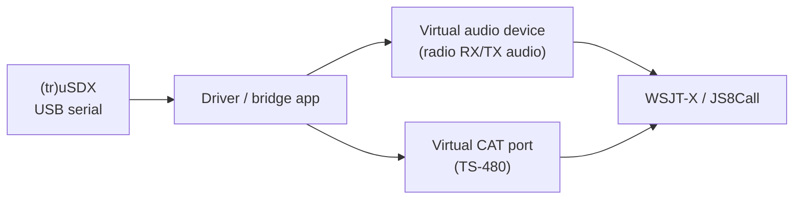

# CAT and digital modes over one USB cable

Here is the (tr)uSDX's most modern trick, and the one that changes what "minimal station" means: on current firmware, the single Micro-USB cable carries **computer control and both directions of audio**. No sound-card interface, no audio leads, no VOX cable spaghetti — a laptop, the radio, a wire antenna, and you are on [FT8](outpost:entry/logbook73.handbook/ft8). This chapter covers CAT control, the audio-over-USB system, the classic audio-cable fallback, and the settings that make digital modes clean.

## CAT control: the radio speaks Kenwood

Plug the Micro-USB into a computer and the radio appears as a serial port (it uses a CH340-family USB chip — most systems have the driver already; Windows sometimes wants it installed once, and the [firmware chapter](outpost:entry/logbook73.guide.trusdx/firmware) links the same driver used for updates).

The control protocol is **Kenwood TS-480**: in any logging or digital-mode program, select _Kenwood TS-480_ as the rig. The serial speed depends on firmware:

| Firmware         | Baud rate |
| ---------------- | --------- |
| 2.00t and later  | `115200`  |
| earlier releases | `38400`   |

If CAT refuses to connect, the baud rate is the first suspect and the firmware version the second. With CAT up, your software reads and sets frequency and mode, and can key transmit — which alone makes logging accurate and rig control comfortable ([HF Data Modes](outpost:entry/logbook73.handbook/hf-data-modes) surveys what's possible once a computer is attached).

## Audio over the USB cable (firmware 2.00u and later)

The official manual is emphatic, and rightly pleased with itself: _digital modes over the USB cable only — no audio cables and sound cards are needed; the audio stream is transported over the CAT serial interface._ The radio multiplexes digitised receive audio and transmit audio through the same serial stream as the control commands.

Because operating systems don't natively treat a serial port as a sound card, a small **driver/bridge program** runs on the computer: it opens the radio's serial port, presents a virtual audio device (and a virtual CAT port) to your applications, and shuttles the streams. The official manual page points to the _(tr)uSDX CAT-streaming driver_ for WSJT-X, JS8Call and Winlink use, with community implementations covering Windows, Linux and macOS (the Linux and Mac routes are documented via the official forum and linked guides; community scripts such as the `trusdx-audio` Python bridge are the usual Linux answer). On Android, **FT8CN** (v0.91+) speaks to the radio directly over USB-OTG — a phone-sized station for a phone-sized radio.

The setup shape is always the same regardless of OS:

In WSJT-X, then: **Radio** = Kenwood TS-480 on the driver's virtual port, `115200` baud; **Audio in/out** = the driver's virtual audio device; **PTT** = CAT. Practical wisdom from the forum threads: plug in and power the radio _before_ starting the driver and application (port numbering on some systems is assigned at connection), and give things a moment to enumerate.

Expectations, set honestly: the audio path is engineered for _digital modes_, which are narrow and robust — it is not a hi-fi streaming interface, and it is a recent feature that has seen active debugging across the beta series. If it misbehaves, the classic path below always works.

## The classic path: audio cables and VOX

Before 2.00u — and still, any time you prefer it — digital modes run the way QRP operators have run them for decades:

1. **Computer audio out → radio mic input** (the key/mic jack), at a _low_ level.
2. **Radio audio out → computer mic/line in** (the phones jack).
3. **Keying by VOX:** menu `3.1 VOX` ON — transmit begins when the computer's tones start and ends when they stop. The `3.2 Noise Gate` threshold decides what counts as "audio has started": raise it just past any computer hiss.

Cheap TRS leads and five minutes of level-setting; the only art is the levels, covered next.

## Levels: the whole art of clean digital

Digital modes are constant-envelope-ish and unforgiving of overdrive. Two rules produce a clean signal every time:

- **Drive lightly.** Set the computer's output volume low and creep it up. On the radio, watch forward power (`1.13` metering): it should reach a steady, _believable_ level — and if power stops rising as you raise computer volume, you are past the useful point; back off well below there. A digital signal driven into the flat region is spattering products across the band. In WSJT-X, use the **Pwr** slider and the standard practice of keeping the audio path unclipped.
- **Watch the duty cycle.** FT8 transmits for most of fifteen seconds in every thirty; WSPR for two minutes. The (tr)uSDX's efficiency is a genuine advantage here — far less heat than a linear PA at the same output — but give it air, keep it out of direct sun on a summit, and let receive periods do their cooling.

Mode settings on the radio for any digital work: **USB** sideband (always, all bands, by universal convention), filter **wide** (`2400`–`3000 Hz`) so the software sees the whole audio passband, AGC ON, and — for the audio-cable path — VOX ON only while operating, OFF after.

## RF and USB: the gremlin and the ferrite

The most common digital-mode complaint with any tiny station: everything works on receive, then **transmit makes the USB connection drop**, the audio glitch, or the computer act haunted. That is your own RF riding the cables — the small-station problem from [chapter 7](outpost:entry/logbook73.guide.trusdx/antennas-swr) in its favourite habitat. The fix list, in order of effectiveness:

1. **Antenna first:** a properly matched antenna, further from the operating position, radiating your watts instead of feeding them to your desk.
2. **Choke the coax** at the radio: several turns through a ferrite ring or a clamp-on core.
3. **Choke the USB lead** the same way; a short, good-quality lead beats a long thin one.
4. **Lower power** while diagnosing — if the problem vanishes at reduced drive, it is definitely RF, and the chokes will pay for themselves.

## A five-minute FT8 session, end to end

1. Radio: USB mode, band via encoder double-press, wide filter, metering on. Antenna checked ([chapter 7](outpost:entry/logbook73.guide.trusdx/antennas-swr) ritual).
2. Computer: driver/bridge running (or audio cables + VOX armed); WSJT-X pointed at TS-480 / virtual audio; **rig control shows the right frequency** — change bands on the radio and watch WSJT-X follow, which proves CAT.
3. Pick the band's standard FT8 frequency (WSJT-X knows them), receive for a minute — decodes scrolling means your RX chain is right.
4. Answer a CQ at modest drive. Watch the first transmit period on the radio's meter: sensible power, no USB drama, SWR happy.
5. Log the contact; the world's weak-signal database now contains proof that a hand-sized radio and a wet piece of string work fine. It never stops being funny.

Five watts into FT8's decode threshold is, in felt terms, a big signal — this mode plus this radio is the most contacts-per-gram the hobby currently offers. When conditions are thin, this is the chapter to come back to; when they are good, even [SSB](outpost:entry/logbook73.guide.trusdx/ssb) feels easy.
