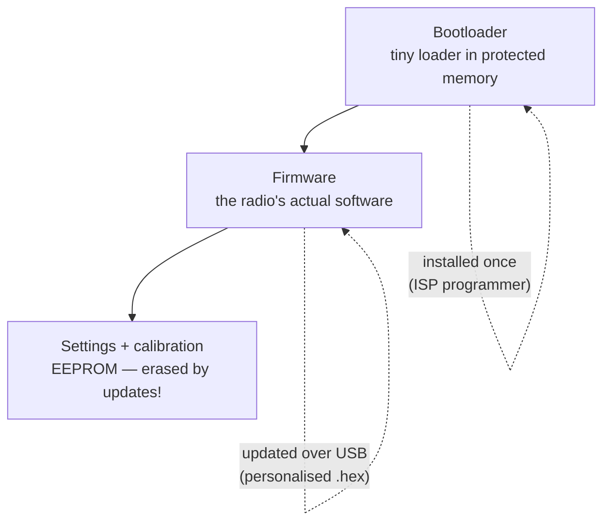

# Bootloader, firmware and updates

The (tr)uSDX's firmware is not an afterthought bolted to hardware — it _is_ most of the radio. SSB generation, filtering, the decoder, the metering: all of it is software on one small chip, which is why updates genuinely change what the radio can do (audio over USB and the spectrum view both arrived this way). This chapter explains the pieces — bootloader, personalised firmware, the update ritual, and the beta channel — so an update is a five-minute chore rather than an act of faith.

## The three-layer picture

- **The bootloader** is a small program that lets new firmware arrive over the USB cable. It is installed once — by the seller or group-buy organiser, normally before you ever see the radio — and it is why you _don't_ need special hardware for updates.
- **The firmware** is the radio. Official builds are the 2.00 series, developed by PE1NNZ with DL2MAN.
- **Your settings and calibration** live in EEPROM — and the official documentation is blunt that **updates erase them**. The [calibration card](outpost:entry/logbook73.guide.trusdx/calibration) exists for exactly this moment.

## Your serial number, and why firmware is "personal"

At power-on the radio briefly shows its **serial number**. On the official firmware page you enter that serial (and optionally your callsign) and receive **a firmware file generated for your radio** — the project's answer to the flood of unlicensed clones, and the reason a genuine board matters. Two practical consequences:

- **Record the serial number** along with your calibration values; you need it for each update.
- If the radio **doesn't show a serial** at power-up, the official page is explicit: either a hardware defect, or **no bootloader is installed** — see the last section. (A serial starting `7000…` is also called out as a sign of fuse/bootloader trouble.)

## The update ritual

What you need: a data-capable Micro-USB lead, the **CH340 USB driver** (once per computer), and **AVRDudess** — a friendly front-end for the standard AVR flashing tool. Then:

1. **Write down your settings** — calibration group 8 above all. Say it twice because the official page does: the update erases them.
2. Download **your personalised firmware** (a `.hex` file) from the official firmware page using your serial number.
3. Connect the radio by USB; find its COM/serial port (Device Manager on Windows).
4. In AVRDudess: Programmer **Arduino** (the STK500 v1 bootloader protocol), your port, baud **`115200`**, MCU **ATmega328P** — the official instructions stress using this setting _even if your board carries the ATmega328PB variant_.
5. Select the `.hex`, make sure **"set fuses" and the other write-checkboxes are unchecked** (the bootloader's fuses are not the updater's business), and press **Program**.
6. Power-cycle, confirm the new version, then **re-enter your settings and calibration** from the card.

The whole thing is two minutes of transfer and three of ceremony. If the flash fails partway the bootloader is still there — retry the connection and settings; nothing about a failed _firmware_ write bricks the loader.

## Stable releases and the beta channel

Official releases arrive on the firmware page; **beta builds** live on a linked page of their own with a version history, and are announced in the official forum. The 2.00-series letters march forward (a build like `2.00t` is newer than `2.00m`), and recent history shows why the version matters to a manual — features and even _menus_ move:

| Firmware       | What changed (headline)                                                                                                                                   |
| -------------- | --------------------------------------------------------------------------------------------------------------------------------------------------------- |
| 2.00t          | CAT baud became `115200`; spectrum view (hold left + tune) arrived                                                                                        |
| 2.00u          | **Audio over the USB cable** for digital modes                                                                                                            |
| 2.00v/w (beta) | CW messages 1–6; power-off via volume; SSB TX improvements; several menu items removed (PA Bias min fixed at `0`; NR, attenuators, decoder toggle pruned) |
| 2.00x (beta)   | Community pushback honoured: Filter BW, Band, Tune Rate, VFO, RIT and NR **restored** to the menu; Practice mode retired (TX Drive `0` serves instead)    |

Treat that table as illustrative, not gospel — it is exactly the churn the [menu reference](outpost:entry/logbook73.guide.trusdx/menu-reference) warns about, and the beta page's own changelog is the source of truth. The stable/beta decision is temperament: stable for "I want the radio to be the same radio next week", beta for "I want the new toy and will happily re-read a changelog". Beta explicitly _may contain bugs_, in the project's own words.

There is also a wider ecosystem fact worth knowing: the (tr)uSDX firmware descends from the open **uSDX/QCX-SSB** lineage on GitHub, so the _ideas_ (and much of the menu system) are publicly documented source code even though official (tr)uSDX builds are distributed as personalised binaries. When you wonder what a menu item _really_ does, the lineage source is this guide's own backstop.

## After every update: the ten-minute re-commission

1. Re-enter calibration (`8.3`, `8.2`, `8.4`, and `8.7` LPF config) from the card.
2. Volume, filter, S-meter, keyer settings back to taste.
3. Check CAT still connects — remembering the **baud change at 2.00t** if you crossed it.
4. One brief key-down into a dummy load or good antenna: power and SWR sensible.
5. Note the new version on the calibration card.

## If there is no bootloader

Bought from an official seller, this section should never apply — the loader ships installed. But a bare kit board, or a mishap, means installing it once with an **ISP programmer**. The official route is refreshingly cheap: an **Arduino Uno running the ArduinoISP sketch**, a handful of jumper wires to the radio's ISP header, and AVRDudess writing the bootloader **with its documented fuse settings** (the official page lists them exactly — the fuses are the one step where precision matters, and the one step normal updates never touch). Once done, disconnect the programmer forever; every future update is the USB ritual above.

If any of that paragraph reads as a foreign language, it is genuinely fine to ask the seller or the community to do this one step — it is a once-per-radio event, and everything else in this chapter is easy.
