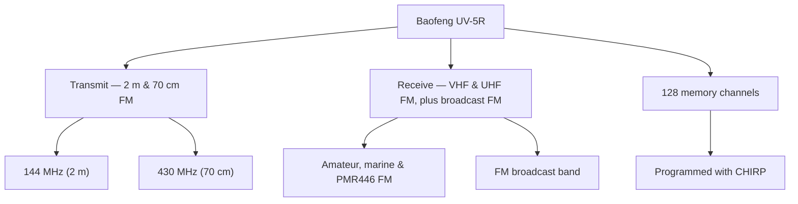
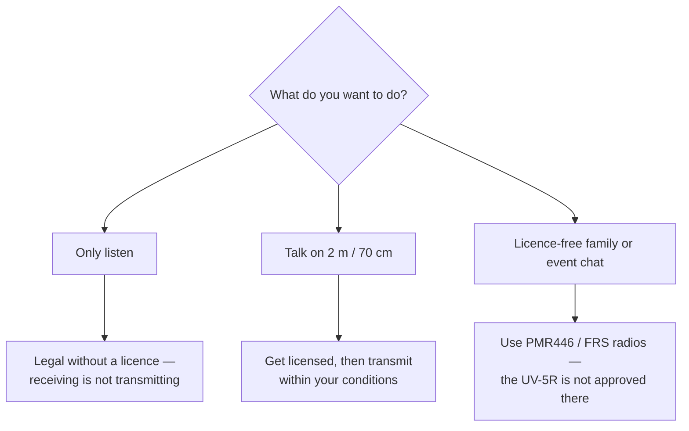

# Why the UV-5R still matters

The Baofeng UV-5R has become a widely used entry point to two-way radio. It is a compact, budget dual-band handheld that can work local [repeaters](outpost:entry/logbook73.handbook/repeaters) when terrain and coverage allow. Yet its reputation online swings wildly between "the radio that democratised the hobby" and "the radio that ruined it". The truth is calmer, kinder and far more useful than either — and this guide exists to give it to you straight.

## Why a cheap radio deserves a proper book

The UV-5R ships with a slim manual that lists its menu and then stops. It will tell you that menu item `16` is called `DTMFST` and offers `OFF / DT-ST / ANI-ST / DT+ANI`, but not what a DTMF side tone is, why anyone would want one, or which value to leave it on. It tells you `STE` exists — but not what a squelch tail is, or why eliminating it makes you a more polite operator. That gap between _listing_ a setting and _explaining_ it is exactly the gap this guide fills. For every item on the radio we answer the questions the manual skips: **what it does, what the radio is doing inside, why the feature exists at all, sensible values, and whether you should touch it.**

The pay-off reaches well beyond one pocket radio. The UV-5R is deliberately simple — two bands, FM only, one knob — which makes it a wonderful teaching instrument. Learn to set a duplex offset, choose a CTCSS tone, pick the right bandwidth and run the lowest power that does the job here, and you have learned a working slice of amateur radio itself. Sit down later in front of a rig ten times the price and its menus will already make sense. A radio this cheap that teaches you properly is worth more to the hobby than an expensive one that stays in its box because its owner is afraid of it.

## A note for experienced operators

If you have been licensed for years, you may wonder why a careful reference should exist for a radio you might never reach for first. Fair — so let us be honest, and accurate. The UV-5R is not a lab-grade radio. To hit its remarkable price it uses far less selective front-end filtering than a premium handheld, so in a strong-RF environment it can overload, intermodulate and serve up ["ghost" signals](outpost:entry/logbook73.handbook/overload-and-ghost-signals) that are not really there — a behaviour so well documented on this exact model that it has become the textbook example. Its transmit is generally acceptable for amateur use, but its spectral purity and consistency are not on a par with a well-engineered Yaesu, Icom or Kenwood, and its history on that front is genuinely mixed (more below). The keypad ergonomics are fiddly and the supplied antenna is weak.

But two things are also true. First, this radio has brought more newcomers **into** amateur radio than any marketing campaign ever could, and this guide's job is to make sure they arrive understanding what they are doing — transmitting cleanly and legally, tones set correctly, behaving well on shared channels. Second, the skills transfer. An operator who can explain why you run the lowest power that does the job, or why a busy-channel lockout is good manners, is a good operator on any equipment.

So wherever this guide makes a recommendation, it leans towards clean, legal, considerate operation: in-band only, lowest sensible power, tones set right, and always within your [licence conditions](outpost:entry/logbook73.handbook/getting-licensed). If that is the operator a budget radio produces, everyone wins — and the UV-5R has produced a great many of them.

## What the UV-5R actually is

At heart the UV-5R is refreshingly straightforward: a dual-band handheld transceiver for the 2 m (144 MHz) and 70 cm (430 MHz) amateur bands, in FM, with 128 memory channels. In the hand it is all of one knob, a two-line screen, a couple of side keys and a numeric keypad.

One knob switches the radio on with a click and sets the volume — that is _all_ it does, which after some radios is a real mercy. The screen shows two frequencies at once (an upper and a lower VFO). The left edge carries the transmit key and two small side keys — `CALL`, which doubles as the FM-broadcast toggle, and `MONI`, which turns on the torch and opens the squelch. The numeric keypad lets you type a frequency directly. In terms of what it can _do_:

In plain terms:

- **It transmits** on 2 m (nominally 136–174 MHz) and 70 cm (400–480 MHz) in FM — the two bands a new licensee lives on. Keep to your amateur allocations within those ranges, and to your permitted power.
- **It receives a little more widely than it transmits, but only in FM.** It will monitor other FM services that fall in those VHF/UHF ranges — marine VHF, [PMR446](outpost:entry/logbook73.handbook/uhf), and assorted business and utility channels — and it has a separate broadcast **FM radio** ([65–108 MHz](outpost:entry/logbook73.handbook/vhf)) for music and news. Because it is an FM-only [receiver](outpost:entry/logbook73.handbook/receivers), it does **not** do the aviation airband (which is AM) or shortwave — a limit worth knowing before you go looking for them.
- **It remembers 128 channels.** A memory stores a frequency together with its offset, tones, bandwidth and power, so recalling "GB3 local" restores everything in one step.
- **You programme it with [CHIRP](outpost:entry/logbook73.guide.uv-5r/getting-started)** — the free, open-source software that supports the UV-5R beautifully. This is a genuine advantage over some pricier radios: a huge community keeps CHIRP current, and a backup of your radio costs nothing.

That is the whole radio. There is no GPS, no [APRS](outpost:entry/logbook73.handbook/aprs), no [digital voice](outpost:entry/logbook73.handbook/digital-voice) — and that simplicity is part of why it is such a good place to start.

## What it is not

Knowing a tool's limits is part of using it well, so here is the honest list:

- **It is a broad receiver, not a fussy one.** The wide, cheap front end has very little filtering, so near a broadcast, paging or cellular site — or, counter-intuitively, on a _better_ outdoor antenna — it can overload, desense and produce [ghost signals](outpost:entry/logbook73.handbook/overload-and-ghost-signals) that are not on the frequency you think you are hearing. This is the UV-5R's single most-documented weakness, and it is the classic example that inexpensive wideband handhelds struggle with strong RF while premium radios cover the same ranges with much better front ends. In everyday pocket use you will rarely notice it; if a "repeater" appears on an odd frequency near a transmitter mast, suspect intermod before you believe it. A modest antenna, or a band-pass filter for fixed use, tames it.
- **It is FM only — no AM, no SSB, no shortwave.** Unlike some newer budget do-everything handhelds, the UV-5R will not demodulate the AM aviation airband or the SSB/CW you would hear on the [HF](outpost:entry/logbook73.handbook/hf) bands. Its broadcast FM tuner is a nice extra, not a scanner. If wide receive coverage is your goal, this is the wrong Baofeng.
- **Its transmit is generally acceptable, not premium.** Modern units generally meet the regulatory requirements of the markets they are sold in, and current production is much cleaner than the earliest examples — but the UV-5R's spurious-emission history is genuinely mixed, and its consistency does not match higher-end amateur gear. The practical answer is the same either way: operate in-band, run the lowest power that does the job, and add a band-pass filter for fixed or repeater use. The measured detail is in the box below.
- **It will transmit where it should not.** Like most radios of its kind it can be made to transmit outside the amateur allocations — and it was that out-of-band _capability_, together with how the radios were marketed, that actually drew regulators' attention to Baofeng-type sets. It was **not** a ban on licensed amateurs using them on the ham bands, and it was **not** about harmonics — a nuance the internet routinely garbles (again, see the box). Do not transmit out of band. **Transmit only where your licence permits** — for a UK Foundation licensee that means your 2 m and 70 cm amateur allocations at your permitted power, and nothing else. Elsewhere, check your national band plan and licence conditions.
- **It is fiddly to set up by hand, with a thin manual.** The keypad programming is awkward and the supplied documentation is sparse — which is precisely why this guide, and CHIRP, exist.

## How it actually tests

The UV-5R has been on the bench more than almost any other budget handheld, so unusually we can lean on real measurements rather than owner impressions. Treat this as the honest current picture:

- **Receive sensitivity is genuinely good.** Independent 12 dB SINAD bench tests put it around **0.13–0.27 µV** on VHF and UHF — competitive with radios costing many times more. This is a real strength, not marketing ([Miklor test results](https://www.miklor.com/UV5R/UV5R-TestResults.php)).
- **The front end is the weak point — and a better antenna can make it worse.** With minimal input filtering, the receiver "collapses quickly" in high-RF conditions, and fitting a bigger outdoor antenna can _degrade_ reception by feeding more out-of-band energy in; an external band-pass filter cures it, which proves the front end is the limiter ([PD0AC review](https://hamgear.wordpress.com/2012/04/05/review-baofeng-uv-5r-part-ii/)).
- **Transmit power is roughly as rated — not the inflated "8 W".** Bench figures land near **4–5 W on VHF** and **3.5–4.5 W on UHF**, close to its 4 W specification; ignore rebadged listings claiming 8 W ([Miklor](https://www.miklor.com/UV5R/UV5R-TestResults.php)).
- **Transmit purity has a real, nuanced history.** ARRL Lab hamfest testing reported in _QST_ (January 2020, Technical Correspondence, pp. 60–62) found only **5–9%** of the Baofeng-family handhelds brought in over four years met the amateur spurious-emission limits, against 100% for Alinco, Icom, Kenwood and Yaesu. Independent tests of current production are kinder — most now _just_ pass, if with less margin than a premium radio, and results vary between individual units ([RadioReference spectral-purity / IMD testing](https://forums.radioreference.com/threads/baofeng-spectral-purity-imd-testing.461065/)). Run low power, keep it in-band, and consider a filter for fixed use.
- **The 2018 FCC action was about out-of-band transmit and marketing — not a ban.** It concerned radios being sold with transmit capability outside their authorised ranges and how they were marketed. It did **not** ban licensed amateurs from using them on the amateur bands, and it was **not** about harmonics ([KB6NU: "Did the FCC just make Baofengs illegal? Short answer: no"](https://www.kb6nu.com/did-the-fcc-just-make-baofengs-illegal-short-answer-no/)).

Read together, these say something sensible: a keen receiver, a crude front end, a transmitter that is fine when you keep it in-band and turned down, and a legal story that is far less dramatic than the forums suggest.

## Who this guide is for, and how to read it

You are welcome here whether you are a brand-new licensee who has just unboxed one of these, someone weighing up their very first radio, a listener exploring what it can hear (receiving is legal without a licence almost everywhere — it is _transmitting_ that needs one), or an old hand who just wants a menu reference that finally explains everything.

Where a decision matters — most of all, "am I allowed to transmit here?" — the answer usually comes down to what you are trying to do:

### What people actually use it for

A radio this cheap earns its keep in ways an expensive rig never gets the chance to. The common ones, and _why_ the UV-5R suits each:

- **Your first licensed radio.** This is the classic use. It is cheap enough that a fumbled setting or a rooftop drop is no tragedy, capable enough to work your local repeaters and simplex, and — because it teaches offsets, tones, bandwidth and power discipline — it makes you a better operator before you spend real money. Start here, learn the craft, then buy your "keeper" knowing exactly what you want from it.
- **A listener's / SWL radio.** With no licence at all you can legally _listen_ to the amateur bands, marine VHF, PMR446 and the broadcast FM band, and get a feel for how busy your local repeaters are before you commit to the exam. Just remember its ceiling: FM only, so no airband and no shortwave.
- **Event marshalling and group comms — with an honest caveat.** For a licensed team (a club net, a hilltop activation, a rally where the marshals are all amateurs), a handful of UV-5Rs on a 2 m or 70 cm simplex channel is superb value. But if your helpers are _not_ licensed, the licence-free route is [PMR446](outpost:entry/logbook73.handbook/uhf) (in Europe) or FRS (in North America) using proper type-approved radios — the UV-5R is **not** approved to transmit on those channels, because they require a fixed antenna and a lower power. Match the radio to the licence, not the other way round.
- **A backup / go-bag radio.** It is small, sips battery, and costs little enough to leave in a rucksack, a car or an emergency kit and forget about. Keep it charged, keep your local repeaters programmed in, and it is a capable fallback when your main rig is unavailable.
- **Kids, scouts and clubs.** For teaching youngsters or running a training session, a box of cheap identical handhelds is far less nerve-wracking than lending out expensive ones. Programme them all the same with CHIRP, and everyone starts on the right channel.
- **A cheap second (or third) radio.** Even seasoned amateurs keep one on the bench as a spare receiver, a cross-check, or a knock-about radio for the shed and the garden. When it costs less than a decent meal, you stop worrying about it.

The guide itself is built in sections, and you do not have to read them in order:

- **[Getting Started](outpost:entry/logbook73.guide.uv-5r/getting-started)** orients you: the layout, the display, the modes, and how to think about programming. Read this first.
- **[Every Menu Explained](outpost:entry/logbook73.guide.uv-5r/menu-reference)** is the reference — a one-page menu map plus chapters for [each](outpost:entry/logbook73.guide.uv-5r/menus-1) [group](outpost:entry/logbook73.guide.uv-5r/menus-2) of settings. Dip in whenever an item puzzles you.
- **[Radio Theory](outpost:entry/logbook73.guide.uv-5r/theory)** is the _why_ behind the settings, cross-linked to the main [handbook](outpost:entry/logbook73.handbook).
- **[Practical Configurations](outpost:entry/logbook73.guide.uv-5r/configs)** gives you ready-made setups to copy straight onto the radio.
- **[Troubleshooting](outpost:entry/logbook73.guide.uv-5r/troubleshooting)** and **[Best Practices](outpost:entry/logbook73.guide.uv-5r/best-practices)** are the "why won't it…" and the "how to be a good operator" sections.

A word on the slant: recommendations here lean towards **UK amateur practice** — Foundation-friendly, with UK band-plan conventions and licence-free comparisons like PMR446 and the [1750 Hz repeater tone](outpost:entry/logbook73.handbook/repeaters). The underlying theory is universal, so if you are elsewhere, take the concepts and check your own national band plan and licence conditions.

## Before you begin

Four things make the rest of this guide go smoothly:

1. **Charge the battery fully** before first use — the standard pack is a 1800 mAh 7.4 V lithium-ion — and fit the supplied antenna finger-tight. **Never transmit without an antenna attached:** a transmitter with nowhere to send its power can damage itself, and even a healthy radio into no antenna is asking for trouble (the reasoning is in [SWR](outpost:entry/logbook73.handbook/swr)).
2. **Match the antenna to the job.** The stock "rubber duck" trades efficiency for portability. If you replace it, choose an antenna specified for 2 m / 70 cm with the correct connector, buy from a reputable supplier, and remember that a more efficient antenna can make front-end overload worse near strong transmitters. More in [Antennas](outpost:entry/logbook73.handbook/antennas).
3. **Know your licence conditions.** If you are not yet licensed you can still follow every receive-only part of this guide legally; see [Getting Licensed](outpost:entry/logbook73.handbook/getting-licensed) when you are ready to transmit. Never transmit out of band.
4. **A quick safety note.** A handheld is a transmitter next to your head. Keep the antenna a few centimetres from your face when transmitting, use the lowest power that does the job, and never key up into a damaged or missing antenna. That is the whole of RF safety for a radio this size; [RF Power](outpost:entry/logbook73.handbook/rf-power) has the reasoning.

## Key takeaways

- The UV-5R is a budget dual-band (2 m / 70 cm) **FM-only** handheld with 128 memories — no GPS, no APRS, no AM/SSB/shortwave — and it has introduced many people to amateur radio; this guide is the reference it should have shipped with.
- Its **receive sensitivity is genuinely good** (bench-tested around 0.13–0.27 µV), but its **cheap, broad front end overloads easily** in strong RF — and a bigger antenna can make that _worse_, not better.
- Its transmit is generally acceptable for amateur use but not premium: the spurious-emission history is mixed (older units often failed the amateur limit, most current production just passes), so operate **in-band, at the lowest sensible power**, within your licence conditions.
- The 2018 FCC action was about **out-of-band transmit capability and marketing, not harmonics, and not a ban** on licensed amateur use — the honest version is far less dramatic than the forums.
- Match the radio to the licence: licensed 2 m/70 cm work is where it shines; licence-free family and event use belongs on PMR446/FRS, where the UV-5R is not approved to transmit.
- Programme it with **CHIRP**, keep a backup, and use an antenna that suits the operating environment — then let a simple, capable radio teach you the craft.

Ready? Let's pick it up and learn our way around it — [Getting Started: Layout, Display & Modes](outpost:entry/logbook73.guide.uv-5r/getting-started).
