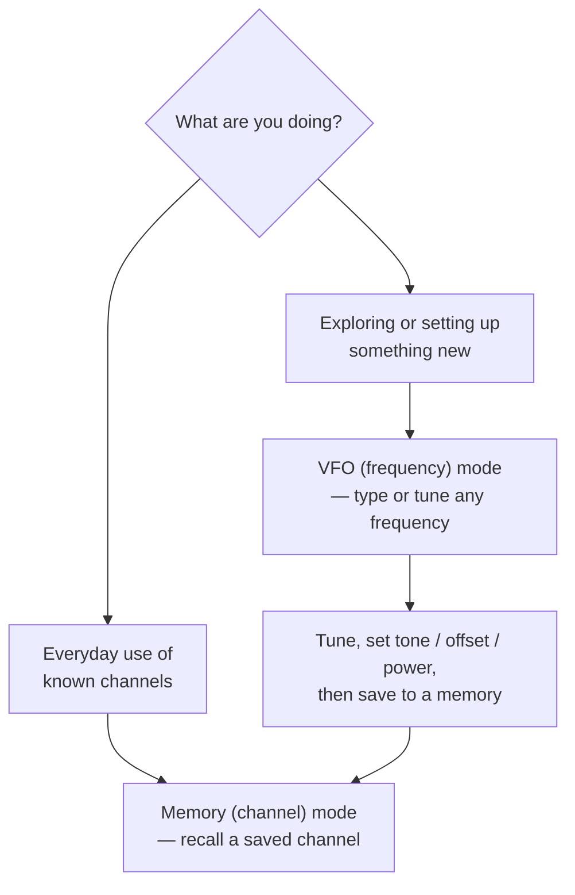
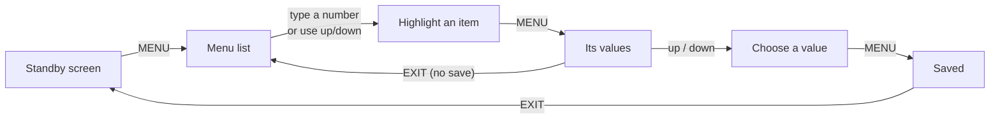

# Getting started: layout, display and modes

The quickest way to fall out with a radio is to press the wrong button in the first five minutes, end up somewhere baffling, and have no idea how to get home. The UV-5R has a reputation for exactly this — not because it is complicated, but because its buttons are quiet about what they do. So before we open a single menu, let's get properly oriented: what every control does, what the two-line screen is telling you, and the two or three ideas the whole radio is built around. Twenty unhurried minutes here and the rest of this guide will feel obvious.

## The front panel

There is not much to the front panel — a handful of controls, and a couple that do double duty on a long press. Don't try to memorise them; just get a feel for what does what as we walk through each one in turn, top to bottom.

1. **Antenna (SMA-Female).** The socket on the radio is a female SMA — the supplied "rubber duck" is the matching SMA-Male and screws in finger-tight. Never force it, and **never transmit without an antenna**, because a transmitter with nowhere to send its power can cook its own output stage. Two things worth knowing early: this is the _opposite_ gender to Yaesu, Icom and Kenwood handhelds, so their antennas need an adapter; and any replacement must suit 2 m / 70 cm and the connector — see [Antennas](outpost:entry/logbook73.handbook/antennas). One honest caution lives here too: the UV-5R's receiver has very little front-end filtering, so bolting on a big outdoor antenna near a broadcast or paging mast can actually make reception _worse_ by flooding it with signals it cannot reject — the subject of [Overload & Ghost Signals](outpost:entry/logbook73.handbook/overload-and-ghost-signals).
2. **Flashlight LED.** A small white torch on the top edge — genuinely handy in a dark shack or footwell. It is toggled by the lower side key (number 8 below), not by a menu. It draws from the same battery that runs the radio, so it is a torch of convenience, not a survival tool.
3. **Volume / power knob.** The top-right knob switches the radio on with a click and sets the volume — clockwise for on and louder, anticlockwise to the click for off. That is _all_ it does. There is no separate power button; the click is the on/off.
4. **Indicator LED.** A small light on the front, up near the top. It glows **red while you transmit** and **green when the squelch opens** on an incoming signal. (Charging status is shown by a separate LED on the drop-in charger base, not by this one.) A glance at it confirms you are actually transmitting — reassuring when you are not sure the PTT has taken.
5. **LCD display.** The screen shows two frequencies at once and is dense with little tags. It rewards a proper read, so it gets its own section next.
6. **PTT (push-to-talk).** The big button on the upper-left edge. Hold it to transmit on the **active** line (more on "active" shortly), release it to go back to listening. Two habits to build from day one: run the **lowest power that does the job** (see [RF Power](outpost:entry/logbook73.handbook/rf-power)), and keep the antenna a few centimetres from your face while you key up. Transmit only where your [licence](outpost:entry/logbook73.handbook/getting-licensed) permits.
7. **Side key 1 — CALL.** The upper of the two grey side keys, just below the PTT. A **short press** toggles the built-in **FM broadcast radio** (the ordinary 65–108 MHz band you listen to music on) on and off. **Press and hold** it to arm the **alarm** — a loud attention tone — and hold again to cancel. The alarm transmits, so treat it as an emergency feature, not a toy.
8. **Side key 2 — MONI.** The lower side key. A **short press** toggles the flashlight. **Press and hold** it to **monitor** — the radio forces the squelch open so you hear the raw background hiss and any signal too weak to break through normally. Monitor is how you dig a faint station out of the noise, or check whether a quiet channel is truly clear before you call.
9. **VFO/MR · A/B · BAND — the mode keys.** Three small keys near the top of the keypad set _how_ the radio is working:
   - **VFO/MR** swaps between **frequency (VFO) mode** — where you dial any frequency by hand — and **memory (MR) mode**, where you recall channels you saved earlier. It is the single most important key to understand, and it has its own section below.
   - **A/B** chooses which of the two on-screen frequency lines is **active** — the one the PTT transmits on and the one the arrows tune.
   - **BAND**, in VFO mode, flips the active line between the **VHF** 2 m band around 144 MHz and the **UHF** 70 cm band around 430 MHz (see [VHF](outpost:entry/logbook73.handbook/vhf) and [UHF](outpost:entry/logbook73.handbook/uhf)). When the FM broadcast radio is running, the same key switches its tuning band instead (65–75 MHz or 76–108 MHz).
10. **MENU · up/down · EXIT — the menu keys.** These four drive the settings list:
    - **MENU** opens the menu and **confirms** a choice.
    - The **up (▲)** and **down (▼)** arrows scroll the menu, tune the active line, and change values. **Hold** an arrow in VFO mode to tune quickly.
    - **EXIT** steps back out of the menu, or clears a half-typed frequency. When you are lost, this is your escape hatch.
11. **Numeric keypad (0–9, ✳, #).** In VFO mode, **type a frequency directly** — far quicker than winding the arrows. In memory mode, the number keys jump to channel numbers, and they send DTMF touch-tones on transmit. Two of them wear a second hat: **✳** activates **reverse** on a short press (swapping your transmit and receive frequencies, handy for testing a repeater) and starts a **scan** when held; **#** toggles **High/Low power** on a short press in memory mode and **locks the keypad** when held for two seconds. The small extra words printed on the number keys (`1 STEP`, `2 TDR`, `3 SAVE` and so on) are menu shortcuts we will meet in the reference.

> **The single most useful habit:** when you get lost, press **EXIT** a couple of times. It walks you back to the standby screen without changing anything. There is no menu so deep you cannot escape it.

## Understanding the display

The standby screen looks cluttered because it is showing you two radios at once, wrapped in a ring of little status tags. Learn the anatomy of one line and you have learned both.

```viz
{
  "type": "display",
  "title": "UV-5R — the standby display",
  "caption": "Two frequency lines, top and bottom, conventionally called A and B. A small arrow marks the active line — the one the PTT transmits on. Every tag around a frequency is a live setting you can change.",
  "screen": {
    "rows": [
      { "vfo": "A", "freq": "434.325", "power": "H", "bw": "N", "shift": "+", "tone": "CT", "active": true },
      { "vfo": "B", "freq": "145.125", "power": "L", "bw": "W", "tone": "DCS" }
    ],
    "topIcons": ["S", "VOX", "R", "|III|"]
  },
  "callouts": [
    { "n": 1, "x": 14, "y": 3, "label": "Status icons", "side": "left" },
    { "n": 2, "x": 5, "y": 16, "label": "Active-line arrow", "side": "left" },
    { "n": 3, "x": 36, "y": 16, "label": "Frequency", "side": "left" },
    { "n": 4, "x": 90, "y": 16, "label": "Line tags", "side": "right" },
    { "n": 5, "x": 8, "y": 33, "label": "Sub-tone: CT / DCS", "side": "left" },
    { "n": 6, "x": 90, "y": 33, "label": "Channel number (MR)", "side": "right" },
    { "n": 7, "x": 92, "y": 3, "label": "Battery gauge", "side": "right" }
  ]
}
```

1. **Status icons** run along the top strip, and they only appear when the feature is on: a signal-strength bar graph when a station is breaking squelch, `VOX` when hands-free transmit is armed, `S` when dual-watch is running, `R` when reverse is engaged, plus a padlock when the keypad is locked and a small envelope or musical note for DTMF activity. If the radio is misbehaving — keying up on its own, say — this strip usually explains why.
2. **The active-line arrow.** The two frequency lines are conventionally called **A** (top) and **B** (bottom), but the screen does not print those letters — instead a small arrow (▲) sits beside whichever line is currently **active**. This matters more than it looks: the PTT transmits on the active line, the arrows tune it, and menu changes apply to it. The `A/B` key moves the arrow.
3. **The frequency** is the big number on each line: what that VFO is tuned to. In VFO mode you can overtype it from the keypad; in memory mode it shows the frequency stored in the current channel.
4. **The line tags** sit around each frequency and are worth learning to read, because they save you diving into menus to check. There is a **power** marker, a **bandwidth** marker, and a **duplex-shift** marker (`+` or `−`) that appears when the line is set up for a repeater. One quirk to know: to save space the UV-5R prints a tag only for the _non-default_ state — you will see an **`L`** for **low power** (high power shows nothing) and an **`N`** for **narrow** bandwidth (wide shows nothing). The figure above shows `H`/`W` as well so you can see the pair, but on the real screen those two states are simply blank. (The factory manual's icon table labels the `N` as "wide band selected", which is a translation slip — on the radio, `N` means **narrow**.)
5. **The sub-tone tag** shows `CT` when a **CTCSS** analogue tone is active on that line, or `DCS` for a digital code. These are the quiet sub-audible tones that keep your speaker silent until the right station calls, and open many [repeaters](outpost:entry/logbook73.handbook/repeaters) — a whole chapter of their own later.
6. **The channel number** appears on the right in **memory (MR) mode** — the `000`–`127` slot you are sitting on. In VFO mode this space is blank because you are on a raw frequency, not a stored channel.
7. **The battery gauge** sits top-right. The UV-5R has no percentage or voltage readout by default (you can set it to show the battery voltage at power-on later), so the segmented bars are your fuel gauge — top it up when it drops to one.

## VFO and memory: the two ways to tune

Almost everything on this radio hangs off one basic question: are you **dialling a frequency by hand**, or **recalling one you saved earlier**? Those are the two **modes**, and the `VFO/MR` key swaps between them.



**VFO (frequency) mode** — the screen shows raw frequencies with no channel number — gives you the whole band to roam. Type a frequency on the keypad or step it with the arrows, and the radio goes there. This is where you _set things up_: find a repeater, add its offset and tone, pick a power level, then store the lot into a memory so you never do it again.

**Memory (channel) mode** — a channel number appears on the right — recalls those stored channels. A memory is not just a frequency: one recall restores the frequency, the duplex offset, the CTCSS/DCS tones, the bandwidth, the power level and (if you named it in software) a label. This is where you live day to day — step to your local repeater and everything is already correct.

Two things trip people up, and both are worth reading twice. First, **memory mode is empty until you store at least one channel** — a brand-new UV-5R has nothing to recall, so pressing `VFO/MR` may look as if it does nothing. Store a channel and it springs to life. Second, **you cannot re-tune a memory channel in place.** A memory is a saved snapshot; to change its frequency or tone you go back to VFO mode, make the change there, and save over the channel. The one thing you _can_ nudge directly on a stored channel is High/Low power, with the `#` key.

## A and B: the two frequency lines and dual-watch

The two lines on the screen behave like two little independent radios sharing one speaker, one antenna and one set of controls. Each has its own frequency, its own band, its own tone and its own power level. Only one is **active** at a time — the line with the arrow — and the `A/B` key moves the arrow between them. The active line is the one the PTT transmits on and the arrows tune, so a good habit is to glance at the arrow before you key up.

By default the radio listens on the **active** line only. Turn on **dual-watch** — the `TDR` menu item, shown as `S` on the display — and it keeps an ear on _both_ lines at once, hopping between them so it can catch a call on either. It is not true simultaneous reception (when one line is busy the other is deaf for that moment), but for everyday monitoring it is exactly what you want: park A on your local [repeater](outpost:entry/logbook73.handbook/repeaters) and B on the 2 m calling channel `145.500 MHz`, switch on dual-watch, and you will hear whichever comes alive.

One subtlety catches newcomers out: with dual-watch on, the UV-5R transmits on whichever line the arrow last settled on — which is not always the one you _think_ you are on. If you answer a call and the other station cannot hear you, check the arrow first. Nine times in ten, that is the whole problem.

## Finding your way around the menu

The UV-5R's settings live in one numbered list — roughly items `0` to the low `40`s, depending on firmware — and you drive it with a simple rhythm. Nothing you do here can break the radio: a change only takes effect when you confirm it, and `EXIT` always backs you out.



In words: press **MENU** to open the list; then either **type the item's number** on the keypad (fast, once you know them) or **scroll with the up/down arrows**; press **MENU** again to drop into that item's values; use the **arrows** to choose one; press **MENU** to **save**; and press **EXIT** to leave. If you wander off, the menu times out on its own and returns to standby without saving.

A worked example, to make the rhythm concrete. To set the squelch — the control that silences the background hiss — press **MENU**, type **`0`** (squelch is item 0), press **MENU** to open it, use **▲/▼** to pick a value from `0` to `9`, press **MENU** to save, then **EXIT**. Low numbers let more through (including hiss); high numbers demand a stronger signal to open up. You have just felt what squelch does; the _why_ is in [What the Settings Really Mean](outpost:entry/logbook73.guide.uv-5r/theory).

The same quirk from the modes section applies here: several menu items behave differently, or refuse to change, depending on whether you are in VFO or memory mode, because some settings belong to the _radio_ and others to the _channel_. If an item won't budge, switch to VFO mode, change it there, and re-save the memory.

## How to think about programming

You can load channels into a UV-5R two ways, and which is right depends almost entirely on **how many**.

**By hand**, using the keypad and menus, is fine for a handful — your two local repeaters and a couple of simplex frequencies. Tune the frequency in VFO mode, set the offset and tone, choose the power, then use the `SAVE` menu item to write it to a channel number. It works, and it is worth doing once so you understand what a memory contains. But be honest with yourself: hand-programming the UV-5R is genuinely tedious — multi-tap entry, a menu number for every field, and no way to see your channels as a list. Twenty channels this way is an afternoon of thumb-ache and mis-keyed tones.

**By software** is the answer for anything more, and it is how nearly every experienced UV-5R owner does it. The standard tool is **CHIRP** — free, open-source, runs on Windows, macOS and Linux, and supports the UV-5R directly. Think of it as a spreadsheet for your radio: each row is a channel, each column a field (frequency, offset, tone, power, name), and when you are happy you write the whole table to the radio in one pass. What takes an afternoon on the keypad takes five minutes in CHIRP.


Three practical notes before you start. First, **you need a programming cable**, bought separately — a USB lead with a two-pin plug for the accessory jack under a rubber flap on the side. The market is full of counterfeit cables whose chips confuse the driver; a genuine one saves real frustration. Second, **always download from the radio first and keep that file.** It is your backup: a fumbled setting or a factory reset then costs you nothing, because you can write the good copy straight back. Third, **read before you write** — CHIRP reads the radio, you edit, then you write; never write a blank or mismatched file. Because the UV-5R stores a flat list of **128 memory channels** (numbered `000`–`127`) rather than folders, a little planning pays off: group your channels in a sensible order in the table — repeaters together, simplex together, PMR446 together — and name them, so the list stays navigable. Ready-made channel plans to copy live in [Practical Configurations](outpost:entry/logbook73.guide.uv-5r/configs).

## Try it yourself

With a charged battery and the antenna fitted finger-tight:

1. **Power on and set the volume** with the top-right knob. Then press and hold **MONI** (side key 2) to open the squelch — the background hiss you hear is the receiver actually listening.
2. **Go to VFO mode** (press `VFO/MR` until the channel number disappears), press `BAND` until you are on the 2 m band, and **type `145500`** on the keypad. That is the 2 m FM calling channel in Region 1. Listen for a few minutes at a busy time.
3. **Give the two lines two jobs.** Set the top line to your nearest repeater's output and the bottom line to `145.500`, press `A/B` to feel the active-line arrow move, then switch on dual-watch (`TDR`) and let it hop between them.
4. **Change the squelch and hear it work.** Press `MENU`, `0`, `MENU`, and step the value up and down with the arrows while listening: low numbers let the hiss through, high numbers silence weak signals. Save with `MENU`, leave with `EXIT`.
5. **Toggle `VFO/MR`** back and forth and watch the screen: the channel number appears in memory mode and vanishes in frequency mode. (If nothing happens in memory mode, you simply have no channels stored yet.)

Nothing here can harm the radio, and `EXIT` always brings you home.

## Key takeaways

- The **knob** does on/off and volume; the **PTT** transmits on the active line; the **two side keys** (CALL and MONI) each carry a second job on a long press — alarm and monitor.
- The screen shows **two frequency lines**, A on top and B below; a small **arrow marks the active line** — the one the PTT sends on and the arrows tune. To save space the radio prints only the non-default tags (`L` for low power, `N` for narrow).
- **VFO mode** dials any frequency (for setting up); **memory mode** recalls saved channels (for daily use). Memory mode needs at least one stored channel, and you re-tune a channel by editing in VFO mode and saving over it.
- **Dual-watch (`TDR`, shown as `S`)** keeps an ear on both lines — but the radio transmits on whichever line the arrow last settled on, so check the arrow before you key up.
- The menu is one numbered list driven by **MENU → number or up/down → MENU → up/down → MENU → EXIT**; changes apply only when confirmed.
- Program a couple of channels by hand to learn how a memory works, but do the bulk in **CHIRP with a USB cable** — and always **download a backup from the radio first**.

Now that you can find your way around, we can start decoding the settings themselves — beginning with the full map in [Menu Reference](outpost:entry/logbook73.guide.uv-5r/menu-reference).
