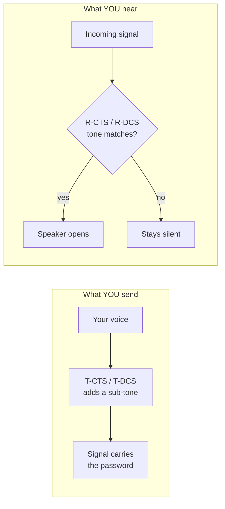
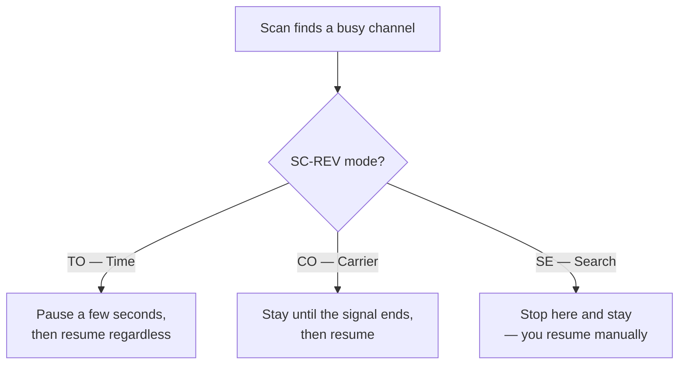

# Menus 0–20

The UV-5R hides forty-odd settings behind a single numbered list, and the screen barely names them — you scroll to `5 W/N` or `18 SC-REV` and the radio expects you to already know what that means. This chapter decodes the half of that list you touch day to day: squelch, step, power, bandwidth, the tones that open repeaters, and the signalling odds and ends. For each substantial item we answer what the manual never does — what it does, what is happening inside, why the feature exists, sensible values, a UK-flavoured recommendation, a worked example, the common mistakes, and whether to change it.

You met the mechanics in [Getting Started](outpost:entry/logbook73.guide.uv-5r/getting-started): press **MENU**, type the item number or scroll with **▲/▼**, **MENU** to open it, arrows to change the value, **MENU** to save, **EXIT** to leave. Nothing here can harm the radio. This is the first of two reference chapters; [Menus 21–40](outpost:entry/logbook73.guide.uv-5r/menus-2) covers the rest.

## How to read these pages

Each substantial item carries a one-glance verdict:

| Symbol | Meaning                                                    |
| ------ | ---------------------------------------------------------- |
| ✅     | Set it like this and forget it — right for almost everyone |
| ⭐     | Genuinely useful, depending on how you operate             |
| ⚠️     | Advanced — understand it before you enable it              |
| ❌     | Leave it off unless you have a specific reason             |

Two honesty notes. The UV-5R is a genuinely sensitive receiver — its great strength — but its squelch is coarse and its front end has little filtering, so a couple of settings are about managing those limits. And a few items (`ANI`, `S-CODE`) can only be _set_ from a PC with CHIRP; the radio only lets you view or select them.

## The four you use most: SQL, STEP, TXP, SAVE

### 0 · SQL — squelch level — ✅ 1–4

The control that silences the background hiss when no one is talking.

- **Does:** sets how strong a signal must be before the speaker opens. `0` leaves it wide open (constant hiss); `9` clamps so tightly only a strong local signal gets through.
- **Inside:** the receiver measures the channel noise; squelch is a gate that mutes the audio below your threshold and opens it above. It is receive-only — it changes nothing you transmit.
- **Why it exists:** an FM receiver with no signal produces a loud, tiring hiss. Squelch mutes that between overs so the radio sits quiet until something arrives.
- **Values:** `0`–`9`.
- **UK recommendation:** ✅ **Start at `3`.** The UV-5R's squelch is famously coarse and varies between units — the step from one number to the next can be large. Drop to `1` to chase weak signals; nudge up until the hiss just stops, and no further.
- **Example:** on a hilltop after a faint simplex station, `SQL 1` lets them break through; back home by a busy road, `SQL 4` keeps the radio silent between overs.
- **Common mistakes:** cranking it to `8`–`9` "to stop the hiss", then missing the weak repeater you can hear on monitor. The **MONI** side key (hold it) forces the squelch fully open when you want to listen underneath it.
- **Related:** the MONI function; the receiver's overload behaviour in [Overload & Ghost Signals](outpost:entry/logbook73.handbook/overload-and-ghost-signals).
- **Should you change it?** Yes — find your setting once by ear, then leave it.

### 1 · STEP — frequency step — ✅ match the service

How far the frequency moves for each press of the arrows in VFO mode.

- **Does:** sets the tuning increment — `2.5`, `5`, `6.25`, `10`, `12.5` or `25` kHz per step.
- **Inside:** the synthesiser lands on a grid of frequencies; the step is that grid's spacing. It does **not** change your transmit bandwidth (that is `5 W/N`) — only where the dial stops.
- **Why it exists:** different services lay their channels on different grids; match the grid and every channel lands exactly on frequency.
- **Values:** `2.5` / `5` / `6.25` / `10` / `12.5` / `25` kHz.
- **UK recommendation:** ✅ **12.5 kHz** for the 2 m and 70 cm amateur bands; `25` kHz for a few legacy channels. One honest limit: the UV-5R has **no 8.33 kHz step**, so the European VHF airband's 8.33 kHz channels cannot be tuned exactly — fine for casual listening, but it will not land dead on every one.
- **Example:** a `12.5` kHz step lands exactly on the 2 m calling channel `145.500`; a `25` kHz step from `145.000` skips past channels you wanted.
- **Common mistakes:** blaming a "deaf" radio for missing a repeater when the real fault is a step that never lands right.
- **Related:** `5 W/N` (bandwidth — a different thing).
- **Should you change it?** Yes, to suit whatever you tune. `12.5` kHz is the home setting for amateur work.

### 2 · TXP — transmit power — ⭐ the lowest that works

Chooses between the radio's two power levels.

- **Does:** switches between **HIGH** (roughly 4–5 W on VHF, a little less on UHF) and **LOW** (around 1 W).
- **Inside:** it changes how hard the final amplifier is driven. More power means a stronger signal at the far end — but a flatter battery, a warmer radio, and more of your signal spilling where you would rather it did not.
- **Why it exists:** you rarely need full power. Through a nearby repeater a watt is plenty; reaching a distant hilltop, you want everything the radio has.
- **Values:** HIGH / LOW. (Bench tests put HIGH at about 4–5 W — close to the claim, and better than some rivals that inflate it; do not expect the "8 W" of some listings.) See [RF Power](outpost:entry/logbook73.handbook/rf-power).
- **UK recommendation:** ⭐ **Run LOW wherever it works, HIGH only when you must** — the most important habit of a considerate operator. It saves battery, keeps you cooler against your head, and, given the UV-5R's transmit is _acceptable_ rather than premium-clean, spreads less spurious energy around the band.
- **Example:** `GB3xx` three miles away lifts you full-quieting on LOW, so you stay LOW all day; a simplex station 20 miles off reports you noisy, so you switch to HIGH for that conversation only.
- **Common mistakes:** leaving HIGH on permanently "to be safe", flattening the battery by lunchtime for no gain on channels that were fine on LOW.
- **Related:** the `#` key toggles High/Low directly on a memory channel; `3 SAVE`.
- **Should you change it?** Constantly. Treat LOW as your default and HIGH as a deliberate choice.

### 3 · SAVE — battery saver — ✅ 1:2 or 1:3

Lets the receiver doze between checks to stretch the battery.

- **Does:** micro-sleeps the receiver while idle, waking briefly to check for a signal. The ratio (`1:1`–`1:4`) sets sleep versus listen; higher saves more.
- **Inside:** rather than listening continuously, the radio powers the receiver down for a fraction of a second, wakes, samples the channel, and sleeps again. The catch: a call arriving _during_ a sleep window is not heard until the next wake, so the start of a transmission can be clipped.
- **Why it exists:** idle listening dominates a handheld's battery drain, so this adds real standby time for a setting you never notice.
- **Values:** OFF / `1:1` / `1:2` / `1:3` / `1:4`.
- **UK recommendation:** ✅ **1:2 or 1:3** for everyday monitoring. Set it **OFF** only when catching the very first syllable matters — net control, or contest-style listening for brief calls.
- **Example:** on `1:3` you occasionally hear a call start as "…nyone about?" because the first word landed in a sleep window.
- **Common mistakes:** chasing a phantom "the radio keeps missing the start of calls" fault when the cure is simply turning SAVE off.
- **Related:** `2 TXP`; dual-watch (`7 TDR`) reduces the benefit.
- **Should you change it?** Set `1:2` and leave it; OFF only for critical listening.

## Bandwidth, backlight and the daily switches: VOX, W/N, ABR, TDR, BEEP, TOT

### 4 · VOX — voice-operated transmit — ❌ normally off

Makes the radio transmit when it hears your voice, so you can talk hands-free.

- **Does:** above `0`, the radio keys up when your voice crosses a loudness threshold and drops when you go quiet — no PTT. The number sets sensitivity.
- **Inside:** an audio-level detector watches the mic; cross the threshold and the firmware keys the transmitter, then un-keys after a short built-in hang. The UV-5R gives you one control (sensitivity `0`–`10`) — no separate delay setting.
- **Why it exists:** genuine hands-free use — driving, climbing, both hands busy — and headset operation.
- **Values:** OFF / `1`–`10` (higher = more sensitive).
- **UK recommendation:** ❌ **Leave OFF for general use.** VOX transmits without you deciding to, which on shared channels and repeaters annoys people — it sends background noise, wind, or half a conversation in the room, and does **not** listen first, so it doubles straight over a station already talking.
- **Example:** a cyclist with an earpiece-and-boom headset sets VOX to `3` to answer without letting go of the bars; indoors at `8` the same radio keys every time a door closes.
- **Common mistakes:** leaving it on and wondering why the radio keys when you cough; setting sensitivity high "so it always catches me" and transmitting every rustle.
- **Related:** the `VOX` icon warns you it is armed; a proper headset helps.
- **Should you change it?** Only with a specific hands-free need and a decent headset.

### 5 · W/N — wide / narrow bandwidth — ✅ match the channel

Sets how much room your FM signal takes up — and how the radio expects incoming signals to sound.

- **Does:** switches between **WIDE** (±5 kHz deviation, a 25 kHz channel) and **NARROW** (±2.5 kHz, a 12.5 kHz channel), for both transmit and receive.
- **Inside:** FM carries your voice as swings in frequency; _deviation_ is how far the carrier swings. Wide swings twice as far as narrow — louder, fuller audio, but twice the spectrum. On receive, the setting sets how wide a slice the radio listens to. See [Modulation](outpost:entry/logbook73.handbook/modulation).
- **Why it exists:** as bands filled, many services halved their spacing from 25 to 12.5 kHz to fit twice the channels — so the radio must do both, and match the other station.

```viz
{
  "type": "spectrum",
  "title": "Wide vs narrow FM — the same voice, half the width",
  "caption": "Wide FM (±5 kHz) fills a 25 kHz channel; narrow FM (±2.5 kHz) fits in half the room. Match your setting to the channel, or the audio comes out wrong.",
  "xLabel": "Channel width",
  "components": [
    { "f": 30, "amp": 0.85, "width": 24, "label": "WIDE — ±5 kHz (25 kHz)", "tone": "primary" },
    { "f": 72, "amp": 0.85, "width": 10, "label": "NARROW — ±2.5 kHz (12.5 kHz)", "tone": "ink" }
  ],
  "noiseFloor": 0.04
}
```

- **Values:** WIDE / NARROW.
- **UK recommendation:** ✅ **Match the channel.** Modern UK amateur repeaters and simplex on the `12.5` kHz grid want **NARROW**; a few legacy `25` kHz allocations want **WIDE**. [PMR446](outpost:entry/logbook73.handbook/uhf) is **NARROW** by regulation. When in doubt on the amateur bands, NARROW is the safer modern default.
- **Example:** set WIDE on a narrow repeater and your voice over-deviates — loud, distorted, splattering the channel above; switch to NARROW and it cleans up. Reversed, a narrow radio on a wide station sounds quiet and muffled.
- **Common mistakes:** transmitting WIDE on PMR446 (illegal and rude); leaving everything WIDE because "louder is better".
- **Related:** `1 STEP` (the channel _grid_, a separate idea); the `N` icon.
- **Should you change it?** Yes — store it correctly in each memory so you never think about it again.

### 6 · ABR — backlight timer — ✅ a few seconds

How long the screen stays lit after a keypress. Values `OFF` / `1`–`5` seconds. The backlight is a steady drain, so the radio lights it on activity and drops it to save power. ✅ **5 seconds** is a comfortable read without wasting much; choose **OFF** if you operate by ear and want maximum standby. A minor taste setting — pick once.

### 7 · TDR — dual watch — ⭐ useful, with one trap

Lets the radio keep half an ear on both frequency lines at once.

- **Does:** when ON, the receiver hops between the two on-screen lines (A and B) so it catches a call on either. The `S` icon shows it running.
- **Inside:** the radio time-shares its single receiver, sampling each line many times a second; when one goes active it parks there for the conversation, then resumes hopping.
- **Why it exists:** most handhelds have one receiver, but you often want to watch two things — your repeater _and_ the calling channel.
- **Values:** OFF / ON.
- **UK recommendation:** ⭐ **ON** when you genuinely want two channels; OFF for simplicity and slightly better battery and squelch response. **The trap:** which line the PTT transmits on can catch you out — an incoming call on the _other_ line can leave you keying up in the wrong place. The governing setting (`TX-AB`) lives in [Menus 21–40](outpost:entry/logbook73.guide.uv-5r/menus-2); until then, glance at the active-line arrow before you key.
- **Example:** line A on `145.500`, line B on `GB3xx`, TDR on, and the radio watches both while you make coffee.
- **Common mistakes:** transmitting on the wrong line after an incoming call moved the radio's attention; expecting true simultaneous reception — two signals at once still collide.
- **Related:** `TX-AB` in [Menus 21–40](outpost:entry/logbook73.guide.uv-5r/menus-2); the `A/B` key.
- **Should you change it?** On when you need it, off when you do not — and learn `TX-AB` before relying on it.

### 8 · BEEP — keypad beep — ✅ ON

The confirmation tone on each keypress. **ON** gives useful feedback that a press registered (handy with gloves or in the dark); **OFF** for silent operation on a quiet net. Purely taste — leave it ON while learning the radio.

### 9 · TOT — transmission time-out timer — ⭐ 60–180 s

Cuts off an over-long transmission automatically.

- **Does:** limits continuous transmit time; reach the set value and the radio stops and beeps, even with the PTT held.
- **Inside:** a countdown starts when you key up and resets when you release. Hit zero and the firmware un-keys the transmitter regardless.
- **Why it exists:** a stuck or accidentally-pressed PTT (radio sat on in a bag) would otherwise hold a channel or repeater open indefinitely — the classic "stuck mic" — and on repeaters it enforces not hogging the channel.
- **Values:** `15`–`600` seconds in `15`-second steps.
- **UK recommendation:** ⭐ **60–180 seconds.** `180` s is a sensible ceiling — long enough for any single over, short enough to catch a stuck PTT quickly. Many repeaters run their own timer too; treat this as your back-stop.
- **Example:** set to `180`, if your radio ends up pressed against a car seat with the PTT down, it cuts after three minutes rather than jamming the repeater all afternoon.
- **Common mistakes:** setting it so short (`15`–`30` s) that it cuts you off mid-sentence.
- **Related:** `2 TXP`; repeater etiquette in [Best Practices](outpost:entry/logbook73.guide.uv-5r/best-practices).
- **Should you change it?** Set `180` s and forget it — a safety net you hope never to hear.

## The tone squelch quartet: R-DCS, R-CTS, T-DCS, T-CTS

Menus `10`–`13` are four faces of one idea, and they cause more confusion than anything else on the radio — so it is worth slowing down. All four concern a quiet **sub-tone** riding under your voice that a radio uses as a password. There are two systems and two directions. **CTCSS** (Continuous Tone-Coded Squelch System) sends a single low pitch — `67.0` to `254.1` Hz, down at the bottom of the audio range and filtered out before it reaches the speaker — continuously under your speech. **DCS** (Digital-Coded Squelch) does the same job with a slow digital code (`D023`, `D754`…, each with a Normal `N` or Inverted `I` variant). And the direction matters:

- **T-** (_transmit_) menus add the tone or code to what **you send** — how you open a repeater that demands an access tone.
- **R-** (_receive_) menus keep your radio **silent unless** an incoming signal carries the tone or code you set — "tone squelch", so your speaker stays quiet through everyone else on a shared channel.



The everyday case is a [repeater](outpost:entry/logbook73.handbook/repeaters). Most UK repeaters need a **CTCSS access tone** to open — a specific pitch for your region — so you set **`13 T-CTS`** to that tone and your radio quietly sends it whenever you transmit. You usually leave the _receive_ tone (`11 R-CTS`) **off**, so you still hear everything the repeater sends back. (The older way in to some UK repeaters is a **1750 Hz tone burst**, which the UV-5R sends by holding the PTT and tapping the `BAND` key — a momentary tone, not the continuous CTCSS these menus produce.)

### 11 · R-CTS — receive CTCSS (tone squelch) — ⭐ for busy shared channels

Keeps your speaker silent unless an incoming signal carries the matching sub-tone.

- **Does:** sets an analogue tone (`67.0`–`254.1` Hz) that an incoming signal _must_ carry for your squelch to open; signals without it stay muted even though the radio can hear them.
- **Inside:** on top of the ordinary noise-squelch the radio adds a tone detector — both gates must pass, enough signal _and_ the right tone. The tone is filtered out of the audio, so you never hear it.
- **Why it exists:** on a channel shared by several groups, tone squelch lets you sit quietly through everyone else's traffic and be alerted only when _your_ group calls. It gives no privacy — anyone can still hear you — it only manages what your speaker bothers you with.
- **Values:** OFF / `67.0` … `254.1` Hz (the 50 standard tones).
- **UK recommendation:** ⭐ **Off for general listening**; set it to match when a shared or noisy channel drives you mad with unwanted traffic. Never set it on the calling channel, where you _want_ to hear everyone.
- **Example:** a work party agrees on `88.5` Hz; `R-CTS 88.5` keeps your radio quiet through a neighbouring group on the same PMR446 channel and opens only for your team.
- **Common mistakes:** setting a receive tone then thinking the radio is "dead" because nothing is sending it; confusing it with encryption — it offers no privacy.

```viz
{
  "type": "spectrum",
  "title": "The CTCSS sub-tone hides below your voice",
  "caption": "A continuous ~100 Hz tone sits beneath the 300–3000 Hz speech band; the far radio checks for it but filters it out of what you hear.",
  "xLabel": "Audio frequency (0–3.4 kHz)",
  "components": [
    { "f": 3, "amp": 0.55, "width": 2, "label": "CTCSS tone (67–254 Hz)", "tone": "success" },
    { "f": 50, "amp": 0.85, "width": 44, "label": "Your voice (300–3000 Hz)", "tone": "primary" }
  ],
  "noiseFloor": 0.04
}
```

### 13 · T-CTS — transmit CTCSS — match the repeater

Sends an analogue sub-tone with everything you transmit.

- **Does:** adds a chosen CTCSS tone (`67.0`–`254.1` Hz) under your transmitted audio.
- **Inside:** the radio mixes a low, steady tone beneath your voice; a repeater set for tone access responds only if it is present and correct.
- **Why it exists:** repeaters use a required access tone so they are not triggered by noise, distant co-channel signals or interference — only the right tone wakes them.
- **Values:** OFF / `67.0` … `254.1` Hz.
- **UK recommendation:** **Set it to the tone your repeater requires** — published in the repeater's listing (the RSGB repeater directory in the UK; your national society elsewhere). Tones are assigned by region, so a repeater 50 miles away may want a different one.
- **Example:** `GB3xx` requires `71.9` Hz, so `T-CTS 71.9` makes the repeater relay you; get the tone wrong and it ignores you, even with a perfect signal.
- **Common mistakes:** setting `R-CTS` instead of `T-CTS` and wondering why the repeater never opens.
- **Related:** `11 R-CTS`; the 1750 Hz burst alternative (hold PTT, tap `BAND`); store the tone _in the memory_ so it travels with the frequency.
- **Should you change it?** Yes, per repeater — and let CHIRP store it in each memory.

### 10 · R-DCS and 12 · T-DCS — the digital versions — ⭐ if the channel uses them

`R-DCS` and `T-DCS` are the DCS equivalents of the two CTCSS menus above, used identically — `R-DCS` is receive-side tone squelch, `T-DCS` is what you send. The only difference is the coding: instead of a single analogue pitch, DCS sends a continuous low-speed digital word, written with an `N` (Normal) or `I` (Inverted) suffix — `D023N`, `D754I`. A radio set for one system will not answer the other, so a channel is either CTCSS or DCS, never both. In UK amateur practice CTCSS dominates on repeaters; you meet DCS mostly on commercial and some PMR446 setups. ⭐ Use only when the channel specifies a DCS code; otherwise leave OFF. **Never set both a CTCSS and a DCS tone on the same VFO**, and never mix a code's `N` and `I` versions — they are not interchangeable.

## Voice, signalling and DTMF: VOICE, ANI, DTMFST, S-CODE, SC-REV, PTT-ID, PTT-LT

The tail of this half is a cluster of DTMF-signalling odds and ends inherited from the radio's commercial-fleet roots. For ordinary amateur voice you can leave nearly all of it alone — but here is what each one does.

### 14 · VOICE — voice prompt — leave to taste

The robotic voice that announces menu numbers and actions aloud. **ON** can help while you learn which item is which; **OFF** is where most operators settle once the menu is familiar. It changes nothing you transmit — pure preference.

### 15 · ANI — automatic number identification — ⚠️ set on a PC only

A short DTMF code that identifies the _radio itself_ to a controller.

- **Does:** holds a brief DTMF (touch-tone) string identifying this handset. It can only be _set_ in CHIRP; on the radio you can view it but not change it. Paired with `19 PTT-ID`, the radio sends it automatically when you key or release.
- **Why it exists:** a leftover from fleet radio, where a controller logs which handset transmitted so a dispatcher sees who is calling without anyone speaking.
- **Values:** a 3-digit code, set in software.
- **UK recommendation:** ⚠️ **Leave it at default and leave `PTT-ID` off.** ANI has essentially no use in amateur voice — and, crucially, it is **not** your callsign and does **not** satisfy your legal duty to identify. You must still give your callsign by voice as your licence requires.
- **Common mistakes:** believing ANI "identifies you" so you need not say your callsign — wrong, and a licence breach.
- **Related:** `16 DTMFST`, `17 S-CODE`, `19 PTT-ID`, `20 PTT-LT`.
- **Should you change it?** No. Note it exists, leave it, identify by voice.

### 16 · DTMFST — DTMF side tone — leave default

Controls whether _you_ hear the DTMF tones the radio produces, in your own speaker: `OFF` sends them silently, `DT-ST` lets you hear tones you key, `ANI-ST` the automatic ANI code, `DT+ANI` both. It affects only your own feedback, not what is transmitted — and matters only if you use DTMF at all.

### 17 · S-CODE — signalling code group — ⚠️ set on a PC only

Selects which of fifteen stored DTMF signalling codes (`1`–`15`) is live — the one `19 PTT-ID` sends. The sequences themselves are programmed only in CHIRP; on the radio you just pick which group is active. In a commercial fleet, different codes address different units. ⚠️ **Leave it alone** for amateur voice — it does nothing on its own and only has any effect when `PTT-ID` is on.

### 18 · SC-REV — scan resume method — ⭐ CO for monitoring

Decides what the radio does when a scan lands on a busy channel.

- **Does:** sets how scanning behaves once it finds a signal — pause a fixed time then move on (`TO`), hold while the signal is present and resume when it drops (`CO`), or stop dead on the first signal (`SE`).
- **Inside:** the scanner steps through channels looking for one that breaks squelch; this is the rule it follows the instant it hears something. `TO` (Time) waits a few seconds regardless; `CO` (Carrier) waits until the carrier disappears; `SE` (Search) halts and leaves scanning to you.



- **Why it exists:** skimming a band you want it to sample and move on; following a conversation you want it to sit put until the talkers finish.
- **Values:** `TO` / `CO` / `SE`.
- **UK recommendation:** ⭐ **CO (Carrier)** is the best all-round choice — the radio parks on an active conversation and resumes only once the channel goes quiet, so you never lose a QSO mid-flow. Use `TO` to keep sampling a busy band; `SE` when hunting a single signal.
- **Example:** scanning your repeater zone on `CO`, the radio finds a chat on `GB3xx`, holds for the whole conversation, and resumes only when it clears; on `TO` it would jump away mid-over.
- **Common mistakes:** using `SE` for general monitoring and having it stop forever on the first birdie.
- **Related:** the `✳` key (hold to scan); `0 SQL` — set squelch properly first, or the scanner stalls on noise.
- **Should you change it?** Yes — set `CO` and most scanning behaves as you expect.

### 19 · PTT-ID — send signalling code on transmit — ⚠️ off for ham chat

Sends the active `S-CODE` automatically at the **B**eginning **O**f **T**ransmission (`BOT`), the **E**nd (`EOT`), `BOTH`, or never (`OFF`) — the radio prepends or appends the DTMF code around your audio. Fleet and controller systems use it to log or gate transmissions by unit.

- **Values:** OFF / BOT / EOT / BOTH.
- **UK recommendation:** ⚠️ **OFF for ordinary amateur voice.** A burst of DTMF before or after every over is pointless on a ham channel and mildly antisocial — it clutters the audio and can trip other people's decoders. Enable it only for a system that expects it, and remember the burst does **not** satisfy your legal callsign requirement.
- **Related:** `15 ANI`, `17 S-CODE`, `20 PTT-LT`.
- **Should you change it?** Only for a specific signalling system; otherwise leave OFF.

### 20 · PTT-LT — PTT-ID delay — ⚠️ only if you use PTT-ID

A short delay (`0`–`30` ms) before the DTMF signalling code is sent after you key up. A transmitter and a repeater both take a moment to key up; if the ID begins instantly its first digits can be clipped before the path is established, so the delay lets everything settle first. ⚠️ **Irrelevant unless `PTT-ID` is on.** If you use PTT-ID through a repeater and the far end misses the start of your code, nudge this toward `20`–`30` ms; otherwise ignore it.

## Key takeaways

- The four you touch daily: **`0 SQL`** (set by ear, `1`–`4`; the squelch is coarse), **`1 STEP`** (`12.5` kHz for UK ham; no 8.33 kHz airband), **`2 TXP`** (run LOW, HIGH only when needed), **`3 SAVE`** (`1:2`–`1:3`, off when the first syllable matters).
- **`5 W/N`** must match the channel — NARROW for modern UK repeaters and PMR446, WIDE for legacy 25 kHz — or the audio comes out distorted or muffled. **`9 TOT`** at `180` s is your stuck-mic safety net.
- **`7 TDR`** dual-watch is handy but has a "which line transmits" trap; learn `TX-AB` in [Menus 21–40](outpost:entry/logbook73.guide.uv-5r/menus-2) before relying on it.
- The tone quartet (`10`–`13`) is one idea in two systems and two directions: **T-** adds a password to what you send (your repeater's access tone), **R-** silences your speaker until it hears one; CTCSS is an analogue pitch, DCS a digital code — never mix them.
- The DTMF-signalling tail (`ANI`, `S-CODE`, `PTT-ID`, `PTT-LT`) is commercial-fleet legacy — leave it off, and remember an ANI or PTT-ID burst is **not** your callsign. **`18 SC-REV` = CO** is the one genuinely useful setting here.
- Above all: lowest power that works, correct bandwidth, tones stored in each memory — habits explained further in [What the Settings Really Mean](outpost:entry/logbook73.guide.uv-5r/theory).

With the everyday half of the menu decoded, we can tackle the rest — display colours, memory management, alarm and repeater features, and the tail-tone tidiness that keeps repeaters happy — in [Menus 21–40](outpost:entry/logbook73.guide.uv-5r/menus-2).
