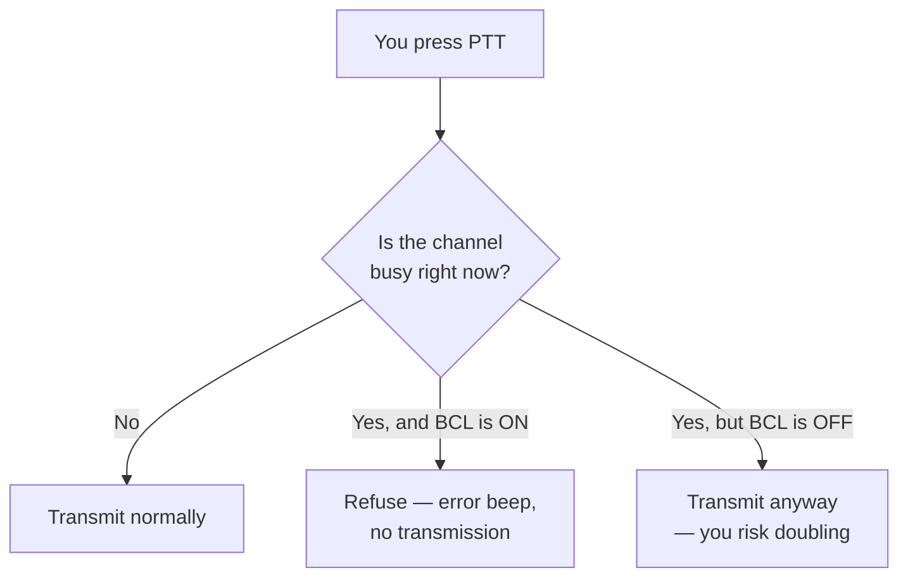
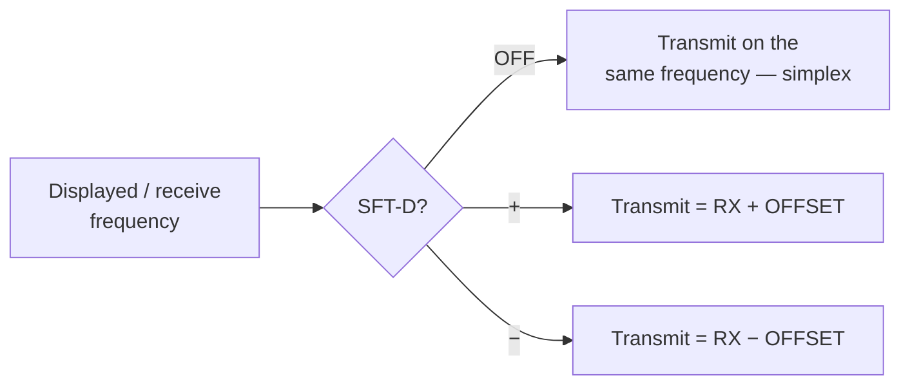

# Menus 21–40

Menus 21 to 40 are where the UV-5R stops talking about tones and squelch and starts on the housekeeping: what the screen shows you, how it guards a channel someone else is using, how it works out a repeater's transmit frequency, and how you fold the whole lot into a memory. None of it is glamorous — but three or four of these settings are the difference between a radio that behaves and one that surprises you. As in [the first half of the menu](outpost:entry/logbook73.guide.uv-5r/menus-1), every substantial item gets the full treatment, and the trivial on/off ones get a line.

## How to read these pages

Each item carries a one-glance verdict, the same key used throughout the guide:

| Symbol | Meaning                                                    |
| ------ | ---------------------------------------------------------- |
| ✅     | Set it like this and forget it — right for almost everyone |
| ⭐     | Genuinely useful, depending on how you operate             |
| ⚠️     | Advanced — understand it before you enable it              |
| ❌     | Leave it off unless you have a specific reason             |

To reach any item, press **MENU**, use the `▲`/`▼` keys to move to the number you want, press **MENU** again to open it, choose a value with `▲`/`▼`, and press **MENU** once more to save. **EXIT** backs out without saving. One rule runs through this whole half of the menu, and it saves a great deal of confusion: **the UV-5R will not let you edit most channel content while you are in memory (MR) mode.** Bandwidth, tones, busy-channel lockout, the repeater shift — all of them are edited in **frequency (VFO) mode** and then saved into a memory. In memory mode only the transmit power can be nudged. Keep that in your back pocket; several items below depend on it.

Here is the whole block at a glance before we go deep:

| #   | Item   | What it does                                       | Verdict              |
| --- | ------ | -------------------------------------------------- | -------------------- |
| 21  | MDF-A  | Top row shows frequency / channel number / name    | ⭐ taste             |
| 22  | MDF-B  | Bottom row shows frequency / channel number / name | ⭐ taste             |
| 23  | BCL    | Refuse to transmit onto an already-busy channel    | ✅ ON                |
| 24  | AUTOLK | Auto-lock the keypad after a pause                 | ⭐ ON                |
| 25  | SFT-D  | Repeater shift direction (OFF / + / −)             | ⭐ per repeater      |
| 26  | OFFSET | Size of the repeater shift, in MHz                 | ⭐ per band plan     |
| 27  | MEMCH  | Store the current VFO into a memory (000–127)      | ✅                   |
| 28  | DELCH  | Delete a stored memory                             | ⭐ housekeeping      |
| 29  | WT-LED | Standby backlight colour                           | ⭐ OFF saves battery |
| 30  | RX-LED | Receive backlight colour                           | taste                |
| 31  | TX-LED | Transmit backlight colour                          | ⭐ leave on          |
| 32  | AL-MOD | Alarm behaviour (SITE / TONE / CODE)               | ⚠️                   |
| 33  | BAND   | Switch the VFO between VHF and UHF                 | ✅                   |
| 34  | TX-AB  | Which VFO transmits during dual-watch              | ⭐                   |
| 35  | STE    | Squelch-tail elimination on simplex                | ⭐ ON                |
| 36  | RP-STE | Squelch-tail elimination via a repeater            | ⭐                   |
| 37  | RPT-RL | Repeater tail delay                                | ⚠️ default           |
| 38  | PONMSG | Power-on message (full logo / message)             | taste                |
| 39  | ROGER  | Roger beep at end of transmission                  | ❌ OFF               |
| 40  | RESET  | Restore defaults (VFO / ALL)                       | ⚠️                   |

## What each row shows — MDF-A and MDF-B

The UV-5R has a two-line display: the **top line is the A VFO, the bottom line is B**. In memory mode, each line can show its channel three different ways, and that is all these two settings do.

### MDF-A / MDF-B — ⭐ show frequency, channel number or name

- **Does:** independently sets whether the top row (`MDF-A`) and the bottom row (`MDF-B`) display, for the channel you are on, its **frequency**, its **channel number** (`000`–`127`), or its **name**.
- **Inside:** nothing electrical changes — this is purely how memory data is drawn on the screen. A stored channel always holds its frequency and its slot number; a name is optional extra text.
- **Why it exists:** operators think differently. Some recognise a channel by its frequency, some by "channel 12", some by a name like `GB3xx`. Two independent rows let you have it both ways at once.
- **Values:** FREQ / CH / NAME.
- **UK recommendation:** ⭐ **FREQ** while you are learning — seeing `145.500` teaches you the band as you scroll — then **NAME** once your channels are named. A common set-up is `MDF-A` to NAME (top line reads `GB3xx`) and `MDF-B` to FREQ (bottom line shows `433.000`): the name of the machine and the raw number, both at a glance.
- **Common mistakes:** setting a row to NAME and seeing a blank or the channel number instead — because **the UV-5R cannot name channels from the keypad.** Names come only from programming software over the cable ([CHIRP](outpost:entry/logbook73.guide.uv-5r/getting-started) does it in a column), so if you have never run software against the radio, NAME has nothing to show.
- **Related:** MEMCH (27), which stores the channel a name attaches to; the display anatomy in [Getting Started](outpost:entry/logbook73.guide.uv-5r/getting-started).
- **Should you change it?** A matter of taste — pick it once to suit how your brain files channels.

## Guarding the channel — BCL and AUTOLK

### BCL — busy channel lockout — ✅ ON

Refuses to let you transmit on top of a conversation already in progress.

- **Does:** when on, if the channel is currently busy — the squelch is open on a signal — pressing PTT does **nothing** but beep. As soon as the channel is clear, PTT works normally.
- **Inside:** the transmit routine first asks the receiver, "is the squelch open right now?" If yes, it declines to key up and sounds a short error tone instead. If no, it transmits as usual.
- **Why it exists:** on a simplex channel you can only hear one side of a distant conversation, so it is easy to key up blindly across someone you cannot hear and "double" — two stations transmitting at once, both of them unreadable. BCL is the radio quietly checking the channel is free before it lets you speak.



- **Values:** OFF / ON.
- **UK recommendation:** ✅ **ON** for simplex channels. It is good manners in a single setting, and it costs you nothing.
- **Worked example:** you are on the 2 m calling channel `145.500` and someone just out of your range is mid-over. With BCL on, your PTT beeps and refuses until they finish — so you never transmit across them. With it off, you would happily key up over a conversation you could not hear.
- **Common mistakes:** two big ones. First, **BCL is stored per channel and set in VFO mode** — it is on the "invalid in memory mode" list, so to turn it on for a saved channel you enable it in frequency mode and re-store. Second, do **not** rely on it for repeater channels: a repeater is busy the instant it transmits back to you, so BCL can lock you out of a machine you are legitimately trying to use. Turn it off on repeater memories.
- **Related:** SQL (squelch, menu 0), whose decision BCL reuses; the VOX interaction noted in [menus-1](outpost:entry/logbook73.guide.uv-5r/menus-1).
- **Should you change it?** Yes — on for simplex, off for repeaters, and then forget it.

### AUTOLK — automatic keypad lock — ⭐ ON

Locks the keypad on its own after a spell of no key-presses.

- **Does:** when on, the keypad locks itself after roughly ten seconds of inactivity, so a stray press in your pocket or bag cannot change anything. A padlock icon appears; hold the `#` key to unlock.
- **Inside:** an idle timer resets on every key-press; when it expires, the firmware ignores further keys until you unlock, exactly as the manual `#`-hold lock does.
- **Why it exists:** a handheld lives in a pocket, and the number keys will happily retune the VFO, wind up the power, or start a scan if something leans on them. Auto-lock is the seatbelt.
- **Values:** OFF / ON.
- **UK recommendation:** ⭐ **ON** for anyone carrying the radio on a belt or in a bag. Leave it OFF only if the radio sits on a desk and you find the constant unlocking a nuisance.
- **Worked example:** you clip the radio to your rucksack strap for a hillwalk. With AUTOLK on, ten seconds after your last press the keypad locks, and the frequency you set at the car park is still there at the summit — not "441.mystery" because a strap buckle pressed `4` twice.
- **Common mistakes:** panicking when the keypad "stops working" — it has simply auto-locked; hold `#` to release it. Note the **PTT and the knobs always keep working**, lock or no lock, so you can still transmit and change volume.
- **Related:** the manual `#`-hold lock (does the same thing on demand); BAND (33) and the VFO controls it protects.
- **Should you change it?** Turn it on for portable use and leave it.

## The repeater shift — SFT-D and OFFSET

These two settings, together, are how the UV-5R transmits on one frequency while it listens on another — the trick that lets you work a [repeater](outpost:entry/logbook73.handbook/repeaters). They only bite in frequency (VFO) mode; you set them, then store the result as a memory.



### SFT-D — shift direction — ⭐ per repeater

- **Does:** tells the radio to transmit **above** (`+`) the frequency you are listening on, **below** it (`−`), or on the **same** frequency (OFF) for a direct, simplex contact.
- **Inside:** on transmit, the radio takes the displayed frequency and adds or subtracts the OFFSET value; on receive it sits on the displayed frequency. SFT-D only chooses the sign of that jump.
- **Why it exists:** a repeater listens on one frequency and re-transmits on another a fixed distance away. Your radio has to mirror that split — shift on transmit, shift back on receive — without you retuning by hand mid-over.
- **Values:** OFF / + / −.
- **UK recommendation:** ⭐ **OFF** for simplex. For repeaters, follow your national band plan: in the UK that is **−** on 2 m and **+** on 70 cm. Elsewhere, [check your national band plan](outpost:entry/logbook73.handbook/repeaters) — the sense and size of the shift both vary by region.
- **Worked example:** a UK 2 m repeater you hear on `145.700` needs SFT-D `−` (you transmit _below_ what you listen on); a UK 70 cm repeater heard on `433.000` needs SFT-D `+` (you transmit _above_ it).
- **Common mistakes:** leaving a shift set on a simplex channel, so you transmit off-frequency and nobody answers; picking `+` where your band plan wants `−`. Note also the separate **Reverse (R)** function, which temporarily swaps your transmit and receive frequencies so you can check whether you can hear a repeater's input directly — handy for diagnosing coverage, but not something to leave on.
- **Related:** OFFSET (26, below); the T-CTS transmit tone in [menus-1](outpost:entry/logbook73.guide.uv-5r/menus-1) — most repeaters also need a CTCSS access tone; the 1750 Hz burst (hold PTT, then press the `BAND` key), which a few older UK machines still want.
- **Should you change it?** Only when adding a new repeater by hand. Once it is stored as a memory, the channel remembers the direction for you.

### OFFSET — the size of the shift — ⭐ per band plan

- **Does:** sets how far, in MHz, the transmit frequency moves from the receive frequency when SFT-D is `+` or `−`. SFT-D chooses the direction; OFFSET chooses the distance.
- **Inside:** the plain number added to or subtracted from your displayed frequency on transmit. It has no effect at all while SFT-D is OFF.
- **Why it exists:** every band standardises its repeater spacing, and the radio needs the exact figure to land on the repeater's input.
- **Values:** entered by keypad, `00.000` to `69.990` MHz — you type the magnitude in MHz.
- **UK recommendation:** ⭐ **`00.600`** (0.6 MHz) on 2 m; **`01.600`** (1.6 MHz) on 70 cm. In other regions the 70 cm shift especially differs — commonly 5 MHz in the US and 7.6 MHz across much of continental Europe — so take the number from the repeater's own listing.
- **Worked example:** you can hear a 70 cm repeater on `433.000`. Set SFT-D `+` and OFFSET `01.600`, and your radio will transmit on `433.000 + 1.600 = 434.600` — the repeater's input — while still listening on `433.000`. On 2 m, a repeater heard on `145.700` with SFT-D `−` and OFFSET `00.600` transmits on `145.100`.
- **Common mistakes:** entering `600` instead of `00.600` (that would try to shift 600 MHz); copying a US 5 MHz 70 cm offset onto a UK repeater; setting a sensible offset but forgetting the tone, so your signal reaches the input but never keys the machine.
- **Related:** SFT-D (25); the repeater's published listing, which is the final word on both figures; MEMCH (27) to save the finished channel.
- **Should you change it?** Only when programming a repeater in VFO mode; a saved memory carries it for you thereafter.

## Storing and deleting channels — MEMCH and DELCH

### MEMCH — store to a memory — ✅

Takes everything about the current VFO and saves it as one recallable channel.

- **Does:** writes the current frequency, shift direction, offset, tones, bandwidth and power into a numbered memory slot, `000` to `127`, so recalling that channel restores the whole set-up in one step.
- **Inside:** the radio copies the live VFO settings into a memory record. From then on, memory mode reads back that snapshot rather than the VFO.
- **Why it exists:** nobody wants to re-key a repeater's frequency, offset and tone every time they use it. Memories are the point of the radio for day-to-day operating; 128 of them is plenty for a personal channel list.
- **Values:** a destination slot, `000`–`127`. Opening MEMCH shows the next free slot by default.
- **UK recommendation:** ✅ Save every frequency you use more than once. When you store, make sure the VFO already holds the **lowest power that reaches the target** — the memory keeps whatever power was set, so store repeaters and locals at Low or Medium and save your battery and your neighbours' front ends.
- **Worked example:** in frequency mode you set `433.000`, SFT-D `+`, OFFSET `01.600`, T-CTS `71.9` Hz and Low power, then press MENU → 27 → MENU, dial to slot `007` with `▲`/`▼`, and press MENU to store. That machine is now channel `007` forever.
- **Common mistakes:** saving before you have set the tone, so the channel reaches the repeater but cannot open it; overwriting a slot you meant to keep. There is also a useful trick the manual buries — for an **odd-split repeater** (transmit and receive not a tidy fixed offset apart) store the _receive_ frequency to a channel first, then tune the _transmit_ frequency in VFO and store to the **same** channel number; the radio keeps the receive from the first save and the transmit from the second.
- **Related:** DELCH (28) to remove; MDF-A/B (21/22) for how the saved channel displays; naming is software-only, via [CHIRP](outpost:entry/logbook73.guide.uv-5r/getting-started).
- **Should you change it?** This is an action, not a setting — use it whenever you have a set-up worth keeping.

### DELCH — delete a memory — ⭐ housekeeping

Removes a stored channel. Open DELCH, dial to the slot number, and confirm.

- **Does:** empties a memory slot. It does **not** renumber the channels around it — slot `007` simply becomes empty, and `008` stays `008`.
- **UK recommendation:** ⭐ Use it to tidy mistakes, but there is no undo. If you built your channels in [CHIRP](outpost:entry/logbook73.guide.uv-5r/getting-started), the safe route is to fix the list on the computer and write the whole lot back, so your backup file always matches the radio.
- **Should you change it?** Only as housekeeping — and keep the CHIRP backup so a slip costs you nothing.

## The backlight colours — WT-LED, RX-LED and TX-LED

Three settings, one job each: they set the backlight colour for the three states the radio can be in. All three offer **OFF / BLUE / ORANGE / PURPLE**, and none of them affects anything but the light.

- **WT-LED — standby colour (⭐ OFF to save battery).** The backlight while the radio is just sitting and listening. Setting this to **OFF** is the single best-known UV-5R battery tip — the light is the biggest idle drain, and you rarely need the screen lit while nothing is happening.
- **RX-LED — receive colour (taste).** The colour when a signal opens the squelch. A distinct colour here — say **blue** — turns the radio into a silent "someone's talking" indicator across the room.
- **TX-LED — transmit colour (⭐ leave on).** The colour while you are transmitting. Keep this **on**, and ideally a colour you do not use elsewhere (**orange** or **purple**), because a glance at it confirms the radio is actually keyed — a real help when you are not sure the PTT has taken or whether a stuck PTT is transmitting in your bag.

A tidy, low-drain scheme: **WT-LED OFF, RX-LED BLUE, TX-LED ORANGE** — dark when idle, blue when hearing, orange when talking.

## The alarm — AL-MOD

### AL-MOD — alarm behaviour — ⚠️

Sets what the emergency alarm does when it is triggered (by a long press of the `CALL` key).

- **Does:** chooses one of three alarm behaviours. **SITE** sounds a loud siren from the radio's own speaker and transmits nothing. **TONE** sounds the local siren _and_ transmits an alarm tone on your current frequency. **CODE** transmits your identifying DTMF/ANI code along with the alarm.
- **Why it exists:** a personal-safety attention-getter — a local noise to attract help nearby, or an over-the-air alert to a group monitoring a channel.
- **Values:** SITE / TONE / CODE.
- **UK recommendation:** ⚠️ Understand it before you enable anything but **SITE**. TONE and CODE **transmit**, so they are only appropriate on a channel where the people who might respond have agreed to it — never a shared calling channel or a repeater, where an unannounced alarm tone is disruptive and pointless.
- **Common mistakes:** triggering it by accident with a long `CALL` press and transmitting a siren across a channel; treating it as a real emergency system — it is a novelty attention-getter, not a substitute for a phone or a proper alerting scheme.
- **Should you change it?** Leave it at SITE unless you have a specific, agreed use for on-air alerting.

## Band and transmit selection — BAND and TX-AB

### BAND — VHF or UHF — ✅

- **Does:** switches the current VFO between the **VHF (2 m)** and **UHF (70 cm)** ranges. It is the menu twin of the `BAND` key on the keypad.
- **Why it exists:** the UV-5R is dual-band, and a VFO can only sit on one band at a time; this is how you send it to the other.
- **Values:** VHF / UHF.
- **UK recommendation:** ✅ Set it to the band you want and think no more of it — most people just press the `BAND` key instead of diving into the menu.
- **Common mistakes:** typing a 70 cm frequency while the VFO is on VHF and finding it will not accept it — switch the band first. Note it only works in **frequency mode**; in memory mode the channel's band is fixed.
- **Should you change it?** Whenever you want the other band. It is a quick flip, not a set-and-forget preference.

### TX-AB — which VFO transmits in dual-watch — ⭐

- **Does:** when dual-watch (TDR, menu 7) is on and the radio is flitting between the A and B rows, this decides which row your PTT actually transmits on. **OFF** lets the radio choose (normally whichever row last heard activity); **A** or **B** pins transmit to that row no matter what.
- **Inside:** dual-watch time-shares one receiver between two frequencies. When you key up, the radio must commit to one; TX-AB removes the ambiguity by forcing the choice.
- **Why it exists:** dual-watch is convenient but its "which channel am I on now?" moment is a classic way to transmit on the wrong frequency. Pinning transmit to a known row makes it predictable.
- **Values:** OFF / A / B.
- **UK recommendation:** ⭐ If you monitor two channels but only ever _talk_ on one — say, listening to a repeater on A while keeping an ear on the calling channel on B, but only ever transmitting through the repeater — set **TX-AB to A**. Then a press of PTT always goes to the repeater, whichever row happened to be active when a signal arrived.
- **Worked example:** A is your local repeater, B is `145.500` simplex. With TX-AB OFF, if the last thing you heard was on B, your PTT transmits simplex on `145.500` — not through the repeater you meant. Set TX-AB `A` and PTT always keys the repeater.
- **Common mistakes:** forgetting it is set to A or B later, then wondering why the radio "won't transmit on the other channel" during dual-watch; leaving it OFF and doubling on the wrong frequency because you misjudged which row was live.
- **Related:** TDR/dual-watch (menu 7, in [menus-1](outpost:entry/logbook73.guide.uv-5r/menus-1)); the A/B display rows.
- **Should you change it?** Yes, if you dual-watch but only transmit on one of the pair — it turns a guessing game into a certainty.

## Squelch tails — STE, RP-STE and RPT-RL

When an FM station stops transmitting, its carrier dies a fraction of a second before your squelch closes, and in that gap you hear a short burst of noise — the **squelch tail**, or "kerchunk". These three settings exist to tame it. The theory of _why_ the burst happens lives in [What the Settings Really Mean](outpost:entry/logbook73.guide.uv-5r/theory); here is what each control does.

```viz
{
  "type": "wave",
  "title": "The squelch tail, and what STE removes",
  "caption": "When the other station un-keys, their carrier dies just before your squelch closes — and that gap is a burst of noise (the 'tail'). STE tells your radio to mute the instant the carrier goes.",
  "xLabel": "time — the moment the far station un-keys is near the right",
  "traces": [
    { "kind": "points", "label": "without STE", "tone": "danger", "points": [[0,0.35],[0.55,0.35],[0.6,0.05],[0.62,0.85],[0.64,0.2],[0.66,0.9],[0.68,0.25],[0.7,0.8],[0.72,0.3],[0.74,0.75],[0.75,0],[1,0]] },
    { "kind": "points", "label": "with STE", "tone": "success", "style": "dashed", "points": [[0,0.35],[0.55,0.35],[0.6,0.05],[0.61,0],[1,0]] }
  ]
}
```

### STE — squelch-tail elimination (simplex) — ⭐ ON

- **Does:** on **simplex** contacts, silences the noise burst at the end of each over. When on, your radio adds a brief signal just before it stops transmitting that tells the _other_ STE-equipped radio to mute cleanly, and it obeys the same signal from others.
- **Inside:** just before it drops carrier, the transmitter sends a short reversed-phase sub-audible tone. A receiving radio watching for that reversal mutes its audio the instant it sees it, rather than waiting for the squelch to notice the carrier has gone.
- **Why it exists:** the "kerchunk" at the end of every over is tiring on a long simplex chat, and it can mask the first moment of the next person's reply. STE removes it for a cleaner exchange.
- **Values:** OFF / ON.
- **UK recommendation:** ⭐ **ON** for simplex operating. It only helps when the radios at both ends support it (most modern FM handhelds do), and it never hurts.
- **Worked example:** two UV-5Rs chatting on `145.500` with STE on hand the channel back and forth silently; with STE off, each over ends in a little burst of hiss.
- **Common mistakes:** expecting STE to help through a repeater — it does not; that is what RP-STE is for. And because STE is a transmit-side courtesy, turning it on only affects the tail _you_ send — the person you are working needs it on too for your speaker to go quiet.
- **Related:** RP-STE (36); SQL (menu 0) — a well-set squelch shortens the tail on its own.
- **Should you change it?** Turn it on for simplex and leave it.

### RP-STE — squelch-tail elimination through a repeater — ⭐

- **Does:** the same idea, but for the tail you hear at the end of a **repeater's** transmission. It sets a short delay so your radio drops its audio in step with the repeater dropping its carrier, killing the kerchunk the repeater would otherwise hand you.
- **Inside:** the radio waits a chosen number of tenths of a second before muting, timed to match the repeater's own tail so the two coincide.
- **Why it exists:** a repeater has its own squelch tail, and it is the same annoyance one step removed. RP-STE lets you trim it to your local machine.
- **Values:** OFF / `1`–`10` (increasing delay).
- **UK recommendation:** ⭐ Leave **OFF** unless a specific repeater gives you an audible tail worth chasing, then try a low number (`1`–`3`) and adjust by ear. The right value depends on the individual repeater, so there is no universal setting.
- **Common mistakes:** setting a large value and clipping the end of the repeater's audio; confusing it with STE (35), which is for simplex.
- **Related:** STE (35); RPT-RL (37).
- **Should you change it?** Only if a repeater you use often has a nagging tail — otherwise leave it off.

### RPT-RL — repeater tail delay — ⚠️

- **Does:** a companion timing adjustment for the repeater tail, delaying when the effect is applied. It is a fine-tuning partner to RP-STE.
- **Values:** OFF / `1`–`10`.
- **UK recommendation:** ⚠️ **Leave at the default (OFF)** unless you are deliberately tuning tail behaviour to one particular repeater and know what you are listening for. It changes nothing you will notice in normal use.
- **Should you change it?** Almost never — it is a niche adjustment for people optimising against a specific machine.

## The finishing touches — PONMSG and ROGER

### PONMSG — power-on message — taste

- **Does:** chooses what the screen shows for a second at switch-on: **FULL**, the full boot logo/graphic, or **MGS**, a short message (a couple of characters you can set in programming software).
- **Why it exists:** cosmetic, plus a small practical use — some owners put their callsign or name in the MGS text so a found radio can be returned.
- **Values:** FULL / MGS.
- **UK recommendation:** taste. If you can set the message in [CHIRP](outpost:entry/logbook73.guide.uv-5r/getting-started), putting your callsign there is a nice touch; otherwise it makes no difference.
- **Should you change it?** Only if you want a personalised boot screen.

### ROGER — roger beep — ❌ OFF

- **Does:** plays a short beep at the end of each transmission, so the other station hears a "beep" as you release PTT.
- **Why it exists:** the beep signals "I've finished, over to you" — a habit carried over from some commercial and PMR radios.
- **Values:** ON / OFF.
- **UK recommendation:** ❌ **OFF** for amateur operating. On the amateur bands a roger beep is widely considered unnecessary and mildly irritating — a clean release and "over" does the job — and on a repeater it can collide with the machine's own courtesy tone. Leave it off.
- **Common mistakes:** leaving it on from the factory and beeping at everyone on the calling channel.
- **Should you change it?** Turn it off and forget it.

## Starting over — RESET

### RESET — restore defaults — ⚠️

The panic button, with two settings' worth of destruction.

- **Does:** **VFO** resets only the VFO/operating settings to factory defaults and leaves your stored memory channels intact. **ALL** wipes everything back to factory — every menu setting **and every memory channel** you have programmed.
- **Inside:** it overwrites the working configuration (and, for ALL, the memory bank) with the factory image held in the radio.
- **Why it exists:** a clean escape when the radio's settings have got into a tangle you cannot unpick — a stuck tone, a mystery lock, a menu you cannot find your way out of.
- **Values:** VFO / ALL.
- **UK recommendation:** ⚠️ Reach for **VFO** first — it clears operating confusion without touching the channels you spent an evening programming. Only use **ALL** as a last resort, and **only if you have a CHIRP backup**, because it deletes every channel with no undo.
- **Worked example:** a friend's radio "won't open the squelch and beeps when I press PTT". Rather than hunt through menus, a VFO reset clears any stray tone, BCL or lock in one move, and their memories survive.
- **Common mistakes:** choosing ALL to fix a small problem and losing a full channel list; not keeping a backup, so ALL means an evening of re-programming.
- **Related:** [CHIRP](outpost:entry/logbook73.guide.uv-5r/getting-started) — read the radio to a file _before_ you ever consider ALL, and a reset becomes a two-minute restore rather than a disaster.
- **Should you change it?** Only deliberately, and back up first.

## Key takeaways

- **Set channel content in frequency (VFO) mode, then store it** — bandwidth, tones, BCL and the repeater shift are all off-limits in memory mode; only power can be nudged on a saved channel.
- **BCL ON for simplex, OFF for repeaters** — it stops you doubling across a busy channel, but it will lock you out of a repeater that is answering you.
- **SFT-D + OFFSET make the repeater shift** (UK: `−` and `00.600` on 2 m, `+` and `01.600` on 70 cm); MEMCH saves the finished channel, and names come only from software.
- **The LED colours are free diagnostics** — WT-LED OFF saves the battery, and a distinctive TX-LED confirms at a glance that you are really transmitting.
- **TX-AB pins your transmit to A or B during dual-watch**, curing the "wrong channel" surprise; STE (simplex) and RP-STE (repeater) tidy the noise burst at the end of an over.
- **Roger beep off, alarm understood before use, and RESET only with a CHIRP backup** — VFO reset first, ALL as a last resort.

That is the whole menu decoded. Next we turn from _what_ each setting does to _why_ it works the way it does — the handful of ideas the settings all rest on, in [What the Settings Really Mean](outpost:entry/logbook73.guide.uv-5r/theory).
