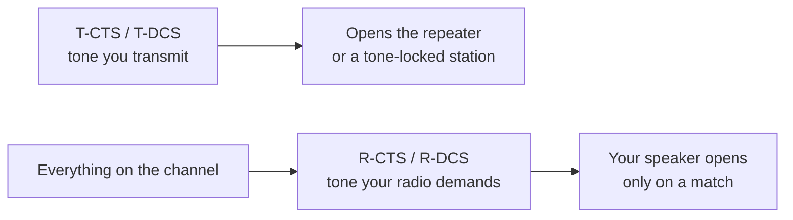
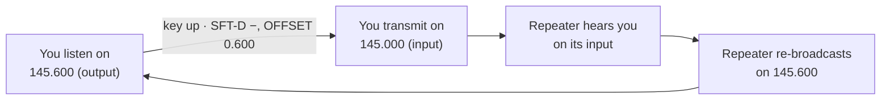

# What the settings really mean

Open the UV-5R's menu for the first time and you meet a wall of abbreviations — `SQL`, `TDR`, `T-CTS`, `SFT-D`, `STE` — that look designed to keep you out. They are not. Every one of them is a lever on something physical happening inside the radio, and once you can picture what that something is, the codes stop being a barrier and start being a set of tools you reach for on purpose. This chapter is the _why_ behind the settings; the [menu reference](outpost:entry/logbook73.guide.uv-5r/menu-reference) is the _what_ and _where_. Read them together and the little radio will never puzzle you again.

## The gate on the hiss: squelch (`SQL`)

Leave a receiver switched on with nothing to hear and it does not fall silent — it hisses. That hiss is the sound of random radio noise (and the receiver's own electronics) with no signal to override it, and listening to it for hours would drive anyone to distraction. **Squelch** is the gate that mutes it. Think of it as a bouncer on the speaker: it measures how strong the incoming signal is, and only opens the door when something crosses a set loudness. Below the threshold — just noise — the speaker stays shut. Above it — a real signal — the speaker opens and you hear the traffic.

The `SQL` menu sets where that threshold sits, from `0` to `9`. At `0` the gate is wedged permanently open and you hear the raw hiss all the time; at `9` only a strong, clean signal will lift it.

```viz
{
  "type": "wave",
  "title": "What squelch actually does",
  "caption": "The speaker opens only where the received signal (solid) rises above the squelch threshold (dashed). The weak blip in the middle never crosses, so it stays muted; the two strong signals open the gate.",
  "xLabel": "time →",
  "traces": [
    { "kind": "points", "label": "received signal", "tone": "primary", "points": [[0,0.12],[0.08,0.15],[0.16,0.1],[0.24,0.14],[0.3,0.4],[0.36,0.45],[0.44,0.42],[0.5,0.13],[0.58,0.11],[0.66,0.4],[0.74,0.72],[0.82,0.68],[0.9,0.22],[1,0.13]] },
    { "kind": "points", "label": "squelch threshold", "tone": "danger", "style": "dashed", "points": [[0,0.55],[1,0.55]] }
  ]
}
```

The trap is that squelch cuts both ways. Set it too low and you put up with hiss; set it too high and you silence exactly the weak, distant stations you most want to hear — a repeater on the very edge of its range, a friend just about making it in from the next valley. Worked example: with `SQL` at `4` you sit in comfortable silence and a modest signal from five miles away still opens the speaker cleanly. Wind it up to `9` and the same station now flickers in and out, or vanishes altogether, while you congratulate yourself on a nice quiet radio that is quietly ignoring the very contact you wanted. **The right setting is the lowest number that reliably mutes the hiss where you are** — often `3`–`5`. When you are chasing something faint, drop it, or hold the `MONI` side key to force the gate open and listen through the noise for a voice.

## Tones that keep your speaker quiet: CTCSS and DCS

Picture a single repeater channel shared by three groups across a city, each unaware of the others because a hill sits between them. Left to plain squelch, your speaker would burst open every time _any_ of them transmitted, filling your day with conversations that are nothing to do with you. The fix is a quiet code ridden underneath the voice — a **sub-audible tone** — and a radio clever enough to keep its speaker shut unless that code is present. Two systems do this job, and the UV-5R supports both.

**CTCSS** (Continuous Tone-Coded Squelch System, and often called a "sub-tone" or by the trade name PL) sends one low, steady tone the whole time you transmit — one of fifty standard frequencies from `67.0` to `254.1` Hz. It sits _below_ the range your ear cares about (speech lives roughly 300 Hz to 3 kHz), so the far radio's tone decoder hears it perfectly while you never do.

```viz
{
  "type": "spectrum",
  "title": "A CTCSS tone hides below your voice",
  "caption": "The sub-audible tone (here 71.9 Hz) sits below the 300 Hz–3 kHz speech band, so the far radio's decoder detects it but your ear never notices it.",
  "xLabel": "audio frequency →",
  "components": [
    { "f": 4, "amp": 0.95, "label": "CTCSS 71.9 Hz", "tone": "primary" },
    { "f": 52, "amp": 0.5, "label": "your voice", "tone": "muted", "width": 72 }
  ]
}
```

**DCS** (Digital-Coded Squelch) does the same job with a continuous stream of low-speed digital data instead of a single tone — the UV-5R offers 105 codes, written like `D023N` (the `N` is "normal", `I` is "inverted"). It is simply a different, slightly more selective dialect of the same idea. Whichever the channel uses, the principle is identical: a code you cannot hear decides whether your speaker opens.

### The part everyone gets wrong: receive tone versus transmit tone

Here is the single most important idea in this chapter, and the reason the UV-5R splits tones into **four** menu items — `R-CTS`, `T-CTS`, `R-DCS`, `T-DCS`. Receiving a tone and transmitting a tone are two completely independent jobs.



- **The transmit tone (`T-CTS` / `T-DCS`) is the key you send out.** Most repeaters will not relay you at all unless your signal carries the correct sub-tone — it is how they reject interference and stray carriers. Set the tone the repeater's listing specifies and it lets you in.
- **The receive tone (`R-CTS` / `R-DCS`) is the lock on your own speaker.** Set it and your radio stays silent unless an incoming signal carries a _matching_ tone — this is what mutes the other two groups on that shared channel.

The two are separate on purpose. To simply _use_ a busy repeater, you usually set only the **transmit** tone — you want to hear everyone on the machine, so you leave the receive side open. To hide from co-channel groups on a _simplex_ frequency, you set **both** to the same tone so your team can hear each other and nobody else. Worked example: your local repeater lists an access tone of `71.9` Hz. Set `T-CTS` to `71.9`, leave `R-CTS` off, and you are in — you transmit the key it wants, and you still hear every station using the machine.

One honest warning: a tone is **not** privacy and **not** encryption. It only decides whose signal opens _your_ speaker; anyone listening with their tone-squelch off, or with plain squelch, hears every word. Use tones for tidiness and repeater access, never for secrecy — and remember the UV-5R can scan "for" a tone (open the receive-tone menu and press the `*SCAN` key while a signal is present) to reveal which one a station is using in the first place.

## Working a repeater: duplex, offset and shift direction

A [repeater](outpost:entry/logbook73.handbook/repeaters) is a radio on a hill that listens on one frequency and re-transmits everything it hears on another, giving two low-powered handhelds a shared high point to talk through. For that to work it must listen and talk at the same time — so it uses **two** frequencies at once, and your radio has to mirror the split: transmit on the repeater's input, but sit on its output to listen. Doing that by hand every time you key up would be miserable, so the radio automates it with two settings.

`SFT-D` (shift direction) tells the radio whether to transmit **above** (`+`), **below** (`−`) or on the same frequency (`OFF`, for simplex) as the one on the screen. `OFFSET` sets _how far_ it jumps, in MHz. Together they mean you tune to the frequency you _hear_, and the radio quietly moves to the input the instant you press the key.



Worked example, UK 2 m: your local machine's output is `145.600`, so you tune the radio there. Set `SFT-D` to `−` and `OFFSET` to `0.600`, and every time you press the key the radio drops to `145.000` — the repeater's input — then hops back to `145.600` to listen. On 70 cm the UK convention flips the sign: an output of `433.150` with `SFT-D` `+` and `OFFSET` `1.600` puts your transmit on `434.750`. These figures are regional — the 70 cm shift in particular varies (it is ±5 MHz in the US, for instance) — so **check your national band plan** and, better still, let a memory channel remember it all for you. For simplex (talking directly, radio to radio) you set `SFT-D` to `OFF`: transmit and receive land on the same frequency.

One extra key on the way in: some older repeaters, common across the UK and Europe, historically expected a short **1750 Hz tone burst** to wake them up. The UV-5R sends it when you hold the PTT and press the `BAND` key — a quick "knock" before you speak. Most machines have since moved to CTCSS access, but the toneburst still lingers, and it is handy to know your radio can do it.

## How much of the channel you fill: wide versus narrow FM (`W/N`)

The UV-5R talks in FM ([frequency modulation](outpost:entry/logbook73.handbook/modulation)) — it carries your voice by wagging the transmit frequency slightly up and down in time with the sound. How _far_ it wags is the **deviation**, and that determines how much of the band your signal occupies. `W/N` gives you two choices: **Wide** swings up to about ±5 kHz and fills roughly 16 kHz of spectrum; **Narrow** swings only about ±2.5 kHz and fits into around 11 kHz.

```viz
{
  "type": "spectrum",
  "title": "Wide and narrow FM, side by side",
  "caption": "Wide FM (±5 kHz deviation, ~16 kHz occupied) sounds louder but is hungrier for spectrum; narrow FM (±2.5 kHz, ~11 kHz) packs more channels in but sounds quieter. Mismatch the two and the audio comes out wrong.",
  "xLabel": "frequency across two channels →",
  "components": [
    { "f": 28, "amp": 0.85, "label": "wide ±5 kHz", "tone": "primary", "width": 28 },
    { "f": 74, "amp": 0.85, "label": "narrow ±2.5 kHz", "tone": "success", "width": 15 }
  ]
}
```

Why offer both? Spectrum is finite. As bands filled up, many services were squeezed onto tighter channel spacing, and narrow FM lets twice as many conversations sit side by side without treading on each other. The cost is a little audio level: narrow simply moves the frequency less, so it arrives quieter.

The setting matters because a **mismatch sounds broken**. Transmit wide to a radio expecting narrow and your voice arrives loud and over-driven, harsh at the edges; transmit narrow to a radio expecting wide and you sound thin, distant and hard to hear — and each side will blame the other's radio. The rule is to match the service. The UK's 2 m and 70 cm band plans now sit on a **12.5 kHz** channel grid, where **narrow** is the modern norm — though plenty of older wide-FM gear is still on the air, and a few legacy `25 kHz` allocations remain **wide**. Licence-free [PMR446](outpost:entry/logbook73.handbook/uhf) is **narrow** by regulation. So don't assume: match whatever the specific channel or repeater specifies, copy its bandwidth when you copy its frequency, and if a contact sounds distorted for no obvious reason, a `W/N` mismatch is a prime suspect.

## Turning it down: power levels (`TXP`)

The UV-5R offers two output levels — roughly **4 watts** on `HIGH` and about **1 watt** on `LOW`. The instinct of every new operator is to leave it on high "to be sure", and it is almost always the wrong instinct. There is a golden rule in amateur radio — **use the lowest power that does the job** — and four separate reasons stand behind it.

- **Battery.** Transmitting is by far the thirstiest thing the radio does. Dropping from 4 W to 1 W stretches a day's operating noticeably, which matters most in exactly the moment you would least like a flat battery.
- **Interference.** Your signal does not stop at the person you are talking to. Excess power splashes further than you need, reaching stations you cannot even hear and making you harder for everyone to work around. Low power is quite literally being a considerate neighbour.
- **RF exposure.** A handheld transmits centimetres from your face. Less power means less energy near your head — the reasoning is in [RF Power](outpost:entry/logbook73.handbook/rf-power) — and it costs you nothing when the contact works fine anyway.
- **Cleanliness.** Budget transmitters tend to run cleanest when they are not being pushed to their limit. The UV-5R's spurious-emission record is genuinely mixed (the honest, measured detail is in the [overview](outpost:entry/logbook73.guide.uv-5r/overview)), and running lower power, in-band, is part of keeping your signal tidy.

Worked example: you can hit a repeater five miles away on `LOW` with a full, quiet signal — so use it. If a station struggles to hear you, _then_ step up to `HIGH`. Reach for power last, not first; you can toggle High/Low on the fly with a quick press of the `#` key. And always transmit within your [licence conditions](outpost:entry/logbook73.handbook/getting-licensed) — the lowest sensible power is both good manners and good practice.

## Listening to two channels: dual-watch (`TDR`) and its limits

`TDR` — dual watch, or dual reception — lets the radio keep half an ear on **both** displayed VFOs, the upper and the lower, so you can monitor your local repeater and a simplex calling channel at once. Switch it on and the radio rapidly flips between the two, sampling each for activity. Catch a signal on either and it stops there and lets you listen until that station finishes, then resumes hopping.

It is genuinely useful, but understand what it is _not_: it is not two receivers. The radio can only truly listen to one frequency at a time, so it is time-sharing — flicking back and forth many times a second — which means it can **miss the opening moment of a call** on one channel while it happens to be sampling the other, and it cannot follow two conversations that overlap. For a calm pair of channels it works well; for two busy ones it will feel like it is dropping syllables, because it is.

There is one more trap worth burning in. When dual-watch catches a signal, _which_ channel does your PTT transmit on? That is what `TX-AB` decides — it pins transmit to VFO A or B (or follows the last active one). Get it wrong and you will reply to a station on the repeater while your radio confidently transmits on the simplex channel it was also watching, and nobody answers. If dual-watch ever leaves you talking to yourself, check `TX-AB` first.

## Guards and good manners: `TOT`, `BCL`, `ROGER` and `STE`

A cluster of small settings exist purely to protect the radio, protect the channel, and make you a tidier operator.

**`TOT` — the time-out timer.** This caps how long a single press of the key can transmit — the UV-5R offers roughly 15 to 600 seconds. Two things make it worth setting. First, it protects the radio: transmitting continuously heats the power transistors, and a runaway key-down (a PTT jammed against your rucksack, say) can cook them; the timer cuts it off before harm is done. Second, it protects the channel: it stops one long-winded over from hogging a repeater, and on real repeaters it mirrors the machine's own timer, so you learn to leave gaps. A limit of `180` seconds (three minutes) is a sensible starting point — long enough for any reasonable over, short enough to save you from a stuck button.

**`BCL` — busy channel lockout.** With this on, the radio **refuses to transmit onto a channel that is already busy** — if a signal strong enough to break squelch is present, the key simply will not work until it clears. That is plain courtesy: it stops you doubling on top of a conversation you can hear. There is a subtlety the manual notes, and it is a genuinely useful one: on a channel where different groups use different CTCSS tones, your speaker might be _muted_ by your own tone-squelch even though someone is transmitting — and `BCL` will still spot the carrier and hold you back, stopping you from stamping on a conversation you cannot even hear.

**`ROGER` — the roger beep.** When on, the radio sends a short beep at the end of every transmission, a "roger, over to you" marker so the other station knows you have finished. It has its place in noisy fleet and family-radio use, but on the amateur bands it is widely felt to be needless clutter — a courteous "over" in your own voice does the job — so the usual advice is to **leave it off**. A related setting, `DTMFST`, decides whether you hear a side tone when the radio sends signalling tones; it is purely for your own feedback and changes nothing that goes out on the air.

**`STE` and `RP-STE` — squelch-tail elimination.** When you finish speaking on a tone-squelched simplex channel and release the key, your carrier collapses. In the fraction of a second before the far radio's tone decoder realises the tone has gone and shuts the gate, it plays a brief burst of noise — the _squelch tail_, that little "kssht" at the end of an over. `STE` (tail-tone elimination) cures it: at the very end of your transmission the radio sends a quick reversed-phase tone, a signal that tells the receiving radio to close its squelch _instantly_, turning that ugly "kssht" into a clean click. It works radio-to-radio, which is why it should be **on for simplex** and off when working through a repeater — the machine regenerates the tone itself and manages its own tail. For through-repeater work, `RP-STE` (values `1`–`10`) and its companion `RPT-RL` tune the timing to a specific repeater's behaviour; they are advanced fiddles best left at default unless a particular machine leaves an audible tail you want to chase.

## Talking to machines: DTMF, ANI and PTT-ID

Not everything the radio "says" is speech. **DTMF** (Dual-Tone Multi-Frequency) is the touch-tone system — press a key while transmitting and the radio sends the matching pair of audio tones. It is how you send commands to a repeater (to link it, unlink it, or trigger a feature), how you dial a node number into an internet-linked gateway, and, in fleet radio, how a controller signals one specific handset. For ordinary conversation you never need it; it lives on the keypad waiting for the day you do.

**`ANI`** (Automatic Number Identification) and **`PTT-ID`** are the fleet-dispatch side of the same coin. When on, the radio automatically sends a short DTMF identity code each time you key up (`BOT` — beginning of transmission), release (`EOT` — end), or both, so a control operator's screen can show _which_ radio just called. It is invaluable in a taxi firm or a security team and pointless in an amateur ragchew, where you identify with your callsign in your own voice as your licence requires. On the UV-5R the `ANI` code itself can only be set with the programming software; the sensible default for casual amateur use is to leave `PTT-ID` **off**, so you are not peppering every over with tones nobody needs.

## Try it yourself

With the radio charged and a real antenna fitted:

1. **Feel the squelch.** Tune to a quiet channel, open the menu to `SQL` and set it to `0`. Listen to the raw hiss — that is your receiver with the gate wide open. Now step it up one number at a time until the hiss just disappears. That number, for where you are, is your squelch. Then hold the `MONI` side key and hear the gate forced open again.
2. **Set an offset by hand.** In frequency mode, tune to a local repeater's output. Set `SFT-D` and `OFFSET` from its listing, key up briefly (into a dummy load or at low power, within your licence), and watch the displayed frequency jump to the input while you transmit, then snap back to listen.
3. **Prove the power rule.** Work a repeater on `LOW` (press `#` to toggle) and listen to your own signal on a second radio or an [SDR](outpost:entry/logbook73.guide.uv-5r/getting-started). If it is full and clean, you have just demonstrated that 1 watt was plenty — and saved your battery doing it.
4. **Hunt a tone.** On a repeater you can hear but not access, run the UV-5R's CTCSS scan (open the `R-CTS` menu and press `*SCAN` while the signal is present) to discover the access tone, then set it as your `T-CTS`. You have just reverse-engineered a repeater's key.

Nothing here can harm the radio, and stepping out of any menu undoes nothing you did not confirm.

## Key takeaways

- **Squelch (`SQL`)** is the gate that mutes the hiss; set it to the lowest number that reliably silences the noise where you are, or you will mute the weak stations you most want to hear.
- **CTCSS and DCS** are inaudible codes that decide whose signal opens your speaker — and the UV-5R keeps **transmit tone** (`T-CTS`/`T-DCS`, the key you send a repeater) firmly separate from **receive tone** (`R-CTS`/`R-DCS`, the lock on your own speaker). Tones are for tidiness and access, never privacy.
- **Duplex** is two settings: `SFT-D` (direction) and `OFFSET` (size) make the radio transmit on a repeater's input while you listen on its output — UK 2 m is `−0.600`, 70 cm `+1.600`, but check your band plan.
- **Wide vs narrow (`W/N`)** is how much channel you fill; match the service (UK amateur bands now sit on a 12.5 kHz grid where narrow is the modern norm, though wide gear is still common; PMR446 is narrow by regulation) or the audio comes out distorted or thin.
- **Power (`TXP`):** use the lowest that does the job — it saves battery, cuts interference, lowers RF exposure and keeps a budget transmitter cleaner. Reach for `HIGH` only when `LOW` will not reach.
- **Dual-watch (`TDR`)** time-shares between two channels rather than truly hearing both, so it can miss the start of a call — and `TX-AB` decides which one you actually transmit on.
- The good-manners cluster — `TOT` (anti-runaway), `BCL` (no talking over others), `ROGER`/`ANI`/`PTT-ID` (leave off for ham), and `STE`/`RP-STE` (kill the squelch-tail "kssht") — is small but it is what separates a considerate operator from an annoying one.

Now that you understand what every setting is _for_, let's turn theory into practice with copy-and-go setups in [Ready-made Configurations](outpost:entry/logbook73.guide.uv-5r/configs).
