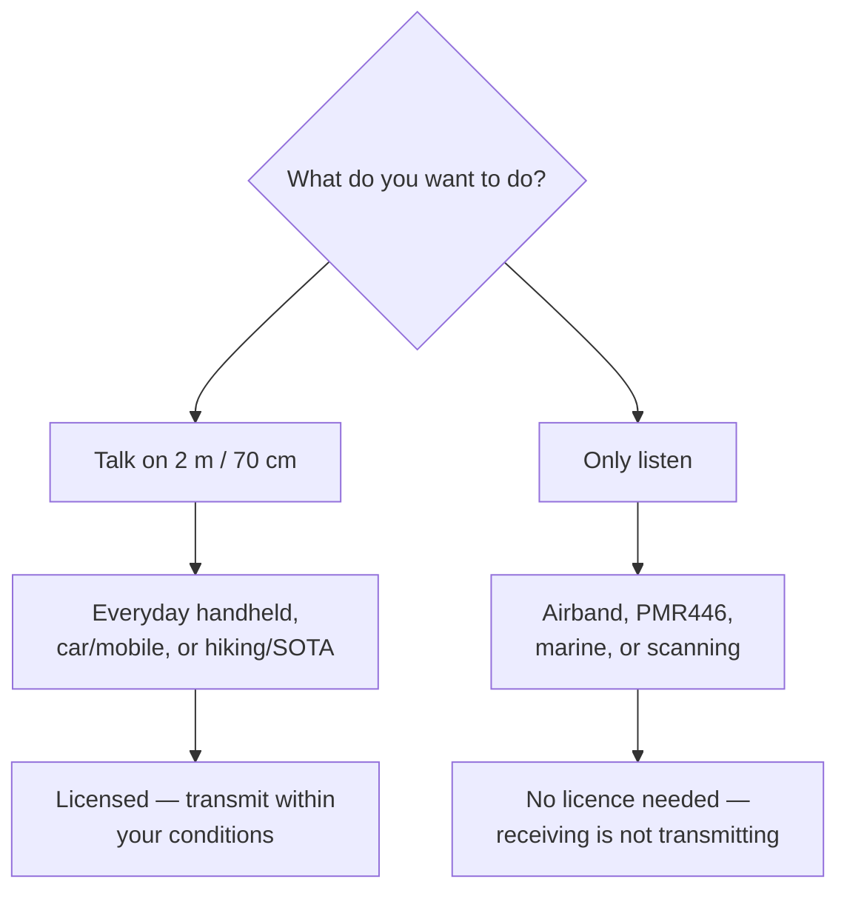
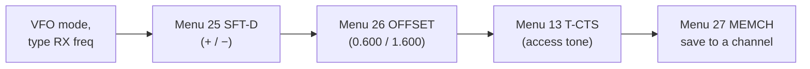

# Ready-made configurations

The quickest way to enjoy a UV-5R is to stop reading menus and start using it — and the fastest route there is to copy a setup that already works. This chapter is a set of ready-made configurations: the everyday one, the one for the car, the one for a hilltop, and several receive-only setups for listening to airband, marine and licence-free traffic. Each is a short table of menu numbers and values you can key straight in, with a note on what it is for and where it earns its keep.

## How to use these configs

Everything below is expressed as **menu number → value**, because that is how the UV-5R thinks. To set any item, press `MENU`, key the number (or step to it with `▲`/`▼`), press `MENU` again to open it, choose the value with `▲`/`▼`, and press `MENU` once more to save. `EXIT` backs you out without changing anything. If that dance is unfamiliar, [Getting Started](outpost:entry/logbook73.guide.uv-5r/getting-started) walks through it, and the full meaning of every item lives in the two menu chapters — [the first](outpost:entry/logbook73.guide.uv-5r/menus-1) covers menus 0–20, [the second](outpost:entry/logbook73.guide.uv-5r/menus-2) covers 21–40.

One rule saves a lot of confusion. **In channel (memory) mode the UV-5R refuses to change most per-channel settings** — CTCSS/DCS tones, wide/narrow, step, busy-channel lockout, the channel name. Only High/Low power can be nudged on a stored channel. So you set a channel up in **frequency (VFO) mode**, get every value right, and _then_ save it to a memory. Better still, do the whole job in **[CHIRP](outpost:entry/logbook73.guide.uv-5r/getting-started)** — the free programming software turns an afternoon of thumb-aching menu-diving into a five-minute table you can edit, reorder and back up. Every config here can be typed into CHIRP just as easily as into the radio.

## The universal baseline

Set these once and every config below inherits them. They encode the good manners this guide keeps pushing — lowest sensible power, busy-channel lockout on, no roger beep — plus a few quality-of-life choices. Where a config wants something different, it says so.

| Menu | Name   | Value     | Why                                                                                                   |
| ---- | ------ | --------- | ----------------------------------------------------------------------------------------------------- |
| 0    | SQL    | `4`       | Silences the hiss but still opens for real signals; nudge up in strong RF, down to hear weak ones     |
| 2    | TXP    | `LOW`     | The UV-5R's Low is ~1 W and does the job most of the time; save High for when you actually need reach |
| 3    | SAVE   | `3` (1:3) | Battery save; note it switches itself off whenever dual-watch (TDR) is on                             |
| 4    | VOX    | `OFF`     | Hands-free transmit trips on coughs and background noise — leave it off                               |
| 6    | ABR    | `5` (5 s) | Backlight timeout; long enough to read, short enough to save battery                                  |
| 8    | BEEP   | `ON`      | The keypress confirmation is genuinely useful while you learn the radio                               |
| 14   | VOICE  | `OFF`     | The spoken menu prompts wear thin fast                                                                |
| 16   | DTMFST | `OFF`     | You do not need to hear DTMF tones during ordinary voice work                                         |
| 19   | PTT-ID | `OFF`     | No automatic ID burst on amateur voice chat                                                           |
| 23   | BCL    | `ON`      | Busy-channel lockout — refuses to transmit on top of an occupied channel                              |
| 24   | AUTOLK | `ON`      | Auto-locks the keypad so a pocket cannot re-tune you                                                  |
| 35   | STE    | `ON`      | Tail-tone elimination — kills the "kerchunk" of noise at the end of a simplex over                    |
| 39   | ROGER  | `OFF`     | No roger beep; it adds nothing on the amateur bands and annoys people                                 |

**TDR (menu 7, dual-watch)** is deliberately left out of the baseline because the right answer depends on the config — on when you want to watch two channels, off when you want maximum battery life and minimum confusion. Each setup below tells you which.

A word on **power**, because it runs through everything here. The UV-5R offers only two levels, High (~4 W) and Low (~1 W). Both sit comfortably inside any amateur allowance — a UK Foundation licensee has far more headroom than the radio can use — so "run low power" is never about the licence, it is about good practice: less battery drain, less interference to distant users sharing the channel, and a cleaner signal. Turn it up only when Low genuinely will not reach. The reasoning is in [RF Power](outpost:entry/logbook73.handbook/rf-power).

## 1 · UK Foundation operator — your first setup

This is the "do this first" configuration: the sensible defaults above, plus the handful of channels a newly licensed operator actually uses. Programme your local [repeaters](outpost:entry/logbook73.handbook/repeaters) and the calling channels, and you are on the air properly.

| Menu | Name | Value                                                | Notes                                                       |
| ---- | ---- | ---------------------------------------------------- | ----------------------------------------------------------- |
| 1    | STEP | `12.5 kHz`                                           | The 2 m and 70 cm channel grid in Region 1                  |
| 5    | W/N  | `NARR`                                               | UK 2 m/70 cm FM is now 12.5 kHz narrow-band                 |
| 7    | TDR  | `ON`                                                 | Watch the calling channel _and_ your local repeater at once |
| 2    | TXP  | `LOW` around town, `HIGH` to reach a distant machine |                                                             |

Then store these as memory channels (in VFO mode, or in CHIRP):

| Purpose                 | RX freq        | Menu 25 SFT-D | Menu 26 OFFSET | Tone                              |
| ----------------------- | -------------- | ------------- | -------------- | --------------------------------- |
| 2 m FM calling (S20)    | `145.500`      | `OFF`         | —              | none                              |
| 70 cm FM calling (SU20) | `433.500`      | `OFF`         | —              | none                              |
| Local 2 m repeater      | e.g. `145.700` | `-`           | `00.600`       | T-CTS (menu 13) = repeater's tone |
| Local 70 cm repeater    | e.g. `433.000` | `+`           | `01.600`       | T-CTS (menu 13) = repeater's tone |

Almost every UK repeater needs a **CTCSS access tone** — a sub-audible tone your radio sends to unlock it. The repeater's own listing gives the figure (UK tones run 67.0–118.8 Hz by region); set it in **menu 13 (T-CTS)**. A few older machines instead want a **1750 Hz toneburst**: hold `PTT`, then press `BAND`, and the radio sends the burst. The offsets above are UK conventions — **−0.6 MHz on 2 m, +1.6 MHz on 70 cm**; elsewhere check your national band plan (much of Europe uses −7.6 MHz on 70 cm, North America ±5 MHz). Programming a repeater by hand always follows the same order:

Transmit only on 2 m and 70 cm within your amateur allocation, at your licensed power. If you are not yet licensed you can programme and _listen_ to all of this legally — see [Getting Licensed](outpost:entry/logbook73.handbook/getting-licensed) when you are ready to talk.

## 2 · Everyday handheld

The daily driver: the same settings as above, but here is the _habit_ that makes it work. Leave **TDR on (menu 7)** with the 2 m calling channel `145.500` on one line and your busiest local repeater on the other, so you catch a call on either without touching the radio. Keep **TXP Low (menu 2)** — around town, 1 W into a rooftop repeater a few miles away is plenty — and reserve High for when Low visibly will not make it.

Two everyday tricks:

- **Reverse** (the `*` / `SCAN` key) temporarily swaps a repeater's transmit and receive frequencies, so you can hear whether the station you are working is close enough to reach **direct** (simplex) and spare the repeater. Tap it, listen, tap it back.
- **Monitor** (hold the lower side key, `MONI`) opens the squelch so you can hear a signal too weak to break it — useful for judging whether a faint station is workable.

If you never hear yourself through the repeater, the usual causes are a missing or wrong CTCSS tone (menu 13), the wrong offset direction (menu 25), or simply being out of range — all covered in [Troubleshooting](outpost:entry/logbook73.guide.uv-5r/troubleshooting).

## 3 · Car / mobile

A handheld in a car is a compromise, but a good external antenna turns it into a genuinely useful mobile rig. The changes from the everyday setup are about **power, safety and an antenna on the roof**.

| Menu | Name   | Value  | Notes                                                                       |
| ---- | ------ | ------ | --------------------------------------------------------------------------- |
| 2    | TXP    | `HIGH` | You want the reach, and a car battery is not the limit                      |
| 3    | SAVE   | `OFF`  | Powered from the car or in the cradle — no need to micro-sleep the receiver |
| 6    | ABR    | `5`    | Or longer if you like a lit display; still auto-off                         |
| 7    | TDR    | `ON`   | Watch calling + local repeater as you drive through cells                   |
| 24   | AUTOLK | `ON`   | Lock the keypad so nothing gets nudged on the move                          |

The single biggest upgrade is a **mag-mount antenna on the roof** — the metal roof acts as a ground plane and lifts both transmit and receive dramatically over a rubber duck indoors. Fit it, then check it is a sensible match (see [SWR](outpost:entry/logbook73.handbook/swr)) before you lean on High power. One honest caveat lives here: a bigger, higher antenna feeds the UV-5R's broad, lightly filtered front end more of _everything_, so near masts and city-centre transmitter sites you may notice more [overload and ghost signals](outpost:entry/logbook73.handbook/overload-and-ghost-signals) than you did on the little stock whip. It is the classic budget-receiver trade-off, and a band-pass filter cures it for a fixed installation.

Two safety notes, briefly. **Programme before you drive, never during** — that is what CHIRP and pre-stored channels are for. And a proper **speaker-microphone** (not VOX) keeps your hands and eyes where they belong.

## 4 · Hiking / SOTA

On a summit the enemy is a flat battery, so this config is tuned to sip power and still get you heard from a good high location. Amateurs activating hills ([SOTA](outpost:entry/logbook73.handbook/vhf) and similar) live on 2 m FM simplex.

| Menu | Name | Value                           | Notes                                                                 |
| ---- | ---- | ------------------------------- | --------------------------------------------------------------------- |
| 2    | TXP  | `LOW`, `HIGH` for the long shot | Height does the work; from a summit, 1 W goes a very long way         |
| 3    | SAVE | `4` (1:4)                       | Deepest battery save                                                  |
| 6    | ABR  | `OFF`                           | Kill the backlight — every mA counts on the hill                      |
| 7    | TDR  | `OFF`                           | Watch one channel; dual-watch disables battery save and drains faster |
| 0    | SQL  | `4`–`5`                         | A touch higher so the speaker is not hissing away your battery        |
| 8    | BEEP | `OFF`                           | Optional — quieter and marginally kinder to the battery               |

Primary channel: **`145.500` (2 m FM calling)**, where activators call before moving to a working frequency; keep `433.500` (70 cm calling) stored too. A **spare battery kept warm in an inside pocket** is worth more than any setting — lithium cells lose capacity in the cold. From a genuine summit you rarely need a repeater, but if you do, the 1750 Hz burst (hold `PTT`, press `BAND`) and a distant machine can give you real range. Height beats power every time: the view from the top is doing the heavy lifting, not the last watt.

## 5 · Airband listening (receive only)

Here honesty matters more than a tidy table. **The UV-5R is a poor airband receiver, and for most people it will not work at all.** Two things stand in the way. First, aviation uses **AM**, and the UV-5R has no AM detector — it can only "slope-detect" a strong AM signal through its FM circuitry, which comes out weak and distorted and only for a nearby, powerful transmitter. Second, the useful airband (118–137 MHz) sits mostly **below the radio's 136 MHz receive floor**, so the bulk of it is simply out of tuning range.

If you want to try anyway — say the control tower of a field you are standing beside broadcasts near the very top of the band:

| Menu | Name | Value   | Notes                                                                            |
| ---- | ---- | ------- | -------------------------------------------------------------------------------- |
| 5    | W/N  | `NARR`  | Tightens the passband a little for slope detection                               |
| 0    | SQL  | `0`–`1` | Open it right up; slope-detected AM is quiet and will not break a normal squelch |
| 7    | TDR  | `OFF`   | Single channel, all attention on the one signal                                  |

> **The honest verdict.** This is the one setup in this chapter where the answer is "the radio can't really do this." If airband matters to you, use a receiver with a real AM mode and coverage down to 118 MHz — a cheap RTL-SDR dongle, a purpose-made scanner, or a wideband handheld like the [RT-950 Pro](outpost:entry/logbook73.guide.rt-950-pro/overview) — and leave the UV-5R to the FM bands it does well. Whatever you use, **listening is receive-only**: you are never permitted to transmit on aviation frequencies.

## 6 · PMR446 monitoring (receive only)

[PMR446](outpost:entry/logbook73.handbook/uhf) is the European licence-free band families and event teams use — eight analogue channels around 446 MHz, 12.5 kHz narrow FM, at a fraction of a watt. The UV-5R will _hear_ them perfectly (it is FM, and 446 MHz is inside its range), which makes it handy for keeping an ear on a group. **It cannot legally transmit there:** PMR446 requires a type-approved radio with a fixed antenna and a 0.5 W ERP limit, and the UV-5R meets none of those conditions. So this is monitoring and awareness only.

| Menu | Name | Value      | Notes                                    |
| ---- | ---- | ---------- | ---------------------------------------- |
| 1    | STEP | `12.5 kHz` | The PMR446 channel spacing               |
| 5    | W/N  | `NARR`     | PMR446 is narrow-band FM                 |
| 0    | SQL  | `3`–`4`    | Enough to silence the hiss between overs |

The eight analogue channels (Region 1):

| Ch  | Frequency   | Ch  | Frequency   |
| --- | ----------- | --- | ----------- |
| 1   | `446.00625` | 5   | `446.05625` |
| 2   | `446.01875` | 6   | `446.06875` |
| 3   | `446.03125` | 7   | `446.08125` |
| 4   | `446.04375` | 8   | `446.09375` |

North America's equivalent is **FRS/GMRS** on different frequencies (462/467 MHz) — the same idea, another band plan; if you are there, store those instead. To actually _talk_ on the licence-free channels, buy a cheap type-approved PMR446 or FRS handset: match the radio to the licence, not the other way round.

## 7 · Marine listening (receive only)

Unlike airband, marine VHF is **FM and inside the UV-5R's range**, so the radio receives it properly. This is a rewarding listen near the coast or a busy harbour — but again **receive only**: transmitting on marine channels needs a marine radio licence and an approved set, and is not something to do on a UV-5R.

| Menu | Name | Value    | Notes                             |
| ---- | ---- | -------- | --------------------------------- |
| 1    | STEP | `25 kHz` | Marine VHF sits on a 25 kHz grid  |
| 5    | W/N  | `WIDE`   | Marine channels are wide FM       |
| 0    | SQL  | `3`–`4`  | Silences the between-traffic hiss |

A few internationally standard simplex channels to start with (transmit and receive on the same frequency, so easy to monitor):

| Channel | Frequency | Used for                                               |
| ------- | --------- | ------------------------------------------------------ |
| 16      | `156.800` | Distress, safety and calling — the channel to leave on |
| 06      | `156.300` | Ship-to-ship safety                                    |
| 67      | `156.375` | Small-craft safety (UK)                                |
| 72      | `156.625` | Ship-to-ship                                           |
| 13      | `156.650` | Bridge-to-bridge navigation                            |

Some services use **duplex** channels (the ship and the shore station transmit on different frequencies); for casual listening the simplex channels above give you most of the activity. Near a big port, expect the same [front-end overload](outpost:entry/logbook73.handbook/overload-and-ghost-signals) the UV-5R is prone to — if a "ship" appears on an implausible channel next to a strong transmitter, suspect intermod. Marine channel numbering is international but a few allocations are national (the UK's private marina channels M1 `157.850` and M2 `161.425`, for instance), so check your national marine band plan.

## 8 · Emergency go-bag

A UV-5R is small, cheap and sips battery, which makes it an ideal radio to charge, programme, and forget in a rucksack until you need it. The configuration is really a _channel plan_ plus a storage discipline.

| Menu | Name   | Value     | Notes                                                                   |
| ---- | ------ | --------- | ----------------------------------------------------------------------- |
| 2    | TXP    | `LOW`     | Conserve battery; go `HIGH` only to reach a repeater                    |
| 3    | SAVE   | `4` (1:4) | Deepest battery save for standby                                        |
| 6    | ABR    | `1`–`OFF` | Minimal backlight                                                       |
| 7    | TDR    | `OFF`     | One channel, maximum endurance (switch on when actively monitoring two) |
| 24   | AUTOLK | `ON`      | Nothing gets nudged in the bag                                          |

Build a single zone of memories that mixes **transmit-capable** amateur channels with a **listen-only** situational-awareness list:

| Memory                       | Purpose                                                                |
| ---------------------------- | ---------------------------------------------------------------------- |
| Local 2 m / 70 cm repeaters  | Your everyday machines — most likely to carry traffic and be monitored |
| `145.500` / `433.500`        | 2 m and 70 cm FM calling — where to call if the repeaters are down     |
| PMR446 ch 1–8                | Listen for family, neighbours and event teams (receive only)           |
| Marine ch 16 + local working | Coastal awareness (receive only)                                       |
| Local news / broadcast FM    | The `CALL` key toggles the 65–108 MHz FM radio for bulletins           |

Storage matters as much as programming. **Keep the battery charged** — lithium cells self-discharge, so top it up every few months and store around half to two-thirds charge for longevity. Drop a **charged spare battery** and the programming cable in the bag. And remember the licensing reality: in an emergency you may always _listen_ on anything the radio can hear, but you may only _transmit_ within your licence — so being licensed, and having your local repeaters and calling channels already stored, is what turns this from a scanner into a communications tool. National emergency-communications groups (your national society can point you to them) publish local calling frequencies worth adding.

## Try it yourself

Pick the one config that matches how you will use the radio today and build it now — it takes ten minutes:

1. **Set the universal baseline** (the table near the top) — thirteen menu items, and every setup inherits them.
2. **Programme two channels in VFO mode:** `145.500` as a plain simplex channel, and your nearest 2 m repeater with SFT-D `−` (menu 25), OFFSET `00.600` (menu 26) and its access tone in T-CTS (menu 13). Save each with **menu 27 (MEMCH)**.
3. **Switch to channel mode** and confirm you cannot change the tone there — proof of the "set it in VFO mode first" rule.
4. **Turn on TDR (menu 7)** and watch the radio flick between your two channels, catching a call on either.
5. **When you have more than a handful of channels**, stop doing it by hand — type the lot into [CHIRP](outpost:entry/logbook73.guide.uv-5r/getting-started), reorder them, and keep the file as a backup a factory reset cannot touch.

## Key takeaways

- Every config is **menu number → value**; set the **universal baseline once** (BCL on, Low power, roger off, VOX off) and each setup inherits it.
- Set channels up in **VFO mode then save** — channel mode will not let you change tones, bandwidth or step — and for anything past a few channels, use **CHIRP** and keep a backup.
- The transmit-capable setups (**Foundation, everyday, car, hiking**) differ mainly in **power, TDR and antenna**: low power and dual-watch around town, High power and a roof antenna mobile, deep battery-save and a single channel on the hill.
- The receive-only setups (**airband, PMR446, marine, go-bag**) are legal without a licence, but each has a limit: **airband barely works** (no AM mode, and mostly below the 136 MHz floor), while **PMR446 and marine you may monitor but not transmit** on with a UV-5R.
- Run the **lowest power that does the job**, keep it **in-band**, program your **local repeaters and calling channels**, and you have a cheap radio set up like a careful operator's.

When one of these setups does not behave — no repeater, a dead channel, ghost signals — head to [Troubleshooting](outpost:entry/logbook73.guide.uv-5r/troubleshooting), where every common "why won't it…" has an answer.
