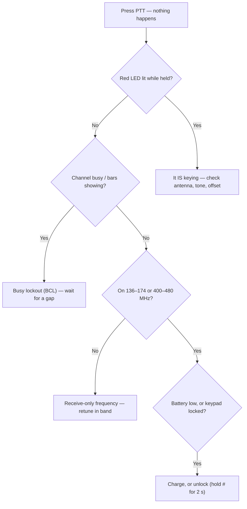
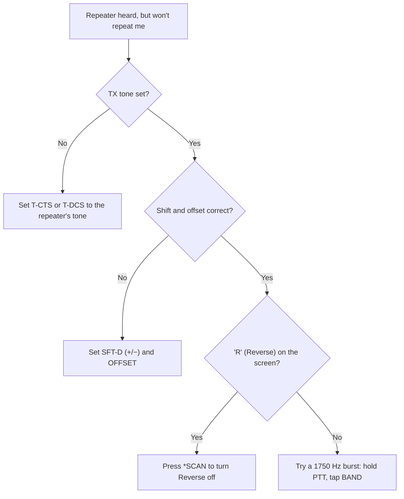
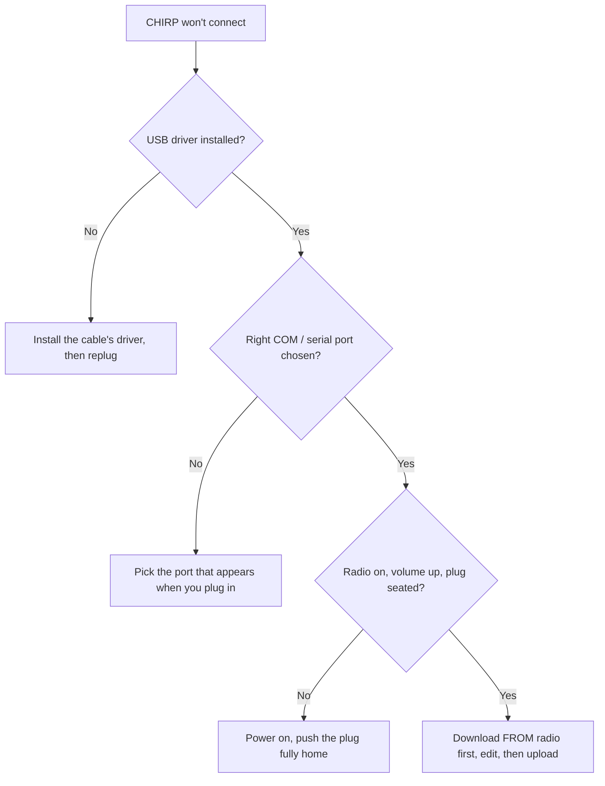

# Troubleshooting

Almost nothing that goes wrong with a UV-5R is actually broken. The radio is a small, robust thing; what trips people up, over and over, is a setting left somewhere unexpected — a receive tone that mutes a perfect signal, a busy-channel lock that refuses to key, a memory mode with nothing to recall. This chapter is a fault-finder built around the words you would actually use — "it's gone silent", "it won't transmit" — and for each one it walks you from symptom, to cause, to fix.

## Before you panic: the thirty-second checks

Two habits solve most problems before you have properly started worrying.

**First, read the icon strip along the top of the display.** The UV-5R is honest about its own state, if you know where to look. A padlock means the keypad is locked; `VOX` means it can transmit on its own; `R` means the transmit and receive frequencies are swapped (Reverse); `N` means narrow bandwidth; `CT` or `DCS` means a sub-tone is active; `+`/`−` means a repeater shift is set. When the radio is "misbehaving", that little row of symbols has usually already confessed why.

**Second, remember what a memory channel is.** A stored channel is a frozen snapshot — frequency, offset, tones, bandwidth and power, all saved together. So a fault that follows one channel around but vanishes on another is baked into that snapshot, not a hardware fault; the cure is to fix it in VFO (frequency) mode and re-save, exactly as [Getting Started](outpost:entry/logbook73.guide.uv-5r/getting-started) describes.

If you ever feel truly lost, press `EXIT` a few times to back out to the standby screen — it changes nothing — and start from there.

## "It's gone silent — hiss but no voices, or nothing at all"

This is the single most common panic, and it splits neatly into two very different faults. Work out which one you have and the fix is obvious.

**Fault A — total silence, not even background hiss.** Your **squelch** is set too high. Squelch is a noise-gate that keeps the speaker quiet until a signal is strong enough to be worth hearing; wind it up too far and it stays shut even on real signals. Menu `0` (`SQL`) runs 0–9.

- **The fix:** open the menu, drop `SQL` to `3`, and listen. To sanity-check the radio is alive at all, press and **hold the `MONI` side key** (side key 2): that forces the squelch fully open and you should hear a wash of white noise. Hiss means the receiver is working perfectly — the squelch was simply doing its job too well. Set `SQL` back to the lowest number that stays quiet between signals (usually 2–4). The full story is in [The Radio Menu explained](outpost:entry/logbook73.guide.uv-5r/menus-1).

**Fault B — the radio is clearly busy but stays mute.** Here the tell-tale is that the little receive indicator lights, or the signal-strength bars jump, yet no audio comes out. That is a **receive sub-tone** doing exactly what it was told. If menu `11` (`R-CTS`, receive CTCSS) or menu `10` (`R-DCS`, receive DCS) is set, the radio holds the speaker shut for every signal that does _not_ carry the matching sub-audible tone — even a loud, crystal-clear one.

```viz
{
  "type": "spectrum",
  "title": "Why a receive tone can silence a working radio",
  "caption": "A CTCSS sub-tone rides below your voice, too low to hear. Set the radio to listen for one (R-CTS) and it keeps the speaker shut for every signal that doesn't carry the matching tone — even loud, perfect ones.",
  "xLabel": "audio frequency (low → high)",
  "components": [
    { "f": 4, "amp": 0.55, "label": "CTCSS sub-tone", "tone": "primary" },
    { "f": 48, "amp": 0.9, "width": 52, "label": "the voice you want to hear", "tone": "muted" }
  ],
  "noiseFloor": 0.04
}
```

- **How it happens:** you programmed the channel in [CHIRP](outpost:entry/logbook73.guide.uv-5r/getting-started) using its "Tone Squelch (TSQL)" setting, which quietly sets _both_ the transmit and the receive tone. Or you meant to set only a transmit tone and nudged the receive one by mistake.
- **The fix:** set menu `10` (`R-DCS`) and menu `11` (`R-CTS`) to `OFF`. Now the radio opens on any signal on the frequency. Keep a _transmit_ tone if your repeater needs one — that is menu `13`, and it is a separate thing (see the next section). A receive tone is only worth having on a busy shared channel where you genuinely want to ignore everyone not in your group.

This is precisely the factory manual's "the receiving indicator lights but I hear no speaker" entry — and now you know both halves of it. There is much more on why these tones exist in [CTCSS, DCS & sub-tones](outpost:entry/logbook73.guide.uv-5r/menus-1).

## "It won't transmit"

You press PTT and nothing goes out — no red light, or a light but nobody hears you. The UV-5R refuses to transmit for several sensible reasons, and it is worth stepping through them in order.



Walking the branches:

- **Busy channel lockout (menu `23`, `BCL`).** With `BCL` set to `ON`, the radio will not let you key up onto a frequency that already has a signal strong enough to open the squelch. This is a _good manners_ feature — it stops you transmitting on top of a conversation you cannot hear because your own tone decoder is muting it. If the radio simply refuses while the channel sounds active, this is why. The fix is to **wait for a gap**, not to disable it; but if you need to override for a legitimate reason, menu `23` turns it `OFF`. Leave it back on afterwards. More in [The Radio Menu](outpost:entry/logbook73.guide.uv-5r/menus-2).
- **You are on a receive-only frequency.** The UV-5R transmits only on **136–174 MHz** and **400–480 MHz** (and only where your [licence](outpost:entry/logbook73.handbook/getting-licensed) permits within those). If the active VFO is tuned to the broadcast FM band (65–108 MHz, reached with the `CALL` key), or you have typed a frequency outside those transmit ranges, the PTT does nothing useful. Menu `33` (`BAND`) selects whether frequency-mode tuning lives on `VHF` or `UHF`; if you cannot even dial the frequency you want, this is often the reason. Retune inside your amateur allocation and it will key. **Never transmit out of band** — it is not just impolite, it is illegal.
- **Low battery.** Transmitting is thirsty: the radio sips about 380 mA listening but pulls up to **1.4 A** on transmit. A pack that receives happily can be too flat to key at full power, or drop out mid-over. If receive is fine but transmit is weak or dead, charge it. A tired, aged pack behaves the same way even when "full" — see the quick-fix table below.
- **The keypad is locked.** A padlock icon and dead keys mean the lock is on (menu `24`, `AUTOLK`, can set it automatically). **Hold the `# / 🔒` key for about two seconds** to unlock.
- **The time-out timer cut you off (menu `9`, `TOT`).** This one feels like a fault but is a safety feature: hold PTT longer than the set time (commonly 60–180 s) and the radio stops transmitting to protect its finals from overheating. Release PTT, let it reset, and carry on — and take the hint to keep your overs shorter.

And one that is not really the radio's fault at all: **never key up without the antenna fitted.** A transmitter with nowhere to send its power can damage itself; the reasoning is in [SWR](outpost:entry/logbook73.handbook/swr). If you have swapped antennas, make sure the new one is finger-tight in the SMA socket.

## "I can hear the repeater, but it won't open for me"

Receiving a [repeater](outpost:entry/logbook73.handbook/repeaters) and _accessing_ one are two different jobs, and it is completely normal to do the first perfectly while failing at the second. Listening needs nothing special; getting the repeater to relay you needs three things to line up.



- **You are not sending the access tone.** Almost every modern repeater is guarded by a **transmit CTCSS tone** (occasionally DCS) — a sub-audible tone your radio must send to be let in. This is menu `13` (`T-CTS`) for CTCSS or menu `12` (`T-DCS`) for DCS. Crucially, this is _separate_ from the receive tone of the last section: to work a repeater you usually want a **transmit tone set and the receive tone off**, so you send the right code but still hear everyone. Set `T-CTS` to the tone in the repeater's listing (for example `77.0 Hz`), leave `R-CTS` off, and try again.
- **Your offset or shift is wrong.** A repeater listens on one frequency and transmits on another; your radio must mirror that split. Menu `25` (`SFT-D`) sets the direction (`+` or `−`) and menu `26` (`OFFSET`) sets the size. In the UK that is **−0.6 MHz on 2 m** and **+1.6 MHz on 70 cm**; elsewhere, check your national band plan (the 70 cm shift in particular varies — ±5 MHz in the US, −7.6 MHz across much of Europe). If the shift is wrong you transmit on a frequency the repeater is not listening to, so it never hears you even though you hear it. Storing the repeater as a memory channel bakes both of these in for good.
- **Reverse is switched on.** If you see an `R` on the display, the `*SCAN` key's Reverse function is active — it has swapped your transmit and receive frequencies, so you are now transmitting on the repeater's _output_ and listening on its _input_. Nothing works. **Press `*SCAN` to toggle Reverse off** and the `R` disappears. (Reverse is genuinely useful for checking whether you could reach another station direct, simplex — but leave it off for normal repeater work.)
- **Your repeater wants a 1750 Hz burst instead.** Some older European and UK repeaters open on a **1750 Hz tone-burst** rather than a continuous CTCSS tone. The UV-5R can send one: **press and hold PTT, then tap the `BAND` key**. If CTCSS does not open a machine listed as toneburst-access, try that.

If all of that is right and it still will not trigger, only then consider power and antenna — but reach is rarely the real problem. Chasing more power before checking tone and shift is the classic new-operator wild-goose chase.

## "There's horrible interference in town — signals that come and go"

Welcome to the UV-5R's single most famous limitation, and the honest reason it costs what it does. To hit its price and cover a wide range, the radio uses **very little front-end filtering** — the input tuning that a premium handheld uses to reject everything except the frequency you want. In a strong-RF environment — near a broadcast, paging, cellular or taxi transmitter site — that thin filtering lets too much energy into the receiver at once, and it **overloads**: it desenses (goes deaf to weak signals), and it manufactures **["ghost" signals](outpost:entry/logbook73.handbook/overload-and-ghost-signals)** — mixing products and intermodulation that appear on frequencies where nothing is really transmitting. This is so well documented on this exact model that it has become the textbook example.

Three things worth knowing, because they are counter-intuitive:

- **It is not a fault, and it is not the frequency's fault.** If a "repeater" or "signal" appears on an odd frequency close to a transmitter mast, suspect intermod before you believe it is real — the signal is being made inside your receiver.
- **A bigger, better antenna makes it _worse_.** More gain feeds _more_ out-of-band energy into an already-crude front end, and the receiver collapses faster. On a UV-5R, the modest stock "rubber duck" can genuinely behave better than a big outdoor whip when you are surrounded by strong signals.
- **The cures are physical, not menu-driven.** Move away from the transmitter site; use a shorter, less efficient antenna in the worst spots; and for a fixed station, fit an external **band-pass filter** on the antenna lead — a filter for just the 2 m or 70 cm band restores sanity, and the fact that it works proves the front end was the limiter. No menu setting fixes overload, because the problem is in hardware, not firmware. The physics is in [Overload & ghost signals](outpost:entry/logbook73.handbook/overload-and-ghost-signals) and [Receivers](outpost:entry/logbook73.handbook/receivers).

None of this makes the UV-5R a bad radio — its raw sensitivity is genuinely excellent, bench-tested competitive with sets costing many times more. It simply means the front end is where the money was saved, and knowing that turns a baffling "fault" into a predictable, manageable quirk.

## "The signal-strength meter never moves"

Good news: this is not broken. The UV-5R's `S`-meter is best thought of as a **two-state indicator**, not a calibrated gauge. In practice the bars tend to sit empty on no signal and slam to full the moment anything opens the squelch, with very little in between. It will not give you the smooth, graded read-out of an expensive rig, and it never will — that is a design economy, not a fault, and it is widely noted on this model.

A related quirk from the same cost-saving: the radio has a handful of internal **"birdies"** — faint spurious tones generated by its own oscillators that appear at a few fixed spots (around 78, 156, 416, 442, 468 and 494 MHz on many units). If you find a steady, silent carrier that opens the squelch on exactly one of those frequencies and nowhere near it, that is the radio hearing itself, not a distant station. Nudge off the frequency and it vanishes. Neither the flat S-meter nor the birdies need fixing — they just need to be recognised for what they are.

## "It's stuck — I can't change channel, or it won't leave one VFO"

This feels alarming and is almost always one of a few harmless states.

- **Memory mode with nothing stored.** If you press `VFO/MR` into memory (channel) mode on a radio with no channels saved yet, there is nothing to recall, so the up/down keys and the knob appear dead. As the manual puts it plainly: _you cannot select a channel if not previously stored._ The fix is to press `VFO/MR` back to frequency mode and either use the radio there, or store some channels (by hand, or far more easily with [CHIRP](outpost:entry/logbook73.guide.uv-5r/getting-started)).
- **You are editing the wrong line.** The UV-5R shows two frequencies — an upper (A) and a lower (B) VFO — and the `A/B` key chooses which one your changes apply to. If tuning or menu edits seem to do nothing, you may be watching one line while editing the other. Press `A/B` so the little arrow/highlight is on the line you mean to change.
- **You are in channel mode, trying to change channel-only settings.** In memory mode the radio deliberately locks most per-channel settings — CTCSS/DCS, bandwidth, PTT-ID, busy lockout, scan-add and the channel name are all greyed out; **only High/Low power can be changed on the fly** (tap the `# / 🔒` key). This is not a fault: a memory is a snapshot, so to change its contents you go to VFO mode, set it up, and re-save over the channel. It is the golden rule from [Getting Started](outpost:entry/logbook73.guide.uv-5r/getting-started).
- **Dual watch is transmitting on the "wrong" VFO.** With dual watch on (menu `7`, `TDR`), the radio listens to both A and B and — depending on menu `34` (`TX-AB`) — may transmit on whichever it last heard, which can feel random. If you keep transmitting on the wrong frequency during dual watch, set `TX-AB` deliberately to `A` or `B`, or switch dual watch off when it matters (menu `7` → `OFF`). See [The Radio Menu](outpost:entry/logbook73.guide.uv-5r/menus-2).
- **The keypad is simply locked.** Padlock icon, dead keys — hold `# / 🔒` for two seconds.

## "CHIRP won't connect / programming failed"

Nine times out of ten this is the cable, not the radio and not the software. The UV-5R is beautifully supported by CHIRP; the weak link is the cheap USB programming lead, which usually contains a Prolific or FTDI-style chip that needs the right driver.



Work through it in this order:

1. **Install the cable's driver.** Many low-cost leads use counterfeit chips that modern drivers deliberately refuse. If the cable shows up with a warning in your operating system's device list, install the specific driver the cable's seller points to (or an older, tolerant version). No driver, no connection.
2. **Choose the correct port.** In CHIRP, pick the serial/COM port that _appears_ the moment you plug the cable in and _disappears_ when you unplug it. Guessing the wrong port is the second-most-common failure.
3. **Pick the right model.** Select **Baofeng UV-5R** (or the specific variant CHIRP suggests). Choosing a near-neighbour can read garbage or refuse.
4. **Radio on, volume up, plug seated.** Turn the radio on, set the volume to about halfway (some clones use the audio line for data), and press the 3.5 mm/2.5 mm plug **firmly** all the way in — a millimetre proud is enough to fail. Do not transmit while connected.
5. **Download before you upload — always.** The safe workflow is **read the radio into CHIRP first**, edit that image, then write it back. Uploading a blank or mismatched file is how people wipe their settings. And once you have a good read, **save it as a backup file** — then a fumbled write or a factory reset costs you nothing to undo.

If it reads but then errors on write, it is nearly always a loose plug or a flat battery mid-write. Reseat, charge, and try again.

## The quick-fix table: smaller gremlins

| Symptom                                 | Likely cause                                               | Fix                                                                                                                               |
| --------------------------------------- | ---------------------------------------------------------- | --------------------------------------------------------------------------------------------------------------------------------- |
| Radio won't switch on                   | Flat or badly seated battery                               | Recharge; slide the pack off and click it firmly back on                                                                          |
| Battery drains fast                     | Battery-save off, backlight/dual-watch on, or an aged pack | Set menu `3` (`SAVE`) to `1`–`3`; shorten backlight (menu `6`); replace a worn pack                                               |
| Keys up on its own in standby           | VOX too sensitive                                          | Turn menu `4` (`VOX`) `OFF`, or lower its level                                                                                   |
| Constant beeping on key-press           | Keypad beep on                                             | Menu `8` (`BEEP`) → `OFF` (leave on if you like the confirmation)                                                                 |
| A "roger beep" after every over         | Roger tone enabled                                         | Menu `39` (`ROGER`) → `OFF`                                                                                                       |
| Menu items greyed out / won't change    | You're in channel (MR) mode                                | Switch to VFO mode, edit, re-save the channel                                                                                     |
| You hear other groups on "your" channel | Shared frequency with different (or no) tones              | Change frequency, or set a receive tone — accepting it then hides your group from others                                          |
| Audio distorted or muffled to others    | Wrong bandwidth for the channel                            | Match menu `5` (`W/N`) to the channel — `N` (narrow) where channels are 12.5 kHz spaced                                           |
| Everything is scrambled and odd         | Settings tangled beyond patience                           | Last resort: menu `40` (`RESET`) → `VFO` for a soft reset, or `ALL` to wipe fully — but restore from your CHIRP backup afterwards |

A word on that last row: `RESET` → `ALL` erases every memory channel and returns the radio to factory defaults. It is a genuine cure for a hopelessly tangled radio, but only if you have a backup to reload — which is the best reason of all to keep a CHIRP image saved somewhere safe.

## When it really is broken

Occasionally it genuinely is hardware. The honest short list: a **damaged or wrong antenna** (transmitting into it can hurt the finals over time — so replace a bent or cracked whip and never key without one); a **PTT that sticks** or a jack full of pocket lint; a **battery pack that no longer holds charge**; or **water ingress**, which these radios do not love. If a full `RESET` with a known-good battery and antenna does not restore normal behaviour, it may be time to retire that unit — and at this price, that is rarely a tragedy. Keep the CHIRP backup and a spare pack, and you are never more than five minutes from being back on the air.

## Try it yourself

The best way to stop fearing a fault is to cause one deliberately and cure it. With a charged, antenna-fitted radio in VFO mode:

1. **Make it go silent on purpose.** Set menu `11` (`R-CTS`) to a tone — say `88.5 Hz`. Now find a busy local frequency or your local repeater output. The bars will jump but you will hear nothing: you have just recreated the "receiving but muted" fault.
2. **Prove the receiver is fine.** Hold the `MONI` side key. The speaker bursts open — signal and hiss and all — because monitor overrides the tone gate. That is your diagnostic move for any "silent" radio.
3. **Cure it.** Set menu `11` back to `OFF`. Normal listening returns. You now own both halves of the most common UV-5R mystery.
4. **Feel the squelch, too.** Wind menu `0` (`SQL`) up to `9` and notice weak signals vanish; drop it to `1` and the hiss floods back. Leave it where the hiss just stops — usually `2`–`4`.

Nothing here can harm the radio, and `EXIT` always brings you home.

## Key takeaways

- **Most "faults" are settings.** Read the icon strip first (`R`, `CT`, padlock, `VOX`) — it usually names the problem — and remember a memory channel is a frozen snapshot you edit in VFO mode.
- **Silent radio?** Either squelch is too high (menu `0`) or a **receive tone** (`R-CTS`/`R-DCS`, menus `10`/`11`) is muting everything; hold `MONI` to prove the receiver is alive, then fix the right one.
- **Won't transmit?** Check busy-lockout (`BCL`), that you are inside 136–174 / 400–480 MHz and in band, the battery, the keypad lock, and the time-out timer — in that order.
- **Repeater won't open?** You almost certainly need a **transmit tone** (`T-CTS`, menu `13`) with the **receive tone off**, the right **shift and offset** (menus `25`/`26`), Reverse (`R`) turned off — or a **1750 Hz burst** (hold PTT, tap `BAND`).
- **Interference in town** is front-end overload, not breakage — it gets _worse_ on a bigger antenna, and the cures are physical (distance, smaller antenna, a band-pass filter), never a menu.
- **A flat S-meter and the odd birdie are normal**, not faults — recognise them and move on.
- **CHIRP trouble is nearly always the cable** — install the driver, pick the right port and model, and always **download before you upload** and keep a backup.

Fixing problems is half the craft; the other half is never causing them — so let's turn to operating cleanly, legally and considerately in [Best Practices](outpost:entry/logbook73.guide.uv-5r/best-practices).
