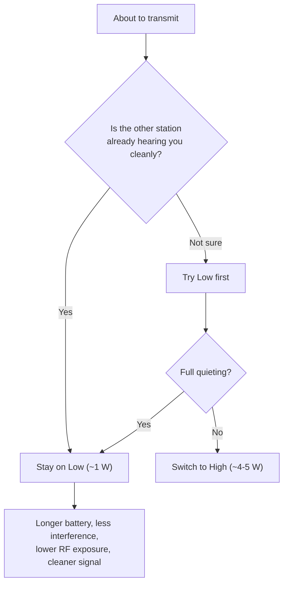
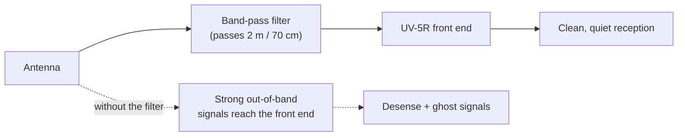
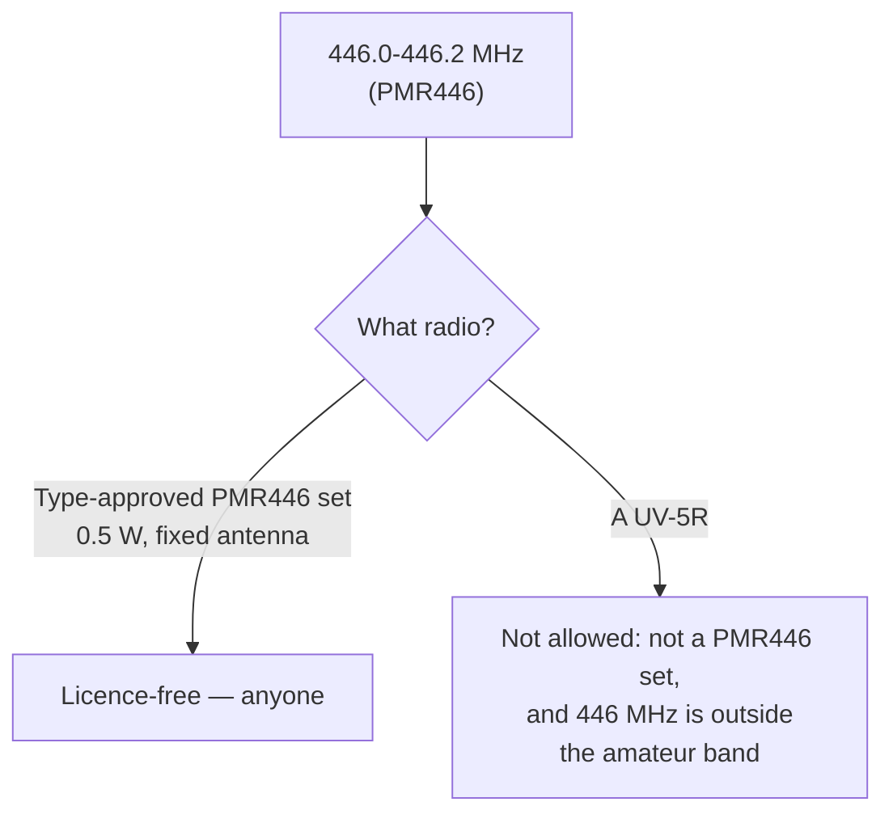

# Best practices

The UV-5R has helped many amateurs get on the air, and it is a capable, programmable budget handheld. What separates a UV-5R that is a joy to own from one that annoys everyone within earshot is not the radio at all: it is a handful of habits. This last chapter is those habits, gathered in one place — how to get the best out of the radio while being the sort of operator other people are glad to hear.

None of this is hard, and none of it costs much. A few menu changes, one small antenna upgrade, and a way of thinking about power and legality that will serve you on any radio you ever own.

## Run the least power that does the job

The single most useful habit on any handheld is **turning the power down**. The UV-5R gives you two levels — **High** (roughly 4–5 W) and **Low** (roughly 1 W) — set at _Menu 2, `TXP`_, or toggled straight from the keypad with the `#` key while in channel mode. Most new operators leave it on High out of a vague sense that "more must be better." It usually isn't.

On the 2 m and 70 cm bands, communication is essentially line-of-sight, and getting into a [repeater](outpost:entry/logbook73.handbook/repeaters) or across town to another handheld is far more about your antenna and your take-off (are you in a dip or on a rise?) than about raw watts. Going from 1 W to 5 W is only a 7 dB increase — barely one S-point — and if a signal is already fully quieting (clean, hiss-free), those extra watts change nothing the other station can hear. They just drain your battery faster, warm up the radio, put more RF next to your head, and add needless energy to a shared channel.



**Worked example.** You want to work your local repeater, `GB3xx`, whose mast is 12 km away with clear line-of-sight from your usual spot. Set the radio to Low and call. Nine times out of ten you will be full quieting on 1 W, because the path is open — the repeater's sensitive receiver and high antenna do the hard work. Only if you drop into a valley, or the repeater comes back weak and scratchy, do you reach for High. That is the whole discipline: **Low by default, High by exception.** It is better for your battery, better for everyone else, and — because a lower-power stage produces less spurious energy in absolute terms — it is genuinely a cleaner signal too. The reasoning behind watts, effective radiated power and RF exposure lives in [RF Power](outpost:entry/logbook73.handbook/rf-power).

## Turn the roger beep off

Out of the box, many UV-5Rs are set to chirp a little "roger beep" at the end of every transmission (_Menu 39, `ROGER`_). Switch it **OFF**. It adds nothing another operator needs — the moment your carrier drops, they already know you have finished — and on a shared channel or a repeater it is just one more piece of noise that everyone has to sit through, over and over. Experienced operators read a roger beep the way you would read someone ending every spoken sentence with an audible "beep": harmless once, wearing after ten times.

While you are in that part of the menu, two related settings make you a tidier presence on simplex. **`STE`** (_Menu 35_, Squelch Tail Elimination) sends a brief reverse-tone burst as your transmission ends, so the receiving radio mutes cleanly instead of coughing out a burst of noise — the "squelch crash" — as your carrier drops. Both radios in the contact need it on for the effect, and it is standard courtesy for simplex chat. **`RP-STE`** (_Menu 36_) does the equivalent job for the tail of a signal coming _back_ through a repeater. Leave `STE` on, set `RP-STE` to match your local machine if its tail bothers you, and leave the roger beep off. Small things, but they are the difference between a radio that sounds considered and one that sounds like a toy.

## Program it with CHIRP, and keep a backup

You _can_ program the UV-5R from its keypad, but the manual is thin and the process is genuinely painful — this is a radio designed to be programmed by computer. The tool of choice is **CHIRP**: free, open-source, cross-platform, and specifically excellent with Baofeng radios. You lay your channels out in a spreadsheet-style table — frequency, offset, tone, name, power — and write them all to the radio in one pass, a job that takes five minutes instead of an afternoon of thumb-aching menu-diving. The full walk-through of what each field means is in [Practical Configurations](outpost:entry/logbook73.guide.uv-5r/configs) and the [Menu Reference](outpost:entry/logbook73.guide.uv-5r/menu-reference).

Two practical notes save a lot of grief. First, **the programming cable is not usually included, and the cheap ones are a lottery.** The UV-5R programs over a USB-to-serial cable that plugs into the two-pin accessory jack, and many budget cables use counterfeit serial chips that fight with modern drivers. Buy a cable from a reputable ham dealer, or one that names a genuine chipset, and you will avoid the classic "the software can't see my radio" evening.

Second — and this is the habit that matters — **download from the radio first, and keep that image as a backup.** Before you change a thing, read the radio's current contents into CHIRP and save the file. Now you have a known-good snapshot. If you ever fumble a factory reset (_Menu 40, `RESET`_), brick a channel, or just want to undo an experiment, you write the saved image back and you are exactly where you started. A UV-5R with a backup on your laptop is a radio you can tinker with fearlessly; one without is a radio you are slightly afraid of. Keep a dated file, and re-save it whenever you make a change worth keeping.

## Fit a better antenna

The stubby "rubber duck" that ships with the radio is a compromise: compact and convenient, but less efficient than a resonant full-length whip. If you change it, choose an antenna specified for 2 m / 70 cm with the correct SMA connector, and verify its matching before transmitting. Do not assume longer is automatically better. A more efficient antenna can improve a weak link, but it can also feed more unwanted energy into this radio's easily overloaded receiver. The theory is in [Antennas](outpost:entry/logbook73.handbook/antennas), and the matching that makes an antenna resonant is in [SWR & Matching](outpost:entry/logbook73.handbook/swr).

A note on fitting: the UV-5R's socket is an **SMA female** (the pin is on the antenna), so antennas sold "for Baofeng" are SMA male. Screw it in **finger-tight only** — never force it — and, as with any transmitter, never key up without an antenna attached.

There is one honest caveat, and it leads straight into the next section. A bigger, more efficient antenna — especially a gain antenna up on a mast for fixed use — feeds the receiver _more_ of everything, including strong signals from services you never wanted. On a radio with a weak front end, that can make overload **worse**, not better. For handheld use, a correctly matched whip may help; near strong transmitters or on a rooftop antenna, test rather than assume, and read on before you are surprised by ghosts.

## Understand front-end overload — and when a filter helps

Here is the UV-5R's one real weakness, told straight. A receiver's "front end" is the first amplifier and mixer that everything arriving at the antenna passes through — think of it as the bouncer on the door of a club. A premium radio's bouncer is fussy: it lets the wanted band in and turns strong signals from neighbouring services away at the door. To hit its price, the UV-5R has **very little front-end filtering** — the bouncer waves almost everyone through — and then relies on later stages to sort the wanted signal out. In a quiet radio environment you will never notice. Near a strong source — an FM broadcast mast, a paging transmitter, a mobile-phone site — those out-of-band signals flood the front end, overwhelm it, and cause two symptoms:

- **Desense:** the receiver goes partially deaf, and weak signals you should hear vanish beneath the strong nearby energy.
- **Ghost (intermod) signals:** strong signals mix together inside the overloaded front end and produce phantom "stations" on frequencies where nothing is really transmitting.

This is well documented on the UV-5R specifically, and it is characteristic of inexpensive wideband handhelds as a class — the full explanation and how to recognise it is in [Overload & Ghost Signals](outpost:entry/logbook73.handbook/overload-and-ghost-signals), with the receiver theory in [Receivers](outpost:entry/logbook73.handbook/receivers). If a "repeater" turns up on an odd frequency next to a transmitter site, suspect intermod before you believe it. (The radio also produces a few fixed internal "birdies" — faint spurs from its own oscillators at predictable spots — which are a receiver artefact, not real signals; recognising them is covered in [Troubleshooting](outpost:entry/logbook73.guide.uv-5r/troubleshooting).)

The fix, where you need one, is an **external band-pass filter**: a small in-line device that passes the amateur band you care about and rejects everything either side _before_ it reaches the radio.

```viz
{
  "type": "spectrum",
  "title": "Why a band-pass filter transforms a cheap receiver",
  "caption": "The radio only wants the small signal in the middle. A band-pass filter passes that band and rejects the strong broadcast, paging and mobile carriers either side before they can overload the front end.",
  "components": [
    { "f": 12, "amp": 0.95, "label": "FM broadcast", "tone": "danger" },
    { "f": 30, "amp": 0.7, "label": "Paging", "tone": "danger" },
    { "f": 50, "amp": 0.28, "label": "Your repeater", "tone": "primary" },
    { "f": 78, "amp": 0.85, "label": "Mobile", "tone": "danger" },
    { "f": 90, "amp": 0.6, "label": "Other services", "tone": "muted" }
  ],
  "noiseFloor": 0.05,
  "mask": { "kind": "bandpass", "from": 42, "to": 58 },
  "xLabel": "Frequency across the band"
}
```

The improvement in a bad location can be dramatic — and that dramatic improvement is itself the proof that the front end, not the radio's sensitivity, was the limit.



You do **not** need a filter for ordinary portable use — most people never fit one. It earns its place at a fixed station on an outdoor antenna, or if you happen to live in the shadow of a broadcast or paging site. If that is you, a band-pass filter for the band you use is a cheap, transformative accessory.

## RF safety, in one short paragraph

A handheld is a transmitter a few centimetres from your face, so a little common sense is worth stating plainly (and it is only a little — this is a low-power radio, not a mast). When you transmit, keep the antenna a hand's-width from your head and away from your eyes, hold the radio slightly away rather than pressed to your cheek, and lean on the low-power habit from earlier — less power out is less exposure. And **never transmit into a missing or damaged antenna.** A transmitter needs somewhere to send its energy; with no proper antenna, that energy reflects back into the final amplifier and can cook it. If your antenna is cracked, the connector is loose, or the whip has snapped, receive-only until you have replaced it. The reasoning — SWR, reflected power, why a bad match stresses the radio — is in [SWR & Matching](outpost:entry/logbook73.handbook/swr), and the exposure side in [RF Power](outpost:entry/logbook73.handbook/rf-power).

## Stay in-band, and stay legal

The UV-5R, like most radios of its kind, can be _made_ to transmit well outside the amateur bands. Don't. **Transmit only where your licence permits** — for a UK Foundation licensee that means your 2 m (144–146 MHz) and 70 cm (430–440 MHz) allocations, at your permitted power, and nothing else. Elsewhere, check your national band plan and licence conditions; the principle is universal even where the numbers differ. If you are not yet licensed, everything in the _receive_ half of this guide is legal to do — see [Getting Licensed](outpost:entry/logbook73.handbook/getting-licensed) when you are ready to press the button.

Two points of law that the internet routinely garbles are worth getting right:

**The 2018 FCC action was not a ban.** The enforcement activity that swirls around Baofeng-type radios concerned their being **marketed with out-of-band transmit capability** — not their harmonics or spectral purity, and emphatically _not_ a prohibition on licensed amateurs using them on the ham bands. A licensed operator using a UV-5R in-band was never the target. State it accurately if it comes up.

**PMR446 is a separate service — the UV-5R is not a PMR446 radio.** In Europe, PMR446 is a licence-free walkie-talkie service on **446.0–446.2 MHz**, using type-approved handsets limited to 0.5 W with a fixed, non-removable antenna. (The US equivalent, FRS, sits on different channels around 462/467 MHz with its own rules — name your own region's service.) A UV-5R can be _tuned_ to those frequencies, but that does **not** make it legal there: it has a removable antenna, more power, and no PMR446 type approval, and — importantly — 446 MHz sits just _above_ the amateur 70 cm allocation, so an amateur licence does not cover it either.



So don't confuse the two. If you want licence-free family radios, buy a pair of proper PMR446 handsets; if you want to explore amateur radio, get licensed and stay in your allocation. The wider context on these UHF services is in [The UHF Bands](outpost:entry/logbook73.handbook/uhf). Keeping in-band and running low power is also the single biggest thing you can do for a clean transmitted signal: the UV-5R's spurious-emission history is the honest weak point of budget sets — early units were often documented exceeding the amateur limit, and while recent production generally meets it, it does so with less margin than a premium radio. In-band, low-power, considerate operation keeps you comfortably on the right side of that.

## Be a good operator on repeaters and simplex

The last habit is the oldest one in the hobby: **listen before you transmit.** Give any channel a good few seconds — someone may be mid-conversation, or pausing for a breath — before you call. From there, a short courtesy checklist covers you almost everywhere:

- **Identify with your callsign** as your licence requires — at the start and end of a contact, and periodically through a long one. Never "kerchunk" a repeater (key up briefly just to hear it respond) without identifying; it is both discourteous and, in most jurisdictions, against your licence conditions.
- **Leave gaps.** On a repeater, pause a second between overs so a station with traffic — or an emergency — can break in. That pause is what lets the repeater's tail drop and someone say their callsign.
- **Access the repeater the way it expects.** Many machines open on a **CTCSS sub-tone**; some European repeaters instead want a **1750 Hz tone burst**, which the UV-5R sends by holding `PTT` and pressing the `BAND` key. Set the tone in the channel (see the [Menu Reference](outpost:entry/logbook73.guide.uv-5r/menu-reference)) and you will never think about it again.
- **On simplex,** call on the calling channel — `145.500 MHz` is the 2 m FM calling frequency in Region 1 — then _move off it_ to a working frequency once you have made contact, so the calling channel stays clear for others. Keep `STE` on for a clean tail, and don't transmit over the top of a contact already in progress.

None of this is about stiff formality. It is nothing more than the behaviour that makes a shared, invisible resource pleasant for everybody on it — and an operator who does these things on a budget handheld is a better operator than one who ignores them on premium equipment.

## Try it yourself

Fifteen minutes with your radio and a laptop:

1. **Prove low power is enough.** Call your local repeater on **Low** (`#` key, or _Menu 2_). If you are full quieting — and you usually will be — leave it there. Only reach for High if it comes back scratchy.
2. **Turn the roger beep off** (_Menu 39, `ROGER` → OFF_) and confirm `STE` is on (_Menu 35_). Have a friend listen: your transmissions now end cleanly and quietly.
3. **Take a CHIRP backup.** Install CHIRP, plug in the cable, and _download from radio_ before changing anything. Save the file with today's date. That single file makes every future experiment safe.
4. **Hear the front end work — and struggle.** Drive to a spot near an FM broadcast or paging mast and scan around your usual channels. Any "stations" that appear on odd frequencies, or reception that goes deaf near the site, is overload in action — exactly the behaviour a band-pass filter tames.

## Key takeaways

- **Low power by default, High by exception** — 1 W is usually plenty on line-of-sight VHF/UHF, and it means longer battery, less interference, lower RF exposure and a cleaner signal.
- **Turn the roger beep off** (`ROGER`), keep `STE` on for clean simplex tails, and you instantly sound like a considered operator.
- **Program with CHIRP and keep a dated backup** — read from the radio first, buy a reputable cable, and you can tinker fearlessly.
- **Match the antenna to the job** — verify its band coverage, connector and matching, and remember that a bigger antenna in a strong-RF spot can worsen the UV-5R's **front-end overload**.
- **Never transmit into a missing or damaged antenna**, and keep the whip a hand's-width from your head.
- **Stay in-band and within licence.** The 2018 FCC action targeted out-of-band marketing, not a ban on licensed amateur use; and PMR446 is a separate, type-approved service — a UV-5R is not a legal PMR446 radio.
- **Listen first, identify with your callsign, leave gaps, and move off the calling channel** — good manners are the same on any radio.

That is the radio, end to end: how it is built, what every menu does, how to set it up and how to be a credit to the hobby while you use it. When a setting puzzles you from here on, the fastest way home is the one-page map in the [Menu Reference](outpost:entry/logbook73.guide.uv-5r/menu-reference).
