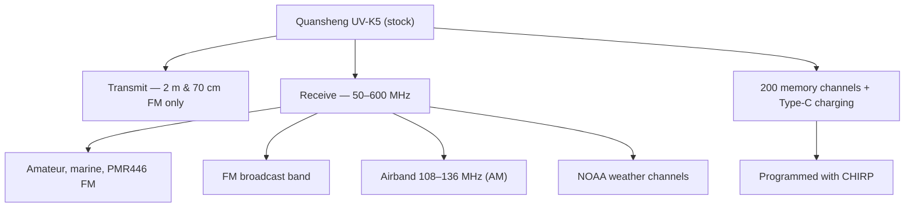
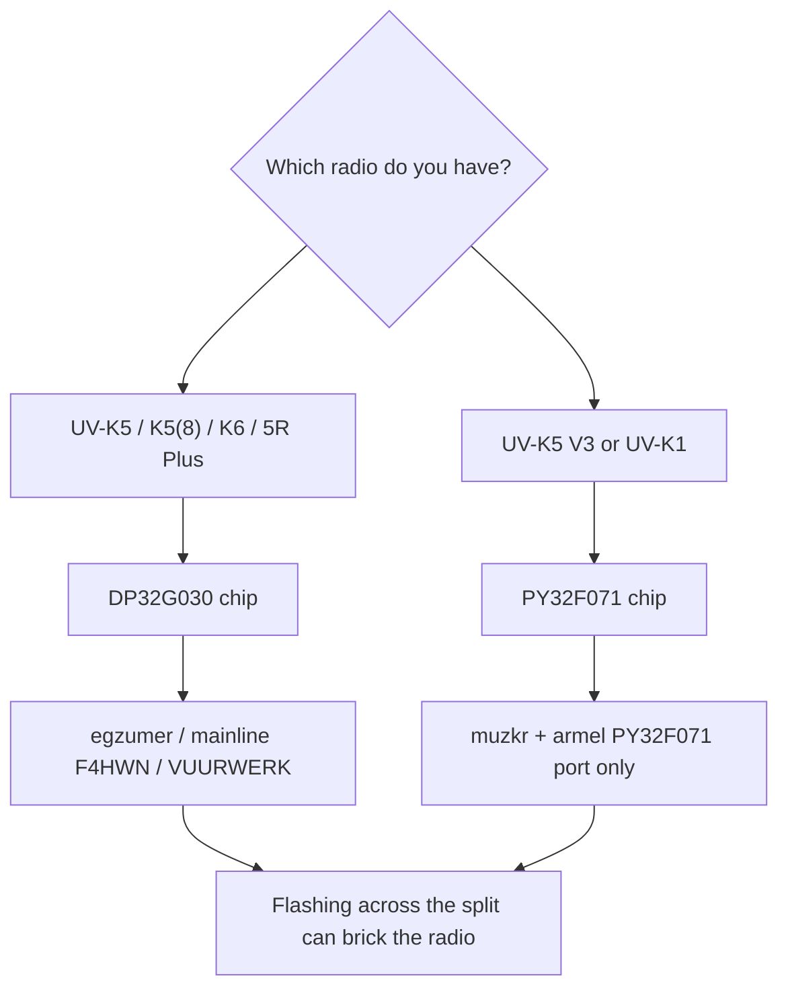
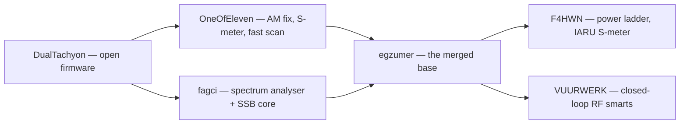
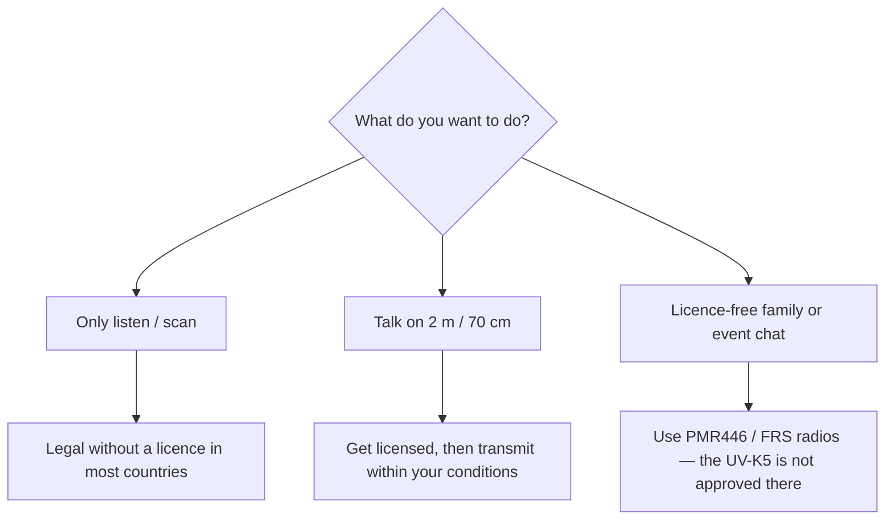

# Why the UV-K5 (and the firmware that rewrote it)

Some radios are sold. The Quansheng UV-K5 was _adopted_ — picked up by a wave of programmers, reverse-engineers and tinkerers who looked at a budget handheld and decided to rewrite what it could do. Out of the box it is a modest wideband FM handheld, much like the [Baofeng UV-5R](outpost:entry/logbook73.guide.uv-5r/overview) in what it can and cannot do. But it has become one of the most widely modified radios in the hobby, and a whole open-source firmware community has turned it into a pocket spectrum analyser, an SSB receiver and a good deal more. This guide covers both radios: the honest, useful thing it is on stock firmware, and the remarkable thing it becomes when you reflash it.

## Why this cheap radio earns a proper book

The UV-K5 ships with the same kind of thin manual its rivals do: a table that tells you menu item `28` is called `STE` and that it can be `OFF` or `ON`, but never what a squelch tail is, why silencing it makes you a more considerate operator, or which value to leave it on. That gap between _listing_ a setting and _explaining_ it is exactly the gap this guide fills — and for the UV-K5 there is a second, larger gap the manual does not even acknowledge: everything the radio can become once you replace its firmware. Nowhere in the box does it mention that the same hardware will run a live spectrum display, decode single sideband, or hunt the band for human voices.

So this guide does two jobs. First, it is the reference the stock radio should have shipped with — every one of its 55 menu items explained: what it does, what the radio is doing inside, why the feature exists, sensible values, and whether you should touch it. Second, it is a careful, safety-first tour of the custom-firmware world that has grown up around this radio — what each of the popular firmwares adds, which one suits you, and, above all, **how to flash the right one without bricking your radio.** That last point matters more here than on almost any other set, and we will come back to it hard.

## What the UV-K5 actually is

Strip away the folklore and the stock UV-K5 is refreshingly simple: a dual-band handheld transceiver for the 2 m (144 MHz) and 70 cm (430 MHz) amateur bands, transmitting in FM only, with **200 memory channels**. In the hand it is a power/volume knob, a two-line screen, two programmable side keys, a PTT and a numeric keypad — plus, on most current bodies, a **USB Type-C** port for charging, which is a genuine convenience over older micro-USB and barrel-jack radios.

In plain terms:

- **It transmits** on 2 m and 70 cm in FM. The exact edges depend on the market version the radio was built for — the CE/UKCA version transmits `144–146` and `430–440 MHz`, the FCC version `144–148` and `420–450 MHz`, and so-called "normal" versions rather more widely. Keep to your own amateur allocation within those ranges, and to your permitted power.
- **It receives much more widely than it transmits.** The stock firmware advertises a `50–600 MHz` receive window (with some gaps), which is a lot more than the UV-5R's. It will monitor other FM services in those ranges — marine VHF, [PMR446](outpost:entry/logbook73.handbook/uhf), business channels — has a broadcast **FM radio**, receives the **NOAA** weather channels, and, unusually for a radio this cheap, can demodulate **AM** for the aviation airband (`108–136 MHz`, switched on with menu item `49`).
- **It remembers 200 channels.** A memory stores a frequency with its offset, tones, bandwidth and power, so recalling a repeater restores everything in one step.
- **You programme it with [CHIRP](outpost:entry/logbook73.guide.uv-k5/getting-started)** — the free, open-source software — over a Kenwood-style two-pin cable. CHIRP handles channels and settings; it is _not_ a firmware flasher, a distinction that matters later.

That is the whole stock radio. No GPS, no [APRS](outpost:entry/logbook73.handbook/aprs), no [digital voice](outpost:entry/logbook73.handbook/digital-voice), and — on stock firmware — **no SSB and no CW**. The airband is AM-receive only. It is, deliberately, a simple radio.

## The honest hardware picture

Knowing a tool's limits is part of using it well, and the UV-K5 shares the UV-5R's central weakness. To hit its price it uses a wide, cheap front end with very little filtering, so near a broadcast, paging or cellular site — or, counter-intuitively, on a _better_ outdoor antenna — it can overload, desense and serve up ["ghost" signals](outpost:entry/logbook73.handbook/overload-and-ghost-signals) that are not really on the frequency you think you are hearing. Its receive sensitivity on a quiet band is genuinely good; its behaviour in a strong-RF environment is not. No firmware can fix this — it is a property of the silicon and the missing filters — though, as we will see, the clever custom firmwares work _around_ it in software rather than pretending it is not there.

On transmit, the stock radio is FM only and rated at **≤5 W** — treat any rebadged listing claiming "8 W" with the scepticism it deserves. As with all budget handhelds, its spectral purity is not on a par with a well-engineered Yaesu, Icom or Kenwood, so the same sensible advice applies throughout this guide: **operate in-band, run the lowest power that does the job, and add a band-pass filter for fixed or repeater use.** The wide receive coverage is a feature to enjoy; the wide _transmit_ capability that custom firmware can unlock is a hazard to respect. More on that below.

## The family — and the one thing you must get right

"UV-K5" is really a family of near-identical radios, and here is where you must pay attention, because getting it wrong can turn a working radio into a paperweight. They split into two hardware generations built on **two different microcontrollers (the MCU — the small computer chip that runs the radio), and firmware built for one MCU will not run on the other.**

| Model                   | MCU (the chip inside) | Firmware family                                     |
| ----------------------- | --------------------- | --------------------------------------------------- |
| UV-K5 (original)        | DP32G030              | Classic custom firmware (egzumer, F4HWN, VUURWERK…) |
| UV-K5(8) / UV-K6        | DP32G030              | Same as above                                       |
| UV-5R Plus              | DP32G030              | Same as above                                       |
| **UV-K5 V3**            | **PY32F071**          | **Separate PY32F071 port only**                     |
| **UV-K1 ("Kong Mini")** | **PY32F071**          | **Separate PY32F071 port only**                     |

The original generation — the UV-K5, the eight-band UV-K5(8), the UV-K6 and the UV-5R Plus — is built on a chip called the **DP32G030**. These four share one architecture and run the enormous library of "classic" custom firmware. The newer generation — the **UV-K5 V3** and the compact **UV-K1** — moved to a different chip, the **PY32F071**, which forced the firmware authors to rewrite the low-level drivers. It needs its own firmware line and its own flashing tools.

**The rule to burn into memory: match the firmware to the MCU.** Flash a DP32G030 firmware onto a PY32F071 radio (or the reverse) and you can brick it — one firmware author warns bluntly that you might "need to buy another radio". So before you download anything, confirm which model and chip you have. One extra caution worth flagging: some _late-production_ UV-K5(8) units are reported by the community to have shipped with different silicon again, which broke compatibility for those specific radios — so if you have a recent K5(8), verify the exact chip before flashing rather than assuming. When in doubt, do not flash. The [firmware overview](outpost:entry/logbook73.guide.uv-k5/firmware-overview) and [flashing](outpost:entry/logbook73.guide.uv-k5/firmware-flashing) pages walk this through slowly, including how to back up your radio's unique factory calibration _before_ you write anything.

## The thing that makes it special: the firmware ecosystem

Here is why this radio deserves a book of its own. Its firmware was reverse-engineered and re-released as open source, and a community formed around it. What one hobbyist added, the next built on, and a clear family tree grew:

DualTachyon reverse-engineered a clean open firmware; OneOfEleven layered on reception improvements (the celebrated "AM fix", a proper S-meter, faster scanning, on-radio channel naming); fagci contributed a **spectrum analyser** and the beginnings of single-sideband demodulation. **egzumer** merged those into the de-facto community-standard build, and later forks — most notably **F4HWN** and **VUURWERK** — grew from there. On the newer PY32F071 hardware, a separate port of F4HWN (by muzkr and armel) carries the same ideas across.

What do you actually get for reflashing? Depending on the firmware:

- **A live spectrum analyser** — a full-screen band scope that sweeps a range and shows you activity at a glance, launched on most builds with `F` + `5`. This alone transforms the radio from a "tune and hope" set into something you can _see_ the band with.
- **SSB (single-sideband) receive** — egzumer adds a USB demodulator alongside FM and AM, so you can, within the radio's limits, listen to the SSB and CW that stock firmware cannot touch. It is a receive convenience, not a lab-grade SSB rig, but it is remarkable on budget hardware.
- **Cleaner reception in strong signals** — the "AM fix" dynamically manages the front-end gain to stop the AM demodulator saturating, and VUURWERK goes further still with a closed-loop approach that continuously measures the noise floor and signal type and adapts in real time (its signature trick is a _voice-seeking_ spectrum that lights up on human speech and stays flat on carriers and pagers).
- **A radio you can shape to fit you** — fully configurable side keys, better battery metering, backlight dimming, richer scanning with many named scan lists, and on-radio channel naming.

Two honest cautions travel with all of this. First, these are **volunteer, no-warranty projects** — powerful, actively developed, occasionally buggy; run a current, stable release, not a random build. Second, custom firmware can _unlock transmit outside the amateur bands._ That the radio _can_ be made to transmit on airband, marine or PMR frequencies is a capability, **never a permission** — the front end and power stage are not designed for it, and doing so is illegal almost everywhere. Keep the transmit lock set to your region and transmit only where your licence allows.

## Receiving is legal; transmitting needs a licence

Because the UV-K5 receives so widely, it is worth being clear where the legal line sits — and it is the same line as for any radio. **Listening is permissive in most countries; transmitting is not.** In most places you may legally _receive_ the amateur bands, broadcast FM, the airband and much else with no licence at all (a few countries do restrict listening to certain services, so check locally). _Transmitting_ is different: you may only transmit on frequencies your licence and national allocation permit, at permitted power, for permitted purposes.

Your national regulator is the authority — Ofcom in the UK, the FCC in the US, and their equivalents elsewhere. If you are not yet licensed, every receive-only part of this guide is open to you; see [Getting Licensed](outpost:entry/logbook73.handbook/getting-licensed) when you are ready to transmit, and never transmit out of band.

## A quick word on RF safety

A handheld is a transmitter next to your head. Keep the antenna a few centimetres from your face when you transmit, use the lowest power that does the job, and **never key up into a damaged or missing antenna** — a transmitter with nowhere to send its power can damage itself (the reasoning is in [SWR](outpost:entry/logbook73.handbook/swr) and [RF Power](outpost:entry/logbook73.handbook/rf-power)). That is the whole of RF safety for a radio this size.

## Who this guide is for, and how it is built

You are welcome here whether you are a brand-new licensee who has just unboxed one, a listener exploring what a cheap wideband receiver can hear, a tinkerer itching to try that spectrum analyser, or an old hand who wants a menu reference that finally explains everything. The guide is built in sections, and you do not have to read them in order:

- **[Getting Started](outpost:entry/logbook73.guide.uv-k5/getting-started)** — the layout, the display, the modes, and how to think about programming. Read this first.
- **[Receive Everything](outpost:entry/logbook73.guide.uv-k5/receive-everything)** and **[Scanning](outpost:entry/logbook73.guide.uv-k5/scanning)** — making the most of that wide receiver, and hunting the bands.
- **[Every Stock Menu Explained](outpost:entry/logbook73.guide.uv-k5/menu-reference)** — the reference map, plus chapters on the [core](outpost:entry/logbook73.guide.uv-k5/menus-core), [tone](outpost:entry/logbook73.guide.uv-k5/menus-tones), [DTMF](outpost:entry/logbook73.guide.uv-k5/menus-dtmf) and [channel](outpost:entry/logbook73.guide.uv-k5/menus-channels) settings.
- **The custom-firmware section** — [an overview](outpost:entry/logbook73.guide.uv-k5/firmware-overview), the [flashing](outpost:entry/logbook73.guide.uv-k5/firmware-flashing) how-to, deep dives on [egzumer](outpost:entry/logbook73.guide.uv-k5/firmware-egzumer), [F4HWN](outpost:entry/logbook73.guide.uv-k5/firmware-f4hwn) and [VUURWERK](outpost:entry/logbook73.guide.uv-k5/firmware-vuurwerk), and help [choosing](outpost:entry/logbook73.guide.uv-k5/firmware-choosing) between them.
- **[Theory](outpost:entry/logbook73.guide.uv-k5/theory)**, **[Configurations](outpost:entry/logbook73.guide.uv-k5/configs)**, **[Troubleshooting](outpost:entry/logbook73.guide.uv-k5/troubleshooting)** and **[Best Practices](outpost:entry/logbook73.guide.uv-k5/best-practices)** — the _why_, the ready-made setups, the "why won't it…", and how to be a good operator.

As with the [UV-5R guide](outpost:entry/logbook73.guide.uv-5r/overview), recommendations lean towards UK amateur practice — Foundation-friendly, with UK band-plan conventions and licence-free comparisons like PMR446 and the [1750 Hz repeater tone](outpost:entry/logbook73.handbook/repeaters). The underlying theory is universal, so if you are elsewhere, take the concepts and check your own national band plan and licence conditions.

## Try it yourself

Before you read another page, do one five-minute thing that needs no licence and no flashing: **identify exactly which radio you own.** Look at the model name printed on the case and on the box — is it a plain UV-K5, a UV-K5(8), a UV-K6 or a UV-5R Plus, or does it say **V3** or **UV-K1**? Then pop the battery off and read the board label if there is one. Write down what you find. That single fact — which MCU generation you have — decides which half of the firmware world is yours, and it is the difference between a successful reflash and a bricked radio later. If you cannot tell, that is fine: stay on stock firmware and enjoy the radio while you read the [firmware overview](outpost:entry/logbook73.guide.uv-k5/firmware-overview), which shows you how to confirm the chip properly.

## Key takeaways

- The UV-K5 is a budget dual-band **FM-only-on-transmit** handheld with **200 memories**, wide **50–600 MHz receive** (including AM airband and NOAA), and Type-C charging — a lot of capability, with the same easily overloaded front end as the UV-5R.
- It is one of amateur radio's **most extensively modified handhelds**: an open-source firmware ecosystem (egzumer, F4HWN, VUURWERK) turns it into a **spectrum analyser**, an **SSB receiver** and much more — things the stock firmware cannot do at all.
- The family splits by **MCU**: UV-K5 / K5(8) / K6 / 5R Plus use the **DP32G030**; the newer **UV-K5 V3** and **UV-K1** use the **PY32F071**. Firmware is MCU-specific, and **flashing the wrong one can brick the radio** — identify your model and chip before you download anything.
- Custom firmware can _unlock out-of-band transmit_ — a capability, never a permission. Keep the region TX lock set and operate **in-band, at the lowest sensible power**, within your licence conditions.
- **Receiving is legal** in most countries without a licence; **transmitting needs one** — check your national regulator (Ofcom, FCC or your own).
- Programme channels with **CHIRP** (not a firmware flasher), keep a backup, and treat every custom firmware as a powerful but no-warranty volunteer project — run a current, stable release.

Ready? Let's pick it up and learn our way around it — [Getting Started: Layout, Display & Modes](outpost:entry/logbook73.guide.uv-k5/getting-started).
