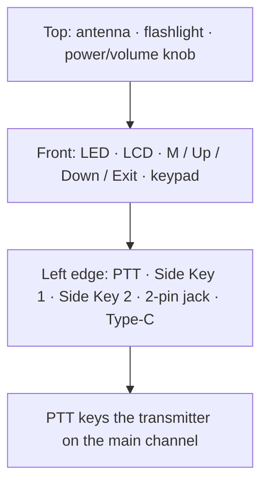
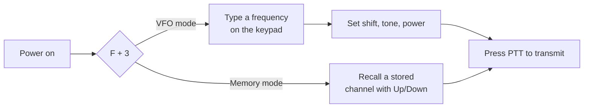
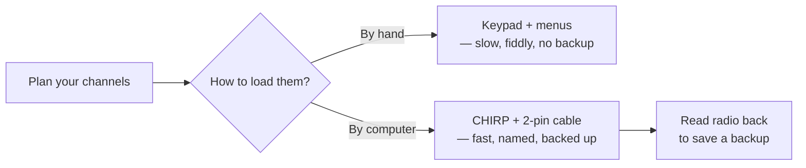

# Getting started: layout, display, keys and first steps

Pick a Quansheng UV-K5 out of its box and the first thing you notice is how little there is to it: one knob, a small screen, four keys around it and a numeric pad. That plainness is a kindness — everything the radio can do is reachable from those few controls once you know the shortcuts. This page walks you round the outside of the radio, decodes the little symbols on its screen, hands you the all-important **F-key shortcut table**, and gets you to your very first transmission without bricking anything or breaking the law.

We are describing the radio exactly as it leaves the factory — the **stock firmware**. Later pages in this guide cover the popular replacement firmwares, but you should learn the set as it ships first, because every fix and every clever trick makes more sense once the standard layout is in your fingers.

## The radio in your hand

Hold the UV-K5 with the screen facing you and the antenna up. Work round it and you will find every control the manual gives you a name for.

**Across the top** sit three things. In the middle is the **antenna** on an SMA socket — screw it on finger-tight before you do anything else, and **never transmit without it fitted**, because a transmitter with nowhere to send its power can damage itself (the reasoning lives in [SWR](outpost:entry/logbook73.handbook/swr)). To one side is a small **flashlight** LED — the manual calls it the "jacklight" — a genuine torch you can switch on in the dark. On the other side is the **power/volume knob**: turn it clockwise from the stop to switch the radio on, and keep turning to raise the volume; turn it anticlockwise to the stop to switch off. That single knob is the whole of the on/off and volume story, which after some radios is a real mercy.

**On the front face**, below the top edge, is a small **indicator LED** that tells you the radio's state at a glance: it glows **red when transmitting**, **green when receiving** a signal, and **blue while charging** (staying lit blue when the battery is full). Beneath it is the **LCD screen**, and below that the keys: the **M** (Menu/Confirm) key, an **Up** and a **Down** key, an **Exit** key, and the **numeric keypad** with the `F` function key, `*` (star) and `#` among the digits. The **speaker** and **microphone** grilles are on the front too.

**Down the left edge** are the keys you press without looking. At the top is the **PTT** — the push-to-talk key that keys the transmitter. Below it sit **Side Key 1** and **Side Key 2**, two small buttons that are **programmable**: each can be set to a different job, and each has a short-press and a long-press action. Below the side keys you will find the **Kenwood-style 2-pin jacks** — the two-hole socket used for the programming cable, an external speaker-microphone, or an earpiece. Many current UV-K5-class bodies also carry a **USB Type-C** port for charging; some cheaper bodies omit it and charge only through the drop-in base. Check which one you have before you go hunting for a Type-C cable.



The battery clips on the back and charges either in the drop-in base (a green light means an empty base or a full battery; red means charging) or, on bodies that have it, through the Type-C port for emergency top-ups.

## Reading the display

The LCD packs a lot of small print into a little space, and each symbol is telling you something you will one day be glad you understood. Here is the shorthand.

| On screen       | What it means                                                         |
| --------------- | --------------------------------------------------------------------- |
| Signal bars     | Received signal strength — fewer bars, weaker signal                  |
| `H` / `M` / `L` | Transmit power: High, Medium or Low                                   |
| `CT`            | A CTCSS sub-tone is active (an analogue "password" tone)              |
| `DCS`           | A DCS code is active (the digital equivalent of `CT`)                 |
| `N`             | Narrow bandwidth (12.5 kHz); its absence means wide                   |
| `VOX`           | Voice-operated transmit is armed — the radio may key on your voice    |
| `+` / `−`       | Repeater transmit shift: your transmit frequency is offset up or down |
| `DW`            | Dual watch is running (the radio is keeping an ear on two channels)   |
| `R`             | Reverse — transmit and receive frequencies are temporarily swapped    |
| `RX` / `TX`     | The radio is receiving / transmitting right now                       |
| `AM`            | AM receive is switched on (used only for the 108–136 MHz airband)     |
| `SCR`           | The scrambler (voice inversion) is on — see the warning below         |
| Padlock         | The keypad is locked                                                  |

Two of those deserve a note up front. The **`SCR` scrambler** is analogue voice inversion, not encryption — it makes your audio sound garbled to a plain receiver but offers no real privacy, and using it on the amateur bands is generally not permitted; leave it off. And the **`+`/`−` shift** is how the screen reminds you the radio is set up for a repeater — if you see it when you meant to work simplex, you will be transmitting on the wrong frequency.

```viz
{
  "type": "display",
  "title": "A UV-K5 set up for a repeater",
  "caption": "The tags around the frequency tell the whole story: High power, narrow bandwidth, a minus shift and a CTCSS access tone — a typical repeater setup.",
  "screen": {
    "rows": [
      { "freq": "145.500", "vfo": "A", "power": "H", "bw": "N", "shift": "-", "tone": "CT", "mode": "FM", "active": true }
    ],
    "bottomTags": ["DW"]
  },
  "callouts": [
    { "n": 1, "x": 20, "y": 50, "label": "Active-channel arrow", "side": "left" },
    { "n": 2, "x": 80, "y": 30, "label": "H power, N narrow", "side": "right" },
    { "n": 3, "x": 80, "y": 70, "label": "- shift, CT tone", "side": "right" }
  ]
}
```

## The keys, and the one that matters most

Four keys do the everyday driving. **M** (Menu/Confirm) opens the menu; press it, choose an item with Up/Down, press M again to edit the value, Up/Down to change it, and M once more to save. A handy trick: **long-pressing M jumps straight to the last menu item you used**. **Up** and **Down** move you through the menu, or step the frequency in VFO mode, or change channel in memory mode. **Exit** clears an entry or backs out one level; **long-press Exit** returns you to the main screen from anywhere. The **star** `*` key on its own opens the manual-dial/call page, and **long-pressing star** starts a scan.

The **`F` key** is the one that unlocks the radio's personality. On its own it does nothing dramatic — **long-pressing `F` locks and unlocks the keypad** (the side keys keep working even when locked, so your torch and monitor stay available). But press and release `F` and _then_ a number, and you fire off a shortcut. This is how you reach the features that would otherwise be buried, so it is worth committing the table to memory — or sticking it inside the battery cover.

| Press   | Does                                                                  |
| ------- | --------------------------------------------------------------------- |
| `F` `1` | **BAND** — switch which frequency band you are on                     |
| `F` `2` | **A/B** — switch the main channel between VFO A and VFO B             |
| `F` `3` | **VFO/MR** — switch between frequency (VFO) and memory (channel) mode |
| `F` `4` | **Frequency meter** — measure a strong nearby signal (Fast Copy)      |
| `F` `5` | **Weather** — NOAA emergency weather-channel receive                  |
| `F` `6` | **H/M/L** — cycle transmit power High / Medium / Low                  |
| `F` `7` | **VOX** — voice-operated transmit on/off                              |
| `F` `8` | **Reverse** — swap transmit and receive frequencies                   |
| `F` `9` | **CALL** — jump to your one-key call channel                          |
| `F` `*` | **SER** — start a CTCSS/DCS tone search on the current signal         |
| `F` `0` | **FM** — start or leave the broadcast FM radio                        |

Do not worry about memorising all eleven at once. The two you will reach for constantly are **`F` `3`** (to swap between tuning modes) and **`F` `6`** (to drop your power), and they are explained next.

## VFO mode versus memory mode

The UV-K5 has two ways of choosing a frequency, and **`F` `3`** toggles between them. Getting this pair straight in your head removes most beginner confusion.

**VFO mode** — "frequency mode" — is the radio as a free dial. You type a frequency on the keypad, or step up and down with the arrows in increments set by the `STEP` menu, and the radio sits there. This is where you _build_ a setup: pick a band with `F` `1`, punch in a frequency, add a repeater shift and a tone if you need them, then transmit. In VFO mode you can enter a frequency directly, which is how you get on air quickly for a one-off simplex chat.

**Memory mode** — "MR" or "channel mode" — is the radio recalling a channel you stored earlier. A memory holds a frequency _together with_ everything that goes with it — the repeater shift and offset, the access tone, the bandwidth, the power and a name — so recalling "channel 12" restores the whole setup in one step. Once you have your local repeaters and simplex calling channels stored, memory mode is where you will live day to day, spinning through channels with Up/Down.



Which line the radio is actually using — VFO A or VFO B — is set by **`F` `2`**, and the **solid arrow** on the display marks the active one. The PTT always transmits on that main channel, so before you key up, glance at the arrow.

## Keeping an ear on two channels: dual watch

The UV-K5, like most handhelds, has a single receiver, but it can pretend to have two. Switch on **dual watch** (menu `18 TDR`, choosing `CHAN_A` or `CHAN_B` for which line transmits by default) and the radio hops rapidly between VFO A and VFO B, so it catches a call on either. The **`DW`** symbol shows it is running.

There is one trap worth flagging now: because both lines share one receiver, an incoming call on the _other_ line can grab the radio's attention, and you can find yourself keying up on the wrong frequency. The menu setting decides which line is your default transmit channel — so set that deliberately, and check the active-channel arrow before you talk. Dual watch is genuinely useful for watching your local repeater _and_ the calling channel at once; just respect the trap.

## The side keys, and what they do out of the box

The two small buttons below the PTT come from the factory with sensible defaults:

- **Side Key 1** — short press = **Monitor** (opens the squelch so you can hear a weak signal buried under the noise); long press = **1750 Hz tone burst** (the momentary tone some repeaters need to open, used by holding the burst as you key up).
- **Side Key 2** — short press = **Flashlight** (the torch on top); long press = **Emergency alarm**.

Both keys are **reprogrammable in software** to any of: emergency alarm, output-power select, monitor, FM radio, scan on/off, VOX on/off, transmit-1750, or flashlight. Until you have a reason to change them, the defaults are fine — the monitor button especially earns its keep for chasing weak signals.

## Your first transmission

Here is the honest goal: get you legally on the air. Before you key up, know that **you must hold a licence to transmit**, and you may only transmit where your licence permits — for most newcomers that means the 2 m and 70 cm amateur allocations at your permitted power, and nothing else. If you are not yet licensed, see [Getting Licensed](outpost:entry/logbook73.handbook/getting-licensed) and enjoy the receive-only parts of this guide in the meantime. Note too that the transmit range depends on which market version you have (an FCC-market radio covers different edges from a CE/UKCA one), so **stay inside your national band plan** rather than trusting the radio's limits.

**For a simplex chat** (both stations on the same frequency, no repeater), it could not be simpler:

1. Press **`F` `3`** until you are in **VFO mode**.
2. Press **`F` `1`** to select the right band.
3. Type the simplex frequency on the keypad — the 2 m calling frequency, say.
4. Press **`F` `6`** and choose **`L`** (Low) power — always start low; you rarely need more.
5. Listen first to be sure the channel is clear, then hold the **PTT**, wait a beat, and speak across the top of the microphone. Release to listen. Give your callsign as your licence requires.

**For a repeater** there are two extra steps, because a repeater listens on one frequency and transmits on another, and usually wants an access tone:

1. In VFO mode, enter the repeater's _output_ frequency (the one you receive).
2. Set the **shift direction** in menu `08 SFT-D` (`+` or `−`, whichever the repeater uses) and the **offset** amount in menu `09 OFFSET`. The `+`/`−` symbol will appear on screen.
3. Set the **transmit access tone** in menu `07 T_CTCS` (for a CTCSS tone) to the exact value the repeater's listing gives — tones are assigned by region, so a distant repeater may want a different one. The `CT` symbol confirms it is set.
4. Choose your power with **`F` `6`**, then listen, key up and give your callsign. If the repeater does not respond even with a good signal, the tone is the usual culprit.

The mechanics of shifts, tones and the rest are covered properly in the [menu reference](outpost:entry/logbook73.guide.uv-k5/menu-reference) and its companion pages; the point here is that you _can_ build a working repeater setup by hand. Whether you _should_ is the next question.

## Two ways to programme: by hand, or by computer

You have just seen keypad programming, and it works — but it is fiddly. Typing a frequency is fine; setting a shift, an offset, a tone, a bandwidth and a name for _every_ channel by scrolling through numbered menus is slow and error-prone, and one mistyped tone means a repeater that never answers.

The far better way is **on a computer with CHIRP** — the free, open-source programming software that supports the UV-K5 family. You lay out your channels in a spreadsheet-like grid, complete with names, tones, shifts and power, then write the whole lot to the radio in seconds; and you can read the radio _back_ to keep a backup, so a factory reset costs you nothing. To do this you need the **Kenwood 2-pin programming cable** that plugs into the side jacks, and the right **USB driver** on your computer for that cable's chip. Cables vary, drivers occasionally fight with the operating system, and the exact CHIRP model name can change between releases — so **check CHIRP's own current notes** for which driver and which radio profile to use rather than trusting an old forum post.



One accuracy note that matters more later than now: the UV-K5 family splits into two hardware types under the skin, built on different microcontrollers. It has no bearing on stock programming with CHIRP — that works either way — but it matters enormously the day you consider **replacing** the firmware, because the custom firmwares are built for one chip or the other, and flashing the wrong one can brick the radio. We keep that straight for you on the [firmware overview](outpost:entry/logbook73.guide.uv-k5/firmware-overview) page. For now, stock firmware and CHIRP is all you need.

## Try it yourself

With the radio charged and the antenna fitted:

1. **Learn the two shortcuts.** Press `F` `3` a few times and watch the display flip between a typed frequency (VFO) and a stored channel number (MR). Then press `F` `6` and cycle `H` / `M` / `L`, watching the power symbol change.
2. **Store one channel by hand.** In VFO mode, enter your local 2 m simplex calling frequency, then use menu `14 MEM-CH` to save it to a channel number. Flip to memory mode with `F` `3` and recall it. You have made your first memory.
3. **Read the display.** Turn on dual watch (`18 TDR`) and confirm the `DW` symbol appears; set a bandwidth of narrow (`10 W/N`) and watch the `N` appear. Then turn them off again. Getting comfortable making a symbol come and go is how the screen stops being mysterious.

If you have CHIRP and a cable, do all three the easy way instead — and take a backup while you are there.

## Key takeaways

- The whole radio is one **power/volume knob**, an **LCD**, four keys (**M / Up / Down / Exit**), a keypad, a **PTT** and **two programmable side keys** — plus the SMA antenna, flashlight, Kenwood 2-pin jacks and (on most bodies) a Type-C port.
- The **LED** tells you the state at a glance: red = transmit, green = receive, blue = charging.
- The **`F`-key shortcuts** unlock everything — learn `F` `3` (VFO/MR), `F` `6` (power) and `F` `1` (band) first; long-press `F` locks the keypad.
- **VFO mode** is a free dial for building or one-off use; **memory mode** recalls a stored channel with its shift, tone, bandwidth and power all attached. `F` `3` swaps between them; the solid arrow shows the active line.
- Out of the box, **Side Key 1** is Monitor / 1750 Hz burst and **Side Key 2** is Flashlight / Emergency alarm — both reprogrammable.
- For a **first transmission**: start in VFO mode, pick the band, enter the frequency, drop to **Low power**, add a shift and access tone for a repeater, listen, then key up and give your callsign — always within your [licence conditions](outpost:entry/logbook73.handbook/getting-licensed).
- Programme by keypad in a pinch, but **CHIRP on a computer** (2-pin cable, correct driver) is faster, gives named channels and lets you keep a backup.

Now that you can find your way around the set, let us put its real party trick to work — because this little radio hears far more than the amateur bands: [Receive Everything: the UV-K5 as a scanner and listener](outpost:entry/logbook73.guide.uv-k5/receive-everything).
